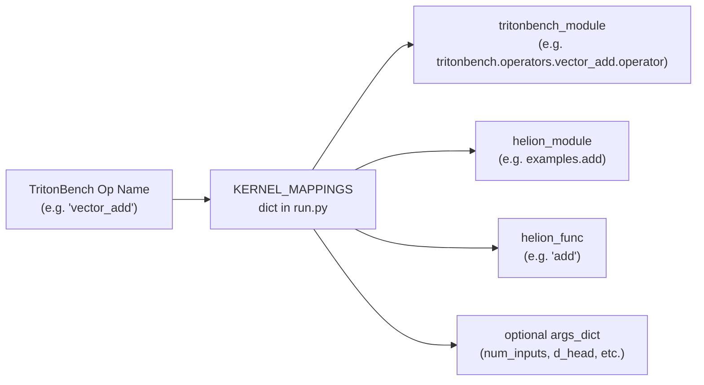
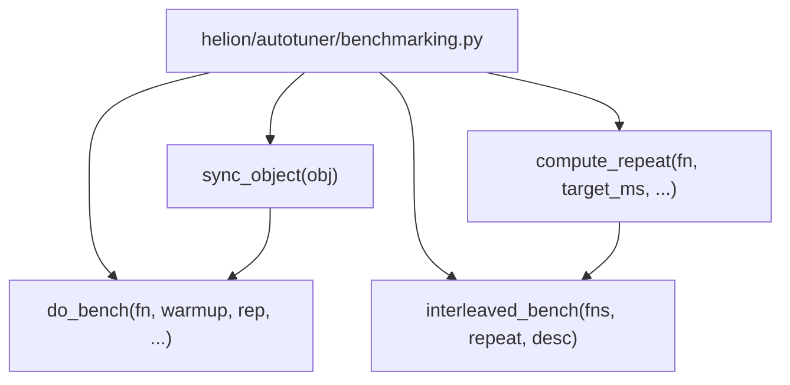
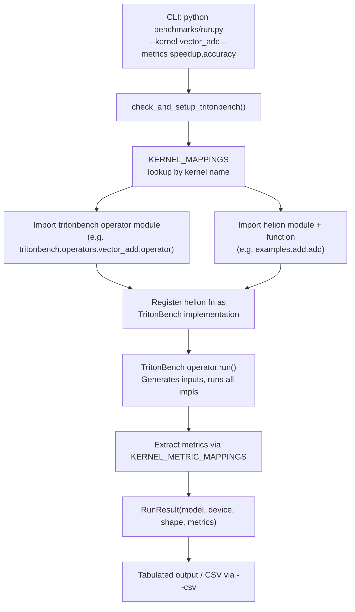

<!-- source: DeepWiki mcp.deepwiki.com · repo pytorch/helion · page 8.1 Local Benchmarking · fetched 2026-10-21 -->

# Local Benchmarking

<details>
<summary>Relevant source files</summary>

The following files were used as context for generating this wiki page:

- [.pre-commit-config.yaml](.pre-commit-config.yaml)
- [benchmarks/README.md](benchmarks/README.md)
- [benchmarks/run.py](benchmarks/run.py)
- [helion/autotuner/benchmarking.py](helion/autotuner/benchmarking.py)
- [lint.sh](lint.sh)
- [test/test_examples.py](test/test_examples.py)

</details>


This page documents how to run performance benchmarks locally against [TritonBench](https://github.com/meta-pytorch/tritonbench), covering the `benchmarks/run.py` entry point, the `KERNEL_MAPPINGS` registry, command-line arguments, and the low-level benchmarking utilities in `helion/autotuner/benchmarking.py`. For CI-based benchmarking workflows and scheduled nightly runs, see [CI/CD Benchmarking](#8.2).

---

## Overview

Helion's benchmarking infrastructure compares kernel performance across four implementations:

| Implementation | Description |
|---|---|
| **PyTorch eager** | Baseline eager-mode reference |
| **torch.compile** | `torch.compile` with max-autotune |
| **Triton** | Reference Triton kernel from TritonBench |
| **Helion** | Helion-compiled kernel from the `examples/` directory |

The benchmark runner is `benchmarks/run.py`. It delegates input generation and baseline implementations to [TritonBench](https://github.com/meta-pytorch/tritonbench), while injecting Helion kernels as additional implementations via TritonBench's operator registration mechanism.

---

## Entry Point: `benchmarks/run.py`

### Quick Start

```
# Run a single kernel
python benchmarks/run.py --metrics speedup,accuracy --kernel vector_add

# Run multiple kernels
python benchmarks/run.py --metrics speedup,accuracy --kernel vector_add,rms_norm

# Run all registered kernels
python benchmarks/run.py --metrics speedup,accuracy

# Shard inputs across GPUs (run first 1/4 of inputs on GPU 1)
CUDA_VISIBLE_DEVICES=1 python benchmarks/run.py --input-shard 1/4 \
  --metrics accuracy,tflops,gbps,speedup --csv --output-dir ./

# Sample 5 equally-spaced inputs
python benchmarks/run.py --metrics speedup,accuracy --kernel softmax \
  --input-sample-mode equally-spaced-k --num-inputs 5
```

### TritonBench Setup

`check_and_setup_tritonbench()` ([benchmarks/run.py:844-905]()) is called automatically at startup. It verifies that a usable TritonBench installation is present. If not (or if a partial install is detected via a `.tritonbench_installing` marker file), it:

1. Clones `https://github.com/meta-pytorch/tritonbench.git` into `benchmarks/tritonbench/`
2. Initializes submodules
3. Installs requirements via `pip`

### Environment Variables

| Variable | Default | Effect |
|---|---|---|
| `HELION_BENCHMARK_DISABLE_LOGGING` | `0` | Set to `1` to suppress all logging output |
| `CUDA_VISIBLE_DEVICES` | — | Selects which GPU to use for benchmarking |

---

## KERNEL_MAPPINGS

`KERNEL_MAPPINGS` ([benchmarks/run.py:111-352]()) is the central registry that associates TritonBench operator names with Helion example kernels.

**Kernel mapping flow diagram:**



Sources: [benchmarks/run.py:103-352]()

### Entry Format

Each entry in `KERNEL_MAPPINGS` takes one of four forms:

| Format | Tuple Structure |
|---|---|
| Single kernel | `(tritonbench_module, helion_module, helion_func)` |
| Single kernel + args | `(tritonbench_module, helion_module, helion_func, args_dict)` |
| Multiple variants | `(tritonbench_module, [(helion_module, helion_func), ...])` |
| Multiple variants + args | `(tritonbench_module, [(helion_module, helion_func), ...], args_dict)` |

The `args_dict` overrides TritonBench operator constructor arguments. Common keys:

| Key | Example | Purpose |
|---|---|---|
| `num_inputs` | `10` | Limit input count (CI time control) |
| `d_head` | `128` | Head dimension for attention operators |
| `non_square` | `""` | Enable non-square shape inputs |
| `rep` | `"3000"` | Repetition count for noisy hardware |
| `input_id` | `1` | Select a specific input configuration |
| `target_size` | `0` | Set target size for ragged ops |

### Registered Kernels (selected)

| TritonBench op | Helion module | Helion function |
|---|---|---|
| `vector_add` | `examples.add` | `add` |
| `gemm` | `examples.matmul` | `matmul_tritonbench` |
| `addmm` | `examples.matmul` | `addmm_tritonbench` |
| `rms_norm` | `examples.rms_norm` | `rms_norm_tritonbench` |
| `softmax` | `examples.softmax` | `softmax_tritonbench` |
| `layer_norm` | `examples.layer_norm` | `layer_norm_tritonbench` |
| `flash_attention` | `examples.attention` | `attention` |
| `fp8_gemm` | `examples.fp8_gemm` | `fp8_gemm_tritonbench` |
| `fp8_attention` | `examples.fp8_attention` | `fp8_attention_tritonbench` |
| `grouped_gemm` | `examples.grouped_gemm` | `grouped_gemm_jagged_persistent_tritonbench` |
| `cross_entropy` | `examples.cross_entropy` | `cross_entropy` |
| `welford` | `examples.welford` | `welford` |
| `mamba2_chunk_scan` | `examples.mamba2_chunk_scan` | `helion_mamba2_chunk_scan_kernel` |
| `blackwell_attentions` | `examples.blackwell_attention` | `blackwell_attention_tritonbench` |

The full list is in `KERNEL_MAPPINGS` ([benchmarks/run.py:111-352]()).

---

## KERNEL_METRIC_MAPPINGS

`KERNEL_METRIC_MAPPINGS` ([benchmarks/run.py:355-675]()) defines which TritonBench-reported metric keys to extract and how to rename them for Helion's output tables.

For each kernel, the dict maps raw TritonBench metric strings to normalized names. For example, for `vector_add`:

| Raw TritonBench Key | Normalized Name |
|---|---|
| `torch_add` | `baseline` |
| `triton_add-speedup` | `triton_speedup` |
| `triton_add-accuracy` | `triton_accuracy` |
| `torch_compile_add-speedup` | `torch_compile_speedup` |
| `helion_add-speedup` | `helion_speedup` |
| `helion_add-accuracy` | `helion_accuracy` |

Hardware-specific variants are handled: the `fp8_gemm` entry conditionally selects `blackwell_persistent_tma` or `triton_tma_persistent` keys based on `IS_B200` ([benchmarks/run.py:619-627]()).

---

## Custom Kernel Configuration Files

Beyond the hardcoded `KERNEL_MAPPINGS`, `benchmarks/run.py` supports loading kernel definitions from external YAML or JSON files via `load_kernel_config()` ([benchmarks/run.py:678-760]()).

**Config file structure:**

```
{
  "kernel_mappings": {
    "<op_name>": {
      "tritonbench_module": "...",
      "helion_module": "...",
      "helion_func": "...",
      "args": { ... }
    }
  },
  "kernel_metric_mappings": { ... },
  "hardware_overrides": {
    "NVIDIA B200": {
      "kernel_mappings": { ... },
      "kernel_metric_mappings": { ... }
    }
  }
}
```

`merge_kernel_configs()` ([benchmarks/run.py:808-841]()) merges custom configs with the built-in base, with custom entries taking precedence. `hardware_overrides` keys are matched against the GPU model string returned by `get_nvidia_gpu_model()`.

---

## Input Sharding and Sampling

`MAX_NUM_INPUTS = 20` ([benchmarks/run.py:92]()) is the default upper bound on the number of input configurations per kernel.

| CLI Argument | Example | Description |
|---|---|---|
| `--input-shard` | `1/4` | Run this shard's fraction of all inputs |
| `--num-inputs` | `5` | Limit to this many inputs |
| `--input-sample-mode` | `equally-spaced-k` | Select `k` evenly distributed inputs |

The `RunResult` dataclass ([benchmarks/run.py:95-100]()) captures the model name, device, input shapes, and metric values for each run.

---

## Benchmarking Utilities: `helion/autotuner/benchmarking.py`

These utilities are used both by the autotuner internally and by the benchmark runner.

**Module structure diagram:**



Sources: [helion/autotuner/benchmarking.py:1-207]()

### `do_bench`

[helion/autotuner/benchmarking.py:133-206]()

A modified version of `triton.testing.do_bench`. Key differences from the upstream version:
- Calls `sync_object()` to ensure all distributed ranks run the same number of repetitions, preventing deadlocks in multi-GPU scenarios.

**Parameters:**

| Parameter | Default | Description |
|---|---|---|
| `fn` | — | Zero-argument callable to benchmark |
| `warmup` | `25` | Warmup duration in milliseconds |
| `rep` | `100` | Repetition duration in milliseconds |
| `grad_to_none` | `None` | Tensors whose `.grad` should be cleared each iteration |
| `quantiles` | `None` | List of quantile floats to return |
| `return_mode` | `"mean"` | One of `"min"`, `"max"`, `"mean"`, `"median"`, `"all"` |

Returns the runtime in milliseconds as a float (or tuple if `quantiles` is set or `return_mode="all"`).

### `interleaved_bench`

[helion/autotuner/benchmarking.py:57-114]()

Benchmarks multiple callables simultaneously by interleaving their executions. This reduces noise from external factors (GPU temperature drift, power throttling) that affect sequential benchmarks.

**Algorithm:**
1. Warm up all functions once.
2. For each repetition `i`, run every function `fns[j]` in sequence, surrounding each with CUDA event recording.
3. Return the **median** elapsed time per function across all repetitions.

**Parameters:**

| Parameter | Description |
|---|---|
| `fns` | List of zero-argument callables |
| `repeat` | Number of repetitions |
| `desc` | Optional string for the progress bar label |

Returns `list[float]` of median millisecond timings, one per function.

### `compute_repeat`

[helion/autotuner/benchmarking.py:18-54]()

Estimates how many repetitions are needed to produce a stable benchmark for one function call, using the same heuristic as Triton's `do_bench`. It:
1. Runs `estimate_runs=5` executions with L2 cache clearing.
2. Divides `target_ms` by the per-call estimate.
3. Clamps the result to `[min_repeat, max_repeat]` (defaults: 10–1000).

### `sync_object`

[helion/autotuner/benchmarking.py:117-127]()

When `torch.distributed` is initialized, broadcasts an object from rank 0 to all other ranks. Used by `do_bench` to ensure all ranks agree on the repeat count.

---

## Data Flow: From CLI to Result



Sources: [benchmarks/run.py:1-352](), [benchmarks/README.md:1-14]()

---

## Hardware Detection

`IS_B200` ([benchmarks/run.py:65]()) is a module-level constant set at import time:

```python
IS_B200 = is_cuda() and get_nvidia_gpu_model() == "NVIDIA B200"
```

This controls hardware-specific metric key selection in `KERNEL_METRIC_MAPPINGS` (e.g., which Triton baseline is compared for `fp8_gemm`). The `is_cuda()` helper checks `torch.version.cuda`.

---

## Logging

`log_tensor_metadata()` ([benchmarks/run.py:68-88]()) logs the shape, stride, dtype, and device of all tensor arguments passed to a kernel. It is called at warning level so output is suppressed unless the logger is configured appropriately.

Setting `HELION_BENCHMARK_DISABLE_LOGGING=1` calls `logging.disable(logging.CRITICAL)` ([benchmarks/run.py:57-58]()), suppressing all log output from the benchmark runner.

---

