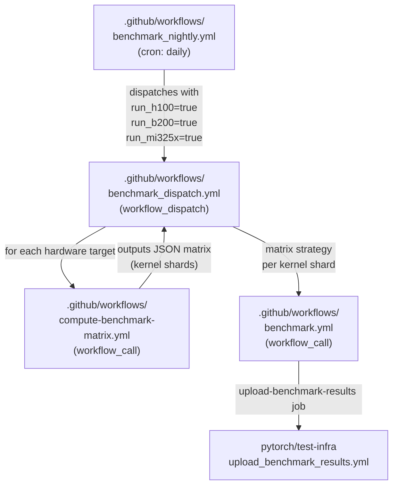
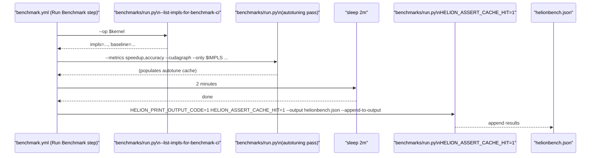
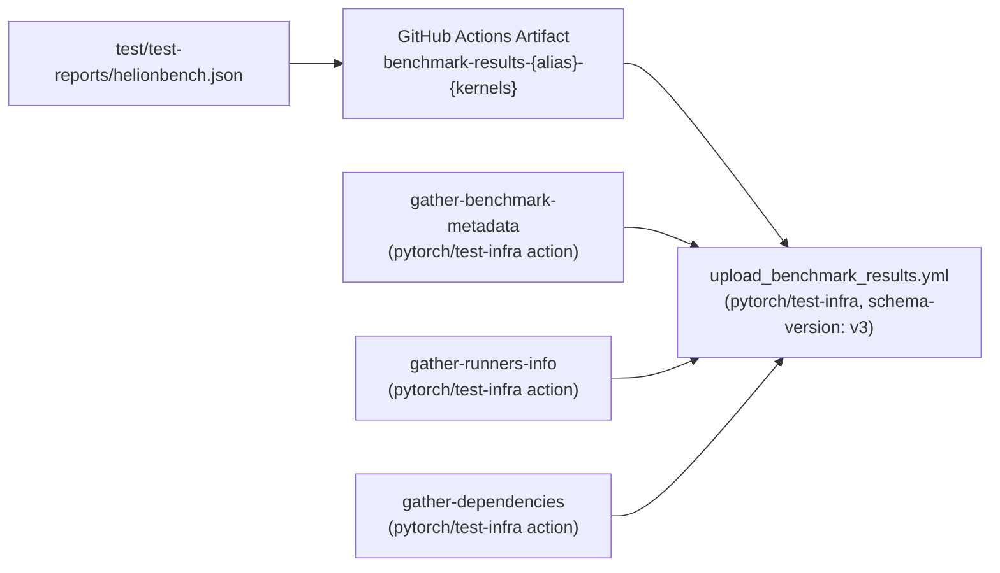
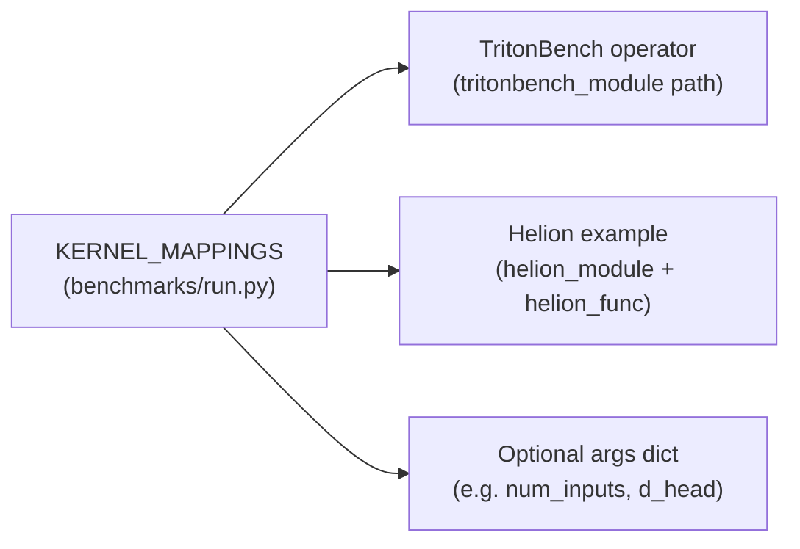

<!-- source: DeepWiki mcp.deepwiki.com · repo pytorch/helion · page 8.2 CI/CD Benchmarking · fetched 2026-10-21 -->

# CI/CD Benchmarking

<details>
<summary>Relevant source files</summary>

The following files were used as context for generating this wiki page:

- [.github/workflows/benchmark.yml](.github/workflows/benchmark.yml)
- [.github/workflows/benchmark_dispatch.yml](.github/workflows/benchmark_dispatch.yml)
- [.github/workflows/benchmark_nightly.yml](.github/workflows/benchmark_nightly.yml)
- [.github/workflows/compute-benchmark-matrix.yml](.github/workflows/compute-benchmark-matrix.yml)
- [benchmarks/run.py](benchmarks/run.py)
- [test/test_examples.py](test/test_examples.py)

</details>


This page documents the GitHub Actions workflows that automate performance benchmarking of Helion kernels in CI. It covers the workflow files, the two-pass benchmark execution strategy, hardware targets, kernel sharding, and result upload.

For documentation on running benchmarks locally, including the `KERNEL_MAPPINGS` dictionary and `benchmarks/run.py` CLI arguments, see [Local Benchmarking](#8.1).

---

## Overview

The CI benchmarking system consists of four GitHub Actions workflow files that together orchestrate scheduled and on-demand performance comparisons of Helion kernels against Triton, `torch.compile`, and PyTorch eager baselines across multiple GPU architectures.

**Workflow Files**

| File | Trigger | Purpose |
|---|---|---|
| `.github/workflows/benchmark_nightly.yml` | Cron (daily 00:00 PST) | Schedules full benchmark runs on all hardware |
| `.github/workflows/benchmark_dispatch.yml` | `workflow_dispatch` | Manual dispatch; selects hardware and kernel list |
| `.github/workflows/compute-benchmark-matrix.yml` | `workflow_call` | Shards a kernel list across N runners |
| `.github/workflows/benchmark.yml` | `workflow_call` | Core reusable benchmark job; installs, runs, uploads |

---

## Workflow Relationships

**Diagram: Workflow call graph**



Sources: [.github/workflows/benchmark_nightly.yml:1-31](), [.github/workflows/benchmark_dispatch.yml:1-118](), [.github/workflows/compute-benchmark-matrix.yml:1-49](), [.github/workflows/benchmark.yml:1-236]()

---

## Nightly Schedule

`benchmark_nightly.yml` runs on cron `0 8 * * *` (midnight PST / 08:00 UTC). It dispatches `benchmark_dispatch.yml` at `ref: main` with all three hardware flags set to `true` and no custom kernel overrides, meaning the default kernel list in `benchmark_dispatch.yml` is used.

Sources: [.github/workflows/benchmark_nightly.yml:5-30]()

---

## Manual Dispatch

`benchmark_dispatch.yml` accepts the following `workflow_dispatch` inputs:

| Input | Default | Description |
|---|---|---|
| `run_h100` | `false` | Run on H100 |
| `run_b200` | `true` | Run on B200 |
| `run_mi325x` | `false` | Run on MI325X |
| `kernels` | *(see below)* | Comma-separated kernel names |
| `env_vars` | `""` | Extra environment variables passed to benchmark runner |
| `custom_args` | `""` | Extra CLI arguments appended to `benchmarks/run.py` |

Default kernel list [.github/workflows/benchmark_dispatch.yml:25]():
```
softmax,jsd,welford,kl_div,int4_gemm,layer_norm,layer_norm-bwd,
rms_norm,rms_norm-bwd,cross_entropy,flash_attention,gemm,grouped_gemm
```

### Hardware Targets

| Alias | Runner | Docker Image | Runtime |
|---|---|---|---|
| `h100` | `linux.aws.h100` | `nvidia/cuda:12.8.1-devel-ubuntu24.04` | `cu128` |
| `b200` | `linux.dgx.b200` | `nvidia/cuda:13.0.1-devel-ubuntu24.04` | `cu130` |
| `mi325x` | `linux.rocm.gpu.gfx942.2` | `rocm/dev-ubuntu-24.04:6.4.4-complete` | `rocm6.4` |

Sources: [.github/workflows/benchmark_dispatch.yml:38-117]()

---

## Kernel Sharding

`compute-benchmark-matrix.yml` distributes the kernel list evenly across up to `max-runners` parallel runners using round-robin assignment.

**Diagram: Kernel sharding logic**

```mermaid
flowchart LR
    input["inputs:\nmax-runners=13\nkernels=softmax,gemm,..."]
    shard["bash: round-robin assign\nkernels → BUCKETS[i % jobs]"]
    output["outputs.matrix =\n{\"kernels\":[\"softmax,gemm\",\"jsd,...\",...]}"]

    input --> shard --> output
```

- If `total_kernels < max-runners`, the number of jobs equals the number of kernels (no empty shards).
- Each shard is a comma-separated string passed as the `kernels` input to `benchmark.yml`.
- H100 and B200 use `max-runners: 13`; MI325X uses `max-runners: 6`.

Sources: [.github/workflows/compute-benchmark-matrix.yml:23-48](), [.github/workflows/benchmark_dispatch.yml:43-44](), [.github/workflows/benchmark_dispatch.yml:67-68](), [.github/workflows/benchmark_dispatch.yml:93-94]()

---

## Core Benchmark Job (`benchmark.yml`)

This is the reusable workflow called for each kernel shard on each hardware target.

### Inputs

| Input | Required | Description |
|---|---|---|
| `runner` | yes | GitHub Actions runner label |
| `python-version` | yes | Python version (e.g. `"3.12"`) |
| `image` | yes | Docker container image |
| `runtime-version` | yes | PyTorch index URL suffix (e.g. `cu128`) |
| `container-options` | yes | Docker options (e.g. `--gpus all`) |
| `alias` | yes | Short name used in artifact naming |
| `kernels` | yes | Comma-separated kernel shard |
| `env-vars` | no | Extra env vars prepended to run commands |
| `custom-args` | no | Extra CLI args appended to `benchmarks/run.py` |

### Environment Setup Steps

1. Install system packages (`git`, etc.)
2. Check out code (`actions/checkout`)
3. Set up Python (`actions/setup-python`)
4. Install `uv` (`astral-sh/setup-uv`)
5. Create virtualenv via `uv venv`
6. Install PyTorch via `uv pip install "torch==2.9.*"`
7. Install Helion in editable mode: `uv pip install -e .'[dev]'`
8. Clone and install tritonbench from `https://github.com/pytorch-labs/tritonbench/`

Sources: [.github/workflows/benchmark.yml:62-121]()

---

### Two-Pass Execution Strategy

Each kernel in the shard is benchmarked in two sequential passes.

**Diagram: Two-pass execution per kernel**



**Pass 1 — Autotuning run**

Runs `benchmarks/run.py` without writing results. This populates the autotune cache on disk. Key flags used:

| Flag | Value |
|---|---|
| `--metrics` | `speedup,accuracy` |
| `--latency-measure-mode` | `triton_do_bench` |
| `--cudagraph` | (flag) |
| `--only-match-mode` | `prefix-with-baseline` |
| `--input-sample-mode` | `equally-spaced-k` |
| `--keep-going` | (flag; continues on individual failures) |

**Sleep** — 2-minute pause between passes to allow the GPU to cool and stabilize.

**Pass 2 — Cache-hit run**

Reruns the same kernel with `HELION_ASSERT_CACHE_HIT=1` and `HELION_PRINT_OUTPUT_CODE=1`. `HELION_ASSERT_CACHE_HIT=1` causes Helion to raise an error if the autotune cache is not hit, verifying that pass 1 populated the cache correctly. Results are written (appended) to `test/test-reports/helionbench.json`.

Sources: [.github/workflows/benchmark.yml:122-196]()

### Implementation Discovery

Before each kernel's two-pass run, the workflow queries `benchmarks/run.py` for the list of implementations and the baseline:

```
python benchmarks/run.py --list-impls-for-benchmark-ci --op $kernel
```

The output line format is:
```
$kernel: impls=<comma-list> baseline=<name>
```

The `IMPLS` value is passed to `--only` and `BASELINE` to `--baseline`. If either is missing, the kernel is skipped with a warning.

Sources: [.github/workflows/benchmark.yml:139-151]()

---

### Result Collection and Upload

**Diagram: Result upload pipeline**



- The `benchmark` job outputs `benchmark-metadata`, `runners-info`, and `dependencies` from three `pytorch/test-infra` actions.
- The `upload-benchmark-results` job calls `pytorch/test-infra/.github/workflows/upload_benchmark_results.yml@main` with `schema-version: v3` and `dry-run: false`.
- Artifact name pattern: `benchmark-results-{alias}-{kernels}` (e.g. `benchmark-results-h100-softmax,gemm`).

Sources: [.github/workflows/benchmark.yml:198-236]()

---

## Kernel Coverage

The `KERNEL_MAPPINGS` dictionary in `benchmarks/run.py` defines every kernel that can appear in the `kernels` input. Each entry maps a TritonBench operator name to a Helion example module and function.

**Diagram: Kernel registry structure**



Several kernels override `num_inputs` in their args dict to cap CI runtime:

| Kernel | `num_inputs` override | Reason |
|---|---|---|
| `fp8_gemm` | 10 | Long compilation time |
| `flash_attention` | 6 | Long compilation time |
| `fp8_attention` | 10 | Long compilation time |
| `layer_norm-bwd` | 10 | Long compilation time |
| `rms_norm-bwd` | 5 | Triton OOM at last input |
| `gemm` | 8 | Long compilation; uses `rep=3000` for B200 stability |
| `gemm-bwd` | 10 | Long compilation time |
| `welford` | 6 | Long compilation time |
| `grouped_gemm` | 6 | Long compilation time |
| `int4_gemm` | 10 | Long compilation time |

The `IS_B200` flag in `benchmarks/run.py` [benchmarks/run.py:65]() switches metric key names in `KERNEL_METRIC_MAPPINGS` for `fp8_gemm` to use `blackwell_persistent_tma` and `blackwell_pt2` variants rather than the standard Triton TMA and PT2 variants.

Sources: [benchmarks/run.py:92-352](), [benchmarks/run.py:355-675]()

---

## Environment Variables Used in CI

| Variable | Set by | Effect |
|---|---|---|
| `HELION_AUTOTUNE_LOG_LEVEL` | `benchmark.yml` env block | Set to `INFO`; controls autotuner logging verbosity |
| `HELION_ASSERT_CACHE_HIT` | Pass 2 run command | Raises an error if autotune cache is not hit |
| `HELION_PRINT_OUTPUT_CODE` | Pass 2 run command | Prints generated Triton code to stdout |
| `HELION_BENCHMARK_DISABLE_LOGGING` | Optional (user-supplied) | Set to `"1"` to suppress all logging output from `run.py` |

Sources: [.github/workflows/benchmark.yml:40-41](), [.github/workflows/benchmark.yml:173-187](), [benchmarks/run.py:57-58]()

---

