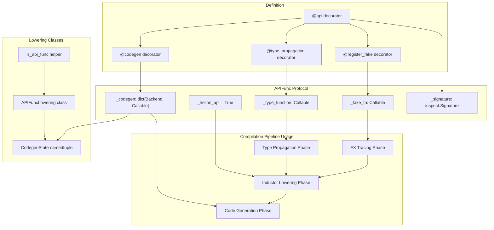
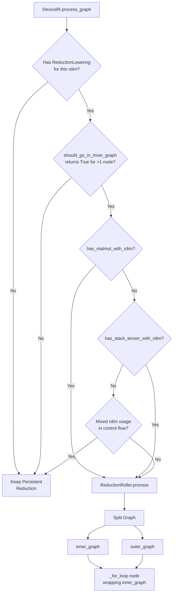
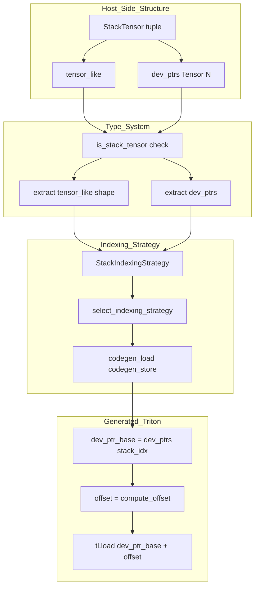
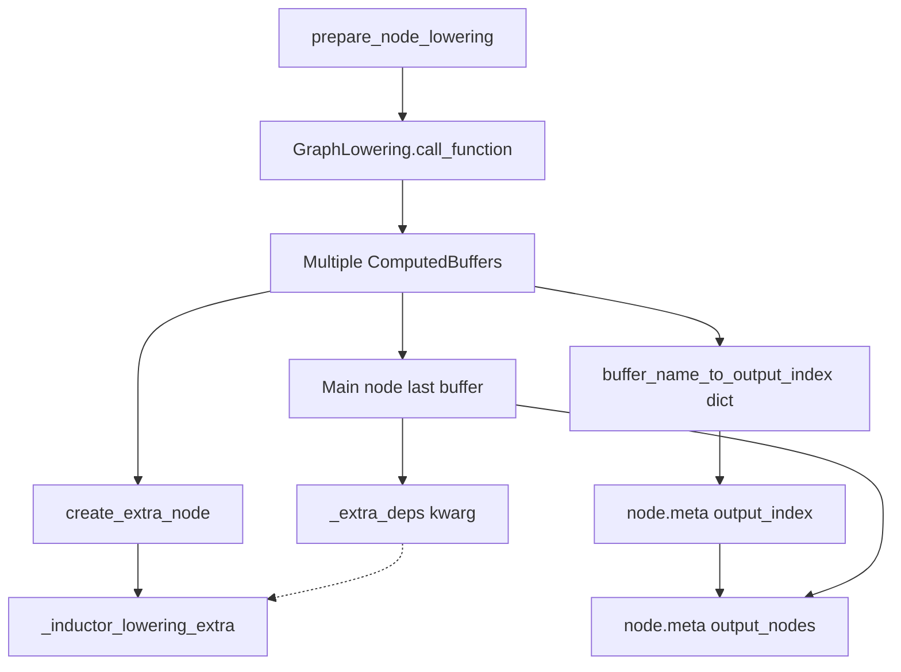
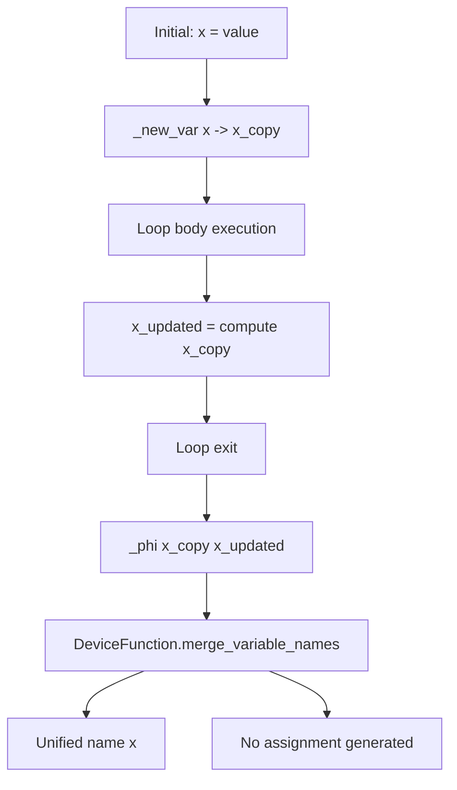
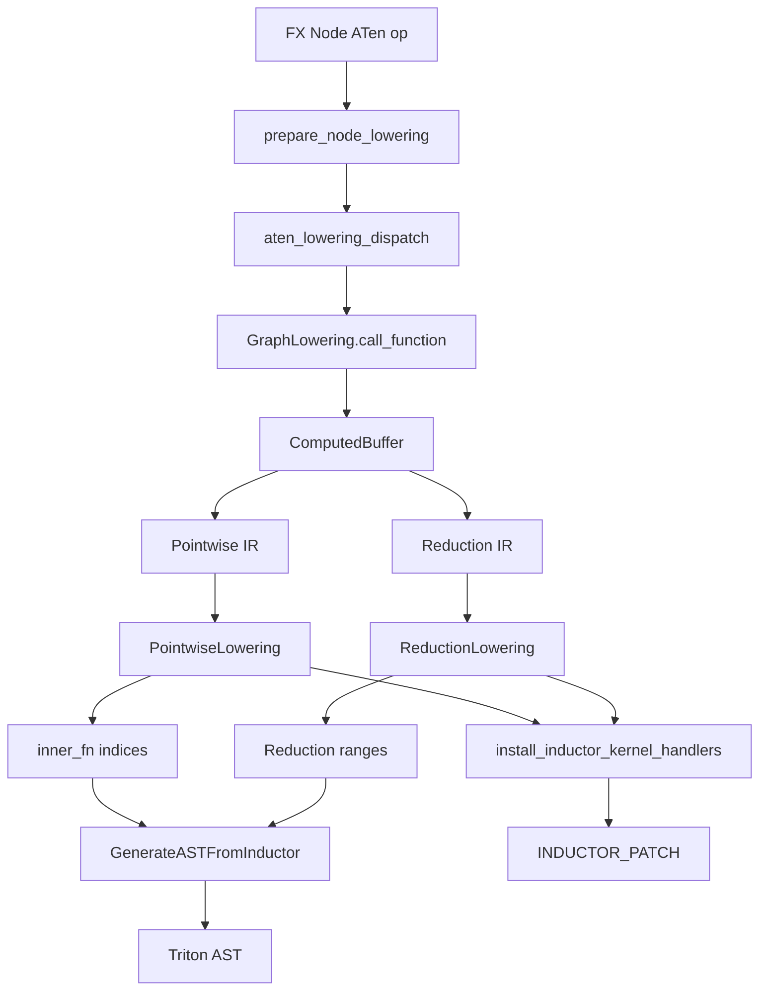

<!-- source: DeepWiki mcp.deepwiki.com · repo pytorch/helion · page 9 Advanced Topics · fetched 2026-10-21 -->

# Advanced Topics

<details>
<summary>Relevant source files</summary>

The following files were used as context for generating this wiki page:

- [README.md](README.md)
- [docs/_static/helion_logo.png](docs/_static/helion_logo.png)
- [docs/_static/helion_nobackground.png](docs/_static/helion_nobackground.png)
- [docs/_static/js/runllm-widget.js](docs/_static/js/runllm-widget.js)
- [docs/api/config.md](docs/api/config.md)
- [docs/conf.py](docs/conf.py)
- [docs/events.md](docs/events.md)
- [docs/index.md](docs/index.md)
- [docs/installation.md](docs/installation.md)
- [docs/tileir_backend.md](docs/tileir_backend.md)
- [examples/README.rst](examples/README.rst)
- [examples/distributed/README.rst](examples/distributed/README.rst)
- [examples/grpo_loss.py](examples/grpo_loss.py)
- [examples/segment_reduction.py](examples/segment_reduction.py)

</details>


This page documents advanced Helion features for power users and contributors, including internal mechanisms, optimization techniques, and extension points. Topics assume familiarity with basic kernel authoring (page 3) and the compilation pipeline (page 5).

**Navigation**: This page covers system internals and advanced patterns. For specific guides:
- Page 9.1: Comprehensive example kernel implementations
- Page 9.2: Reduction rolling optimization details
- Page 9.3: Performance tuning strategies
- Page 9.4: Guide to extending Helion with custom operations

Prerequisites: Understanding of [Kernel Authoring Guide](#3), [Compilation Pipeline](#5), and [Configuration and Autotuning](#4).

---

## Advanced Capabilities Overview

Helion's advanced features enable fine-grained control over code generation and optimization:

| Capability | Primary Use Case | Key Code Entities |
|------------|------------------|-------------------|
| **API Extension System** | Add custom operations with full compilation support | `@api()`, `APIFunc` protocol, `APIFuncLowering` |
| **Reduction Rolling** | Convert persistent reductions to loops for memory efficiency | `ReductionRoller`, `roll_reduction.py` |
| **Memory Operation Control** | Fine-grained load/store behavior | `hl.load()`, `hl.store()`, eviction policies, `extra_mask` |
| **Multi-Output Lowering** | Operations producing multiple tensors | `_inductor_lowering_extra`, `output_nodes` metadata |
| **Stack Tensors** | Batch processing with irregular sizes | `StackTensor`, `StackIndexingStrategy` |
| **Control Flow IR** | Internal loop/conditional representation | `_for_loop`, `_if`, `_phi`, `_new_var` |
| **Inductor Integration** | Leverage PyTorch's operator lowerings | `InductorLowering`, `aten_lowering_dispatch` |

Sources: [helion/language/_decorators.py:1-358](), [helion/_compiler/roll_reduction.py:1-412](), [helion/language/memory_ops.py:1-365](), [helion/_compiler/inductor_lowering.py:1-1171]()

---

## API Function Extension System

### Architecture of Custom Operations

Custom operations integrate into Helion through the `@api` decorator system, which provides hooks into each compilation phase.

**Diagram: API Function Compilation Pipeline**



**APIFunc Protocol Structure**

The `APIFunc` protocol defines the complete interface for custom operations:

```python
# From helion/language/_decorators.py:39-85
class APIFunc:
    _helion_api: bool = True
    _fake_fn: Callable | None
    _codegen: dict[Backend, Callable]
    _type_function: Callable | None
    _ref_fn: Callable | None
    _signature: inspect.Signature
    _prepare_args: Callable | None
    _get_masked_value: Callable | None
```

Sources: [helion/language/_decorators.py:39-85](), [helion/language/_decorators.py:125-204](), [helion/_compiler/inductor_lowering.py:722-754]()

### Key Decorator Functions

The extension system uses several cooperating decorators:

| Decorator | Purpose | Required | Implementation Location |
|-----------|---------|----------|------------------------|
| `@api()` | Mark function as API operation | Yes | [helion/language/_decorators.py:125-204]() |
| `@register_fake()` | Symbolic execution for tracing | Yes | [helion/language/_decorators.py:206-244]() |
| `@codegen()` | Generate Triton AST | Yes | [helion/language/_decorators.py:246-284]() |
| `@type_propagation()` | Custom type inference | Optional | [helion/language/_decorators.py:286-317]() |
| `@prepare_args()` | Transform arguments | Optional | [helion/language/_decorators.py:319-341]() |
| `@get_masked_value()` | Masking behavior | Optional | [helion/language/_decorators.py:343-358]() |
| `@ref()` | Reference implementation | Optional | Used by ref eager mode |

**Key Compilation Integration Points**:
- Type guard: `is_api_func()` at [helion/language/_decorators.py:91-92]()
- Lowering class: `APIFuncLowering` at [helion/_compiler/inductor_lowering.py:722-770]()
- Codegen state: `CodegenState` at [helion/_compiler/inductor_lowering.py:1133-1171]()

Sources: [helion/language/_decorators.py:1-358](), [helion/_compiler/inductor_lowering.py:722-770]()

---

## Reduction Rolling Optimization

Reduction rolling is an advanced optimization that converts persistent (unrolled) reductions into looped reductions to reduce register pressure and enable larger reduction dimensions.

### When Reductions Are Rolled

Reduction rolling is triggered when a reduction dimension is used by multiple operations, making loop-based execution more efficient than persistent unrolling.

**Diagram: Reduction Rolling Decision Logic**



**Key Decision Methods**:
- `is_reduction()`: Identifies reduction nodes - [helion/_compiler/roll_reduction.py:84-90]()
- `should_go_in_inner_graph()`: Tests for rdim usage - [helion/_compiler/roll_reduction.py:92-184]()
- `has_matmul_with_rdim()`: Detects matmul with rdim inputs - [helion/_compiler/roll_reduction.py:312-340]()
- `has_stack_tensor_with_rdim()`: Detects stack tensors with rdim - [helion/_compiler/roll_reduction.py:342-369]()

Sources: [helion/_compiler/roll_reduction.py:57-412]()

### ReductionRoller Implementation

The `ReductionRoller` class splits a graph into inner (uses rdim) and outer (does not use rdim) subgraphs:

**Core Methods**:

| Method | Purpose | Implementation |
|--------|---------|----------------|
| `is_reduction()` | Checks if node is a `ReductionLowering` for target rdim | [helion/_compiler/roll_reduction.py:84-90]() |
| `should_go_in_inner_graph()` | Determines rdim usage via tensor shapes | [helion/_compiler/roll_reduction.py:92-184]() |
| `process()` | Main loop: routes nodes to inner/outer graphs | [helion/_compiler/roll_reduction.py:371-407]() |
| `start_new_graph()` | Wraps inner graph in `_for_loop` node | [helion/_compiler/roll_reduction.py:199-273]() |
| `get_inner_arg()` | Creates placeholders or duplicates nodes | [helion/_compiler/roll_reduction.py:274-310]() |
| `size_node()` | Creates `_get_symnode` for rdim size | [helion/_compiler/roll_reduction.py:185-197]() |

**Special Handling**:
- Matmul operations: [helion/_compiler/roll_reduction.py:312-340]()
- Stack tensors: [helion/_compiler/roll_reduction.py:342-369]()
- Control flow (`_for_loop`, `_if`): [helion/_compiler/roll_reduction.py:104-115]()
- Atomic operations: [helion/_compiler/roll_reduction.py:46-54](), [helion/_compiler/roll_reduction.py:149-158]()
- Duplicate-safe ops: [helion/_compiler/roll_reduction.py:37-41]()

**Graph Splitting Algorithm**:
1. Iterate through all nodes in original graph
2. For each node, call `should_go_in_inner_graph()`
3. If inner: add to `inner_graph`, create placeholders for inputs via `get_inner_arg()`
4. If outer: add to `outer_graph`, possibly wrapping accumulated inner graph in `_for_loop`
5. When inner graph is wrapped, create `_for_loop` node with `graph_id`, bounds, and arguments

Sources: [helion/_compiler/roll_reduction.py:57-412]()

---

## Advanced Memory Operations

### Memory Operation Capabilities

The `hl.load()` and `hl.store()` operations provide control over memory access patterns and masking behavior:

**Feature Matrix**:

| Feature | `hl.load()` | `hl.store()` | Implementation |
|---------|-------------|--------------|----------------|
| Basic indexing | ✓ | ✓ | [helion/language/memory_ops.py:183-281]() |
| Extra masking | ✓ | ✓ | `extra_mask` parameter |
| Eviction policies | ✓ | ✗ | `eviction_policy` parameter |
| Stack tensors | ✓ | ✓ | [helion/language/memory_ops.py:70-76]() |
| Automatic masking | ✓ | ✓ | Generated from tile bounds |
| Masked value | Default 0 | N/A | `_get_masked_value()` |

### Eviction Policy Support

Load operations accept cache eviction hints to optimize memory hierarchies:

**Eviction Policy Mapping**:

The mapping from user-facing names to Triton-level names is defined at [helion/language/memory_ops.py:19-24]():

```python
_EVICTION_POLICY_MAP = {
    "": None,              # No explicit policy
    "first": "evict_first", # Evict earliest-loaded data first
    "last": "evict_last",   # Evict most-recently-loaded data first
}
```

**Configuration Integration**:

Eviction policies can be:
1. Specified explicitly: `hl.load(tensor, [i, j], eviction_policy="evict_last")`
2. Auto-tuned via `Config(load_eviction_policies=[...])`
3. Per-load indexing: `Config(load_eviction_policies=["", "evict_first", "evict_last"])`

The policy selection is implemented in the load codegen at [helion/language/memory_ops.py:252-260]().

Sources: [helion/language/memory_ops.py:19-24](), [helion/language/memory_ops.py:252-260]()

### Stack Tensor Operations

Stack tensors support batch processing with variable-sized elements by storing an array of device pointers.

**Diagram: Stack Tensor Structure and Codegen**



**Implementation Points**:
- Stack tensor detection: [helion/language/memory_ops.py:70-76]()
- Load codegen for stacks: [helion/language/memory_ops.py:270-279]()
- Store codegen for stacks: [helion/language/memory_ops.py:102-112]()

**Usage Pattern**:
```python
# Create stack tensor with N elements
stack = (tensor_like, dev_ptrs_tensor)  # dev_ptrs_tensor has shape [N]

# Load from element at stack_idx
value = hl.load(stack, [i, j])  # Automatically uses dev_ptrs[stack_idx]
```

Sources: [helion/language/memory_ops.py:70-76](), [helion/language/memory_ops.py:102-112](), [helion/language/memory_ops.py:270-279]()

---

## Multi-Output Operations

Some operations naturally produce multiple outputs (e.g., `addmm_bwd` returns three gradients). Helion handles this through the Inductor lowering system.

### Multi-Output Lowering Process

Operations that produce multiple tensors (e.g., `addmm_bwd` with three gradients) require special handling to maintain 1:1 node-to-buffer mapping.

**Diagram: Multi-Output Node Creation**



**Implementation Steps**:

1. **Buffer Creation**: Inductor lowering produces multiple `ComputedBuffer` objects - [helion/_compiler/inductor_lowering.py:197-255]()
2. **Extra Nodes**: Each non-final buffer gets an extra node via `create_extra_node()` - [helion/_compiler/inductor_lowering.py:304-331]()
3. **Index Tracking**: Buffers are mapped to output indices via `buffer_name_to_output_index` - [helion/_compiler/inductor_lowering.py:184-227]()
4. **Metadata Storage**: Main node stores `output_nodes` mapping index to node name - [helion/_compiler/inductor_lowering.py:256-269]()
5. **DCE Prevention**: `_extra_deps` ensures all output nodes are reachable - [helion/_compiler/inductor_lowering.py:267-269]()

**Collection at Codegen**:

During code generation, `_collect_multi_outputs()` reconstructs the tuple of results using the `output_nodes` metadata - [helion/_compiler/inductor_lowering.py:1011-1051]().

Sources: [helion/_compiler/inductor_lowering.py:197-269](), [helion/_compiler/inductor_lowering.py:304-331](), [helion/_compiler/inductor_lowering.py:1011-1051]()

---

## Control Flow Primitives

Helion uses internal operations to represent control flow constructs, as FX graphs don't natively support them.

### Internal Control Flow Operations

FX graphs don't natively support control flow, so Helion uses internal operations:

| Operation | Purpose | Args Structure | Implementation |
|-----------|---------|----------------|----------------|
| `_for_loop` | Device loop execution | `(graph_id, begin, end, args)` | [helion/language/_tracing_ops.py:78-89]() |
| `_if` | Conditional branching | `(test, graph_id, args)` | [helion/language/_tracing_ops.py:92-101]() |
| `_phi` | SSA-style merge | `(lhs, rhs)` | [helion/language/_tracing_ops.py:105-148]() |
| `_new_var` | Variable copy for phi | `(value,)` | [helion/language/_tracing_ops.py:313-355]() |

### Phi Node Semantics

Phi nodes merge variables from different control flow paths using name unification rather than explicit assignment:

**Diagram: Phi Node Flow**



**Codegen Implementation**:

The phi codegen at [helion/language/_tracing_ops.py:125-132]() calls `merge_variable_names()` to unify the two variable names, ensuring both branches refer to the same storage:

```python
@_decorators.codegen(_phi)
def _(state: CodegenState) -> ast.Name:
    lhs = state.ast_arg(0)  # Variable from one branch
    rhs = state.ast_arg(1)  # Variable from other branch
    state.device_function.merge_variable_names(lhs.id, rhs.id)
    return lhs  # Return unified name
```

This approach avoids explicit phi assignments in the generated Triton code, relying instead on variable name aliasing.

Sources: [helion/language/_tracing_ops.py:105-148](), [helion/language/_tracing_ops.py:125-132]()

---

## Example Kernel Patterns

The examples in `test/test_examples.py` demonstrate common kernel authoring patterns. See page 9.1 for comprehensive documentation of individual kernels.

### Pattern Categories

Example kernels are organized into several categories:

| Category | Kernels | Key Techniques |
|----------|---------|----------------|
| **Element-wise** | `test_add`, `test_sigmoid`, `test_sum` | Broadcasting, tile-based iteration |
| **Matrix Operations** | `test_matmul`, `test_matmul_bwd`, `test_bmm` | Reduction loops, tiled matmul, gradient computation |
| **Attention** | `test_attention_*` variants | Online softmax, persistent tiling, dynamic shapes |
| **Normalization** | `test_layernorm_*`, `test_rms_norm_*`, `test_softmax_*` | Reduction-based statistics, numerical stability |
| **Irregular Data** | `test_jagged_*`, `test_moe_*`, `test_segment_*` | Variable-length batches, sparse routing |
| **Low-Precision** | `test_fp8_*`, `test_bf16xint16` | Mixed-precision computation |

### Key Pattern Examples

| Pattern | Implementation | Test | Generated Code |
|---------|----------------|------|----------------|
| Broadcasting | Expand to match ranks | [test/test_examples.py:27-36]() | [test/test_examples.expected:4-49]() |
| Multi-output gradients | `addmm_bwd` with 3 outputs | [test/test_examples.py:53-87]() | [test/test_examples.expected:51-201]() |
| Flash attention | Block-based softmax | [test/test_examples.py:593-610]() | [test/test_examples.expected:203-331]() |
| Dynamic shapes | Symbolic dimension sizes | [test/test_examples.py:612-626]() | [test/test_examples.expected:333-466]() |
| Persistent + L2 grouping | Cache optimization | [test/test_examples.py:793-812]() | [test/test_examples.expected:468-561]() |

For detailed analysis of specific kernels and their optimization patterns, see page 9.1.

Sources: [test/test_examples.py:1-1323](), [test/test_examples.expected:1-65536]()

---

## Integration with Inductor Lowering

Helion leverages PyTorch's Inductor to automatically lower ATen operations to optimized device IR.

### Inductor Integration Architecture

**Diagram: Inductor Lowering Flow**



**Configuration**:

The `INDUCTOR_PATCH` at [helion/_compiler/inductor_lowering.py:70-77]() controls Inductor behavior:

```python
INDUCTOR_PATCH: dict[str, object] = {
    "triton.codegen_upcast_to_fp32": True,  # FP32 upcasts for correctness
    "split_reductions": False,               # Preserve reduction IR
    "unroll_reductions_threshold": 1,        # Avoid automatic unrolling
}
```

**Key Classes**:

| Class | Purpose | Implementation |
|-------|---------|----------------|
| `InductorLowering` | Base class for lowerings | [helion/_compiler/inductor_lowering.py:352-415]() |
| `PointwiseLowering` | Element-wise operations | [helion/_compiler/inductor_lowering.py:450-542]() |
| `ReductionLowering` | Reduction operations | [helion/_compiler/inductor_lowering.py:544-720]() |
| `GenerateASTFromInductor` | AST generation from Inductor IR | [helion/_compiler/inductor_lowering.py:787-921]() |

**Lowering Dispatch**:

The `aten_lowering_dispatch` registry at [helion/_compiler/aten_lowering.py]() maps ATen ops to lowering implementations. Standard ops use Inductor's built-in lowerings, while custom patterns can override specific operations.

Sources: [helion/_compiler/inductor_lowering.py:70-921](), [helion/_compiler/aten_lowering.py:1-100]()

---

## Best Practices Summary

For expert users, follow these guidelines when working with advanced features:

### Custom Operations
- Always provide `@register_fake()` for shape/dtype inference
- Implement `@codegen()` to generate correct Triton AST
- Use `@ref()` for testing in reference eager mode
- Set `tiles_as_sizes=True` for operations that should receive sizes instead of tile objects

### Reduction Optimization
- Let reduction rolling happen automatically for large reductions
- Avoid mixing reduction dimension usage within control flow unless necessary
- Use `Config(reduction_loops=[...])` to force specific reduction loop sizes
- Be aware that matmul and stack tensors prevent certain rolling optimizations

### Memory Patterns
- Use `extra_mask=` for conditional memory access beyond tile bounds
- Specify `eviction_policy=` for sequential access patterns
- Consider stack tensors for batch processing of variable-sized data
- Ensure proper masking to avoid out-of-bounds accesses

### Multi-Output Operations
- Rely on Inductor lowering's automatic multi-buffer handling
- Check `node.meta['output_nodes']` for output tensor mapping
- Use `_extra_deps` if outputs have no natural data dependency

### Performance
- Profile with different indexing strategies: `pointer`, `block_ptr`, `tensor_descriptor`
- Tune `l2_grouping` for cache locality in persistent kernels
- Use `pid_type="persistent_interleaved"` for persistent execution patterns
- Consider split-k strategies for reductions along large dimensions

For comprehensive examples, see [Kernel Examples Reference](#9.1). For specific optimization techniques, see [Reduction Optimization](#9.2) and [Performance Tuning Guide](#9.3). To add custom operations, see [Extending Helion](#9.4).

---

