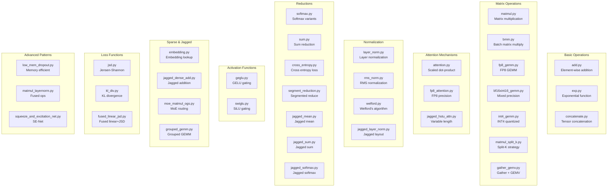
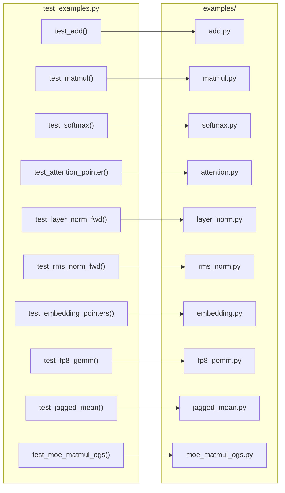
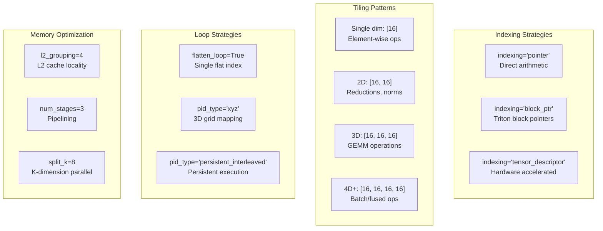

<!-- source: DeepWiki mcp.deepwiki.com · repo pytorch/helion · page 9.1 Kernel Examples · fetched 2026-10-21 -->

# Kernel Examples Reference

<details>
<summary>Relevant source files</summary>

The following files were used as context for generating this wiki page:

- [docs/_static/helion_logo.png](docs/_static/helion_logo.png)
- [docs/_static/helion_nobackground.png](docs/_static/helion_nobackground.png)
- [docs/_static/js/runllm-widget.js](docs/_static/js/runllm-widget.js)
- [docs/conf.py](docs/conf.py)
- [docs/events.md](docs/events.md)
- [examples/README.rst](examples/README.rst)
- [examples/add.py](examples/add.py)
- [examples/attention.py](examples/attention.py)
- [examples/bmm.py](examples/bmm.py)
- [examples/concatenate.py](examples/concatenate.py)
- [examples/cross_entropy.py](examples/cross_entropy.py)
- [examples/distributed/README.rst](examples/distributed/README.rst)
- [examples/embedding.py](examples/embedding.py)
- [examples/grpo_loss.py](examples/grpo_loss.py)
- [examples/jagged_dense_add.py](examples/jagged_dense_add.py)
- [examples/jagged_mean.py](examples/jagged_mean.py)
- [examples/long_sum.py](examples/long_sum.py)
- [examples/matmul.py](examples/matmul.py)
- [examples/matmul_split_k.py](examples/matmul_split_k.py)
- [examples/moe_matmul_ogs.py](examples/moe_matmul_ogs.py)
- [examples/rms_norm.py](examples/rms_norm.py)
- [examples/softmax.py](examples/softmax.py)
- [test/test_type_propagation.expected](test/test_type_propagation.expected)
- [test/test_type_propagation.py](test/test_type_propagation.py)

</details>


## Purpose and Scope

This document provides a comprehensive reference for all example kernels included in the Helion repository. These examples demonstrate various GPU kernel patterns and serve as both learning resources and performance benchmarks. Each example is located in the `examples/` directory and has corresponding test coverage in `test/test_examples.py`.

For information about writing your own kernels, see [Kernel Authoring Guide](#3). For benchmarking these examples, see [Local Benchmarking](#8.1) and [CI/CD Benchmarking](#8.2). For understanding the test infrastructure used to validate these examples, see [Testing Framework](#7.1).

## Example Organization

All example kernels reside in `examples/` directory as standalone Python files. Each file typically contains:
- One or more kernel implementations decorated with `@helion.kernel`
- Reference PyTorch implementations for correctness validation
- Helper functions for input generation and preprocessing

The test suite in [test/test_examples.py:1-1586]() validates each example by comparing its output against PyTorch reference implementations using `check_example()` utility.

### Example Taxonomy



Sources: [test/test_examples.py:1-1586]()

## Test Coverage Map



Sources: [test/test_examples.py:1-1586]()

## Basic Operations

### Element-wise Addition

**File**: `examples/add.py`  
**Test**: [test/test_examples.py:27-36]()

Demonstrates basic element-wise operations with broadcasting support. Takes two tensors of potentially different dtypes and shapes, performs addition with broadcasting.

**Configuration**:
- `block_sizes=[128, 1]` - Single-dimensional tiling
- `flatten_loop=True` - Uses flattened iteration space

**Tested Signature**: `(torch.Tensor[512, 512, float32], torch.Tensor[512, float16]) -> torch.Tensor`

### Exponential Function

**File**: `examples/exp.py`  
**Tests**: 
- Forward: [test/test_examples.py:1390-1403]()
- Backward: [test/test_examples.py:1405-1425]()

Implements element-wise exponential function with forward and backward passes.

**Forward Configuration**:
- `block_sizes=[16]`
- `num_warps=4`, `num_stages=3`

**Backward Configuration**: Same as forward, computes gradient as `grad_out * exp(x)`

### Concatenation

**File**: `examples/concatenate.py`  
**Tests**:
- Pointer indexing: [test/test_examples.py:628-640]()
- Block pointer: [test/test_examples.py:642-657]()

Concatenates two tensors along dimension 1. Demonstrates conditional indexing based on tile position.

**Function**: `concat2d_dim1`  
**Block Pointer Configuration**:
- `block_sizes=[128, 64]`
- `indexing="block_ptr"`

## Matrix Operations

### Matrix Multiplication

**File**: `examples/matmul.py`  
**Tests**:
- Forward: [test/test_examples.py:38-51]()
- Backward: [test/test_examples.py:53-87]()
- Template with closure: [test/test_examples.py:224-290]()

Core GEMM implementation demonstrating blocked matrix multiplication with optional fusion of epilogue operations.

**Forward Configuration**:
- `block_sizes=[16, 16, 16]` - Tile dimensions for M, N, K
- `l2_grouping=4` - L2 cache optimization

**Backward Functions**:
- `matmul_bwd`: Computes gradients for both input matrices
- Block sizes: `[16, 16, 16, 16, 16, 16]` for separate tiles

**Template Pattern**: Accepts lambda for epilogue fusion (e.g., `lambda acc, tile: torch.relu(acc + bias[tile])`)

### Batch Matrix Multiply

**File**: `examples/bmm.py`  
**Test**: [test/test_examples.py:179-191]()

Batched matrix multiplication handling 3D tensors `[batch, M, K] @ [batch, K, N]`.

**Configuration**:
- `block_sizes=[16, 16, 16, 16]` - Batch, M, N, K tiles
- Requires PyTorch 2.8+

**Tested Signature**: `(torch.Tensor[16, 512, 768, float16], torch.Tensor[16, 768, 1024, float16]) -> torch.Tensor[16, 512, 1024]`

### FP8 GEMM

**File**: `examples/fp8_gemm.py`  
**Test**: [test/test_examples.py:198-222]()

Demonstrates FP8 matrix multiplication using `torch.float8_e4m3fn` dtype. Requires compute capability ≥ 9.0 (H100+).

**Configuration**:
- `block_sizes=[16, 16, 32]`
- `num_warps=4`, `num_stages=3`

**Reference Function**: `reference_fp8_gemm_pytorch(x_fp8, y_fp8)` in example file

### Mixed Precision GEMM (BF16×INT16)

**File**: `examples/bf16xint16_gemm.py`  
**Test**: [test/test_examples.py:445-474]()

Performs matrix multiplication with mixed bfloat16 and int16 operands. Demonstrates type conversion within kernel.

**Functions**:
- `_bf16xint16_gemm`: BF16 × INT16 → BF16
- `_int16xbf16_gemm`: INT16 × BF16 → BF16

**Reference**: `reference_bf16xint16_pytorch(x, w, swapped)`

### INT4 Quantized GEMM

**File**: `examples/int4_gemm.py`  
**Test**: [test/test_examples.py:1261-1294]()

Matrix multiplication with 4-bit integer weights packed into int8 storage. Two int4 values per byte.

**Function**: `matmul_bf16_int4`  
**Configuration**:
- `block_sizes=[64, 64, 32]`
- `num_warps=4`, `num_stages=3`
- Higher tolerance: `rtol=2e-1, atol=1.0`

**Packing Format**: Two int4 values packed as `(low & 0xF) | (high << 4)`

### Split-K Matrix Multiplication

**File**: `examples/matmul_split_k.py`  
**Test**: [test/test_examples.py:701-715]()

Implements split-K parallelization strategy for matrix multiplication, decomposing K dimension across blocks.

**Configuration**:
- `block_sizes=[16, 16, 32]`
- `split_k=8` - Parallel K-dimension chunks
- `indexing="block_ptr"`

### Gather + GEMV

**File**: `examples/gather_gemv.py`  
**Test**: [test/test_examples.py:1241-1259]()

Combines indexed weight gathering with matrix-vector multiplication: `w[idx] @ x`.

**Configuration**:
- `block_sizes=[16, 16]`
- `num_warps=8`, `num_stages=1`

**Signature**: `(w: [8, 1024, 1024], idx: [2], x: [1024]) -> [2, 1024]`

## Attention Mechanisms

### Scaled Dot-Product Attention

**File**: `examples/attention.py`  
**Tests**:
- Pointer indexing: [test/test_examples.py:577-591]()
- Block pointer: [test/test_examples.py:595-610]()
- Dynamic shapes: [test/test_examples.py:612-626]()
- Persistent interleaved: [test/test_examples.py:793-812]()

Implements Flash Attention pattern with online softmax computation.

**Pointer Configuration**:
- `block_sizes=[1, 64, 32]` - Batch, query block, key block
- `indexing="pointer"`

**Block Pointer Configuration**:
- `block_sizes=[16, 32, 16]`
- `num_stages=1`
- `indexing="block_ptr"`

**Advanced Features**:
- `pid_type="persistent_interleaved"` - Persistent kernel execution
- `l2_grouping=4` - L2 cache optimization

**Function Variants**:
- `attention`: Standard implementation
- `attention_dynamic`: Dynamic shape support

### FP8 Attention

**File**: `examples/fp8_attention.py`  
**Test**: [test/test_examples.py:819-856]()

Flash Attention variant using FP8 precision. Requires H100+ GPU (compute capability ≥ 9.0).

**Function**: `fp8_attention_kernel`  
**Configuration**:
- `block_sizes=[64, 64]`
- Higher tolerance: `atol=0.2, rtol=0.1`

**Preprocessing**: `preprocess_fp8_attention_inputs(q, k, v)` converts FP16 to FP8

**Reference**: `fp8_attention_pytorch(q, k, v)()` provides expected output

### Jagged HSTU Attention

**File**: `examples/jagged_hstu_attn.py`  
**Test**: [test/test_examples.py:1025-1085]()

Variable-length attention for jagged tensor layouts (e.g., batches with different sequence lengths).

**Function**: `_helion_jagged_attention_kernel`  
**Configuration**:
- `block_sizes=[16, 16]`
- `atol=1e-2, rtol=1e-2`

**Signature**: `(max_seq_len, alpha, q, k, v, seq_offsets) -> output`  
**Layout**: `[total_seq_len, heads, head_dim]` with `seq_offsets` marking batch boundaries

**Reference**: `reference_jagged_hstu_kernel_pytorch(q, k, v, seq_offsets, None, max_seq_len)`

## Normalization Operations

### Layer Normalization

**File**: `examples/layer_norm.py`  
**Tests**:
- Forward with bias: [test/test_examples.py:858-879]()
- Forward without bias: [test/test_examples.py:881-902]()
- Backward: [test/test_examples.py:906-974]()

Standard layer normalization with Welford's algorithm for numerical stability.

**Forward Function**: `layer_norm_fwd`  
**Returns**: `(output, mean, rstd)` - Mean and inverse std used in backward pass

**Configuration**:
- `block_size=32`
- `num_warps=4`, `num_stages=3`

**Backward Function**: `layer_norm_bwd`  
**Configuration**:
- `block_sizes=[32, 1]`
- Returns `(grad_x, grad_weight, grad_bias)`
- Tolerance: `rtol=5e-2, atol=3e-2`

### RMS Normalization

**File**: `examples/rms_norm.py`  
**Tests**:
- Forward: [test/test_examples.py:476-495]()
- Backward: [test/test_examples.py:497-542]()

Root Mean Square normalization, simpler variant of layer norm without mean centering.

**Forward Function**: `rms_norm_fwd`  
**Returns**: `(output, 1/rms)` - Inverse RMS saved for backward

**Configuration**:
- `block_sizes=[16]`
- `indexing="pointer"`

**Backward Function**: `rms_norm_bwd`  
**Returns**: `(grad_x, grad_weight)`

**Reference**: `rms_norm_pytorch(x, weight, eps)` in example file

### Welford's Algorithm

**File**: `examples/welford.py`  
**Test**: [test/test_examples.py:378-396]()

Implements Welford's online algorithm for computing mean and variance in a single pass, used in layer normalization.

**Output**: Layer normalized result using computed statistics  
**Signature**: `(weight, bias, x) -> normalized_output`

### Jagged Layer Normalization

**File**: `examples/jagged_layer_norm.py`  
**Test**: [test/test_examples.py:1361-1388]()

Layer normalization for jagged tensors with variable-length sequences.

**Function**: `jagged_layer_norm_kernel`  
**Configuration**:
- `block_sizes=[4, 8, 8, 8, 8, 8, 8]` - Multiple tiling dimensions

**Signature**: `(x_data, x_offsets, eps) -> normalized_output`  
**Layout**: `x_data[nnz, M]` with `x_offsets[num_rows+1]` indicating row boundaries

**Reference**: `reference_jagged_layer_norm_pytorch(x_data, x_offsets, eps)`

## Reduction Operations

### Softmax

**File**: `examples/softmax.py`  
**Tests**:
- Standard: [test/test_examples.py:293-305]()
- Looped: [test/test_examples.py:308-321]()
- Decomposed: [test/test_examples.py:324-337]()
- Two-pass: [test/test_examples.py:339-348]()
- Two-pass block pointer: [test/test_examples.py:351-362]()

Multiple softmax implementations demonstrating different reduction patterns.

**Standard Configuration**:
- `block_size=1` - One row per thread block
- `num_warps=4`, `num_stages=1`
- `indexing="block_ptr"`

**Looped Variant**:
- `reduction_loop=32` - Process reduction in chunks

**Function Variants**:
- `softmax`: Single-pass online algorithm
- `softmax_decomposed`: Explicit max/exp/sum steps
- `softmax_two_pass`: Separate passes for max-finding and normalization

**Two-Pass Block Pointer**:
- `block_sizes=[8, 64]`
- `indexing="block_ptr"`

### Sum Reduction

**File**: `examples/sum.py`  
**Test**: [test/test_examples.py:717-728]()

Reduces last dimension of tensor using block-level reduction.

**Function**: `sum_kernel`  
**Configuration**:
- `block_sizes=[1]`
- `reduction_loops=[32768]` - Explicit reduction loop size

**Signature**: `(x: [512, 512]) -> [512]` - Sums over last dimension

### Cross Entropy Loss

**File**: `examples/cross_entropy.py`  
**Test**: [test/test_examples.py:364-376]()

Computes cross entropy loss between logits and target class indices.

**Signature**: `(logits: [n, v], targets: [n]) -> scalar_loss`  
**Example**: `n=128` samples, `v=1000` vocabulary size

### Segmented Reduction

**File**: `examples/segment_reduction.py`  
**Test**: [test/test_examples.py:766-789]()

Performs reduction over segments defined by sorted indices using `torch._higher_order_ops.associative_scan`.

**Function**: `segmented_reduction_helion`  
**Signature**: `(indices, input_data, num_nodes) -> output`

**Example**:
- `indices`: [num_edges] sorted indices
- `input_data`: [num_edges, num_features]
- Output: [num_nodes, num_features]

**Reference**: `segmented_reduction_pytorch(*args)` in example file

**Note**: Not supported in ref eager mode yet

### Jagged Mean

**File**: `examples/jagged_mean.py`  
**Test**: [test/test_examples.py:730-761]()

Computes mean over variable-length rows with per-row feature masking.

**Function**: `jagged_mean_kernel`  
**Configuration**:
- `block_sizes=[16, 8, 16]`

**Signature**: `(x_data, x_offsets, feature_counts, M) -> [num_rows, M]`
- `x_data`: [nnz, M] jagged data
- `x_offsets`: [num_rows+1] row boundaries
- `feature_counts`: [num_rows] number of active features per row

**Reference**: `reference_jagged_mean_kernel_pytorch(x_data, x_offsets, feature_counts, M)`

### Jagged Sum

**File**: `examples/jagged_sum.py`  
**Test**: [test/test_examples.py:1296-1322]()

Sums variable-length rows in jagged tensor layout.

**Function**: `jagged_sum_kernel`  
**Configuration**:
- `block_sizes=[16, 8, 16]`

**Signature**: `(x_data, x_offsets) -> [num_rows, M]`

**Reference**: `reference_jagged_sum_kernel_pytorch(x_data, x_offsets)`

### Jagged Softmax

**File**: `examples/jagged_softmax.py`  
**Test**: [test/test_examples.py:997-1023]()

Applies softmax to variable-length rows in jagged tensors.

**Function**: `jagged_softmax_kernel`  
**Configuration**:
- `block_sizes=[16, 8, 16, 16]`

**Signature**: `(x_data, x_offsets) -> softmax_output`

**Reference**: `reference_jagged_softmax_pytorch(x_data, x_offsets)`

**Note**: Skipped in ref eager mode due to `hl.store` indexing issues

## Activation Functions

### GEGLU

**File**: `examples/geglu.py`  
**Test**: [test/test_examples.py:1159-1173]()

Gated Linear Unit with GELU activation: `GELU(x) * y`

**Configuration**:
- `block_sizes=[16]`
- `num_warps=4`, `num_stages=3`

**Signature**: `(x, y) -> GELU(x) * y`  
**GELU Variant**: Uses tanh approximation `approximate="tanh"`

### SwiGLU

**File**: `examples/swiglu.py`  
**Test**: [test/test_examples.py:1175-1189]()

Gated Linear Unit with SiLU (Swish) activation: `SiLU(x) * y`

**Configuration**:
- `block_sizes=[16]`
- `num_warps=4`, `num_stages=3`

**Signature**: `(x, y) -> SiLU(x) * y`  
**SiLU**: Sigmoid-weighted Linear Unit `x * sigmoid(x)`

## Sparse and Jagged Operations

### Embedding Lookup

**File**: `examples/embedding.py`  
**Tests**:
- Pointer indexing: [test/test_examples.py:544-557]()
- Block pointer: [test/test_examples.py:560-574]()

Gathers embeddings from table based on indices.

**Pointer Configuration**:
- `block_sizes=[1, 256]`
- `indexing="pointer"`

**Block Pointer Configuration**:
- `block_sizes=[8, 64]`
- `indexing="block_ptr"`
- `pid_type="xyz"` - Multi-dimensional grid mapping

**Signature**: `(indices: [8, 128, int32], weight: [1024, 256, float16]) -> [8, 128, 256]`

### Jagged Dense Addition

**File**: `examples/jagged_dense_add.py`  
**Test**: [test/test_examples.py:659-672]()

Adds jagged tensor to dense tensor, handling variable-length rows.

**Function**: `jagged_dense_add_2d`  
**Signature**: `(jagged_data, offsets, dense) -> result`

**Helper**: `random_jagged_2d(num_rows, max_cols, device)` generates test inputs

**Reference**: `jagged_dense_add_2d_reference(*args)` in example file

### MoE Matrix Multiplication (OGS)

**File**: `examples/moe_matmul_ogs.py`  
**Test**: [test/test_examples.py:675-698]()

Mixture of Experts matrix multiplication with expert routing.

**Configuration**:
- `block_sizes=[16, 16, 16]`
- `skip_accuracy=True` - Known numerical instability

**Signature**: `(A, W, top1_expert_per_token) -> output`
- `A`: [B, K] input tokens
- `W`: [n_experts, K, N] expert weights
- `top1_expert_per_token`: [B] expert assignments

**Helper**: `moe_matmul_ogs_helion_kernel_args_gen(A, W, top1_expert_per_token)` transforms inputs

**Reference**: `moe_matmul_ogs_reference(*args)` in example file

### Grouped GEMM

**File**: `examples/grouped_gemm.py`  
**Tests**:
- Jagged: [test/test_examples.py:1087-1119]()
- Persistent: [test/test_examples.py:1121-1157]()

Performs batched matrix multiplication with variable batch sizes (jagged layout).

**Function**: `grouped_gemm_jagged`  
**Signature**: `(A_packed, B_shared, group_offsets) -> C_packed`
- `A_packed`: Concatenated group matrices
- `B_shared`: Single weight matrix
- `group_offsets`: Boundaries of each group

**Persistent Variant**: `grouped_gemm_jagged_persistent` - Uses persistent kernel execution

**Example**:
```
G=3 groups, K=64, N=64
group_A = [32×64, 64×64, 96×64]  # Variable M dimensions
B_shared = 64×64
Output: Concatenated [32+64+96, 64]
```

## Loss Functions

### Jensen-Shannon Divergence

**File**: `examples/jsd.py`  
**Test**: [test/test_examples.py:1191-1215]()

Computes Jensen-Shannon divergence between two probability distributions.

**Function**: `jsd_forward`  
**Configuration**:
- `block_sizes=[1, 4096]`
- `num_warps=4`, `num_stages=3`

**Signature**: `(log_p, log_q, weight) -> (loss, None)`  
**Returns**: Tuple where second element is placeholder

**Reference**: `TorchJSDBaseline()(*args)` in example file

### KL Divergence

**File**: `examples/kl_div.py`  
**Test**: [test/test_examples.py:1217-1239]()

Kullback-Leibler divergence loss with batchmean reduction.

**Function**: `kl_div_forward`  
**Configuration**:
- `block_sizes=[1, 4096]`
- `num_warps=4`, `num_stages=3`

**Signature**: `(log_input, target) -> scalar_loss`  
**Target Format**: Not log-space (`log_target=False`)

**Reference**: `torch.nn.KLDivLoss(reduction="batchmean", log_target=False)`

### Fused Linear + JSD

**File**: `examples/fused_linear_jsd.py`  
**Test**: [test/test_examples.py:1324-1359]()

Fuses linear projection and Jensen-Shannon divergence computation.

**Function**: `fused_linear_jsd_kernel`  
**Configuration**:
- `block_sizes=[32]`

**Signature**: `(beta, ignore_index, temperature, student_logits, teacher_logits) -> loss`

**Reference**: `fused_linear_jsd_pytorch(beta, ignore_index, temperature, student_input, teacher_input, student_weight, teacher_weight)`

## Advanced Patterns

### Low Memory Dropout

**File**: `examples/low_mem_dropout.py`  
**Test**: [test/test_examples.py:398-441]()

Memory-efficient dropout using stateless random number generation. Forward and backward passes generate same random mask from seed.

**Functions**:
- `low_mem_dropout`: Forward pass
- `low_mem_dropout_bwd`: Backward pass

**Key Feature**: No mask storage required - regenerate from seed

**Signature**: `(p, x, seed) -> dropped_output`  
**Backward**: `(p, grad_y, seed) -> grad_x`

**Verification**: Same seed produces identical masks in forward and backward

### Fused MatMul + LayerNorm

**File**: `examples/matmul_layernorm.py`  
**Tests**:
- Static shapes: [test/test_examples.py:130-150]()
- Dynamic shapes: [test/test_examples.py:153-173]()

Fuses matrix multiplication with layer normalization in single kernel.

**Configuration**:
- `block_sizes=[16, 16]`
- `static_shapes=True/False`

**Signature**: `(x, weight_mm, weight_ln, bias_ln) -> normalized_output`

**Operation**: `layer_norm(x @ weight_mm, weight=weight_ln, bias=bias_ln)`

### Squeeze-and-Excitation Network

**File**: `examples/squeeze_and_excitation_net.py`  
**Tests**:
- Forward: [test/test_examples.py:1429-1451]()
- Backward dx: [test/test_examples.py:1455-1494]()
- Backward da: [test/test_examples.py:1498-1537]()
- Backward db: [test/test_examples.py:1541-1581]()

Implements SE-Net block with forward and three backward pass kernels for separate gradients.

**Forward Function**: `squeeze_and_excitation_net_fwd`  
**Returns**: `(output, c, d)` where c and d are intermediate activations

**Configuration**:
- `block_sizes=[16, 16, 16, 16]`
- `num_warps=4`, `num_stages=2`

**Operation**: `x * sigmoid(relu(x @ a) @ b)`

**Backward Functions**:
- `squeeze_and_excitation_net_bwd_dx`: Gradient w.r.t. x
- `squeeze_and_excitation_net_bwd_da`: Gradient w.r.t. a
- `squeeze_and_excitation_net_bwd_db`: Gradient w.r.t. b

**Backward Configuration**:
- `block_sizes=[16, 16, 16]`

## Common Configuration Patterns



Sources: [test/test_examples.py:1-1586]()

## Testing Utilities

### check_example Function

The primary testing utility `check_example()` from `helion._testing` module:

```python
check_example(
    example_name: str,        # Example file name without .py
    args: tuple,              # Kernel input arguments
    expected: Any,            # Expected output (tensor or tuple)
    fn_name: str = None,      # Specific function if not main
    block_sizes: list = None, # Block size configuration
    indexing: str = None,     # Indexing strategy override
    rtol: float = 1e-5,       # Relative tolerance
    atol: float = 1e-8,       # Absolute tolerance
    skip_accuracy: bool = False,  # Skip correctness check
    **config_kwargs           # Additional Config parameters
) -> Journal
```

**Behavior**:
1. Imports example file from `examples/{example_name}.py`
2. Extracts kernel function (using `fn_name` if specified)
3. Creates `Config` with provided parameters
4. Runs kernel with configured settings
5. Compares output against expected using `torch.testing.assert_close`
6. Returns `Journal` containing generated Triton code

### Example Test Pattern

```python
def test_example_kernel(self):
    # Prepare inputs
    args = (
        torch.randn([M, K], device=DEVICE, dtype=torch.float32),
        torch.randn([K, N], device=DEVICE, dtype=torch.float32),
    )
    
    # Compute expected output
    expected = args[0] @ args[1]
    
    # Run and validate
    self.assertExpectedJournal(
        check_example(
            "example_name",
            args,
            expected,
            block_sizes=[16, 16, 16],
            num_warps=4,
            num_stages=3,
        )
    )
```

Sources: [test/test_examples.py:27-36](), [test/test_examples.py:38-51]()

## Hardware-Specific Examples

### FP8 Operations

Require compute capability ≥ 9.0 (H100, B200):
- `fp8_gemm.py` - FP8 matrix multiplication
- `fp8_attention.py` - FP8 Flash Attention

**Test Guards**: [test/test_examples.py:194-196](), [test/test_examples.py:815-817]()

### ROCm Incompatibilities

Several examples have known issues on AMD GPUs:
- `matmul_layernorm.py` - Static/dynamic variants [test/test_examples.py:129](), [test/test_examples.py:152]()
- `fp8_gemm.py` - FP8 support [test/test_examples.py:197]()
- `bf16xint16_gemm.py` - Precision differences [test/test_examples.py:443]()
- `attention.py` - Various pointer modes [test/test_examples.py:576]()
- `layer_norm.py` - Backward pass [test/test_examples.py:904]()

**Test Guards**: `@skipIfRocm("failure on rocm")`

### A10G Limitations

Certain operations fail on A10G GPUs:
- `layer_norm.py` - Backward pass [test/test_examples.py:905]()
- `squeeze_and_excitation_net.py` - All variants [test/test_examples.py:1428](), [test/test_examples.py:1453]()

**Test Guards**: `@skipIfA10G("failure on a10g")`

### XPU Support

Intel XPU has limited support:
- `attention.py` - Block pointer variant [test/test_examples.py:594]()
- Template closure tests [test/test_examples.py:247]()

**Test Guards**: `@skipIfXPU("failure on XPU")`

## Summary Table

| Category | Example Count | Key Patterns |
|----------|---------------|--------------|
| Basic Operations | 3 | Element-wise, broadcasting |
| Matrix Operations | 7 | GEMM variants, quantization |
| Attention | 3 | Flash Attention, FP8, jagged |
| Normalization | 4 | LayerNorm, RMSNorm, Welford |
| Reductions | 7 | Softmax, sum, segment reduce |
| Activations | 2 | GEGLU, SwiGLU |
| Sparse/Jagged | 4 | Embeddings, MoE, grouped ops |
| Loss Functions | 3 | JSD, KL divergence, fused |
| Advanced | 3 | Dropout, fusion, SE-Net |

Sources: [test/test_examples.py:1-1586]()

---

