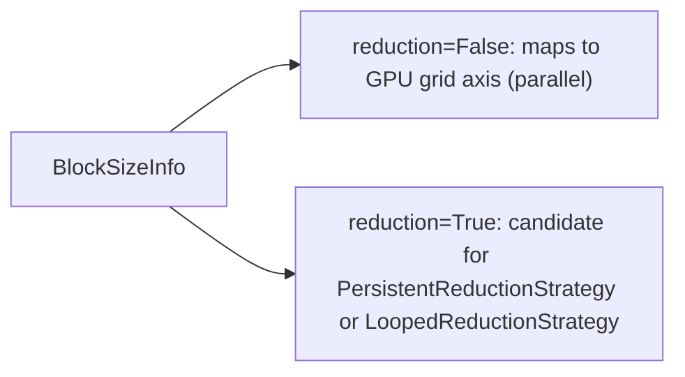
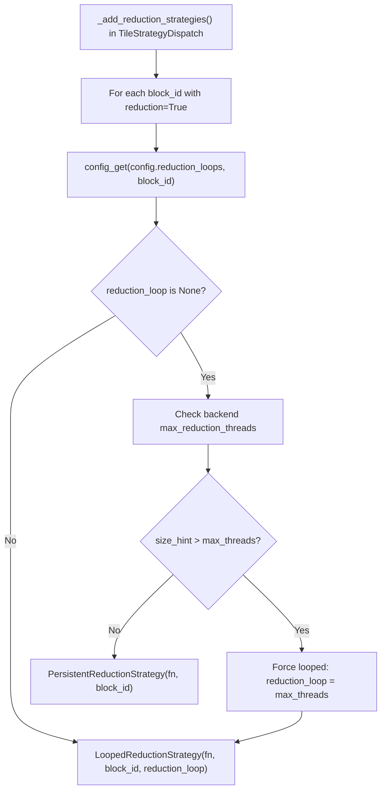
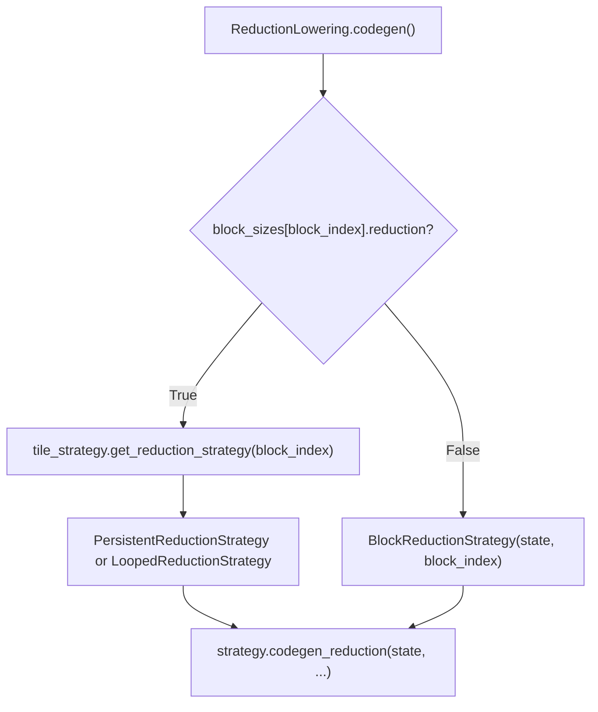
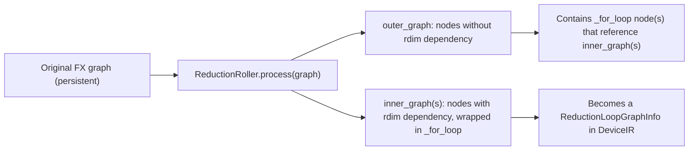
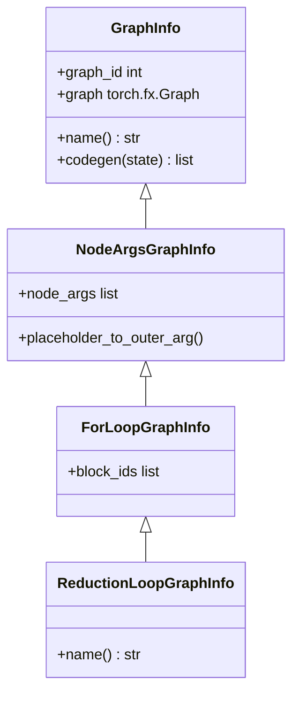
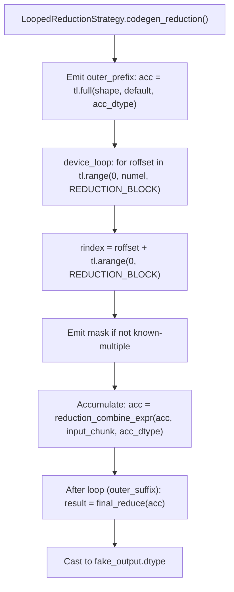

<!-- source: DeepWiki mcp.deepwiki.com · repo pytorch/helion · page 9.2 Reduction Optimization · fetched 2026-10-21 -->

# Reduction Optimization

<details>
<summary>Relevant source files</summary>

The following files were used as context for generating this wiki page:

- [examples/int4_gemm.py](examples/int4_gemm.py)
- [helion/_compiler/inductor_lowering.py](helion/_compiler/inductor_lowering.py)
- [helion/_compiler/reduction_strategy.py](helion/_compiler/reduction_strategy.py)
- [helion/_compiler/roll_reduction.py](helion/_compiler/roll_reduction.py)
- [helion/_compiler/tile_dispatch.py](helion/_compiler/tile_dispatch.py)
- [helion/language/__init__.py](helion/language/__init__.py)
- [helion/language/random_ops.py](helion/language/random_ops.py)
- [test/test_associative_scan.py](test/test_associative_scan.py)
- [test/test_closures.py](test/test_closures.py)
- [test/test_random.py](test/test_random.py)
- [test/test_reduce.py](test/test_reduce.py)
- [test/test_reductions.py](test/test_reductions.py)

</details>


## Overview

This page covers how Helion optimizes reduction operations (sum, max, mean, var, etc.) by selecting among three reduction strategies and optionally transforming persistent reductions into looped reductions via the `ReductionRoller` compiler pass.

For information about tile-based iteration and loop structures, see page 3.1. For details on the broader compilation pipeline, see page 5.

## What is Reduction Optimization?

Reductions aggregate a tensor dimension away (e.g., `x.sum(-1)` reduces the last dimension). Helion compiles these into one of three strategies depending on the configuration:

| Strategy | Class | Description |
|---|---|---|
| **Persistent** | `PersistentReductionStrategy` | Loads the full reduction dimension into registers in one shot |
| **Looped** | `LoopedReductionStrategy` | Loops over the reduction dimension in chunks of a configurable block size |
| **Block** | `BlockReductionStrategy` | Reduces within a tiled dimension (e.g., reducing across a sub-tile that is not a full tensor axis) |

The key tunable parameter is `reduction_loops` in `Config`. Setting it to `None` selects the persistent strategy; setting it to an integer selects the looped strategy with that block size.

Sources: [helion/_compiler/reduction_strategy.py](), [helion/_compiler/tile_dispatch.py:61-89]()

## Reduction Dimensions in Block Sizes

The `BlockSizeInfo` in `CompileEnvironment` carries a `reduction` flag to distinguish reduction axes from parallel tile axes.

**Block size classification diagram:**



The `reduction` flag is set when Helion encounters a reduction operation whose dimension does not correspond to an existing tiled axis, causing `allocate_reduction_dimension()` to create a new `BlockSizeInfo` with `reduction=True`.

Sources: [helion/_compiler/compile_environment.py](), [helion/_compiler/inductor_lowering.py:589-626]()

## Reduction Strategies

### PersistentReductionStrategy

`PersistentReductionStrategy` handles the case where the entire reduction dimension fits in registers. It generates a direct call to the backend's reduction primitive (e.g., `tl.sum`, `tl.max`) without any explicit loop.

Key behaviors:
- Emits a `_RDIM_SIZE_N` constexpr argument whose value is `next_power_of_2(numel)`.
- Generates a mask variable when the reduction size is not a power of two.
- Calls `codegen_reduction()` which maps to `backend.reduction_expr()`.

Sources: [helion/_compiler/reduction_strategy.py:192-307]()

### LoopedReductionStrategy

`LoopedReductionStrategy` handles cases where the reduction dimension is large. It generates a `tl.range()` loop with a configurable `block_size` (the `reduction_loops` config value) and accumulates into an accumulator tensor.

Key behaviors:
- Initializes an accumulator `acc = tl.full(shape, default, acc_dtype)` before the loop.
- Inside the loop, loads a chunk of the reduction dimension and combines with `acc` using `backend.reduction_combine_expr()`.
- After the loop, emits the final reduction of `acc` and assigns to the result variable.
- The result assignment is deferred to `outer_suffix` so downstream codegen knows the variable is not available inline.

Sources: [helion/_compiler/reduction_strategy.py:310-467]()

### BlockReductionStrategy

`BlockReductionStrategy` is used when a reduction operates on a tile dimension that is *not* a dedicated reduction axis (i.e., `BlockSizeInfo.reduction` is `False`). This handles patterns like `x[tile_m, :].sum(-1)` where the inner dimension is tiled but not a reduction dimension.

Key behaviors:
- Reuses the existing index variable from the active device loop (via `self._codegen.index_var(block_idx)`).
- Handles zero-size dimensions by emitting `backend.full_expr(...)` with the identity value.
- Falls back to `call_reduction_function()` for the actual reduction expression.

Sources: [helion/_compiler/reduction_strategy.py:470-528]()

### Strategy Selection

`TileStrategyDispatch._add_reduction_strategies()` is called during kernel compilation and selects the strategy per reduction dimension.

**Strategy selection logic:**



Sources: [helion/_compiler/tile_dispatch.py:61-89]()

`ReductionLowering.codegen()` in `inductor_lowering.py` selects between the named strategies and `BlockReductionStrategy`:



Sources: [helion/_compiler/inductor_lowering.py:647-721]()

## The ReductionRoller Compiler Pass

`ReductionRoller` (in `helion/_compiler/roll_reduction.py`) is described in its own docstring as doing "the opposite of unrolling": it takes a persistent reduction FX graph and splits it into an outer graph (no reduction dimension dependency) and one or more inner graphs (reduction dimension dependent), connected by `_for_loop` nodes.

**ReductionRoller graph transformation:**



Sources: [helion/_compiler/roll_reduction.py:58-413]()

### should_go_in_inner_graph()

The method `ReductionRoller.should_go_in_inner_graph(node)` determines whether each FX node belongs in the inner (reduction) graph or the outer graph. The logic checks:

- If the node is a `ReductionLowering` node whose `block_index` matches the current `rdim`, it goes in the inner graph.
- If the node's output tensor has the reduction dimension in its shape, it goes in the inner graph.
- Special nodes like `_host_tensor`, `_get_symnode`, and duplicate ops are handled separately.
- `_for_loop` and `_if` nodes are examined recursively to check if they use the `rdim`.

Sources: [helion/_compiler/roll_reduction.py:93-184]()

### Safety Checks

`has_matmul_with_rdim()` and `has_stack_tensor_with_rdim()` are called before rolling to determine if the transformation is safe.

| Check | Method | Reason for blocking |
|---|---|---|
| Matmul using rdim | `has_matmul_with_rdim()` | Matmul has its own K-dimension reduction semantics; rolling conflicts |
| StackTensor using rdim | `has_stack_tensor_with_rdim()` | StackTensor memory ops cannot be split across loop boundaries |

Sources: [helion/_compiler/roll_reduction.py:313-371]()

### start_new_graph()

When the roller encounters a break in the inner graph (a node that cannot go in the current inner batch), `start_new_graph()` finalizes the current `inner_graph`, registers it with `DeviceIR.add_reduction_loop_graph()`, and emits a `_for_loop` call in the outer graph that iterates from `0` to `rdim.size` in chunks, collecting the outputs.

Sources: [helion/_compiler/roll_reduction.py:200-249]()

## Graph Representations

### ReductionLoopGraphInfo

Rolled reductions are stored as `ReductionLoopGraphInfo` nodes in `DeviceIR`. The class hierarchy is:



`ReductionLoopGraphInfo` instances are created by `DeviceIR.add_reduction_loop_graph()` and referenced from `_for_loop` nodes in the outer graph. During code generation, `LoopedReductionStrategy.codegen_device_loop()` generates the `tl.range()` loop structure.

Sources: [helion/_compiler/device_ir.py](), [helion/_compiler/reduction_strategy.py:342-394]()

## Configuration and Tuning

### Configuring Reduction Loops

The `reduction_loops` field in `Config` controls reduction behavior per reduction dimension:

| `reduction_loops` value | Strategy selected |
|---|---|
| `None` (default) | `PersistentReductionStrategy` |
| Integer `N` | `LoopedReductionStrategy` with `block_size=N` |

You can pass a list to configure multiple reduction dimensions independently, or a single value to apply to all.

**Example usage from tests:**

```python
# Persistent (no loop) - default
code, output = code_and_output(sum_kernel, args, block_size=1)

# Looped with block size 64
code, output = code_and_output(sum_kernel, args, block_size=2, reduction_loop=64)

# Multiple reduction dimensions
code, output = code_and_output(
    two_rdim_rms_norm,
    args,
    block_sizes=[1, 1],
    reduction_loop=16,
    pid_type="persistent_blocked",
)
```

Sources: [test/test_reductions.py:184-189](), [test/test_reductions.py:567-634](), [helion/_compiler/tile_dispatch.py:61-89]()

### Backend Constraints on Thread Count

Some backends (`max_reduction_threads()` returning non-`None`) limit the maximum number of threads for warp-level reductions. When the reduction size exceeds this limit, `TileStrategyDispatch` automatically forces looped mode:

```
if reduction_loop is None and size_hint > max_threads:
    reduction_loop = max_threads
```

Both `PersistentReductionStrategy` and `LoopedReductionStrategy` compute a `_thread_count` based on `next_power_of_2(min(size_hint, max_threads))` for thread-aware backends.

Sources: [helion/_compiler/tile_dispatch.py:62-88](), [helion/_compiler/reduction_strategy.py:211-223](), [helion/_compiler/reduction_strategy.py:332-337]()

## Code Generation for Looped Reductions

### Generated Triton Pattern

`LoopedReductionStrategy.codegen_reduction()` generates the following pattern:

**Looped reduction code generation flow:**



The accumulator is initialized to `ir.Reduction.default_accumulator(reduction_type, acc_dtype)` (e.g., `0.0` for sum, `-inf` for max). The combine step uses `backend.reduction_combine_expr()` which emits expressions like `acc + chunk` for sum or `tl.maximum(acc, chunk)` for max.

Sources: [helion/_compiler/reduction_strategy.py:396-467]()

### Indexed Reductions (argmin / argmax)

For `argmin` and `argmax`, `LoopedReductionStrategy` maintains a pair of accumulators: one for values (`acc`) and one for indices (`acc_index`). It calls `backend.argreduce_loop_update_statements()` inside the loop and `call_indexed_reduction()` after the loop to finalize the result.

Sources: [helion/_compiler/reduction_strategy.py:428-454]()

## DeviceIR Integration

### Dual-Graph Approach

`DeviceIR` maintains both the original (persistent) graph and any rolled variants generated by `ReductionRoller`. During compilation, `DeviceIR.get_root()` selects the appropriate graph based on the active `Config`:

- If `reduction_loops` is `None` for a dimension, the original (persistent) graph is used.
- If `reduction_loops` has a value, the corresponding rolled graph (a `ReductionLoopGraphInfo`) is used.

This allows the autotuner to evaluate both persistent and looped variants at different block sizes without retracing the kernel.

Sources: [helion/_compiler/device_ir.py](), [helion/_compiler/tile_dispatch.py:84-88]()

### RolledReductionInfo

The `RolledReductionInfo` dataclass (defined in `device_ir.py`) records the outcome of each rolling attempt:

| Field | Type | Purpose |
|---|---|---|
| `rdim` | `BlockSizeInfo` | The reduction dimension being considered |
| `graph_id_to_info` | `dict[int, ...]` | Per-graph rolling metadata |
| `used_rdim` | `bool` | Whether the rdim was actually referenced in the graph |
| `can_be_rolled_by_caller` | `bool` | Whether a parent graph can roll this subgraph |

Sources: [helion/_compiler/roll_reduction.py:58-83](), [helion/_compiler/device_ir.py]()

## Common Reduction Patterns

### Simple Row Sum

The most common pattern reduces the last dimension of a 2D tile:

```python
for tile_n in hl.tile(n):
    out[tile_n] = x[tile_n, :].sum(-1)
```

With `reduction_loop=None` (persistent), the inner dimension is loaded entirely into registers and reduced with a single `tl.sum`. With `reduction_loop=64`, a `tl.range(0, inner_size, 64)` loop is generated.

Sources: [test/test_reductions.py:26-36](), [test/test_reductions.py:184-189]()

### Variance and Mean (`torch.var_mean`)

`torch.var_mean` generates two `ReductionLowering` nodes (one for variance, one for mean). The test suite exercises both persistent and looped variants, and verifies that the results match for non-power-of-two reduction sizes (e.g., 1536).

Sources: [test/test_reductions.py:256-294](), [test/test_reductions.py:396-469]()

### Multiple Reduction Dimensions

A kernel can have multiple distinct reduction dimensions (different `block_id`s marked `reduction=True`). Each is handled by a separate strategy instance. `ReductionRoller` processes one `rdim` at a time. The test `test_reduction_loop_with_multiple_rdims` exercises a kernel with two separate reduction dimensions using `hl.barrier()` to separate the phases.

Sources: [test/test_reductions.py:564-633]()

## associative_scan Implementation

`hl.associative_scan` (from `helion/language/scan_ops.py`) provides a prefix-scan operation using a user-supplied combine function. On the Triton backend it lowers to `tl.associative_scan`.

Key points:

- The combine function is traced and compiled as a separate `@triton.jit` helper function, emitted before the kernel.
- The function signature is normalized so positional arguments correspond to the tensor elements being combined.
- The `dim` parameter specifies which axis of the tile to scan along.
- `reverse=True` is supported and passed through to `tl.associative_scan(..., reverse=True)`.
- `hl.cumsum` and `hl.cumprod` are convenience wrappers that call `hl.associative_scan` with pre-defined add/mul combine functions.

Example generated code structure:
```
@triton.jit
def add_combine_fn_(param_0, param_1):
    return param_0 + param_1

# Inside kernel:
result = tl.associative_scan(row_data, 1, add_combine_fn_)
```

Sources: [helion/language/__init__.py:34-36](), [test/test_associative_scan.py:104-135]()

## Restrictions and Edge Cases

### Matmul Restrictions

If `has_matmul_with_rdim()` returns `True` for a graph, `ReductionRoller` marks that graph as non-rollable. The method checks for `aten.mm`, `aten.addmm`, `aten.bmm`, `aten.baddbmm`, `hl.dot`, and `hl.dot_scaled` operations where any input has the reduction dimension.

**Reason**: Matmul already encapsulates its own K-dimension reduction. Rolling would incorrectly wrap it in an outer loop.

Sources: [helion/_compiler/roll_reduction.py:313-342]()

### Stack Tensor Restrictions

If `has_stack_tensor_with_rdim()` returns `True`, rolling is disabled. This checks memory operations whose host tensor argument is a stack-tensor tuple where the stacked dimension has the `rdim`.

**Reason**: `StackTensor` memory operations have specialized indexing that cannot be split across a loop boundary.

Sources: [helion/_compiler/roll_reduction.py:344-371]()

### User-Defined Reductions (`hl._reduce`)

If a graph node targets `_reduce` (from `helion/language/reduce_ops.py`), `should_go_in_inner_graph()` raises `NotImplementedError`. User-defined reductions via `hl.reduce` are not currently compatible with reduction rolling.

Sources: [helion/_compiler/roll_reduction.py:99-103]()

### Constant-Size Reductions

When the reduction size is a compile-time constant integer (e.g., the inner dimension is known to be 2), `ReductionLowering.__init__()` calls `env.allocate_reduction_dimension(size_symint_or_int)` to create a matching `BlockSizeInfo`. This is exercised by `test_sum_constant_inner_dim` in the test suite.

Sources: [helion/_compiler/inductor_lowering.py:609-615](), [test/test_reductions.py:69-85]()

## Performance Considerations

### When to Use Persistent vs. Looped

| Situation | Recommended strategy |
|---|---|
| Reduction size fits in registers (< few thousand elements) | Persistent (`reduction_loops=None`) |
| Large reduction size, high register pressure | Looped with a tunable block size |
| Backend limits warp-level threads (e.g., CuTe) | Looped (auto-forced when `size_hint > max_threads`) |

### Tuning Reduction Loop Size

The `reduction_loops` parameter is exposed to the autotuner as a `ReductionLoopSpec`. The autotuner searches over powers-of-two block sizes. Larger loop sizes reduce loop overhead but increase register pressure; smaller block sizes reduce register pressure but add loop iteration cost.

See page 4.2 (Autotuning Overview) and page 9.3 (Performance Tuning Guide) for broader guidance on picking configurations.

Sources: [helion/_compiler/tile_dispatch.py:61-89](), [helion/autotuner/config_spec.py]()

## Debugging Rolled Reductions

### Checking if Reduction was Rolled

Inspect the `DeviceIR.rolled_reductions` list to see which graphs were rolled:

```python
for info in device_ir.rolled_reductions:
    print(f"Graph {info.original_graph_id} -> {info.new_graph_id}")
    print(f"Used rdim: {info.used_rdim}")
    print(f"Block IDs: {info.rolled_block_ids}")
```

**Sources:** [helion/_compiler/device_ir.py:266-272]()

### Viewing Generated Loops

Examine the generated Triton code to see the `tl.range()` loops:

```python
device_ir = lower_to_device_ir(host_function)
print(device_ir.debug_str())  # Shows all graphs with loops
```

**Sources:** [helion/_compiler/device_ir.py:298-303]()

### Disabling Rolling

To disable reduction rolling for debugging, configure without reduction loops:

```python
config = helion.Config(
    block_sizes=[...],  # Don't mark as reduction
    # Or explicitly set reduction_loops=[]
)
```

This will use the original unrolled graph for code generation.

---

