<!-- source: DeepWiki mcp.deepwiki.com · repo pytorch/helion · page 9.3 Performance Tuning Guide · fetched 2026-10-21 -->

# Performance Tuning Guide

<details>
<summary>Relevant source files</summary>

The following files were used as context for generating this wiki page:

- [README.md](README.md)
- [docs/api/config.md](docs/api/config.md)
- [docs/api/kernel.md](docs/api/kernel.md)
- [docs/api/settings.md](docs/api/settings.md)
- [docs/deployment_autotuning.md](docs/deployment_autotuning.md)
- [docs/index.md](docs/index.md)
- [docs/installation.md](docs/installation.md)
- [docs/tileir_backend.md](docs/tileir_backend.md)
- [examples/segment_reduction.py](examples/segment_reduction.py)
- [test/test_loops.py](test/test_loops.py)
- [test/test_reductions.expected](test/test_reductions.expected)

</details>


This guide provides best practices for optimizing Helion kernel performance through configuration tuning. It covers selecting optimal block sizes, understanding cache locality optimizations, choosing execution strategies, and interpreting benchmark results.

For information about the autotuning system that automatically searches for optimal configurations, see [Autotuning Overview](#4.2). For details on configuration parameters and their valid ranges, see [Configuration System](#4.1). For benchmarking infrastructure, see [Local Benchmarking](#8.1) and [CI/CD Benchmarking](#8.2).

---

## Block Size Selection

Block sizes control the tile dimensions for `hl.tile` invocations and are the most critical performance parameter. They directly affect register usage, shared memory consumption, and parallelism.

### Block Size Trade-offs

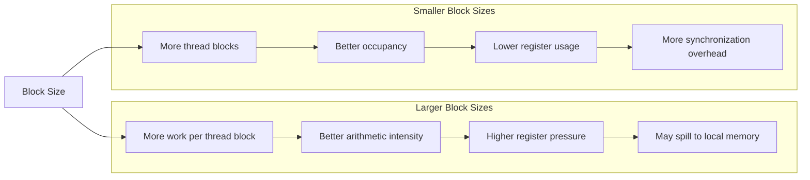

**Sources:** [helion/autotuner/config_spec.py:382-443]()

### Block Size Guidelines

| Kernel Type | Recommended Block Size | Rationale |
|-------------|----------------------|-----------|
| Element-wise operations | 128-256 | High parallelism, low register usage |
| Reductions (small) | 32 | Enables use of warp-level primitives |
| Reductions (medium) | 16 | Balances occupancy and reduction efficiency |
| Reductions (large) | 1 | Maximizes parallelism for persistent reductions |
| Matrix multiplication (M/N dims) | 16-64 | Balances tile reuse and occupancy |
| Matrix multiplication (K dim) | 16-32 | Fits in shared memory/registers |

The `BlockSizeSpec` class determines valid ranges based on size hints:

```python
# From BlockSizeSpec._fragment()
total_ndim = len(base.block_sizes)
reduction_numel = product([next_power_of_2(spec.size_hint) for spec in base.reduction_loops])

if total_ndim <= 2 and reduction_numel <= 128:
    default = 32
elif reduction_numel <= 256:
    default = 16
else:
    default = 1
```

**Sources:** [helion/autotuner/config_spec.py:428-443](), [test/test_examples.py:30-54]()

### Example: Matrix Multiplication Block Sizes

```python
# Small tiles for high occupancy
config = helion.Config(block_sizes=[16, 16, 16])

# Medium tiles for balanced performance  
config = helion.Config(block_sizes=[64, 64, 16])

# Large tiles for compute-bound workloads
config = helion.Config(block_sizes=[128, 128, 32])
```

The matmul test demonstrates multiple configurations:

**Sources:** [test/test_examples.py:41-54](), [test/test_examples.py:227-247]()

---

## L2 Cache Grouping

L2 grouping reorders program IDs to improve L2 cache hit rates by processing tiles that share data in close temporal proximity.

### How L2 Grouping Works

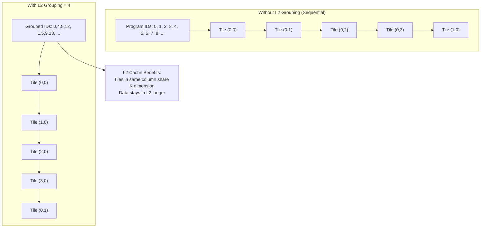

**Sources:** [helion/autotuner/config_spec.py:374-379]()

### L2 Grouping Configuration

The `L2GroupingSpec` allows values from 1 (no grouping) to 64 (maximum grouping):

```python
# No grouping - sequential tile processing
config = helion.Config(l2_grouping=1)

# Small grouping - process 4 tiles along M dimension before moving to next N
config = helion.Config(l2_grouping=4)

# Large grouping - process 64 tiles along M dimension  
config = helion.Config(l2_grouping=64)
```

**Sources:** [helion/autotuner/config_spec.py:374-379](), [test/test_examples.py:41-54]()

### When to Use L2 Grouping

| Scenario | Recommended L2 Grouping | Reason |
|----------|------------------------|--------|
| Matrix multiplication | 4-64 | Reuses K dimension tiles across M dimension |
| Small tiles (<32) | 1 | Overhead of reordering exceeds cache benefits |
| Large input tensors | 16-64 | More opportunities for cache reuse |
| Memory-bound kernels | 8-32 | Maximizes data reuse from cache |
| Attention mechanisms | 4-16 | Balances Q reuse with KV access patterns |

**Sources:** [test/test_examples.py:836-855](), [test/test_examples.expected:476-626]()

---

## Loop Ordering

Loop ordering permutes the iteration order of tiled dimensions to optimize for access patterns or computational dependencies.

### Loop Order Syntax

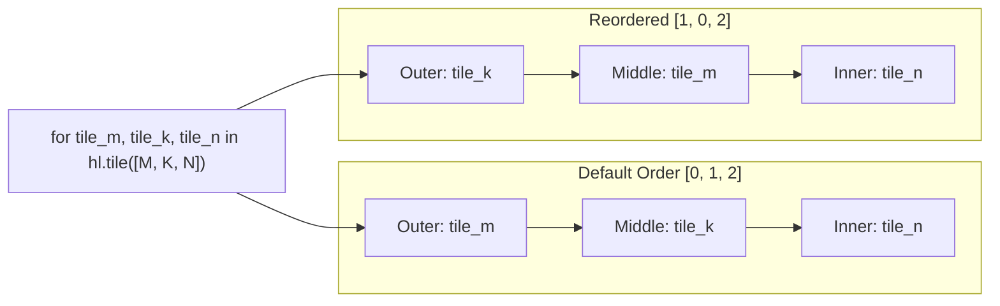

**Sources:** [helion/autotuner/config_spec.py:353-372]()

### Loop Ordering Strategies

The `LoopOrderSpec` validates that configurations are valid permutations:

```python
# Default order - iterate M, then K, then N
config = helion.Config(loop_orders=[[0, 1, 2]])

# Reordered - iterate K first for better reduction locality
config = helion.Config(loop_orders=[[1, 0, 2]])
```

Common patterns:

| Pattern | Loop Order | Use Case |
|---------|-----------|----------|
| Row-major output | `[0, 1]` | Standard iteration, good for most cases |
| Column-major output | `[1, 0]` | Matches transposed output layout |
| Reduction inner | `[0, 1, 2]` | Standard matmul (M, K, N) |
| Reduction outer | `[2, 0, 1]` | Persistent reductions |

**Sources:** [helion/autotuner/config_spec.py:353-372](), [test/test_examples.py:227-247]()

---

## Indexing Strategies

Helion supports three indexing strategies for memory operations, each with different performance characteristics and hardware requirements.

### Indexing Strategy Comparison

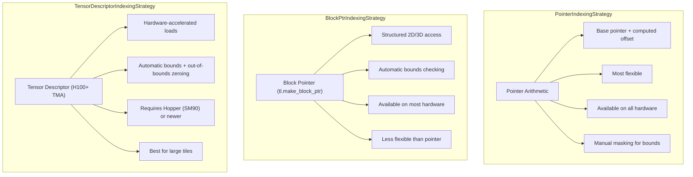

**Sources:** [helion/runtime/config.py:12](), [helion/autotuner/config_spec.py:134-140]()

### Selecting Indexing Strategies

Configuration syntax:

```python
# Single strategy for all loads/stores
config = helion.Config(indexing="pointer")

# Per-operation strategies (advanced)
config = helion.Config(indexing=["pointer", "block_ptr", "tensor_descriptor"])
```

Performance characteristics:

| Strategy | Hardware Req. | Performance | Flexibility | Best For |
|----------|--------------|-------------|-------------|----------|
| `pointer` | Any | Good | High | Complex access patterns, dynamic shapes |
| `block_ptr` | Most GPUs | Better | Medium | Structured 2D/3D access, static patterns |
| `tensor_descriptor` | H100+ | Best | Low | Large tiles, regular access, maximum bandwidth |

**Sources:** [helion/runtime/config.py:61-67](), [test/test_examples.py:574-604]()

### Example: Attention Indexing

```python
# Pointer indexing - most compatible
config = helion.Config(
    block_sizes=[1, 64, 32],
    indexing="pointer"
)

# Block pointer - better performance
config = helion.Config(
    block_sizes=[16, 32, 16],
    num_stages=1,
    indexing="block_ptr"
)
```

**Sources:** [test/test_examples.py:607-621](), [test/test_examples.py:623-640]()

---

## Persistent Execution Modes

Persistent execution modes control how program IDs are assigned to thread blocks, enabling advanced scheduling optimizations.

### PID Type Strategies

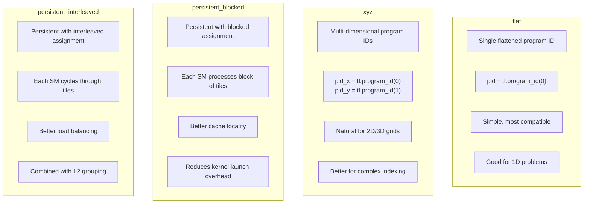

**Sources:** [helion/runtime/config.py:13](), [helion/autotuner/config_spec.py:60]()

### Persistent Kernel Benefits

Persistent kernels keep thread blocks alive to process multiple tiles:

```python
# Standard execution - one tile per thread block
config = helion.Config(pid_type="flat")

# Persistent execution - multiple tiles per thread block
config = helion.Config(pid_type="persistent_interleaved", l2_grouping=4)
```

Benefits:
- **Reduced launch overhead**: Amortize kernel launch cost across many tiles
- **Better cache utilization**: Thread blocks can reuse cached data
- **Improved load balancing**: Dynamic work assignment prevents tail effects

Use persistent modes when:
- Total tiles > number of SMs * 4 (enough parallelism)
- Memory-bound workloads (benefits from cache reuse)
- Variable-length sequences (dynamic load balancing)

**Sources:** [test/test_examples.py:836-855](), [test/test_examples.expected:476-626]()

---

## Reduction Optimization

The `reduction_loops` parameter controls how reductions are performed and has significant performance implications.

### Reduction Strategies

```mermaid
graph TB
    subgraph "Persistent Reduction (reduction_loop=None)"
        PR["Each block reduces entire dimension"]
        PR1["No intermediate writes"]
        PR2["Single atomic update at end"]
        PR3["Best for large reductions"]
        PR --> PR1
        PR1 --> PR2
        PR2 --> PR3
    end
    
    subgraph "Rolled Reduction (reduction_loop=size)"
        RR["Each block reduces tiles of size"]
        RR1["Loop over reduction dimension"]
        RR2["Accumulator in registers"]
        RR3["Good for medium reductions"]
        RR --> RR1
        RR1 --> RR2
        RR2 --> RR3
    end
    
    subgraph "Two-pass Reduction"
        TP["Separate reduce and combine kernels"]
        TP1["First pass: parallel reductions"]
        TP2["Second pass: combine results"]
        TP3["Best for huge reductions"]
        TP --> TP1
        TP1 --> TP2
        TP2 --> TP3
    end
```

**Sources:** [helion/autotuner/config_spec.py:459-493]()

### Reduction Configuration

The `ReductionLoopSpec` determines appropriate values:

```python
# Persistent reduction - single pass through entire dimension
config = helion.Config(reduction_loop=None)

# Rolled reduction - loop in blocks of 1024
config = helion.Config(reduction_loop=1024)

# Small tiles - each block reduces 32 elements
config = helion.Config(reduction_loop=32)
```

Decision criteria from `ReductionLoopSpec._flat_config()`:

```python
low = 8
high = next_power_of_2(max(low, self.size_hint))
default = min(high, 4096)

if value >= self.size_hint:
    return None  # Use persistent reduction
return value
```

**Sources:** [helion/autotuner/config_spec.py:469-484](), [test/test_examples.py:761-772]()

### Example: Softmax Reductions

```python
# Single-pass softmax (persistent)
config = helion.Config(
    block_size=1,
    num_warps=4,
    num_stages=1,
    indexing="block_ptr"
)

# Two-pass softmax with rolled reduction
config = helion.Config(
    block_size=1,
    num_warps=4,
    num_stages=1,
    indexing="block_ptr",
    reduction_loop=32
)
```

**Sources:** [test/test_examples.py:296-324]()

---

## GPU Execution Parameters

### Num Warps

The `num_warps` parameter controls thread block size (threads = warps × 32) and affects occupancy and resource usage.

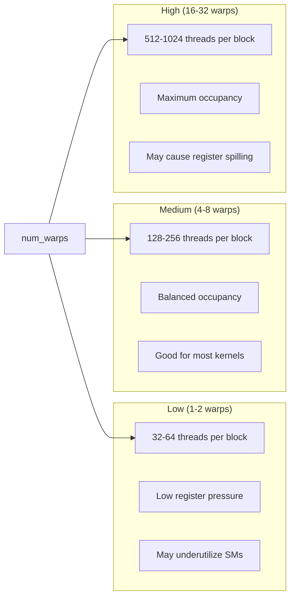

**Sources:** [helion/autotuner/config_spec.py:36-37](), [helion/runtime/config.py:166-169]()

Guidelines:

| Workload Type | Recommended num_warps | Rationale |
|---------------|----------------------|-----------|
| Memory-bound | 4-8 | Hides memory latency without excessive pressure |
| Compute-bound | 8-16 | Maximizes compute utilization |
| Small tiles | 2-4 | Matches workload granularity |
| Large tiles | 8-16 | Sufficient parallelism to fill SM |

### Num Stages

The `num_stages` parameter controls software pipelining depth for overlapping compute and memory operations.

```python
# Default - minimal pipelining
config = helion.Config(num_stages=1)

# Moderate pipelining - good balance
config = helion.Config(num_stages=3)

# Aggressive pipelining - maximum overlap
config = helion.Config(num_stages=5)
```

Trade-offs:
- **More stages**: Better memory/compute overlap, higher shared memory usage
- **Fewer stages**: Lower resource usage, may have idle time

Use more stages when:
- Memory-bound workloads (benefit from prefetching)
- Sufficient shared memory available
- Regular, predictable access patterns

**Sources:** [helion/autotuner/config_spec.py:37](), [helion/runtime/config.py:171-175](), [test/test_examples.py:540-572]()

---

## Range Optimization

For kernels using `tl.range` loops, several optimization parameters control loop execution.

### Range Parameters

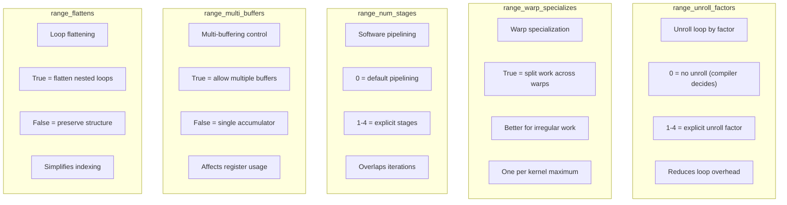

**Sources:** [helion/autotuner/config_spec.py:83-97](), [helion/runtime/config.py:29-34]()

### Range Configuration Example

```python
config = helion.Config(
    range_unroll_factors=[2, 0],      # Unroll first loop 2x, second auto
    range_warp_specializes=[True, None],  # Specialize first loop only
    range_num_stages=[3, 0],          # Pipeline first loop with 3 stages
    range_multi_buffers=[True, None], # Allow multi-buffering first loop
    range_flattens=[False, None]      # Don't flatten first loop
)
```

**Sources:** [helion/autotuner/config_spec.py:520-554](), [helion/runtime/config.py:51-56]()

### Static Ranges

The `static_ranges` parameter converts `tl.range` to `tl.static_range` for compile-time known bounds:

```python
# Dynamic range - runtime bounds checking
config = helion.Config(static_ranges=[False])

# Static range - bounds known at compile time
config = helion.Config(static_ranges=[True])
```

Use `static_range=True` when:
- Loop bounds are compile-time constants
- Want maximum optimization by compiler
- Don't need runtime flexibility

**Sources:** [helion/autotuner/config_spec.py:542-554](), [helion/runtime/config.py:34]()

---

## Autotuning Logging and Diagnostics

### AutotuningLogger System

The `AutotuningLogger` class provides structured logging during autotuning with elapsed time tracking and CSV output.

**Title: AutotuningLogger Architecture**

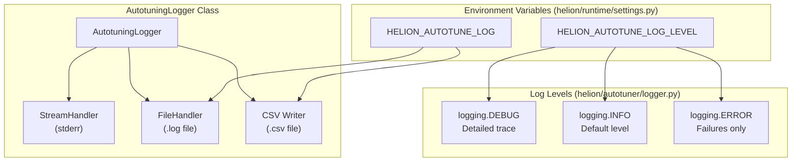

**Sources:** [helion/autotuner/logger.py:56-235](), [helion/runtime/settings.py:160-181]()

### Enabling Autotune Logging

```bash
# Enable CSV and log file output
export HELION_AUTOTUNE_LOG=/tmp/autotune_run

# Set log verbosity (0=NOTSET, 10=DEBUG, 20=INFO, 30=WARNING)
export HELION_AUTOTUNE_LOG_LEVEL=10

# Run kernel - creates /tmp/autotune_run.csv and /tmp/autotune_run.log
python my_kernel.py
```

**Sources:** [helion/runtime/settings.py:160-175](), [helion/autotuner/logger.py:108-125]()

### CSV Log Format

The `AutotuneLogSink` writes structured data for each configuration tested:

**Title: AutotuneLogEntry CSV Schema**

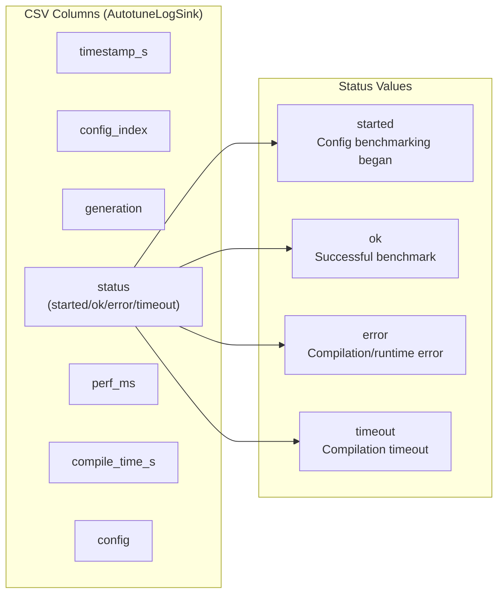

**Sources:** [helion/autotuner/logger.py:252-358](), [helion/autotuner/base_search.py:617-638]()

Example CSV output:

```csv
timestamp_s,config_index,generation,status,perf_ms,compile_time_s,config
0.12,1,0,started,,,Config(block_sizes=[64, 32])
2.45,1,0,ok,0.0266,2.33,Config(block_sizes=[64, 32])
2.58,2,0,started,,,Config(block_sizes=[128, 64])
3.21,2,0,error,,,Config(block_sizes=[128, 64])
```

**Sources:** [helion/autotuner/logger.py:294-357]()

---

## Debugging Slow Kernels

### BaseSearch Benchmarking Methods

The `BaseSearch` class provides core benchmarking functionality used by all autotuners.

**Title: BaseSearch Benchmark Flow**

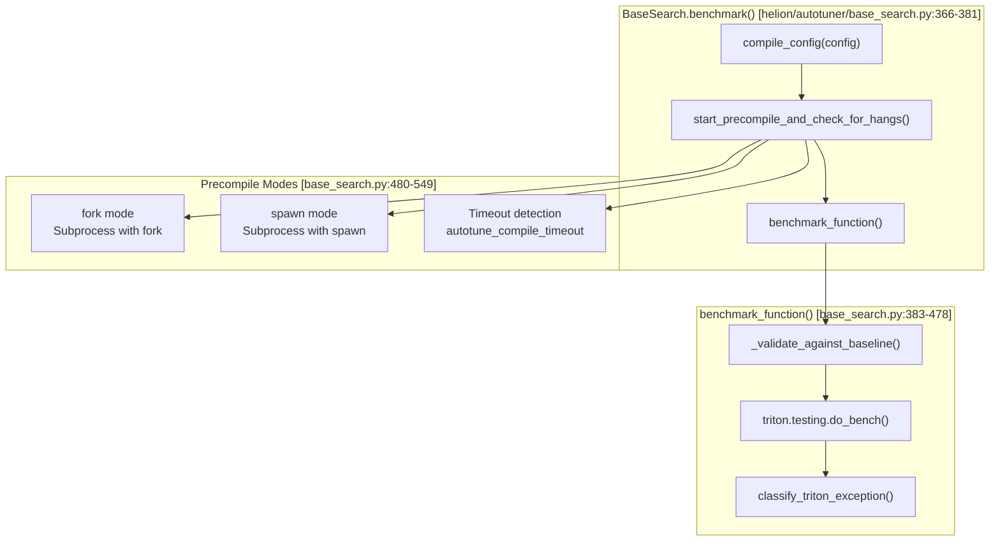

**Sources:** [helion/autotuner/base_search.py:366-549](), [helion/runtime/settings.py:374-391]()

### Accuracy Validation

The `_validate_against_baseline()` method checks numerical correctness during autotuning:

```python
# From BaseSearch._compute_baseline() [base_search.py:169-229]
if self.settings.autotune_baseline_fn is not None:
    baseline_output = self.settings.autotune_baseline_fn(*new_args)
else:
    baseline_config = self.config_spec.default_config()
    baseline_output = self.kernel.compile_config(baseline_config)(*new_args)

# From BaseSearch._validate_against_baseline() [base_search.py:340-364]
torch.testing.assert_close(
    output,
    self._baseline_output,
    atol=self._effective_atol,
    rtol=self._effective_rtol,
)
```

**Tolerance Configuration:**

| Setting | Environment Variable | Default | Description |
|---------|---------------------|---------|-------------|
| `autotune_baseline_atol` | N/A (programmatic only) | 1e-2 | Absolute tolerance for validation |
| `autotune_baseline_rtol` | N/A (programmatic only) | 1e-2 | Relative tolerance for validation |
| `autotune_accuracy_check` | `HELION_AUTOTUNE_ACCURACY_CHECK` | True | Enable/disable accuracy validation |

**Sources:** [helion/autotuner/base_search.py:231-289](), [helion/runtime/settings.py:401-404](), [helion/runtime/settings.py:473-475]()

### FP8 Automatic Tolerance Adjustment

For fp8 dtypes, Helion automatically uses bitwise comparison:

```python
# From BaseSearch._compute_effective_tolerances() [base_search.py:231-289]
fp8_dtypes = {
    torch.float8_e4m3fn,
    torch.float8_e5m2,
    torch.float8_e4m3fnuz,
    torch.float8_e5m2fnuz,
    torch.float8_e8m0fnu,
}

all_dtypes_are_fp8 = dtypes and all(dtype in fp8_dtypes for dtype in dtypes)

if all_dtypes_are_fp8:
    return 0.0, 0.0  # Bitwise comparison
```

**Sources:** [helion/autotuner/base_search.py:261-289]()

### Error Classification

The `classify_triton_exception()` function categorizes errors for appropriate handling:

**Title: Triton Exception Classification**

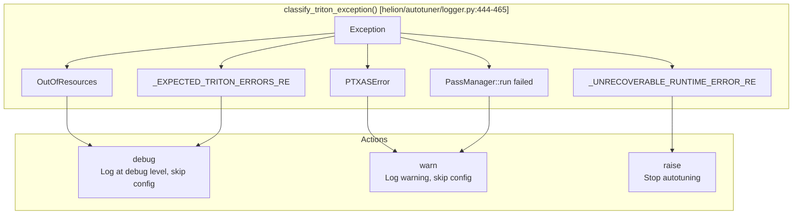

**Sources:** [helion/autotuner/logger.py:405-465](), [helion/autotuner/base_search.py:427-478]()

**Expected Errors (Skipped):**
- `[CUDA]: invalid argument` - Invalid CUDA parameter for config
- `PassManager::run failed` - Triton compilation pipeline failure
- `out of resource: shared memory` - Insufficient shared memory
- `exceeds triton maximum tensor numel` - Tile size too large

**Unrecoverable Errors (Raises):**
- `illegal memory access` - CUDA memory violation
- `misaligned address` - Memory alignment error
- `illegal instruction` - Invalid GPU instruction

**Sources:** [helion/autotuner/logger.py:406-442]()

### Ignoring Errors During Autotuning

```bash
# Skip all autotune errors (useful for exploring large config spaces)
export HELION_AUTOTUNE_IGNORE_ERRORS=1
```

```python
@helion.kernel(autotune_ignore_errors=True)
def experimental_kernel(x: torch.Tensor) -> torch.Tensor:
    # Will skip failing configs without stopping
    pass
```

**Sources:** [helion/runtime/settings.py:423-427](), [helion/autotuner/base_search.py:359-363](), [test/test_autotuner.py:113-154]()

---

## Interpreting Benchmark Results

### Performance Metrics

The benchmarking system provides multiple metrics for comparing kernel performance:

| Metric | Calculation | Interpretation |
|--------|-------------|----------------|
| `speedup` | `baseline_time / kernel_time` | > 1.0 means faster than baseline |
| `accuracy` | `torch.testing.assert_close` match | 1.0 = perfect, < 0.95 = issues |
| `tflops` | `(flops / time) / 1e12` | Tera floating-point operations/sec |
| `gbps` | `(bytes_transferred / time) / 1e9` | Gigabytes per second |

**Sources:** [benchmarks/run.py:1-343]()

### Benchmark Execution

**Title: Two-Phase Benchmark Process**

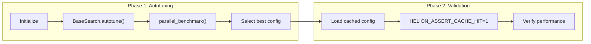

**Sources:** [helion/autotuner/base_search.py:551-659](), [helion/autotuner/base_search.py:661-702]()

### Rebenchmarking for Outlier Detection

The `rebenchmark()` method reduces measurement noise for top-performing configs:

```python
# From BaseSearch.should_rebenchmark() [base_search.py:899-912]
threshold = self.settings.get_rebenchmark_threshold()
return member.perf < threshold * self.best_perf_so_far

# From BaseSearch.rebenchmark() [base_search.py:914-945]
base_repeat = int(200 / self.best_perf_so_far) if self.best_perf_so_far > 0 else 1000
repeat = min(1000, max(3, base_repeat))
```

**Rebenchmark Threshold Settings:**

| Environment Variable | Default | Description |
|---------------------|---------|-------------|
| `HELION_REBENCHMARK_THRESHOLD` | Varies by effort | Multiplier for rebenchmarking |
| `autotune_effort="quick"` | Higher threshold | Less rebenchmarking |
| `autotune_effort="full"` | Lower threshold | More rebenchmarking |

**Sources:** [helion/autotuner/base_search.py:899-945](), [helion/runtime/settings.py:406-411](), [helion/runtime/settings.py:618-631]()

---

## Environment Variables Reference

### Core Settings

**Title: Settings Class Environment Variables**

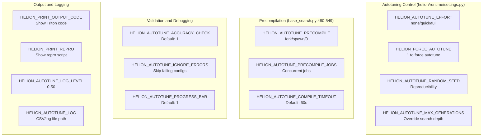

**Sources:** [helion/runtime/settings.py:345-476]()

### Complete Environment Variable Table

| Variable | Type | Default | Description |
|----------|------|---------|-------------|
| `HELION_AUTOTUNE_EFFORT` | `none\|quick\|full` | `full` | Autotuning intensity |
| `HELION_AUTOTUNE_PRECOMPILE` | `fork\|spawn\|0` | `fork` | Subprocess mode for compile safety |
| `HELION_AUTOTUNE_PRECOMPILE_JOBS` | `int` | CPU count | Max concurrent precompile processes |
| `HELION_AUTOTUNE_COMPILE_TIMEOUT` | `int` | `60` | Seconds before killing hung compilation |
| `HELION_AUTOTUNE_RANDOM_SEED` | `int` | Time-based | Seed for random search |
| `HELION_AUTOTUNE_ACCURACY_CHECK` | `0\|1` | `1` | Validate configs against baseline |
| `HELION_AUTOTUNE_IGNORE_ERRORS` | `0\|1` | `0` | Skip errors instead of raising |
| `HELION_AUTOTUNE_PROGRESS_BAR` | `0\|1` | `1` | Show progress during autotuning |
| `HELION_AUTOTUNE_MAX_GENERATIONS` | `int` | Algorithm default | Override search generations |
| `HELION_AUTOTUNE_LOG_LEVEL` | `int` | `20` (INFO) | Logging verbosity (0=all, 50=critical) |
| `HELION_AUTOTUNE_LOG` | `path` | None | Base path for CSV/log output |
| `HELION_REBENCHMARK_THRESHOLD` | `float` | Effort-based | Rebenchmark if < threshold × best |
| `HELION_PRINT_OUTPUT_CODE` | `0\|1` | `0` | Print generated Triton code |
| `HELION_PRINT_REPRO` | `0\|1` | `0` | Print standalone repro script |
| `HELION_FORCE_AUTOTUNE` | `0\|1` | `0` | Force autotune even with explicit config |
| `HELION_STATIC_SHAPES` | `0\|1` | `1` | Use static shapes for specialization |
| `HELION_ALLOW_WARP_SPECIALIZE` | `0\|1` | `1` | Allow warp specialization on CUDA |

**Sources:** [helion/runtime/settings.py:345-476](), [README.md:293-319]()

---

## Performance Tuning Workflow

### Step-by-Step Optimization Process

**Title: Performance Optimization Decision Tree**

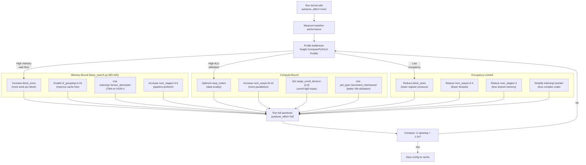

**Sources:** [helion/autotuner/base_search.py:366-702](), [helion/runtime/settings.py:447-454]()

### Quick Debugging Commands

```bash
# 1. Disable autotuning for fast iteration
export HELION_AUTOTUNE_EFFORT=none

# 2. See generated Triton code
export HELION_PRINT_OUTPUT_CODE=1

# 3. Enable verbose autotuning logs
export HELION_AUTOTUNE_LOG_LEVEL=10  # DEBUG
export HELION_AUTOTUNE_LOG=/tmp/debug_autotune

# 4. Run kernel and inspect logs
python my_kernel.py

# 5. Analyze CSV for performance trends
cat /tmp/debug_autotune.csv | column -t -s,

# 6. Check for accuracy issues
grep "accuracy_mismatch" /tmp/debug_autotune.log
```

**Sources:** [README.md:293-323](), [helion/runtime/settings.py:428-434]()

### Common Optimization Patterns

**Pattern 1: Element-wise Operations**
```python
# Simple pointwise kernels (add, mul, sigmoid, etc.)
config = helion.Config(
    block_sizes=[128],              # Large tiles for high parallelism
    num_warps=4,                    # Moderate thread count
    indexing="pointer"              # Simple, flexible indexing
)
# Example: examples/add.py, test/test_examples.py:30-54
```

**Pattern 2: Matrix Multiplication**
```python
# Compute-intensive matmul on H100+
config = helion.Config(
    block_sizes=[64, 64, 16],       # M=64, N=64, K=16 tile sizes
    l2_grouping=16,                 # Group for K dimension reuse
    loop_orders=[[0, 1]],           # Standard M, N iteration
    num_warps=8,                    # Higher parallelism
    num_stages=3,                   # Pipeline for memory/compute overlap
    indexing="tensor_descriptor"    # Maximum bandwidth (TMA)
)
# Example: examples/matmul.py, test/test_examples.py:227-247
```

**Pattern 3: Reductions (Softmax)**
```python
# Large dimension reduction with persistent kernel
config = helion.Config(
    block_sizes=[1, 128],           # B=1 (all batches), N=128 (reduction dim)
    reduction_loop=None,            # Persistent reduction (single pass)
    num_warps=4,                    # Moderate thread count
    num_stages=1,                   # Low pipeline for reduction
    indexing="block_ptr"            # Structured 2D access
)
# Example: examples/softmax.py, test/test_examples.py:296-324
```

**Pattern 4: Attention (Flash Attention)**
```python
# Memory-efficient attention with dynamic Q/K/V tiles
config = helion.Config(
    block_sizes=[16, 32, 16],       # BATCH=16, SEQ_Q=32, SEQ_K=16
    pid_type="persistent_interleaved", # Dynamic load balancing
    l2_grouping=4,                  # Cache Q tiles across K iterations
    num_stages=1,                   # Low pipeline for flexibility
    num_warps=4,                    # Balanced occupancy
    indexing="block_ptr"            # Structured 2D access
)
# Example: examples/attention.py, test/test_examples.py:607-640
```

**Pattern 5: Segmented Reduction**
```python
# Atomic aggregation with associative scan
config = helion.Config(
    block_sizes=[8, 128],           # EDGES=8, FEATURES=128
    num_warps=4,                    # Moderate parallelism
    num_stages=1,                   # Simple pipeline
    indexing="pointer"              # Flexible for atomic_add
)
# Example: examples/segment_reduction.py
```

**Sources:** [test/test_examples.py:30-900](), [examples/segment_reduction.py:58-92](), [examples/matmul.py](), [examples/softmax.py](), [examples/attention.py]()

### Debugging Failed Configs

When autotuning encounters errors, inspect the autotune log to diagnose issues:

```python
# From classify_triton_exception() in logger.py:444-465
# Common patterns:

# OutOfResources - reduce block_sizes or num_stages
if "out of resource: shared memory" in error:
    # Try: block_sizes=[32, 32] instead of [64, 64]
    pass

# PTXASError - invalid assembly, often from complex code
if "ptxas" in error.lower():
    # Try: simpler indexing="pointer", reduce num_warps
    pass

# PassManager failure - Triton optimization pass failed  
if "PassManager::run failed" in error:
    # Try: different loop_orders, reduce num_stages
    pass
```

Use `HELION_AUTOTUNE_IGNORE_ERRORS=1` to continue searching despite errors:

```bash
# Explore entire space, log all failures for analysis
export HELION_AUTOTUNE_IGNORE_ERRORS=1
export HELION_AUTOTUNE_LOG=/tmp/full_search
python my_kernel.py

# Then analyze failure patterns
grep "error" /tmp/full_search.csv | cut -d, -f7 | sort | uniq -c
```

**Sources:** [helion/autotuner/logger.py:444-465](), [helion/autotuner/base_search.py:427-478](), [test/test_autotuner.py:120-154]()

---

## Summary: Key Performance Parameters

| Parameter | Primary Impact | Tuning Strategy |
|-----------|---------------|-----------------|
| `block_sizes` | Parallelism, occupancy, register usage | Start with defaults from autotuner, adjust based on profiling |
| `l2_groupings` | Cache hit rate | Use 4-16 for matmul-like kernels, 1 otherwise |
| `loop_orders` | Memory access patterns | Match output layout and reduction patterns |
| `reduction_loops` | Reduction efficiency | Use None for large reductions, explicit values for medium |
| `num_warps` | Occupancy, resource usage | 4-8 for most kernels, tune based on profile |
| `num_stages` | Memory/compute overlap | 1-3 for most kernels, higher for memory-bound |
| `pid_type` | Work distribution | Use persistent modes for >1000 tiles |
| `indexing` | Memory bandwidth | pointer (compatible), block_ptr (good), tensor_descriptor (best on H100+) |
| `range_unroll_factors` | Loop overhead | 0-2 for most cases, tune for tight loops |
| `range_warp_specializes` | Load balancing | True for irregular work within ranges |

For automatic exploration of these parameters, see [Search Algorithms](#4.3) and [Autotune Caching](#4.4).

**Sources:** [helion/runtime/config.py:1-228](), [helion/autotuner/config_spec.py:1-559](), [benchmarks/run.py:1-343]()

---

