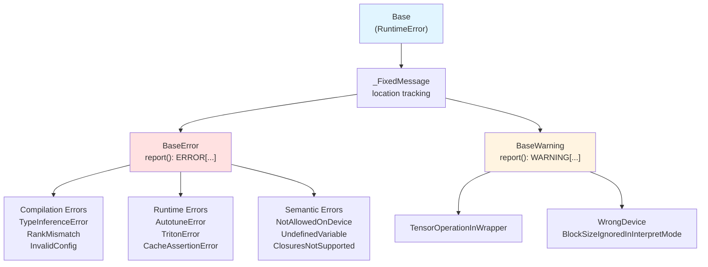
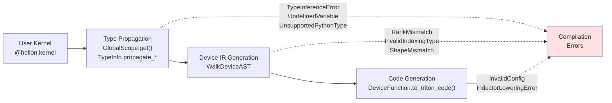
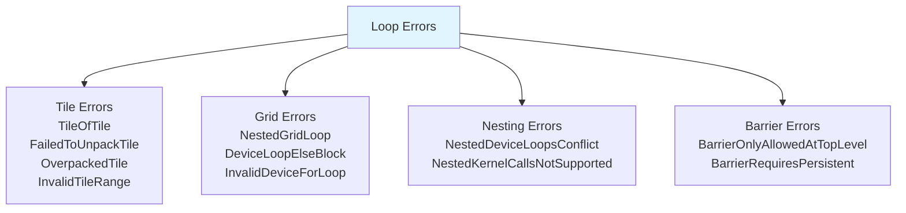
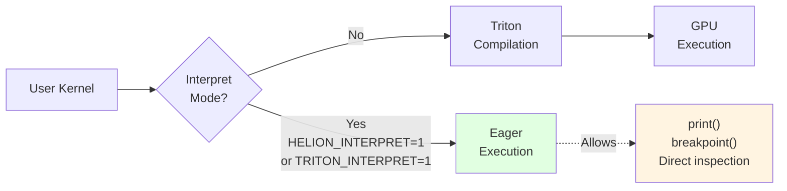
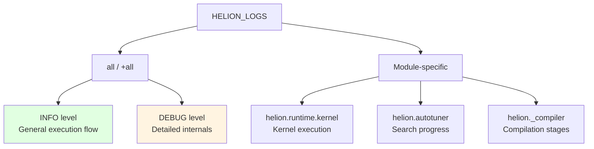
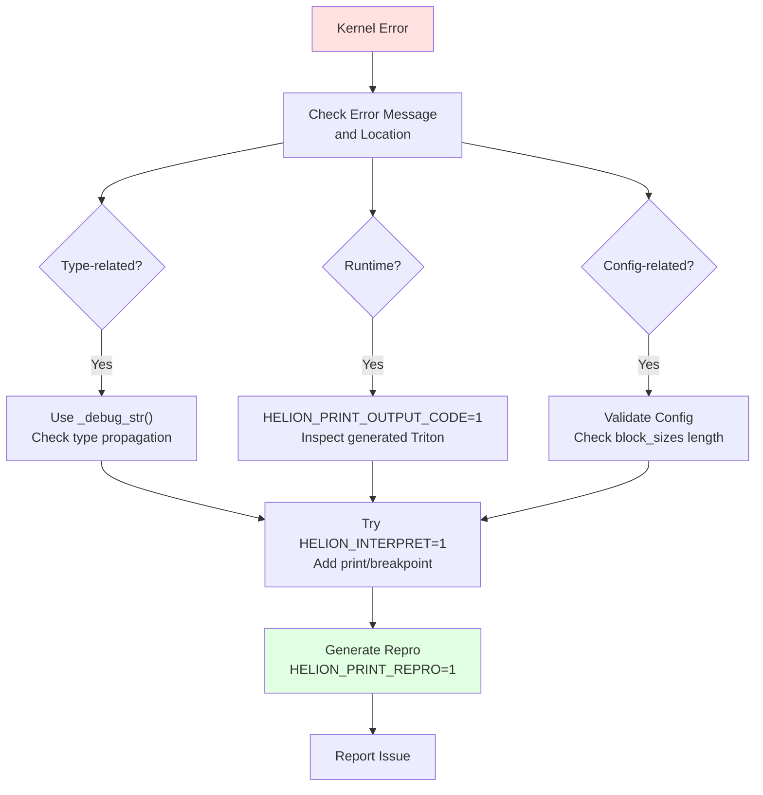

<!-- source: DeepWiki mcp.deepwiki.com · repo pytorch/helion · page 9.4 Error Handling and Debugging · fetched 2026-10-21 -->

# Error Handling and Debugging

<details>
<summary>Relevant source files</summary>

The following files were used as context for generating this wiki page:

- [docs/api/autotuner.md](docs/api/autotuner.md)
- [docs/api/exceptions.md](docs/api/exceptions.md)
- [docs/api/index.md](docs/api/index.md)
- [docs/api/language.md](docs/api/language.md)
- [helion/_compiler/type_propagation.py](helion/_compiler/type_propagation.py)
- [helion/autotuner/finite_search.py](helion/autotuner/finite_search.py)
- [helion/autotuner/logger.py](helion/autotuner/logger.py)
- [helion/exc.py](helion/exc.py)
- [helion/language/stack_tensor.py](helion/language/stack_tensor.py)
- [helion/runtime/precompile_shim.py](helion/runtime/precompile_shim.py)
- [test/test_errors.py](test/test_errors.py)

</details>


This document covers Helion's error handling system, common error patterns, and debugging techniques. It explains the exception hierarchy defined in [helion/exc.py](), debugging settings like `print_output_code` and `print_repro`, and techniques for diagnosing kernel compilation and execution issues.

For information about testing kernels, see [7. Testing and Validation](#7). For runtime settings and environment variables, see [6.2 Settings and Environment Variables](#6.2).

---

## Exception Hierarchy

Helion uses a custom exception hierarchy rooted in `helion.exc.Base` that provides structured error reporting with source location tracking.

### Base Exception Structure



**Key Components:**

| Class | Purpose | Location Tracking |
|-------|---------|-------------------|
| `Base` | Root exception class | Defines `report()` method |
| `_FixedMessage` | Base for formatted messages | Captures `SourceLocation` |
| `BaseError` | User-facing errors | Yes, via `current_location()` |
| `BaseWarning` | Non-fatal warnings | Yes, via `current_location()` |

The `_FixedMessage` class automatically captures the source location when an exception is raised using [helion/_compiler/source_location.py:current_location()]() and appends it to the error message.

**Sources:** [helion/exc.py:9-27](), [helion/exc.py:29-34]()

---

## Error Categories

### Compilation Errors

Errors that occur during kernel analysis and code generation:



**Common Compilation Errors:**

| Exception | When Raised | Example |
|-----------|-------------|---------|
| `TypeInferenceError` | Type propagation fails | Unknown attribute access |
| `UndefinedVariable` | Variable not in scope | Typo in variable name |
| `RankMismatch` | Tensor indexing rank mismatch | `tensor[i]` for 2D tensor |
| `InvalidIndexingType` | Invalid tensor index type | `tensor[dict_key]` |
| `InvalidConfig` | Config parameters incompatible | Too few `block_sizes` |
| `UnsupportedPythonType` | Unsupported type in kernel | Custom class instance |

**Sources:** [helion/exc.py:461-467](), [helion/exc.py:115-136](), [helion/exc.py:138-140](), [helion/_compiler/type_propagation.py:92-100]()

### Semantic Errors

Errors for operations not allowed in specific contexts:

| Exception | Context | Description |
|-----------|---------|-------------|
| `NotAllowedOnDevice` | Device loop | Operation like `return` inside `hl.tile` |
| `DeviceAPIOnHost` | Host code | Calling `hl.zeros` outside device loop |
| `CannotModifyHostVariableOnDevice` | Device loop | Assignment to host variable without subscript |
| `CannotReadDeviceVariableOnHost` | Host code | Reading device-created variable |
| `HostTensorDirectUsage` | Device loop | Using tensor directly without indexing |
| `NotAllowedInHelperFunction` | Helper function | Operations requiring kernel context |

**Example:**

```python
@helion.kernel()
def bad_kernel(x: torch.Tensor) -> torch.Tensor:
    result = torch.empty_like(x)
    for tile in hl.tile(x.size()):
        # ERROR: Cannot modify host variable without subscript
        result = x[tile] * 2  # Should be: result[tile] = x[tile] * 2
    return result
```

**Sources:** [helion/exc.py:182-184](), [helion/exc.py:287-289](), [helion/exc.py:480-482](), [helion/exc.py:491-493](), [test/test_errors.py:257-268]()

### Loop and Control Flow Errors

Errors related to loop constructs and control flow:



**Common Loop Errors:**

| Exception | Description |
|-----------|-------------|
| `TileOfTile` | Passing a tile to `hl.tile()` instead of size |
| `FailedToUnpackTile` | Tuple unpacking mismatch for tiles |
| `OverpackedTile` | Tile wrapped in container during indexing |
| `InvalidTileRange` | Begin > end in range specification |
| `NestedGridLoop` | Grid loop not at top level |
| `InvalidDeviceForLoop` | Using Python loop instead of `hl.tile`/`hl.grid` |

**Sources:** [helion/exc.py:319-321](), [helion/exc.py:227-229](), [helion/exc.py:258-262](), [helion/exc.py:264-269](), [helion/exc.py:111-113](), [helion/exc.py:307-309]()

### Runtime and Autotuning Errors

Errors during kernel execution and autotuning:

| Exception | When Raised | Recovery |
|-----------|-------------|----------|
| `AutotuneError` | Autotuning process fails | Check config space |
| `NoConfigFound` | No valid configs after search | Review kernel complexity |
| `CacheAssertionError` | Expected cache hit missing | Check cache invalidation |
| `TritonError` | Triton compilation/execution error | Check generated code |
| `TritonUnrecoverableRuntimeError` | Unrecoverable Triton error | Use subprocess isolation |

**Autotuning Error Handling:**

The autotuner can be configured to handle errors gracefully:

- `autotune_ignore_errors=True` or `HELION_AUTOTUNE_IGNORE_ERRORS=1` - Skip failing configs
- `autotune_precompile="spawn"` or `HELION_AUTOTUNE_PRECOMPILE=spawn` - Isolate compilation in subprocess

**Sources:** [helion/exc.py:57-59](), [helion/exc.py:331-333](), [helion/exc.py:68-70](), [helion/exc.py:390-399](), [helion/exc.py:401-408]()

### Warnings

Non-fatal warnings that indicate potential issues:

| Warning | Trigger | Mitigation |
|---------|---------|-----------|
| `TensorOperationInWrapper` | Tensor op outside device loop | Move operation inside loop |
| `WrongDevice` | Operation returns wrong device | Check device consistency |
| `BlockSizeIgnoredInInterpretMode` | Block size in interpret mode | Expected behavior in ref mode |
| `TiledKMatmulAccumulationWarning` | Incorrect matmul accumulation | Use `torch.addmm` or `hl.dot(acc=...)` |

Warnings can be suppressed using `ignore_warnings` in the kernel decorator:

```python
@helion.kernel(ignore_warnings=[helion.exc.TensorOperationInWrapper])
def kernel_with_suppressed_warning(x: torch.Tensor) -> torch.Tensor:
    ...
```

**Sources:** [helion/exc.py:417-423](), [helion/exc.py:433-435](), [helion/exc.py:437-439](), [helion/exc.py:441-454]()

---

## Debugging Techniques

### Viewing Generated Code

The `print_output_code` setting displays the generated Triton code to stderr:

**Environment Variable:**
```bash
HELION_PRINT_OUTPUT_CODE=1 python my_kernel.py
```

**Decorator Argument:**
```python
@helion.kernel(print_output_code=True)
def debug_kernel(x: torch.Tensor) -> torch.Tensor:
    ...
```

**Programmatic Access:**
```python
kernel = helion.kernel()(my_function)
bound = kernel.bind(args)
code = bound.to_triton_code(config)
print(code)
```

The generated code includes:
- Triton kernel function with `@triton.jit` decorator
- Grid launch configuration
- Kernel argument handling
- Generated Triton operations

**Sources:** [README.md:299-302](), [docs/index.md:244-247]()

### Generating Reproducible Scripts

The `print_repro` setting generates a standalone script that reproduces the kernel execution:

```bash
HELION_PRINT_REPRO=1 python my_kernel.py
```

The repro script includes:
1. Kernel definition with `@helion.kernel` decorator
2. Config specification (if applicable)
3. `helion_repro_caller()` function that recreates runtime inputs
4. Invocation code

This is useful for:
- Sharing minimal reproducers in bug reports
- Isolating issues from larger codebases
- Testing specific configurations

**Sources:** [README.md:304-307](), [docs/index.md:249-252]()

### Interpret Mode for Debugging



**Two Interpret Modes:**

| Environment Variable | Execution Mode |
|---------------------|----------------|
| `TRITON_INTERPRET=1` | Triton CPU interpreter |
| `HELION_INTERPRET=1` | Helion eager mode (ref mode) |

Both allow:
- `print()` statements inside device loops
- `breakpoint()` for interactive debugging
- Direct variable inspection

**Example:**
```python
@helion.kernel(autotune_effort="none")
def debug_kernel(x: torch.Tensor) -> torch.Tensor:
    out = torch.empty_like(x)
    for tile in hl.tile(x.size(0)):
        intermediate = x[tile] * 2
        print(f"tile={tile}, value={intermediate}")  # Works with HELION_INTERPRET=1
        breakpoint()  # Interactive debugging
        out[tile] = intermediate
    return out
```

**Sources:** [README.md:309-311](), [docs/index.md:249-252](), [helion/exc.py:299-301]()

### Logging System

Enable detailed logging for specific modules:

| Environment Variable | Effect |
|---------------------|--------|
| `HELION_LOGS=all` | INFO-level logs for all modules |
| `HELION_LOGS=+all` | DEBUG-level logs for all modules |
| `HELION_LOGS=+helion.runtime.kernel,helion.autotuner` | Module-specific logging |

**Logging Hierarchy:**



**Sources:** [README.md:321-324](), [docs/index.md:263-266]()

### Type Propagation Debugging

To debug type inference issues, examine the internal representation:

```python
from helion import Kernel

kernel: Kernel = helion.kernel()(my_function)
bound = kernel.bind(args)
debug_info = bound._debug_str()
print(debug_info)
```

This shows:
- Type information for each variable
- Origin tracking for symbols
- Scope resolution details

**Sources:** [test/test_type_propagation.py:27-28]()

---

## Debugging Workflow

### Step-by-Step Debugging Process



**Common Debugging Patterns:**

1. **Type Mismatch Errors:**
   - Use `_debug_str()` to inspect type propagation
   - Check tensor shapes and dtypes
   - Verify origin tracking for symbols

2. **Indexing Errors:**
   - Count dimensions in tensor indexing
   - Check for `RankMismatch` error details
   - Verify tile unpacking matches dimensions

3. **Configuration Errors:**
   - Ensure `block_sizes` length matches `hl.tile()` calls
   - Check `loop_orders` length matches multi-dim tiles
   - Validate `indexing` list length matches load/store count

4. **Autotuning Failures:**
   - Enable `autotune_ignore_errors=True` to skip failing configs
   - Use `autotune_precompile="spawn"` to isolate compilation
   - Check autotuning logs with `HELION_LOGS=+helion.autotuner`

**Sources:** [test/test_errors.py:169-189](), [test/test_errors.py:191-207](), [helion/exc.py:390-408]()

---

## Development Settings Summary

### Quick Reference Table

| Setting | Environment Variable | Decorator Argument | Purpose |
|---------|---------------------|-------------------|---------|
| Skip autotuning | `HELION_AUTOTUNE_EFFORT=none` | `autotune_effort="none"` | Fast iteration |
| View generated code | `HELION_PRINT_OUTPUT_CODE=1` | `print_output_code=True` | Inspect Triton output |
| Generate repro | `HELION_PRINT_REPRO=1` | `print_repro=True` | Create standalone script |
| Interpret mode | `HELION_INTERPRET=1` | - | Enable print/breakpoint |
| Triton interpreter | `TRITON_INTERPRET=1` | - | CPU-based debugging |
| Force autotuning | `HELION_FORCE_AUTOTUNE=1` | - | Ignore provided configs |
| Logging | `HELION_LOGS=all` or `+all` | - | Enable debug output |
| Ignore errors | `HELION_AUTOTUNE_IGNORE_ERRORS=1` | `autotune_ignore_errors=True` | Continue on autotune errors |
| Subprocess isolation | `HELION_AUTOTUNE_PRECOMPILE=spawn` | `autotune_precompile="spawn"` | Isolate compilation |

**Sources:** [README.md:292-324](), [docs/index.md:238-266]()

---

## Common Error Patterns and Solutions

### Pattern 1: Tensor Rank Mismatch

```python
# ERROR: RankMismatch - too few indices
for tile_m in hl.tile(m):
    x_val = x[tile_m]  # If x is 2D, need x[tile_m, :]
```

**Solution:** Ensure indexing dimensionality matches tensor rank.

### Pattern 2: Host Variable Modification

```python
# ERROR: CannotModifyHostVariableOnDevice
result = torch.empty_like(x)
for tile in hl.tile(x.size()):
    result = x[tile] * 2  # Should use subscript: result[tile] = ...
```

**Solution:** Use subscript assignment: `result[tile] = x[tile] * 2`

### Pattern 3: Device Variable in Host Context

```python
# ERROR: CannotReadDeviceVariableOnHost
for tile in hl.tile(batch):
    tmp = x[tile] * 2
return tmp  # tmp is device variable
```

**Solution:** Store to host-allocated tensor inside loop, return that tensor.

### Pattern 4: Configuration Mismatch

```python
# ERROR: InvalidConfig - insufficient block_sizes
@helion.kernel(config=helion.Config(block_sizes=[32, 64]))
def kernel(x: torch.Tensor) -> torch.Tensor:
    for i, j, k in hl.tile(x.shape):  # 3 dimensions, need 3 block_sizes
        ...
```

**Solution:** Provide `block_sizes=[32, 64, 16]` with matching length.

### Pattern 5: Tile Unpacking Error

```python
# ERROR: FailedToUnpackTile
for tile in hl.tile([m, n]):  # Returns single tile with 2D shape
    x_val = x[tile]  # Correct
    
for tile_m, tile_n in hl.tile(m):  # Single dimension, can't unpack
    ...  # ERROR
```

**Solution:** Match unpacking to tile dimensionality: `hl.tile([m, n])` for 2D unpacking.

**Sources:** [test/test_errors.py:191-207](), [test/test_errors.py:257-268](), [test/test_errors.py:270-281](), [test/test_errors.py:169-189](), [test/test_errors.py:116-126]()

---

## Error Message Anatomy

All Helion errors include source location information:

```
ERROR[RankMismatch]: Expected ndim=2, but got ndim=1 (tensor shape: (8,)). You have too few indices.
While processing:
  File "my_kernel.py", line 15, in kernel_function
    x_val = x[tile_m]
            ^^^^^^^^^
```

**Components:**

1. **Error Type:** `ERROR[RankMismatch]` - Exception class name
2. **Message:** Descriptive error with context
3. **Location:** File, line number, and code snippet
4. **Hint:** Additional context (e.g., "You have too few indices")

The location is captured automatically using [helion/_compiler/source_location.py:current_location()]() when the exception is constructed.

**Sources:** [helion/exc.py:18-26](), [helion/exc.py:115-136]()