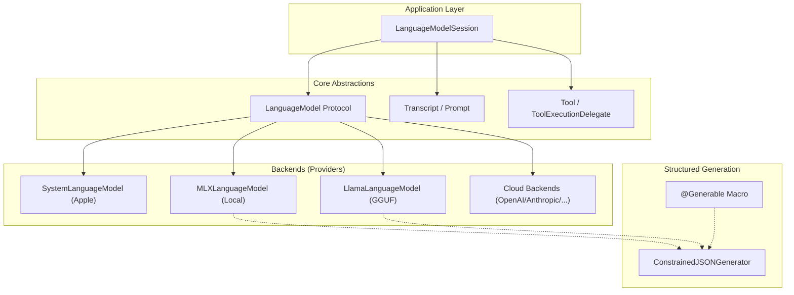

<!-- source: DeepWiki mcp.deepwiki.com · repo huggingface/AnyLanguageModel · page 1 AnyLanguageModel Overview · fetched 2026-10-26 -->

# AnyLanguageModel Overview

Relevant source files

The following files were used as context for generating this wiki page:

- [Package.resolved](Package.resolved)
- [Package.swift](Package.swift)
- [README.md](README.md)

`AnyLanguageModel` is a Swift package designed as a drop-in replacement for [Apple's Foundation Models framework](https://developer.apple.com/documentation/FoundationModels). It extends the native developer experience to a wide array of local and remote Large Language Model (LLM) providers, allowing developers to switch between Apple Intelligence, local inference engines (MLX, llama.cpp, Core ML), and cloud APIs (OpenAI, Anthropic, Gemini) by changing a single import statement [README.md:1-11]().

## Design Philosophy

The library follows a "protocol-first" architecture where all backends conform to a unified `LanguageModel` interface. This allows the `LanguageModelSession` to manage conversation state, tool execution, and structured generation regardless of the underlying model's implementation [README.md:29-36]().

### Drop-in Parity
The API is designed to match `FoundationModels` exactly where possible. For example, the `respond` and `streamResponse` methods on `LanguageModelSession` use the same `Transcript` and `Prompt` data structures found in Apple's framework [README.md:32-36]().

### Trait-Based Dependencies
To keep binary sizes small and build times fast, `AnyLanguageModel` utilizes Swift 6.1 traits. Heavy dependencies like `mlx-swift-lm` or `llama.swift` are only included if the user explicitly opts into the `MLX` or `Llama` traits [Package.swift:24-30]().

## System Architecture

The following diagram illustrates how the high-level Swift entities map to the internal subsystems and external providers.

### Code Entity Mapping
| Entity | Role | Source |
| :--- | :--- | :--- |
| `LanguageModel` | The central protocol all backends implement. | `Sources/AnyLanguageModel/LanguageModel.swift` |
| `LanguageModelSession` | Manages state, tools, and the request lifecycle. | `Sources/AnyLanguageModel/LanguageModelSession.swift` |
| `Transcript` | The conversation history model (Entries, Segments). | `Sources/AnyLanguageModel/Transcript.swift` |
| `Generable` | Protocol/Macro for structured JSON output. | `Sources/AnyLanguageModel/Generable.swift` |
| `Tool` | Protocol for defining executable functions for the LLM. | `Sources/AnyLanguageModel/Tool.swift` |

### Architecture Diagram

Sources: [README.md:14-66](), [Package.swift:50-88]()

## Major Subsystems

### 1. Backend Providers
`AnyLanguageModel` supports a diverse set of backends categorized by their execution environment:
*   **Native:** `SystemLanguageModel` wraps Apple's `FoundationModels.SystemLanguageModel` [README.md:72]().
*   **Local Inference:** `MLXLanguageModel`, `LlamaLanguageModel`, and `CoreMLLanguageModel` enable running models on-device via Apple Silicon, GGUF, or Core ML [README.md:73-75]().
*   **Cloud APIs:** Support for OpenAI (Chat & Responses), Anthropic, Gemini, Ollama, and the Open Responses standard [README.md:76-81]().

### 2. Structured Generation & Tooling
The library provides a robust system for ensuring LLM outputs conform to Swift types.
*   **Macros:** The `@Generable` macro automatically generates JSON schemas from Swift structs [README.md:18-22]().
*   **Constrained Generation:** For local backends (MLX/Llama), the `ConstrainedJSONGenerator` performs logit masking to force the model to follow a specific `GenerationSchema`.
*   **Tools:** Models can call Swift functions via the `Tool` protocol, with `LanguageModelSession` handling the multi-turn execution loop [README.md:14-27]().

### 3. Networking & Traits
The networking layer is abstracted via `HTTPSession`, allowing the library to use `URLSession` by default or `AsyncHTTPClient` when the `AsyncHTTPClient` trait is enabled [Package.swift:28, 82-86]().

## Child Pages Map

For detailed technical documentation on specific areas, refer to the following pages:

*   **[Getting Started & Package Configuration](#1.1)**: Detailed guide on adding the package, configuring Swift 6.1 traits, and resolving dependency graph issues [README.md:95-156]().
*   **[CI/CD & Development Workflow](#1.2)**: Information on the GitHub Actions pipeline, testing across platforms (macOS/Linux), and contribution guidelines.

Sources: [README.md:1-156](), [Package.swift:1-110]()

---

