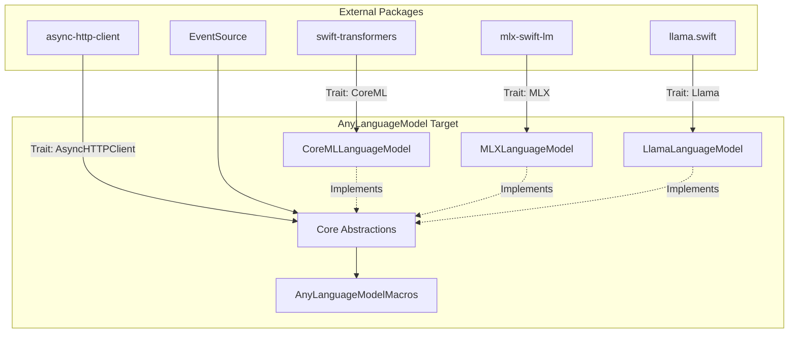
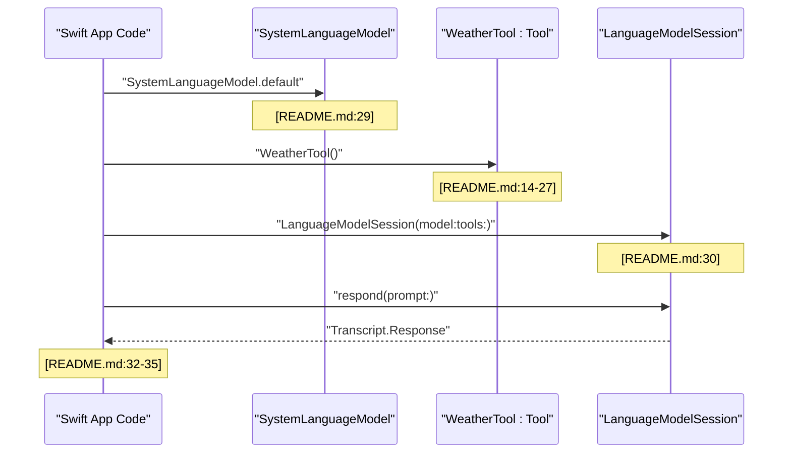

<!-- source: DeepWiki mcp.deepwiki.com · repo huggingface/AnyLanguageModel · page 1.1 Getting Started & Package Configuration · fetched 2026-10-26 -->

# Getting Started & Package Configuration

<details>
<summary>Relevant source files</summary>

The following files were used as context for generating this wiki page:

- [Package.resolved](Package.resolved)
- [Package.swift](Package.swift)
- [README.md](README.md)

</details>


AnyLanguageModel is designed as a drop-in replacement for Apple's `FoundationModels` framework, providing a unified Swift interface for local and cloud-based Large Language Models (LLMs). This page covers the initial setup, dependency management via Swift Package Manager (SwiftPM) traits, and configuration for different platforms.

## Installation

To add AnyLanguageModel to a Swift project, include it as a dependency in your `Package.swift` file.

```swift
dependencies: [
    .package(url: "https://github.com/huggingface/AnyLanguageModel", from: "0.8.0")
]
```
Sources: [README.md:97-103](), [Package.swift:7-16]()

### Requirements
- **Swift**: 6.1+ [README.md:85]()
- **Platforms**: iOS 17.0+, macOS 14.0+, visionOS 1.0+, and Linux [README.md:86](), [Package.swift:9-16]()
- **Xcode**: Xcode 16 is recommended for building projects targeting macOS 15 / iOS 18 to avoid known macro expansion bugs in newer toolchains [README.md:88-93]().

## Package Traits & Optional Dependencies

AnyLanguageModel utilizes the Swift 6.1 Trait system to manage heavy dependencies. By default, the package includes only the core abstractions and cloud-based providers to keep the binary size minimal. Support for local inference engines must be explicitly enabled via traits.

### Available Traits

| Trait | Description | Primary Dependency |
| :--- | :--- | :--- |
| `CoreML` | Enables Core ML model support | `huggingface/swift-transformers` |
| `MLX` | Enables MLX (Apple Silicon) support | `ml-explore/mlx-swift-lm` |
| `Llama` | Enables llama.cpp (GGUF) support | `mattt/llama.swift` |
| `AsyncHTTPClient` | Uses SwiftNIO-based networking instead of `URLSession` | `swift-server/async-http-client` |

Sources: [README.md:105-121](), [Package.swift:24-30]()

### Enabling Traits in Package.swift

To enable specific backends, specify the traits in your package dependency declaration:

```swift
.package(
    url: "https://github.com/huggingface/AnyLanguageModel.git",
    from: "0.8.0",
    traits: ["MLX", "CoreML"] 
)
```
Sources: [README.md:124-133]()

### Dependency Resolution Workaround
Due to an upstream SwiftPM issue (exhausted attempts to resolve the dependency graph), it is often necessary to explicitly add the underlying repositories of the enabled traits to your own `Package.swift` [README.md:135-156]().

## Dependency Graph & Implementation

The package is structured into two primary targets: `AnyLanguageModel` (the main library) and `AnyLanguageModelMacros` (providing `@Generable` and `@Guide` functionality) [Package.swift:49-97]().

### Dependency Flow Diagram

This diagram illustrates how traits pull in external codebases to satisfy specific `LanguageModel` implementations.

"Dependency Graph & Trait Mapping"

Sources: [Package.swift:49-109](), [README.md:105-121]()

## Usage in Xcode Projects

Xcode (as of version 16) does not natively support selecting traits for package dependencies through the GUI. To use AnyLanguageModel with specific traits in an app project, use a **Shim Package** approach:

1. Create a local Swift package (e.g., `MyAppKit`).
2. Add `AnyLanguageModel` as a dependency in that local package's `Package.swift` with the required `traits`.
3. In the local package's source, use `@_exported import AnyLanguageModel` to make the library available to your main app.
4. Add the local package to your Xcode project.

Sources: [README.md:158-220]()

## Quick Start Configuration

Once configured, initializing a model and session follows a standard pattern regardless of the backend.

### Code-to-System Mapping

This diagram maps the high-level configuration concepts to the specific classes used during initialization.

"Initialization Sequence & Entity Mapping"

Sources: [README.md:13-36]()

### Basic Implementation Example
```swift
import AnyLanguageModel

// 1. Choose a backend (requires appropriate trait if not System)
let model = SystemLanguageModel.default 

// 2. Initialize a session with optional tools
let session = LanguageModelSession(model: model, tools: [])

// 3. Generate a response
let response = try await session.respond {
    Prompt("Hello, world!")
}
```
Sources: [README.md:29-35]()

---

