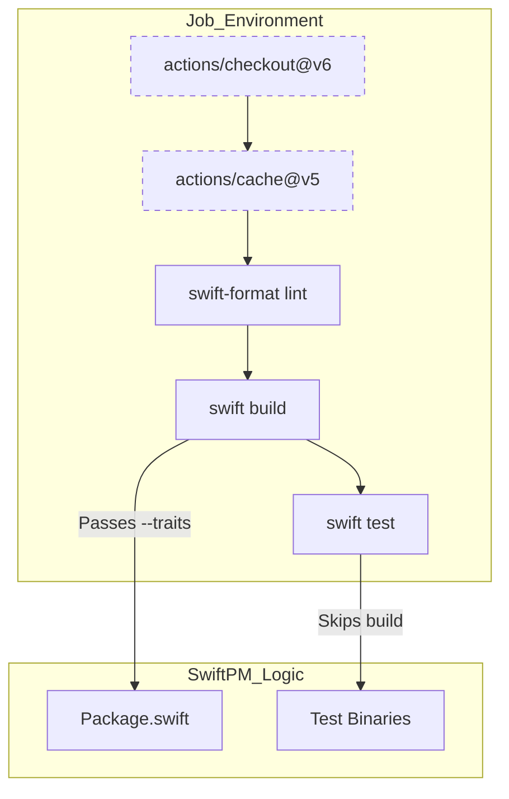

<!-- source: DeepWiki mcp.deepwiki.com · repo huggingface/AnyLanguageModel · page 1.2 CI/CD & Development Workflow · fetched 2026-10-26 -->

# CI/CD & Development Workflow

<details>
<summary>Relevant source files</summary>

The following files were used as context for generating this wiki page:

- [.github/workflows/ci.yml](.github/workflows/ci.yml)
- [Package.swift](Package.swift)
- [Tests/AnyLanguageModelTests/InstructionsTests.swift](Tests/AnyLanguageModelTests/InstructionsTests.swift)

</details>


This page details the automated pipelines and development practices used to maintain `AnyLanguageModel`. The project utilizes GitHub Actions to ensure cross-platform compatibility across macOS and Linux, supporting multiple Swift toolchain versions and a modular trait-based build system.

## CI Pipeline Overview

The Continuous Integration (CI) suite is defined in `.github/workflows/ci.yml`. It triggers on every push or pull request to the `main` branch [ .github/workflows/ci.yml:3-7 ](). The pipeline is split into two primary jobs: `test-macos` and `test-linux`.

### Matrix Strategy and Environments

The CI utilizes a matrix strategy to verify the codebase against different operating systems, Swift versions, and feature sets (traits).

| Platform | Swift Version | Xcode Version | Traits Tested |
| :--- | :--- | :--- | :--- |
| macOS 15 | 6.1 | 16.3 | Default, `AsyncHTTPClient` |
| macOS 15 | 6.2 | 26.0 | Default, `AsyncHTTPClient` |
| Linux (Ubuntu) | 6.1.3 | N/A | Default |
| Linux (Ubuntu) | 6.2.4 | N/A | Default, `AsyncHTTPClient` |

**Sources:** [ .github/workflows/ci.yml:14-38 ](), [ .github/workflows/ci.yml:63-81 ]()

### Workflow Execution Flow

The following diagram illustrates the lifecycle of a single CI job run, from checkout to testing.

**CI Job Lifecycle**

**Sources:** [ .github/workflows/ci.yml:41-61 ]()

---

## Build Configuration & Traits

`AnyLanguageModel` uses Swift Package Manager (SwiftPM) traits to manage optional dependencies and backend-specific code. This allows the core library to remain lightweight while supporting heavy dependencies like MLX or Llama.cpp only when requested.

### Trait Combinations in CI

The CI pipeline explicitly enables backend traits during the build and test phases to ensure that conditional compilation blocks (e.g., `#if hasTrait(MLX)`) are correctly exercised.

*   **macOS Builds:** Run with `--traits MLX,Llama,CoreML` plus an optional `AsyncHTTPClient` trait [ .github/workflows/ci.yml:58-61 ]().
*   **Linux Builds:** Run primarily with the `AsyncHTTPClient` trait, as Apple-specific backends like `CoreML` and `MLX` are platform-restricted [ .github/workflows/ci.yml:101-104 ]().

### Dependency Caching

To optimize CI duration, the workflow caches the `.build` directory and the SwiftPM cache [ .github/workflows/ci.yml:47-50 ](). The cache key is derived from the runner OS, Swift version, trait status, and a hash of `Package.swift` and `Package.resolved` [ .github/workflows/ci.yml:50 ]().

**Sources:** [ Package.swift:24-30 ](), [ .github/workflows/ci.yml:44-53 ]()

---

## Code Quality & Linting

Before building, the CI enforces code style using `swift-format`.

*   **Command:** `swift format lint --strict --recursive .` [ .github/workflows/ci.yml:55 ]().
*   **Strict Mode:** The `--strict` flag ensures that linting warnings are treated as errors, failing the build if the style guide is not followed.

---

## Testing Infrastructure

Tests are executed using the Swift Testing framework. The CI separates the build and test steps using the `--skip-build` flag in the test phase to avoid redundant compilation [ .github/workflows/ci.yml:61 ]().

### Test Suite Organization

The project includes unit tests for core logic and integration tests for specific backends. For example, `InstructionsTests` verifies the `Instructions` builder logic:

*   `initializesFromStringRepresentable()`: Validates basic string initialization [ Tests/AnyLanguageModelTests/InstructionsTests.swift:7-10 ]().
*   `builderCombinesLines()`: Validates that the `@InstructionsBuilder` correctly joins lines with newlines [ Tests/AnyLanguageModelTests/InstructionsTests.swift:18-25 ]().
*   `builderSupportsConditionalsAndOptionals()`: Ensures logic inside the builder (if/else) functions correctly [ Tests/AnyLanguageModelTests/InstructionsTests.swift:27-44 ]().

### Trait-Based Testing Logic

The following diagram bridges the "Natural Language" requirements of a developer to the "Code Entity" execution path within the CI.

**Developer Workflow to Code Execution**
```mermaid
graph LR
    subgraph "Developer_Intent"
        "Add_MLX_Support" --> "Edit_Package.swift"
        "Run_Local_Tests" --> "CLI_Command"
    end

    subgraph "Code_Entity_Space"
        "CLI_Command" -- "swift test --traits MLX" --> "Package.swift"
        "Package.swift" -- "condition: .when(traits: ['MLX'])" --> "MLXLLM_Product"
        "MLXLLM_Product" --> "AnyLanguageModel_Target"
        "AnyLanguageModel_Target" --> "MLXLanguageModel.swift"
    end
```
**Sources:** [ Package.swift:58-61 ](), [ Package.swift:26 ]()

---

## Contribution Workflow

To contribute to `AnyLanguageModel`, follow these steps:

1.  **Fork and Clone:** Create a local copy of the repository.
2.  **Select Traits:** Depending on the backend you are modifying, enable the relevant traits in your environment.
    *   Example: `swift build --traits MLX`
3.  **Implement Changes:** Ensure new logic is covered by unit tests in `Tests/AnyLanguageModelTests/`.
4.  **Format Code:** Run `swift format --in-place --recursive .` before committing.
5.  **Verify Locally:** Run the test suite for both default and trait-enabled configurations.
    *   `swift test`
    *   `swift test --traits AsyncHTTPClient`
6.  **Submit PR:** Ensure the GitHub Actions CI passes for all matrix combinations.

### Known Limitations in CI
*   **Linux Swift 6.1:** `AsyncHTTPClient` is currently disabled on Linux for Swift 6.1 due to an upstream toolchain linker failure related to `libswiftObservation.so` [ .github/workflows/ci.yml:73-77 ](). Coverage for this trait is maintained on Swift 6.2+.

**Sources:** [ .github/workflows/ci.yml:73-81 ](), [ Package.swift:102-106 ]()

---

