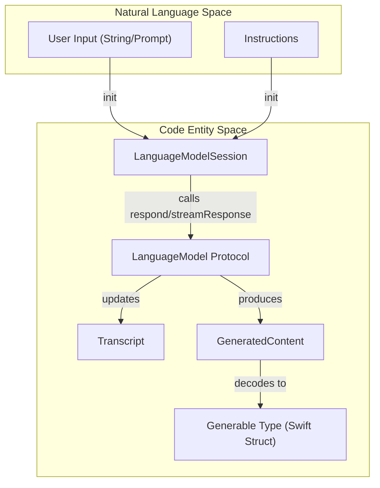
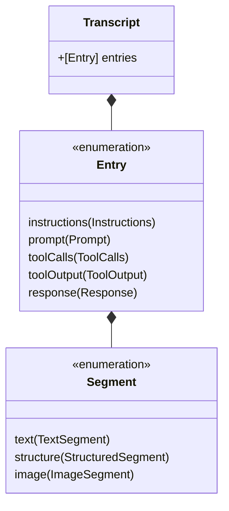

<!-- source: DeepWiki mcp.deepwiki.com · repo huggingface/AnyLanguageModel · page 2 Core Architecture · fetched 2026-10-26 -->

# Core Architecture

Relevant source files

The following files were used as context for generating this wiki page:

- [Sources/AnyLanguageModel/GeneratedContent.swift](Sources/AnyLanguageModel/GeneratedContent.swift)
- [Sources/AnyLanguageModel/GenerationID.swift](Sources/AnyLanguageModel/GenerationID.swift)
- [Sources/AnyLanguageModel/GenerationOptions.swift](Sources/AnyLanguageModel/GenerationOptions.swift)
- [Sources/AnyLanguageModel/LanguageModel.swift](Sources/AnyLanguageModel/LanguageModel.swift)
- [Sources/AnyLanguageModel/LanguageModelSession.swift](Sources/AnyLanguageModel/LanguageModelSession.swift)
- [Sources/AnyLanguageModel/Transcript.swift](Sources/AnyLanguageModel/Transcript.swift)

The AnyLanguageModel framework is built around a set of core abstractions that provide a unified interface for interacting with diverse language model backends—ranging from local Apple Silicon inference (MLX) to cloud APIs (OpenAI, Anthropic). 

The architecture is designed for "drop-in" parity with Apple's Foundation Models framework while extending capabilities for cross-platform support and structured generation.

### System Overview

The following diagram illustrates how the high-level system components interact during a typical generation lifecycle.

**Request & Response Lifecycle**

Sources: [Sources/AnyLanguageModel/LanguageModelSession.swift:32-62](), [Sources/AnyLanguageModel/LanguageModel.swift:20-34]()

---

### LanguageModel Protocol

The `LanguageModel` protocol is the central interface that every backend must implement. It abstracts the complexities of different providers into a standard set of methods for generating responses, handling streaming, and reporting availability.

*   **Availability**: Models use the `availability` property to signal if they are ready for use (e.g., checking if an API key is present or if the hardware supports local inference).
*   **Generation**: The protocol defines `respond` for one-shot completion and `streamResponse` for incremental updates.
*   **Customization**: Each model can define an `associatedtype CustomGenerationOptions` to expose provider-specific features (like OpenAI's `reasoning_effort`) without breaking the common interface.

For details, see [LanguageModel Protocol & Availability](#2.1).

Sources: [Sources/AnyLanguageModel/LanguageModel.swift:3-42]()

---

### LanguageModelSession

The `LanguageModelSession` is the primary object developers interact with. It maintains the state of a conversation, manages the `Transcript`, and coordinates with a specific `LanguageModel` implementation.

*   **State Management**: It tracks `isResponding` using the `@Observable` macro, making it easy to bind UI loading states in SwiftUI.
*   **Thread Safety**: Internal state is protected by a `Locked<State>` primitive to ensure concurrency safety across asynchronous calls.
*   **Tool Orchestration**: It holds a collection of `tools` and an optional `toolExecutionDelegate` to manage multi-turn tool-calling loops.

For details, see [LanguageModelSession](#2.2).

Sources: [Sources/AnyLanguageModel/LanguageModelSession.swift:4-31](), [Sources/AnyLanguageModel/LanguageModelSession.swift:104-126]()

---

### Transcript & Data Model

The `Transcript` serves as the "source of truth" for the conversation history. It is a collection of `Entry` objects that represent the different turns in a dialogue.

**Data Model Mapping**

*   **Entries**: Represent logical turns, such as a user `prompt` or a model `response`.
*   **Segments**: Entries are composed of segments, allowing for multimodal content (text, images, or structured data) within a single message.
*   **GeneratedContent**: A type-safe intermediate representation used to bridge raw model output to Swift types.

For details, see [Transcript & Prompt Data Model](#2.3).

Sources: [Sources/AnyLanguageModel/Transcript.swift:4-81](), [Sources/AnyLanguageModel/GeneratedContent.swift:7-34]()

---

### Generation Options

Generation behavior is controlled via the `GenerationOptions` struct. This allows developers to tune the "creativity" and constraints of the model in a provider-agnostic way.

| Option | Role |
| :--- | :--- |
| `SamplingMode` | Determines if the model uses `greedy`, `topK`, or `nucleus` (top-p) sampling. |
| `Temperature` | Adjusts the probability distribution (0.0 to 1.0) to influence confidence. |
| `MaxTokens` | Prevents runaway generations by setting a hard limit on output length. |
| `CustomOptions` | A type-safe mechanism to pass backend-specific parameters using a model-type subscript. |

For details, see [GenerationOptions & Custom Options](#2.4).

Sources: [Sources/AnyLanguageModel/GenerationOptions.swift:10-123](), [Sources/AnyLanguageModel/GenerationOptions.swift:141-150]()

---

