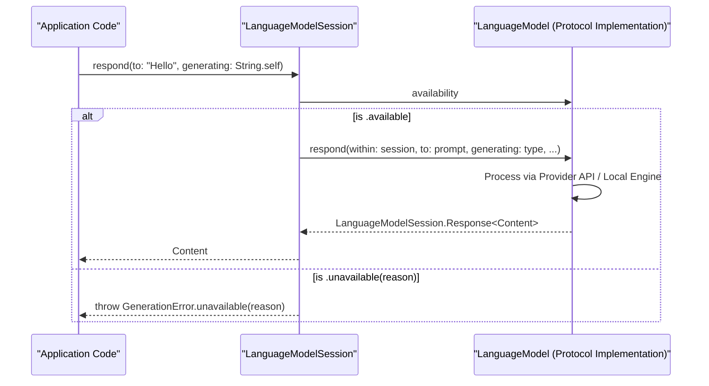
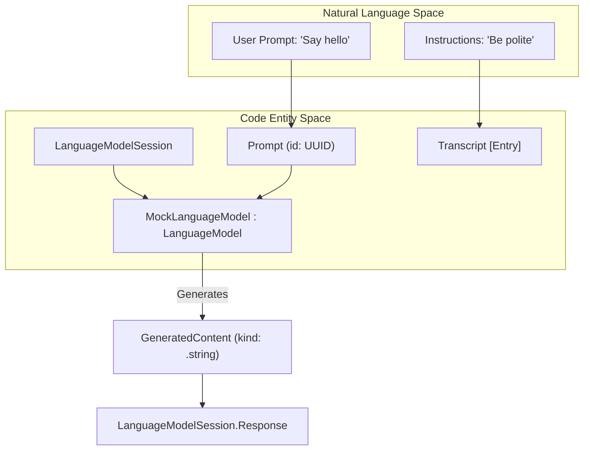

<!-- source: DeepWiki mcp.deepwiki.com · repo huggingface/AnyLanguageModel · page 2.1 LanguageModel Protocol & Availability · fetched 2026-10-26 -->

# LanguageModel Protocol & Availability

<details>
<summary>Relevant source files</summary>

The following files were used as context for generating this wiki page:

- [Sources/AnyLanguageModel/Availability.swift](Sources/AnyLanguageModel/Availability.swift)
- [Sources/AnyLanguageModel/GeneratedContent.swift](Sources/AnyLanguageModel/GeneratedContent.swift)
- [Sources/AnyLanguageModel/GenerationID.swift](Sources/AnyLanguageModel/GenerationID.swift)
- [Sources/AnyLanguageModel/GenerationOptions.swift](Sources/AnyLanguageModel/GenerationOptions.swift)
- [Sources/AnyLanguageModel/LanguageModel.swift](Sources/AnyLanguageModel/LanguageModel.swift)
- [Sources/AnyLanguageModel/Transcript.swift](Sources/AnyLanguageModel/Transcript.swift)
- [Tests/AnyLanguageModelTests/MockLanguageModelTests.swift](Tests/AnyLanguageModelTests/MockLanguageModelTests.swift)
- [Tests/AnyLanguageModelTests/Shared/MockLanguageModel.swift](Tests/AnyLanguageModelTests/Shared/MockLanguageModel.swift)

</details>


The `LanguageModel` protocol is the central abstraction of the `AnyLanguageModel` library. It defines a unified interface for interacting with diverse LLM backends—ranging from local Apple Silicon inference (MLX, Core ML) to remote cloud APIs (OpenAI, Anthropic). This page details the protocol's requirements, the availability system, and how backends provide custom generation options.

## The LanguageModel Protocol

The `LanguageModel` protocol ensures that any backend can be swapped into a `LanguageModelSession` without changing the application-level code. It handles both single-turn responses and streaming, while managing model-specific lifecycle events like prewarming and feedback logging.

### Key Requirements

| Requirement | Description |
| :--- | :--- |
| `UnavailableReason` | An associated type defining why a model might be offline (e.g., missing API keys, unsupported hardware). |
| `CustomGenerationOptions` | An associated type for provider-specific settings (e.g., OpenAI's `reasoning_effort`). Defaults to `Never`. |
| `availability` | A property returning the current `Availability<UnavailableReason>` status. |
| `respond(...)` | Generates a complete response for a given prompt and type. |
| `streamResponse(...)` | Returns a `ResponseStream` that yields partial updates as they are generated. |
| `prewarm(...)` | Optional hook to load weights or initialize buffers before the first request. |
| `logFeedbackAttachment(...)` | Generates a `Data` payload containing debug info for a specific generation. |

### Protocol Definition
[Sources/AnyLanguageModel/LanguageModel.swift:3-42]()

### Default Implementations
The protocol provides convenience properties and default no-op implementations:
*   **`isAvailable`**: A boolean convenience that checks if `availability` is `.available`. [Sources/AnyLanguageModel/LanguageModel.swift:47-53]()
*   **`prewarm`**: Defaults to a no-op. [Sources/AnyLanguageModel/LanguageModel.swift:55-60]()
*   **`logFeedbackAttachment`**: Defaults to returning empty `Data`. [Sources/AnyLanguageModel/LanguageModel.swift:62-69]()

**Sources:** [Sources/AnyLanguageModel/LanguageModel.swift:3-77]()

---

## Availability & UnavailableReason

The `Availability` enum represents the readiness of a backend. Unlike a simple boolean, it uses an associated type `UnavailableReason` to provide diagnostic information when a model cannot be used.

### Availability Enum
[Sources/AnyLanguageModel/Availability.swift:2-8]()
```swift
public enum Availability<UnavailableReason> {
    case available
    case unavailable(UnavailableReason)
}
```

### Implementing UnavailableReason
Backends define their own reasons for being unavailable. For example, a mock model might use a custom string:
[Tests/AnyLanguageModel/Shared/MockLanguageModel.swift:4-6]()

If a model is always available (common for Cloud APIs where availability is checked at request time), the `UnavailableReason` can be set to `Never`. The protocol provides a default implementation for this case. [Sources/AnyLanguageModel/LanguageModel.swift:72-76]()

**Sources:** [Sources/AnyLanguageModel/Availability.swift:1-13](), [Sources/AnyLanguageModel/LanguageModel.swift:46-53](), [Tests/AnyLanguageModel/Shared/MockLanguageModel.swift:4-6]()

---

## Custom Generation Options

While `GenerationOptions` provides common settings like `temperature` and `maximumResponseTokens`, many providers offer unique features. The `LanguageModel` protocol uses an associated type and a type-safe subscript to support these without breaking the core abstraction.

### CustomGenerationOptions Protocol
Backends define a type conforming to `CustomGenerationOptions` (which inherits from `Sendable`, `Equatable`, and `Codable`). 

### Usage in GenerationOptions
Users can set these options using the model type as a key:
[Sources/AnyLanguageModel/GenerationOptions.swift:127-150]()
```swift
var options = GenerationOptions(temperature: 0.7)
options[custom: OpenAILanguageModel.self] = .init(
    reasoningEffort: .high
)
```

**Sources:** [Sources/AnyLanguageModel/LanguageModel.swift:6-11](), [Sources/AnyLanguageModel/GenerationOptions.swift:127-150]()

---

## Data Flow: Request Lifecycle

The following diagram illustrates how the `LanguageModel` protocol bridges the high-level `LanguageModelSession` requests to specific backend implementations.

### Request Execution Flow
"Natural Language Space" (Prompt/Instructions) is transformed into "Code Entity Space" (Transcript/GeneratedContent) via the backend's implementation of the protocol.


**Sources:** [Sources/AnyLanguageModel/LanguageModel.swift:20-34](), [Tests/AnyLanguageModel/Shared/MockLanguageModel.swift:24-44]()

---

## Backend Implementation Example

The `MockLanguageModel` demonstrates how a backend implements the protocol. It stores a `responseProvider` closure to simulate model behavior during testing.

### Mock Implementation Logic
[Tests/AnyLanguageModel/Shared/MockLanguageModel.swift:24-44]()



### Response vs. StreamResponse
*   **`respond`**: Returns a single `LanguageModelSession.Response` containing the final `Content` and `Transcript.Entry` objects. [Sources/AnyLanguageModel/LanguageModel.swift:20-26]()
*   **`streamResponse`**: Returns a `ResponseStream`, yielding `Snapshot` objects. Snapshots contain `PartiallyGenerated` content, allowing UI updates before the full response is ready. [Sources/AnyLanguageModel/LanguageModel.swift:28-34]()

**Sources:** [Tests/AnyLanguageModel/Shared/MockLanguageModel.swift:3-80](), [Sources/AnyLanguageModel/LanguageModel.swift:20-34]()

---

