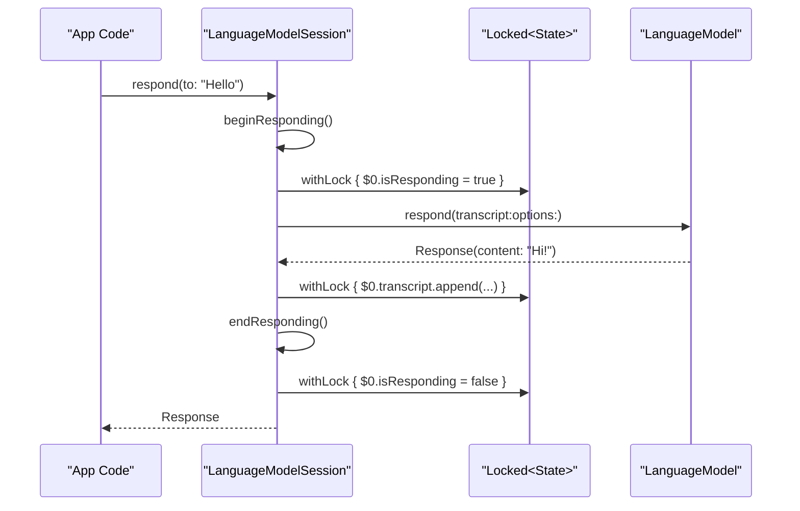
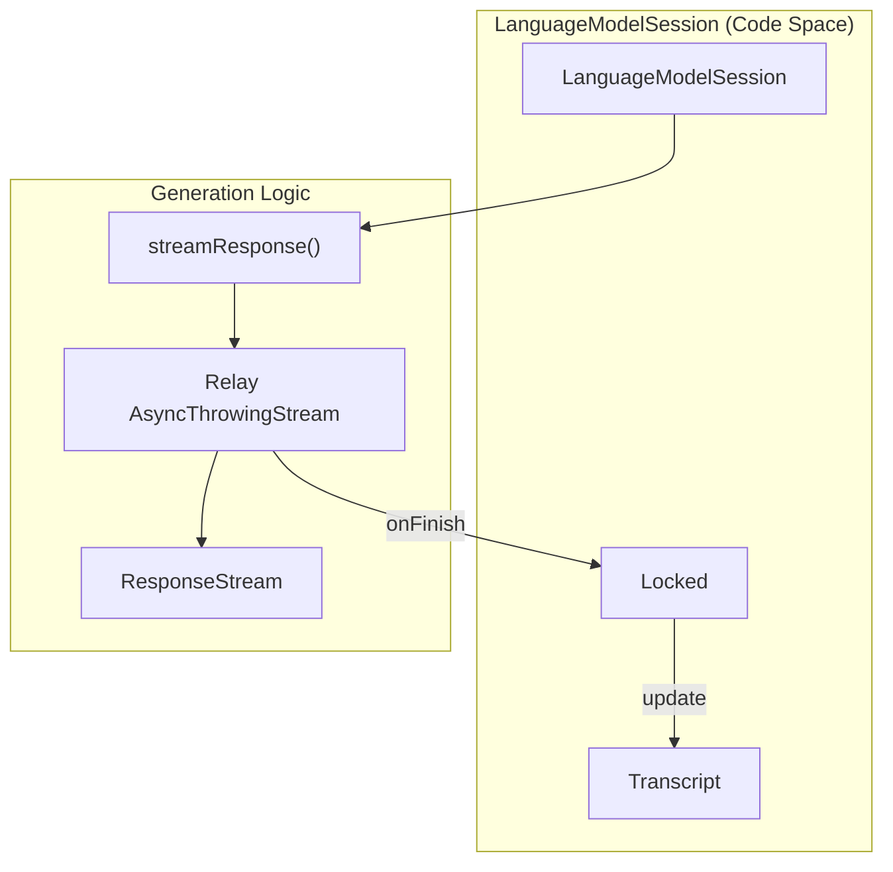

<!-- source: DeepWiki mcp.deepwiki.com · repo huggingface/AnyLanguageModel · page 2.2 LanguageModelSession · fetched 2026-10-26 -->

# LanguageModelSession

Relevant source files

The following files were used as context for generating this wiki page:

- [Sources/AnyLanguageModel/LanguageModelSession.swift](Sources/AnyLanguageModel/LanguageModelSession.swift)
- [Sources/AnyLanguageModel/Shared/Locked.swift](Sources/AnyLanguageModel/Shared/Locked.swift)
- [Sources/AnyLanguageModel/Shared/StructuredGeneration.swift](Sources/AnyLanguageModel/Shared/StructuredGeneration.swift)
- [Tests/AnyLanguageModelTests/APICompatibilityAnyLanguageModelTests.swift](Tests/AnyLanguageModelTests/APICompatibilityAnyLanguageModelTests.swift)
- [Tests/AnyLanguageModelTests/APICompatibilityFoundationModelsTests.swift](Tests/AnyLanguageModelTests/APICompatibilityFoundationModelsTests.swift)
- [Tests/AnyLanguageModelTests/LockedTests.swift](Tests/AnyLanguageModelTests/LockedTests.swift)
- [Tests/AnyLanguageModelTests/ObservationTests.swift](Tests/AnyLanguageModelTests/ObservationTests.swift)

`LanguageModelSession` is the primary interface for interacting with a `LanguageModel`. It manages the conversation state through a `Transcript`, handles the lifecycle of generation requests (both one-off and streaming), and provides observable state for UI integration.

## Overview and Initialization

A session acts as a stateful wrapper around a stateless or context-clearing `LanguageModel` implementation. It maintains a `Transcript` of the conversation and can be configured with system instructions and available tools.

### Initialization Patterns

The session provides several initializers to accommodate different starting points:
- **With Instructions**: Accepts a `String` or an `@InstructionsBuilder` closure to set the system persona [Sources/AnyLanguageModel/LanguageModelSession.swift:32-54]().
- **With Tools**: Accepts an array of `any Tool` objects. If a tool's `includesSchemaInInstructions` property is true, its definition is automatically injected into the transcript's initial instructions entry [Sources/AnyLanguageModel/LanguageModelSession.swift:88-91]().
- **From Existing Transcript**: Allows resuming a previous session by passing a `Transcript` object [Sources/AnyLanguageModel/LanguageModelSession.swift:56-62]().

### Prewarming
The `prewarm(promptPrefix:)` method allows backends to prepare resources (like loading weights into GPU memory or initializing a KV cache) before a formal request is made [Sources/AnyLanguageModel/LanguageModelSession.swift:100-102]().

## Concurrency and State Management

`LanguageModelSession` is marked as `@Observable` and uses a custom concurrency primitive, `Locked<State>`, to ensure thread safety while allowing the UI to react to state changes.

### The Locked<State> Primitive
`Locked<T>` is a synchronization wrapper around `NSLock`. It provides a `withLock` method to safely read or mutate the internal state [Sources/AnyLanguageModel/Shared/Locked.swift:4-22]().

### Observable Properties
The session exposes two main observable properties:
1.  **`isResponding`**: A `Bool` indicating if the model is currently generating content [Sources/AnyLanguageModel/LanguageModelSession.swift:6-9]().
2.  **`transcript`**: The history of the conversation, including instructions, prompts, and responses [Sources/AnyLanguageModel/LanguageModelSession.swift:11-14]().

### State Transition Lifecycle
The following diagram illustrates how the session manages internal state during a generation request.

**Session Request Lifecycle**

Sources: [Sources/AnyLanguageModel/LanguageModelSession.swift:104-126](), [Sources/AnyLanguageModel/Shared/Locked.swift:19-21]()

## Generation Lifecycle

The session provides two primary methods for generating content: `respond` and `streamResponse`.

### The `respond` Lifecycle
When `respond` is called, the session:
1.  Appends the user's `Prompt` to the transcript [Sources/AnyLanguageModel/LanguageModelSession.swift:203-207]().
2.  Sets `isResponding` to `true` [Sources/AnyLanguageModel/LanguageModelSession.swift:117]().
3.  Calls the underlying `LanguageModel.respond` method [Sources/AnyLanguageModel/LanguageModelSession.swift:209]().
4.  Appends the resulting `Response` to the transcript [Sources/AnyLanguageModel/LanguageModelSession.swift:214-221]().
5.  Sets `isResponding` to `false` [Sources/AnyLanguageModel/LanguageModelSession.swift:120]().

### The `streamResponse` Lifecycle
Streaming utilizes the `ResponseStream<Content>` type, which wraps an `AsyncThrowingStream`.
- **Relay Mechanism**: The session creates a "relay" stream. It yields snapshots to the caller as they arrive from the backend [Sources/AnyLanguageModel/LanguageModelSession.swift:133-143]().
- **Finalization**: Only after the stream completes (finishes or throws) does the session append the final accumulated response to the transcript [Sources/AnyLanguageModel/LanguageModelSession.swift:146-164]().

**Response Data Flow**

Sources: [Sources/AnyLanguageModel/LanguageModelSession.swift:128-172](), [Sources/AnyLanguageModel/Shared/Locked.swift:4-11]()

## Error Handling

The session propagates errors from the underlying `LanguageModel`. Common error types include:

| Error Type | Description |
| :--- | :--- |
| `GenerationError` | General failures in the model's ability to produce text (e.g., context overflow, hardware failure). |
| `Refusal` | When a model's safety filters prevent it from answering a specific prompt. |
| `ConstrainedGenerationError` | Thrown by the `ConstrainedJSONGenerator` if the model fails to adhere to a schema [Sources/AnyLanguageModel/Shared/StructuredGeneration.swift:126-131](). |

In all cases, the `wrapRespond` and `wrapStream` helpers ensure that `endResponding()` is called even if an error occurs, preventing the session from being stuck in a "responding" state [Sources/AnyLanguageModel/LanguageModelSession.swift:122-124]().

## Tool Execution Integration

`LanguageModelSession` supports multi-turn tool calling. If a `toolExecutionDelegate` is provided, the session yields control to the delegate to decide whether to execute generated tool calls or provide custom output [Sources/AnyLanguageModel/LanguageModelSession.swift:22-30]().

- **Compatibility Note**: Setting a `toolExecutionDelegate` breaks drop-in parity with Apple's `FoundationModels` framework, as this is an extension specific to `AnyLanguageModel` [Sources/AnyLanguageModel/LanguageModelSession.swift:27-29]().

Sources:
- [Sources/AnyLanguageModel/LanguageModelSession.swift:1-221]()
- [Sources/AnyLanguageModel/Shared/Locked.swift:1-25]()
- [Sources/AnyLanguageModel/Shared/StructuredGeneration.swift:123-140]()
- [Tests/AnyLanguageModelTests/ObservationTests.swift:1-96]()

---

