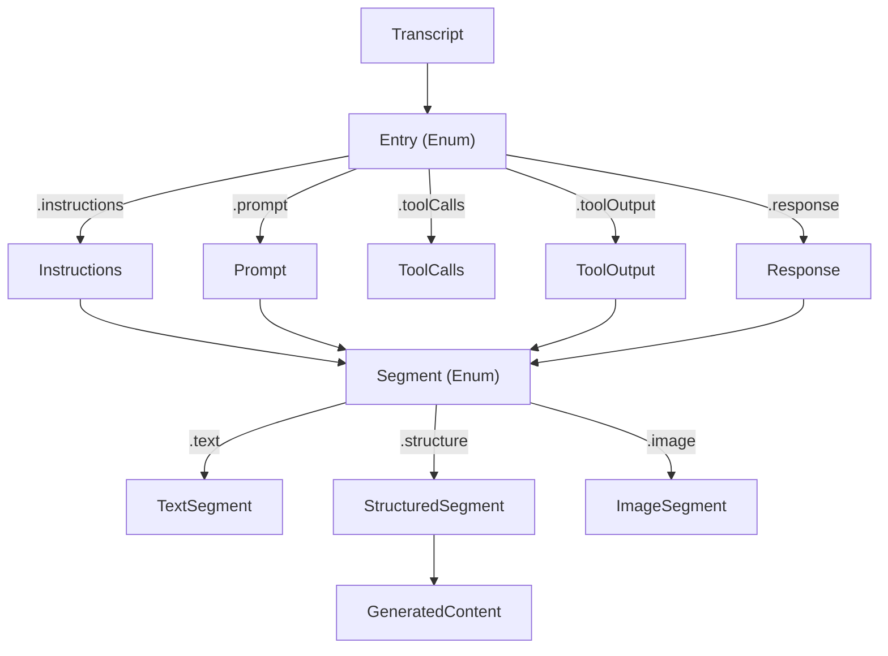
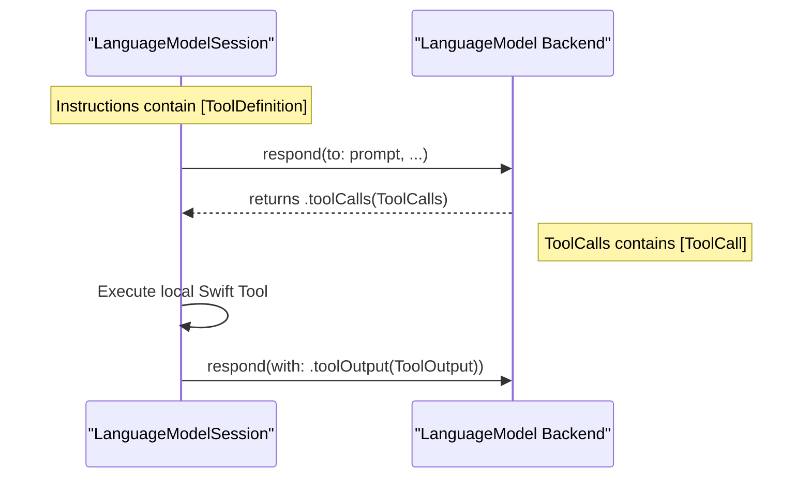

<!-- source: DeepWiki mcp.deepwiki.com · repo huggingface/AnyLanguageModel · page 2.3 Transcript & Prompt Data Model · fetched 2026-10-26 -->

# Transcript & Prompt Data Model

<details>
<summary>Relevant source files</summary>

The following files were used as context for generating this wiki page:

- [Sources/AnyLanguageModel/GeneratedContent.swift](Sources/AnyLanguageModel/GeneratedContent.swift)
- [Sources/AnyLanguageModel/GenerationID.swift](Sources/AnyLanguageModel/GenerationID.swift)
- [Sources/AnyLanguageModel/GenerationOptions.swift](Sources/AnyLanguageModel/GenerationOptions.swift)
- [Sources/AnyLanguageModel/Instructions.swift](Sources/AnyLanguageModel/Instructions.swift)
- [Sources/AnyLanguageModel/LanguageModel.swift](Sources/AnyLanguageModel/LanguageModel.swift)
- [Sources/AnyLanguageModel/Prompt.swift](Sources/AnyLanguageModel/Prompt.swift)
- [Sources/AnyLanguageModel/Transcript.swift](Sources/AnyLanguageModel/Transcript.swift)
- [Tests/AnyLanguageModelTests/PromptTests.swift](Tests/AnyLanguageModelTests/PromptTests.swift)
- [Tests/AnyLanguageModelTests/TranscriptTests.swift](Tests/AnyLanguageModelTests/TranscriptTests.swift)

</details>


This page documents the data structures used to represent conversation history, user inputs, and model outputs within `AnyLanguageModel`. The core of this system is the `Transcript`, which acts as a type-safe, multi-modal container for the entire lifecycle of a language model session.

## Overview of the Data Hierarchy

The data model is designed to bridge high-level natural language concepts with structured code entities. At the top level, a `Transcript` contains a sequence of `Entry` objects, each representing a specific turn or action in the conversation.

### Natural Language to Code Entity Mapping

The following diagram illustrates how conceptual conversation components map to specific Swift types in the `AnyLanguageModel` framework.

| Natural Language Concept | Code Entity (Swift Type) | File Path |
| :--- | :--- | :--- |
| System Role / Instructions | `Transcript.Instructions` | [Sources/AnyLanguageModel/Transcript.swift:234-236]() |
| User Input | `Transcript.Prompt` | [Sources/AnyLanguageModel/Transcript.swift:257-259]() |
| Assistant Message | `Transcript.Response` | [Sources/AnyLanguageModel/Transcript.swift:370-372]() |
| Function Execution Request | `Transcript.ToolCalls` | [Sources/AnyLanguageModel/Transcript.swift:302-304]() |
| Function Result | `Transcript.ToolOutput` | [Sources/AnyLanguageModel/Transcript.swift:336-338]() |

### Data Flow Diagram

This diagram shows how different entities are nested within the `Transcript` structure.

"Transcript Data Hierarchy"

Sources: [Sources/AnyLanguageModel/Transcript.swift:4-81]()

---

## The Transcript and Entry Types

The `Transcript` is a `Codable` and `Sendable` struct that maintains an ordered collection of `Entry` enums [Sources/AnyLanguageModel/Transcript.swift:4-26]().

### Entry Variants
- **`instructions`**: Developer-provided guidance defining model behavior [Sources/AnyLanguageModel/Transcript.swift:28]().
- **`prompt`**: Sourced from the end user [Sources/AnyLanguageModel/Transcript.swift:31]().
- **`toolCalls`**: Generated by the model when it needs to invoke external functions [Sources/AnyLanguageModel/Transcript.swift:34]().
- **`toolOutput`**: The result of a tool execution sent back to the model [Sources/AnyLanguageModel/Transcript.swift:37]().
- **`response`**: The final textual or structured output from the model [Sources/AnyLanguageModel/Transcript.swift:40]().

Each entry has a stable `id` property that routes to the underlying ID of its associated value [Sources/AnyLanguageModel/Transcript.swift:43-57]().

---

## Multi-modal Segments

`AnyLanguageModel` supports multi-modal interactions through the `Segment` type. Instead of simple strings, entries like `Prompt` and `Response` contain arrays of segments [Sources/AnyLanguageModel/Transcript.swift:60-69]().

### Segment Types
| Type | Purpose | Key Properties |
| :--- | :--- | :--- |
| `TextSegment` | Raw text content | `content: String` |
| `StructuredSegment` | JSON-like data | `content: GeneratedContent`, `source: String` |
| `ImageSegment` | Visual data | `source: ImageSegment.Source` |

### ImageSegment Implementation
`ImageSegment` handles images via two sources: raw `Data` (with a MIME type) or a `URL` [Sources/AnyLanguageModel/Transcript.swift:127-132](). 

On Apple platforms, `ImageSegment` provides convenience initializers for system types:
- **UIKit**: `init(id:image:compressionQuality:)` [Sources/AnyLanguageModel/Transcript.swift:195-197]()
- **AppKit**: `init(id:image:compressionFactor:)` [Sources/AnyLanguageModel/Transcript.swift:214-216]()
- **CoreGraphics**: `init(id:cgImage:mimeType:metadata:)` [Sources/AnyLanguageModel/Transcript.swift:227-229]()

Sources: [Sources/AnyLanguageModel/Transcript.swift:84-230]()

---

## Prompt & Instructions DSL

While `Transcript` is the internal storage format, developers typically interact with `Prompt` and `Instructions` using a Result Builder DSL.

### PromptBuilder and InstructionsBuilder
These builders allow for conditional logic and clean syntax when constructing inputs:

```swift
let prompt = Prompt {
    "Answer the following:"
    if userIsPremium {
        "Provide a detailed technical analysis."
    }
    userInput
}
```

- **`Prompt`**: Represents a user message. It can be initialized from a `String`, an `Array`, or a `@PromptBuilder` closure [Sources/AnyLanguageModel/Prompt.swift:26-48]().
- **`Instructions`**: Represents the system persona. It follows the same builder pattern as `Prompt` [Sources/AnyLanguageModel/Instructions.swift:21-43]().

Sources: [Sources/AnyLanguageModel/Prompt.swift:59-94](), [Sources/AnyLanguageModel/Instructions.swift:54-91]()

---

## Tool Definitions and Calls

The transcript models the full tool-calling lifecycle through three specific types:

1.  **`ToolDefinition`**: Defines the tool's schema (name, description, parameters) for the model [Sources/AnyLanguageModel/Transcript.swift:277-285]().
2.  **`ToolCall`**: Represents a single request from the model, including a unique `id`, the `toolName`, and the `arguments` as `GeneratedContent` [Sources/AnyLanguageModel/Transcript.swift:316-324]().
3.  **`ToolOutput`**: Pairs the result of the tool execution back to the specific `id` of the `ToolCall` [Sources/AnyLanguageModel/Transcript.swift:336-348]().

"Tool Calling Lifecycle in Code"

Sources: [Sources/AnyLanguageModel/Transcript.swift:277-360](), [Sources/AnyLanguageModel/LanguageModel.swift:20-35]()

---

## GeneratedContent and ResponseFormat

### GeneratedContent
`GeneratedContent` is the framework's internal representation of structured data (JSON). It can represent strings, numbers, booleans, arrays, or complex structures [Sources/AnyLanguageModel/GeneratedContent.swift:7-34](). It is used for:
- Tool call arguments.
- Structured segments in responses.
- Partial generations during streaming.

### ResponseFormat
`ResponseFormat` tells the model how to constrain its output. It wraps a `GenerationSchema` and can be initialized directly from a `Generable` type [Sources/AnyLanguageModel/Transcript.swift:396-410]().

Sources: [Sources/AnyLanguageModel/GeneratedContent.swift:46-61](), [Sources/AnyLanguageModel/Transcript.swift:391-415]()

---

