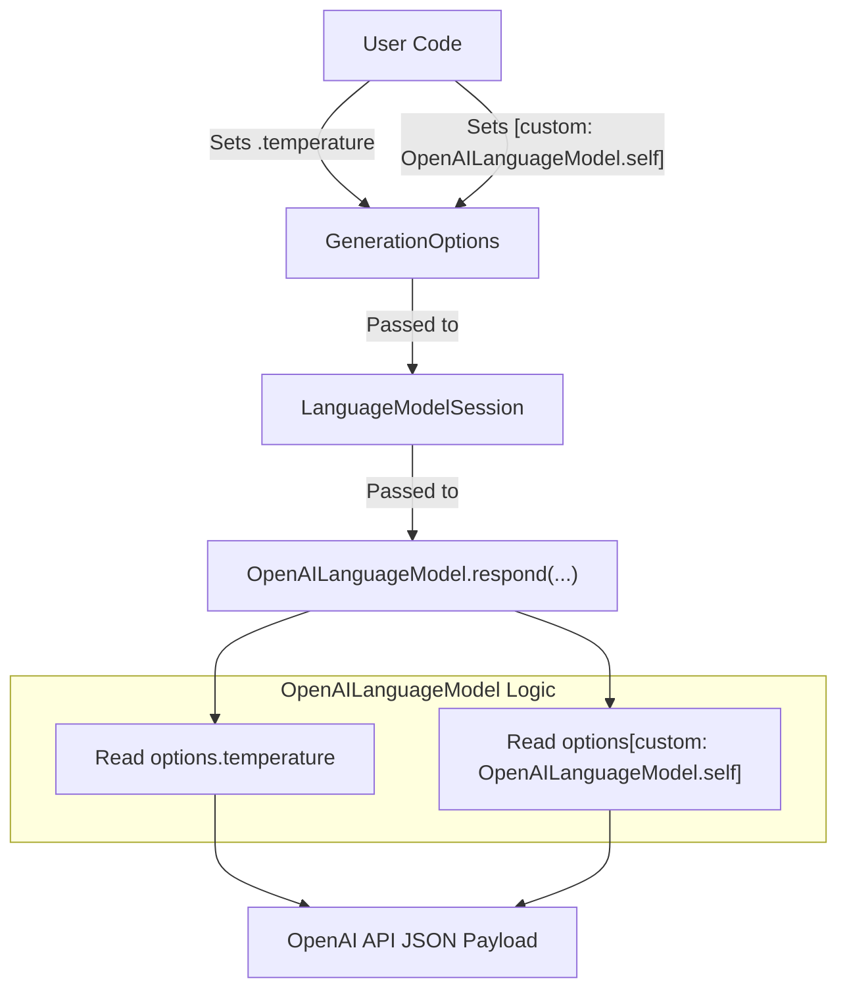
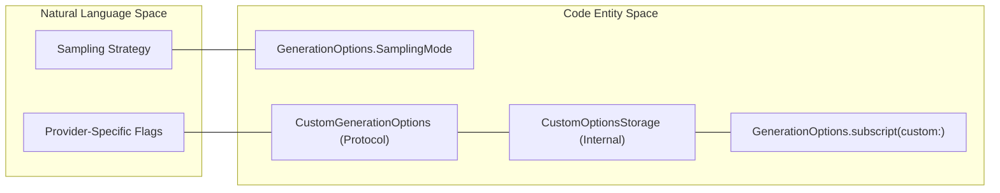

<!-- source: DeepWiki mcp.deepwiki.com · repo huggingface/AnyLanguageModel · page 2.4 GenerationOptions & Custom Options · fetched 2026-10-26 -->

# GenerationOptions & Custom Options

<details>
<summary>Relevant source files</summary>

The following files were used as context for generating this wiki page:

- [Sources/AnyLanguageModel/GeneratedContent.swift](Sources/AnyLanguageModel/GeneratedContent.swift)
- [Sources/AnyLanguageModel/GenerationID.swift](Sources/AnyLanguageModel/GenerationID.swift)
- [Sources/AnyLanguageModel/GenerationOptions.swift](Sources/AnyLanguageModel/GenerationOptions.swift)
- [Sources/AnyLanguageModel/LanguageModel.swift](Sources/AnyLanguageModel/LanguageModel.swift)
- [Sources/AnyLanguageModel/Shared/JSONValue.swift](Sources/AnyLanguageModel/Shared/JSONValue.swift)
- [Sources/AnyLanguageModel/Transcript.swift](Sources/AnyLanguageModel/Transcript.swift)
- [Tests/AnyLanguageModelTests/CustomGenerationOptionsTests.swift](Tests/AnyLanguageModelTests/CustomGenerationOptionsTests.swift)
- [Tests/AnyLanguageModelTests/OpenResponsesLanguageModelTests.swift](Tests/AnyLanguageModelTests/OpenResponsesLanguageModelTests.swift)

</details>


Generation options control the behavior of a language model during the inference process. `AnyLanguageModel` provides a unified set of standard options (sampling, temperature, token limits) while allowing backends to expose provider-specific features through a type-safe custom options mechanism.

## GenerationOptions

The `GenerationOptions` struct is the primary configuration object passed to `respond` and `streamResponse` calls [Sources/AnyLanguageModel/LanguageModel.swift:20-34](). It encapsulates common parameters supported by most LLM engines.

### Sampling Modes
Sampling determines how the model selects the next token from its predicted probability distribution [Sources/AnyLanguageModel/GenerationOptions.swift:11-16]().

| Mode | Function | Description |
| :--- | :--- | :--- |
| **Greedy** | `.greedy` | Always selects the most likely token. Results in deterministic output [Sources/AnyLanguageModel/GenerationOptions.swift:32-34](). |
| **Top-K** | `.random(top:seed:)` | Filters the top $K$ most likely tokens and samples from them. Balances confidence and variety [Sources/AnyLanguageModel/GenerationOptions.swift:52-54](). |
| **Nucleus (Top-P)** | `.random(probabilityThreshold:seed:)` | Samples from the smallest set of tokens whose cumulative probability exceeds $P$. Adapts to the "flatness" of the distribution [Sources/AnyLanguageModel/GenerationOptions.swift:77-79](). |

### Core Parameters
*   **`temperature`**: A Double between `0.0` and `1.0`. Lower values make the distribution "sharper" (more predictable), while higher values increase creativity [Sources/AnyLanguageModel/GenerationOptions.swift:96-107]().
*   **`maximumResponseTokens`**: An Integer limit on the generated length. If the model reaches this limit, it terminates early without throwing an error, protecting against runaway generations [Sources/AnyLanguageModel/GenerationOptions.swift:113-122]().

**Sources:** [Sources/AnyLanguageModel/GenerationOptions.swift:10-122]()

---

## Custom Options Architecture

Because different providers (OpenAI, Anthropic, MLX, etc.) support unique features like "Thinking" modes, "Reasoning Effort," or "Service Tiers," `AnyLanguageModel` uses a type-erased storage system that maintains type safety at the call site.

### The CustomGenerationOptions Protocol
Every `LanguageModel` implementation defines an associated type `CustomGenerationOptions` [Sources/AnyLanguageModel/LanguageModel.swift:6-11](). This type must conform to the `CustomGenerationOptions` protocol, which requires `Sendable`, `Equatable`, and `Codable` conformance.

### Type-Safe Subscript
`GenerationOptions` provides a specialized subscript that uses the `LanguageModel` type as a key to retrieve or set provider-specific options [Sources/AnyLanguageModel/GenerationOptions.swift:141-150]().

```swift
var options = GenerationOptions(temperature: 0.7)

// Setting OpenAI-specific options
options[custom: OpenAILanguageModel.self] = .init(
    extraBody: ["reasoning": .bool(true)]
)
```

### Data Flow: From Options to Provider
The following diagram illustrates how standard and custom options are bridged from the user-facing `GenerationOptions` to the specific backend implementation.

**Option Dispatch Flow**

**Sources:** [Sources/AnyLanguageModel/GenerationOptions.swift:127-150](), [Sources/AnyLanguageModel/LanguageModel.swift:20-26](), [Tests/AnyLanguageModelTests/CustomGenerationOptionsTests.swift:24-35]()

---

## AnyCustomOptions & Type Erasure

To store various disparate types (like `OpenAI.CustomOptions` and `Anthropic.CustomOptions`) within a single `GenerationOptions` instance, the framework uses a private `CustomOptionsStorage` and a type-erasing wrapper called `AnyCustomOptions`.

### Implementation Details
*   **Storage**: Custom options are stored in a dictionary keyed by the string representation of the model type [Sources/AnyLanguageModel/GenerationOptions.swift:125]().
*   **Equality**: `GenerationOptions` remains `Equatable` because `AnyCustomOptions` uses a boxed comparison strategy to check if the underlying custom options match [Tests/AnyLanguageModelTests/CustomGenerationOptionsTests.swift:75-83]().
*   **Persistence**: While `GenerationOptions` is `Codable`, custom options are currently lost during a decoding round-trip to prevent crashes if the specific model type is not linked in the decoding environment [Tests/AnyLanguageModelTests/CustomGenerationOptionsTests.swift:126-143]().

### Mapping Providers to Entities
This diagram maps the natural language concept of "Provider Options" to the specific code entities in the `AnyLanguageModel` ecosystem.

**Code Entity Mapping**


**Sources:** [Sources/AnyLanguageModel/GenerationOptions.swift:17-80](), [Sources/AnyLanguageModel/LanguageModel.swift:6-11](), [Tests/AnyLanguageModelTests/CustomGenerationOptionsTests.swift:48-64]()

---

## Provider Implementation Examples

### OpenAI
The `OpenAILanguageModel` supports `extraBody` for passing arbitrary JSON to the endpoint, alongside specific flags like `reasoningEffort` or `serviceTier` [Tests/AnyLanguageModelTests/CustomGenerationOptionsTests.swift:26-35]().

### Anthropic
The `AnthropicLanguageModel` includes fields for `topP`, `topK`, `stopSequences`, and the `thinking` budget for Claude 3.7+ models [Tests/AnyLanguageModelTests/CustomGenerationOptionsTests.swift:149-168]().

### OpenResponses
A provider-agnostic backend that supports an `extraBody` dictionary of `JSONValue` for pass-through parameters [Tests/AnyLanguageModelTests/OpenResponsesLanguageModelTests.swift:96-102]().

**Sources:** [Tests/AnyLanguageModelTests/CustomGenerationOptionsTests.swift:146-202](), [Tests/AnyLanguageModelTests/OpenResponsesLanguageModelTests.swift:90-104](), [Sources/AnyLanguageModel/Shared/JSONValue.swift:4]()

---

