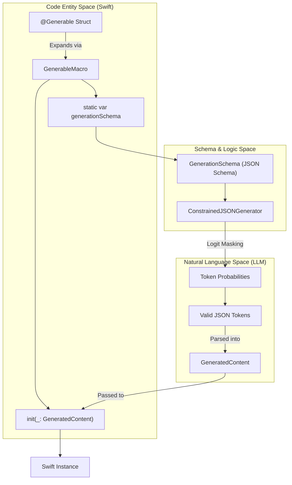
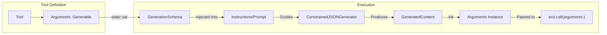

<!-- source: DeepWiki mcp.deepwiki.com · repo huggingface/AnyLanguageModel · page 3 Structured Generation System · fetched 2026-10-26 -->

# Structured Generation System

Relevant source files

The following files were used as context for generating this wiki page:

- [Sources/AnyLanguageModel/Generable.swift](Sources/AnyLanguageModel/Generable.swift)
- [Sources/AnyLanguageModel/GenerationSchema.swift](Sources/AnyLanguageModel/GenerationSchema.swift)
- [Sources/AnyLanguageModel/Tool.swift](Sources/AnyLanguageModel/Tool.swift)
- [Sources/AnyLanguageModelMacros/GenerableMacro.swift](Sources/AnyLanguageModelMacros/GenerableMacro.swift)
- [Tests/AnyLanguageModelTests/GenerableMacroTests.swift](Tests/AnyLanguageModelTests/GenerableMacroTests.swift)

The Structured Generation System in `AnyLanguageModel` allows developers to define strongly-typed Swift structures and enumerations that Large Language Models (LLMs) can populate with guaranteed schema adherence. By bridging the gap between natural language prompts and the type-safe world of Swift, the system enables reliable tool calling, data extraction, and complex agentic workflows.

### System Architecture

The system operates across three primary layers: the **Macro Layer** (for developer ergonomics), the **Schema Layer** (for intermediate representation), and the **Generation Layer** (for real-time constraint enforcement).

#### From Code to Constraints
The following diagram illustrates how a Swift `struct` is transformed into a constrained generation process.

"Natural Language Space to Code Entity Space"

Sources: [Sources/AnyLanguageModel/Generable.swift:6-33](), [Sources/AnyLanguageModelMacros/GenerableMacro.swift:7-38](), [Sources/AnyLanguageModel/GenerationSchema.swift:11-138]()

---

### Core Components

#### 1. Generable Protocol & Macros
The `@Generable` macro is the primary entry point for developers. It automatically conforms a type to the `Generable` protocol and synthesizes the necessary logic to convert between the LLM's raw output and Swift types. Developers use the `@Guide` macro to provide natural language hints and validation constraints (like regex or ranges) directly on properties.

*   **@Generable**: Attached to `struct` or `enum`. Synthesizes `init(_: GeneratedContent)`, a memberwise initializer, and the `generationSchema` property.
*   **@Guide**: Attached to properties to define descriptions, string patterns, or numeric ranges that the LLM must follow.

For details, see [Generable Protocol & @Generable Macro](#3.1).

Sources: [Sources/AnyLanguageModel/Generable.swift:44-74](), [Sources/AnyLanguageModelMacros/GenerableMacro.swift:101-124]()

#### 2. GenerationSchema
`GenerationSchema` is a recursive tree structure (using `Node`) that represents a subset of JSON Schema. It acts as the "source of truth" for what the model is allowed to generate. It supports objects, arrays, strings (with regex/enums), numbers (with ranges), and booleans.

*   **ObjectNode**: Defines required properties and property types.
*   **DynamicGenerationSchema**: Allows building schemas at runtime for cases where types aren't known at compile-time.

For details, see [GenerationSchema & DynamicGenerationSchema](#3.2).

Sources: [Sources/AnyLanguageModel/GenerationSchema.swift:11-20](), [Sources/AnyLanguageModel/GenerationSchema.swift:72-138]()

#### 3. Constrained JSON Generation
This is the engine that enforces the schema during the LLM's inference phase. Instead of letting the model pick any token, the `ConstrainedJSONGenerator` calculates a "logit mask" for every step. This ensures the model can only choose tokens that continue a valid JSON string according to the `GenerationSchema`.

*   **TokenBackend**: An abstraction that allows different LLM backends (MLX, Llama.cpp, etc.) to provide their vocabulary and logit-biasing capabilities.
*   **Logit Masking**: The process of setting the probability of invalid tokens to `-infinity`.

For details, see [ConstrainedJSONGenerator & TokenBackend](#3.3).

Sources: [Sources/AnyLanguageModel/GenerationSchema.swift:9-10](), [Tests/AnyLanguageModelTests/GenerableMacroTests.swift:134-147]()

#### 4. GeneratedContent & Conversion
`GeneratedContent` is an intermediate, type-safe representation of the data returned by the model. It uses a `kind` enum (string, number, bool, array, structure) to store values before they are initialized into final Swift types via the `ConvertibleFromGeneratedContent` protocol.

For details, see [GeneratedContent & Conversion Protocols](#3.4).

Sources: [Sources/AnyLanguageModel/Generable.swift:27-33](), [Sources/AnyLanguageModel/Generable.swift:115-126]()

---

### Integration with Tool Calling
The structured generation system is the backbone of the `Tool` protocol. When a model decides to call a tool, it uses the tool's `Arguments` (which must be `Generable`) to construct a `GenerationSchema`. This schema is then used to force the model to generate valid arguments that match the tool's `call(arguments:)` signature.

"Tool Argument Schema Flow"

Sources: [Sources/AnyLanguageModel/Tool.swift:42-81](), [Sources/AnyLanguageModel/Tool.swift:103-108]()

### Summary Table

| Component | Responsibility | Primary File |
| :--- | :--- | :--- |
| `@Generable` | Code generation for Swift types | [Sources/AnyLanguageModelMacros/GenerableMacro.swift]() |
| `GenerationSchema` | JSON Schema intermediate representation | [Sources/AnyLanguageModel/GenerationSchema.swift]() |
| `Generable` | Protocol defining schema and conversion requirements | [Sources/AnyLanguageModel/Generable.swift]() |
| `Tool.parameters` | Links tool definitions to the schema system | [Sources/AnyLanguageModel/Tool.swift]() |

---

