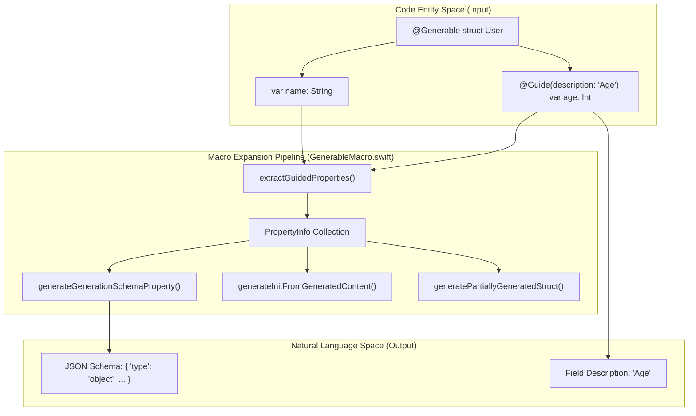
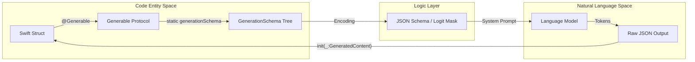

<!-- source: DeepWiki mcp.deepwiki.com · repo huggingface/AnyLanguageModel · page 3.1 Generable Protocol & @Generable Macro · fetched 2026-10-26 -->

# Generable Protocol & @Generable Macro

<details>
<summary>Relevant source files</summary>

The following files were used as context for generating this wiki page:

- [.gitignore](.gitignore)
- [.swift-format](.swift-format)
- [Sources/AnyLanguageModel/ConvertibleFromGeneratedContent.swift](Sources/AnyLanguageModel/ConvertibleFromGeneratedContent.swift)
- [Sources/AnyLanguageModel/ConvertibleToGeneratedContent.swift](Sources/AnyLanguageModel/ConvertibleToGeneratedContent.swift)
- [Sources/AnyLanguageModel/DynamicGenerationSchema.swift](Sources/AnyLanguageModel/DynamicGenerationSchema.swift)
- [Sources/AnyLanguageModel/Generable.swift](Sources/AnyLanguageModel/Generable.swift)
- [Sources/AnyLanguageModel/Tool.swift](Sources/AnyLanguageModel/Tool.swift)
- [Sources/AnyLanguageModelMacros/GenerableMacro.swift](Sources/AnyLanguageModelMacros/GenerableMacro.swift)
- [Sources/AnyLanguageModelMacros/GuideMacro.swift](Sources/AnyLanguageModelMacros/GuideMacro.swift)
- [Sources/AnyLanguageModelMacros/Plugin.swift](Sources/AnyLanguageModelMacros/Plugin.swift)
- [Tests/AnyLanguageModelTests/GenerableMacroTests.swift](Tests/AnyLanguageModelTests/GenerableMacroTests.swift)

</details>


The structured generation system in `AnyLanguageModel` allows Swift types to be used as both the input and output schema for Language Model responses. This is primarily achieved through the `Generable` protocol and the `@Generable` macro, which bridge the gap between Swift's type system and the JSON-based schemas expected by constrained generation engines.

## The Generable Protocol

The `Generable` protocol is the central abstraction for any type that can be produced by a language model. It inherits from conversion protocols that handle the translation between raw `GeneratedContent` and Swift instances [Sources/AnyLanguageModel/Generable.swift:27-33]().

### Protocol Definition
```swift
public protocol Generable: ConvertibleFromGeneratedContent, ConvertibleToGeneratedContent {
    associatedtype PartiallyGenerated: ConvertibleFromGeneratedContent = Self
    static var generationSchema: GenerationSchema { get }
}
```
[Sources/AnyLanguageModel/Generable.swift:27-33]()

### Key Components
- **`generationSchema`**: A static property providing a `GenerationSchema` tree. This tree is used by backends to build logit filters or JSON schemas [Sources/AnyLanguageModel/Generable.swift:32]().
- **`PartiallyGenerated`**: An associated type representing a version of the struct where all fields are optional. This allows the framework to represent an object that is still in the process of being streamed from the model [Sources/AnyLanguageModel/Generable.swift:29]().
- **`ConvertibleFromGeneratedContent`**: Requires an initializer `init(_ content: GeneratedContent)` to reconstruct the type from model output [Sources/AnyLanguageModel/ConvertibleFromGeneratedContent.swift:2-5]().
- **`ConvertibleToGeneratedContent`**: Requires a `generatedContent` property to turn a Swift instance back into a structured format [Sources/AnyLanguageModel/ConvertibleToGeneratedContent.swift:2-5]().

### Standard Library Support
The framework provides default `Generable` conformances for primitive types, allowing them to be used as fields within larger `@Generable` structures:
- `Bool`: Mapped to `.boolean` schema [Sources/AnyLanguageModel/Generable.swift:106-112]().
- `String`: Mapped to `.string` schema [Sources/AnyLanguageModel/Generable.swift:130-137]().
- `Int`, `Float`, `Double`: Mapped to `.number` schema with `integerOnly` flags where appropriate [Sources/AnyLanguageModel/Generable.swift:155-210]().

---

## The @Generable Macro

The `@Generable` macro is a composite macro (`MemberMacro` and `ExtensionMacro`) that automates the boilerplate required to conform a `struct` or `enum` to the `Generable` protocol [Sources/AnyLanguageModelMacros/GenerableMacro.swift:7-13]().

### Expansion Pipeline
When the Swift compiler encounters `@Generable`, the `GenerableMacro.expansion` function performs the following steps:

1.  **Inspection**: It inspects the `DeclGroupSyntax` to determine if it is a `struct` or `enum` [Sources/AnyLanguageModelMacros/GenerableMacro.swift:14-39]().
2.  **Extraction**: It extracts property information (name, type) and searches for `@Guide` attributes on members to gather constraints [Sources/AnyLanguageModelMacros/GenerableMacro.swift:101-124]().
3.  **Synthesis**: It generates several code blocks:
    -   **Memberwise Initializer**: A standard Swift initializer [Sources/AnyLanguageModelMacros/GenerableMacro.swift:22]().
    -   **`init(_ generatedContent:)`**: An initializer that pulls values from a `GeneratedContent` dictionary using the property names as keys [Sources/AnyLanguageModelMacros/GenerableMacro.swift:23]().
    -   **`generationSchema`**: A static property that builds a `GenerationSchema` tree reflecting the struct's layout [Sources/AnyLanguageModelMacros/GenerableMacro.swift:29-33]().
    -   **`PartiallyGenerated` Struct**: A nested struct where every property of the parent is made optional, used for streaming [Sources/AnyLanguageModelMacros/GenerableMacro.swift:34]().

### Macro Data Flow
The following diagram illustrates how the macro transforms a Swift definition into the protocol requirements.

**Diagram: @Generable Macro Expansion Flow**

Sources: [Sources/AnyLanguageModelMacros/GenerableMacro.swift:14-38](), [Sources/AnyLanguageModelMacros/GenerableMacro.swift:101-124]()

---

## The @Guide Macro & Constraints

The `@Guide` macro is a `peer` macro used to annotate properties within a `@Generable` type. It provides natural language hints and programmatic constraints to the model [Sources/AnyLanguageModel/Generable.swift:59-74]().

### Usage and Parameters
- **Description**: Provides a string that is injected into the `GenerationSchema`'s description field, helping the LLM understand the purpose of the field [Sources/AnyLanguageModel/Generable.swift:61]().
- **Constraints**: Supports specific constraints like `.count(n)` for arrays or `.range(min...max)` for numbers [Sources/AnyLanguageModel/Generable.swift:66-67]().
- **Regex**: Allows passing a `Regex` object to enforce string patterns [Sources/AnyLanguageModel/Generable.swift:71-74]().

### Implementation Detail
The `GenerableMacro` searches for these attributes using `extractGuideInfo` [Sources/AnyLanguageModelMacros/GenerableMacro.swift:126-160](). It parses the arguments of the `@Guide` attribute to populate a `Constraints` object, which is then embedded into the synthesized `GenerationSchema`.

**Table: Guide Constraints to Schema Mapping**
| Guide Syntax | Target Type | Schema Impact |
| :--- | :--- | :--- |
| `@Guide(description: "...")` | Any | `node.description` is set |
| `@Guide(.count(5))` | `Array` | `minItems` and `maxItems` set to 5 |
| `@Guide(.range(1...10))` | `Int`/`Double` | `minimum` and `maximum` set |
| `@Guide(regex)` | `String` | `pattern` property set in `StringNode` |

Sources: [Sources/AnyLanguageModelMacros/GenerableMacro.swift:131-165](), [Sources/AnyLanguageModel/Generable.swift:61-74]()

---

## Data Flow: From Code to Model

This diagram bridges the "Code Entity Space" (Swift types) to the "Natural Language Space" (the model's understanding via schema).

**Diagram: Entity Mapping via Generable**

Sources: [Sources/AnyLanguageModel/Generable.swift:31-33](), [Sources/AnyLanguageModel/Tool.swift:103-108](), [Sources/AnyLanguageModelMacros/GenerableMacro.swift:29-33]()

### Handling Enums
When `@Generable` is applied to an `enum`, the macro ensures the enum is treated as a string-based choice (enumeration) in the schema [Sources/AnyLanguageModelMacros/GenerableMacro.swift:39-60]().
- It extracts all cases using `extractEnumCases` [Sources/AnyLanguageModelMacros/GenerableMacro.swift:43]().
- It synthesizes a `generationSchema` that uses `choices` (the case names) to restrict the model's output to only valid enum members [Sources/AnyLanguageModelMacros/GenerableMacro.swift:52-56]().

Sources: [Sources/AnyLanguageModelMacros/GenerableMacro.swift:39-60](), [Tests/AnyLanguageModelTests/GenerableMacroTests.swift:58-63]()

---

