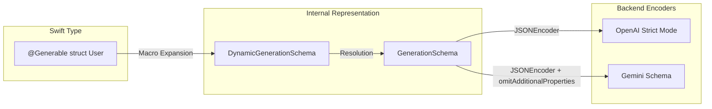

<!-- source: DeepWiki mcp.deepwiki.com · repo huggingface/AnyLanguageModel · page 3.2 GenerationSchema & DynamicGenerationSchema · fetched 2026-10-26 -->

# GenerationSchema & DynamicGenerationSchema

<details>
<summary>Relevant source files</summary>

The following files were used as context for generating this wiki page:

- [.gitignore](.gitignore)
- [.swift-format](.swift-format)
- [Sources/AnyLanguageModel/ConvertibleFromGeneratedContent.swift](Sources/AnyLanguageModel/ConvertibleFromGeneratedContent.swift)
- [Sources/AnyLanguageModel/ConvertibleToGeneratedContent.swift](Sources/AnyLanguageModel/ConvertibleToGeneratedContent.swift)
- [Sources/AnyLanguageModel/DynamicGenerationSchema.swift](Sources/AnyLanguageModel/DynamicGenerationSchema.swift)
- [Sources/AnyLanguageModel/Extensions/Character+Extensions.swift](Sources/AnyLanguageModel/Extensions/Character+Extensions.swift)
- [Sources/AnyLanguageModel/Extensions/JSONDecoder+Extensions.swift](Sources/AnyLanguageModel/Extensions/JSONDecoder+Extensions.swift)
- [Sources/AnyLanguageModel/GenerationGuide.swift](Sources/AnyLanguageModel/GenerationGuide.swift)
- [Sources/AnyLanguageModel/GenerationSchema.swift](Sources/AnyLanguageModel/GenerationSchema.swift)
- [Tests/AnyLanguageModelTests/DynamicGenerationSchemaTests.swift](Tests/AnyLanguageModelTests/DynamicGenerationSchemaTests.swift)
- [Tests/AnyLanguageModelTests/GenerationGuideTests.swift](Tests/AnyLanguageModelTests/GenerationGuideTests.swift)

</details>


The `GenerationSchema` system provides a structured, tree-based representation of JSON schemas used to constrain Large Language Model (LLM) outputs. It serves as the intermediate representation between Swift types (via the `Generable` protocol) and the various backend-specific schema formats (e.g., OpenAI's Structured Outputs, Gemini's JSON schema, or the internal `ConstrainedJSONGenerator`).

## GenerationSchema Structure

`GenerationSchema` is a recursive structure that defines the expected shape of a JSON response. It is composed of a root `Node` and a dictionary of definitions (`defs`) for shared references. [Sources/AnyLanguageModel/GenerationSchema.swift:11-20]()

### Node Types
The core of the schema is the `Node` enum, which covers standard JSON types and schema-specific logic:

| Node Case | Associated Type | Description |
| :--- | :--- | :--- |
| `.object` | `ObjectNode` | A JSON object with named properties and required fields. |
| `.array` | `ArrayNode` | A JSON array with a specific item schema and length constraints. |
| `.string` | `StringNode` | A string with optional regex patterns or enum choices. |
| `.number` | `NumberNode` | A numeric value (integer or floating point) with range bounds. |
| `.boolean` | N/A | A simple boolean `true`/`false`. |
| `.anyOf` | `[Node]` | A union type where the output must match one of the provided schemas. |
| `.ref` | `String` | A reference to a named schema in the `defs` dictionary. |

**Sources:** [Sources/AnyLanguageModel/GenerationSchema.swift:12-19]()

### Specialized Node Structures

#### ObjectNode
Defines a JSON object. It includes a `properties` dictionary mapping keys to `Node` values and a `required` set of keys. [Sources/AnyLanguageModel/GenerationSchema.swift:233-238]()
- **Additional Properties**: By default, `additionalProperties` is set to `false` during encoding to ensure strict schema adherence. [Sources/AnyLanguageModel/GenerationSchema.swift:87-91]()

#### ArrayNode
Defines a JSON array. It contains an `items` `Node` defining the element type, and optional `minItems`/`maxItems` constraints. [Sources/AnyLanguageModel/GenerationSchema.swift:245-250]()

#### StringNode & NumberNode
These nodes support "Guides" for fine-grained validation:
- **StringNode**: Supports `pattern` (Regex) and `enumChoices` (String array). [Sources/AnyLanguageModel/GenerationSchema.swift:257-261]()
- **NumberNode**: Supports `minimum`, `maximum`, and an `integerOnly` flag (which determines if the JSON type is `integer` or `number`). [Sources/AnyLanguageModel/GenerationSchema.swift:268-273]()

## DynamicGenerationSchema

While `GenerationSchema` is optimized for encoding and consumption by generators, `DynamicGenerationSchema` is designed for runtime construction. This is particularly useful when schemas are built programmatically rather than derived from static Swift types via macros.

### Conversion Logic
`DynamicGenerationSchema` uses a `Body` enum to represent its state before being flattened into a `GenerationSchema`. [Sources/AnyLanguageModel/DynamicGenerationSchema.swift:10-17]()

### Natural Language to Code Entity Mapping: Schema Construction

This diagram illustrates how high-level "Dynamic" definitions are transformed into the formal "GenerationSchema" used by backends.

Title: Dynamic Schema Transformation Flow
```mermaid
graph TD
    subgraph "Natural Language Space (Input)"
        UserDesc["'A person with a name and age'"]
    end

    subgraph "Code Entity Space (Dynamic)"
        DGS["DynamicGenerationSchema(name: 'Person')"]
        DGP1["DynamicGenerationSchema.Property(name: 'name')"]
        DGP2["DynamicGenerationSchema.Property(name: 'age')"]
    end

    subgraph "Code Entity Space (Formal)"
        GS["GenerationSchema"]
        OBJ["ObjectNode"]
        STR["StringNode"]
        NUM["NumberNode"]
    end

    UserDesc --> DGS
    DGS -->|contains| DGP1
    DGS -->|contains| DGP2
    
    DGS -.->|converted via init(root:dependencies:)| GS
    GS -->|root| OBJ
    OBJ -->|properties['name']| STR
    OBJ -->|properties['age']| NUM
```
**Sources:** [Sources/AnyLanguageModel/DynamicGenerationSchema.swift:43-49](), [Sources/AnyLanguageModel/GenerationSchema.swift:316-320]()

## The omitAdditionalPropertiesKey Encoder Option

Some LLM providers (notably Google Gemini) have specific requirements for JSON schemas that conflict with the strict `additionalProperties: false` default used for OpenAI or local generators.

To handle this, the system provides a `userInfo` key for `JSONEncoder`:
`public static let omitAdditionalPropertiesKey = CodingUserInfoKey(rawValue: "omitAdditionalProperties")!` [Sources/AnyLanguageModel/GenerationSchema.swift:229]()

When this key is set to `true` in the encoder's `userInfo`, the `ObjectNode` encoding logic skips the `additionalProperties` key entirely. [Sources/AnyLanguageModel/GenerationSchema.swift:88-91]()

## Generation Guides

`GenerationGuide<Value>` provides a type-safe way to specify constraints during schema construction. These are typically applied via the `@Guide` macro but can be used manually with `DynamicGenerationSchema`. [Sources/AnyLanguageModel/GenerationGuide.swift:5-10]()

### Supported Constraints
- **Numeric**: `.minimum(Value)`, `.maximum(Value)`, `.range(ClosedRange<Value>)`. [Sources/AnyLanguageModel/GenerationGuide.swift:64-106]()
- **String**: `.constant(String)`, `.anyOf([String])`, `.pattern(Regex)`. [Sources/AnyLanguageModel/GenerationGuide.swift:29-41]()
- **Array**: `.minimumCount(Int)`, `.maximumCount(Int)`, `.count(ClosedRange<Int>)`. [Sources/AnyLanguageModel/GenerationGuide.swift:189-204]()

## Data Flow: Swift Type to JSON Schema

This diagram shows the path from a Swift struct to the final encoded JSON schema sent to an API.

Title: Schema Generation Lifecycle

**Sources:** [Sources/AnyLanguageModel/GenerationSchema.swift:69-139](), [Tests/AnyLanguageModelTests/DynamicGenerationSchemaTests.swift:8-22]()

### Implementation Details
- **References**: References are encoded as `#/$defs/TypeName`. [Sources/AnyLanguageModel/GenerationSchema.swift:137]()
- **Recursion**: The `Node` enum is `indirect` to allow nested objects and arrays of arbitrary depth. [Sources/AnyLanguageModel/GenerationSchema.swift:12]()
- **Validation**: The `GenerationSchema` initializer validates that all `.ref` nodes have corresponding definitions in the `dependencies` provided during construction. [Tests/AnyLanguageModelTests/DynamicGenerationSchemaTests.swift:105-111]()

**Sources:**
- `Sources/AnyLanguageModel/GenerationSchema.swift`
- `Sources/AnyLanguageModel/DynamicGenerationSchema.swift`
- `Sources/AnyLanguageModel/GenerationGuide.swift`
- `Tests/AnyLanguageModelTests/DynamicGenerationSchemaTests.swift`

---

