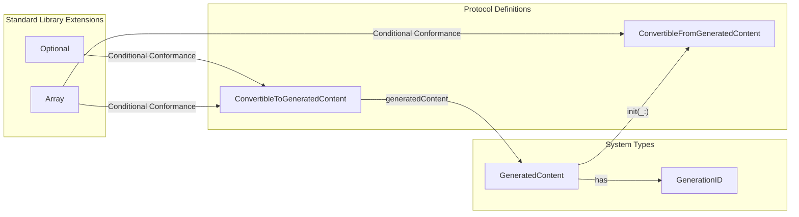

<!-- source: DeepWiki mcp.deepwiki.com · repo huggingface/AnyLanguageModel · page 3.4 GeneratedContent & Conversion Protocols · fetched 2026-10-26 -->

# GeneratedContent & Conversion Protocols

<details>
<summary>Relevant source files</summary>

The following files were used as context for generating this wiki page:

- [.gitignore](.gitignore)
- [.swift-format](.swift-format)
- [Sources/AnyLanguageModel/ConvertibleFromGeneratedContent.swift](Sources/AnyLanguageModel/ConvertibleFromGeneratedContent.swift)
- [Sources/AnyLanguageModel/ConvertibleToGeneratedContent.swift](Sources/AnyLanguageModel/ConvertibleToGeneratedContent.swift)
- [Sources/AnyLanguageModel/DynamicGenerationSchema.swift](Sources/AnyLanguageModel/DynamicGenerationSchema.swift)
- [Sources/AnyLanguageModel/GeneratedContent.swift](Sources/AnyLanguageModel/GeneratedContent.swift)
- [Sources/AnyLanguageModel/GenerationID.swift](Sources/AnyLanguageModel/GenerationID.swift)
- [Sources/AnyLanguageModel/GenerationOptions.swift](Sources/AnyLanguageModel/GenerationOptions.swift)
- [Sources/AnyLanguageModel/LanguageModel.swift](Sources/AnyLanguageModel/LanguageModel.swift)
- [Sources/AnyLanguageModel/Transcript.swift](Sources/AnyLanguageModel/Transcript.swift)
- [Tests/AnyLanguageModelTests/ConvertibleToGeneratedContentTests.swift](Tests/AnyLanguageModelTests/ConvertibleToGeneratedContentTests.swift)

</details>


The structured generation system in `AnyLanguageModel` relies on a specialized intermediate representation to bridge the gap between raw LLM outputs (typically JSON strings) and strongly-typed Swift models. This page documents `GeneratedContent`, the unique `GenerationID`, and the conversion protocols that facilitate this transformation.

## GeneratedContent

`GeneratedContent` is a recursive, type-safe container that represents structured data produced by a language model [Sources/AnyLanguageModel/GeneratedContent.swift:7-7](). It acts as a middle layer that can hold primitives, arrays, or complex key-value structures while maintaining the stability of identifiers during streaming.

### The Kind Enum
The core data is stored in the `Kind` enum, which mirrors JSON types but adds support for tracking property order and specific generation IDs for sub-elements [Sources/AnyLanguageModel/GeneratedContent.swift:34-34]().

| Kind | Description | Swift Mapping |
| :--- | :--- | :--- |
| `string` | A simple text string. | `String` |
| `number` | A numeric value (integer or decimal). | `Double`, `Int`, `Decimal` |
| `bool` | A boolean value. | `Bool` |
| `array` | A sequence of `GeneratedContent` items. | `[GeneratedContent]` |
| `structure` | Key-value pairs with stable key ordering. | `[String: GeneratedContent]` |
| `null` | Represents an empty or null value. | `Optional.none` |

### Partial JSON Parsing
A critical feature of `GeneratedContent` is its ability to be initialized from incomplete JSON strings [Sources/AnyLanguageModel/GeneratedContent.swift:156-160](). This is essential for streaming responses where the model might have only emitted half of a JSON object. The initializer attempts to "heal" the JSON by appending necessary closing braces or brackets to create a valid structure for the `Generable` type to consume [Sources/AnyLanguageModel/GeneratedContent.swift:168-173]().

### Data Flow: From LLM to Swift Entity
The following diagram illustrates how raw text from a `LanguageModel` is transformed into a `GeneratedContent` tree and finally into a Swift struct.

**Data Transformation Pipeline**
```mermaid
graph TD
    subgraph "Natural Language Space (LLM Output)"
        A["Raw JSON String: '{\"name\": \"Swift\", \"ver\": 6}'"]
    end

    subgraph "Code Entity Space (AnyLanguageModel Core)"
        B["GeneratedContent(json:)"]
        C["GeneratedContent.Kind.structure"]
        D["ConvertibleFromGeneratedContent.init(_:)"]
    end

    subgraph "Swift Application Space"
        E["@Generable struct Language"]
    end

    A --> B
    B --> C
    C --> D
    D --> E
```
Sources: [Sources/AnyLanguageModel/GeneratedContent.swift:156-173](), [Sources/AnyLanguageModel/ConvertibleFromGeneratedContent.swift:1-5](), [Sources/AnyLanguageModel/Transcript.swift:97-112]()

## GenerationID

A `GenerationID` is a unique, stable identifier associated with a specific piece of generated content [Sources/AnyLanguageModel/GenerationID.swift:44-44](). 

- **Stability**: Within a single `LanguageModelSession` response stream, the `id` for a specific entity remains constant even as its properties are being filled in [Sources/AnyLanguageModel/GeneratedContent.swift:20-24]().
- **Usage**: It is primarily used to identify items in SwiftUI `List` or `ForEach` views when the content itself (like a name) is still changing [Sources/AnyLanguageModel/GenerationID.swift:15-30]().
- **Manual Creation**: When `GeneratedContent` is created manually (e.g., for a prompt), the `id` is typically `nil` because it was not produced by a generation engine [Sources/AnyLanguageModel/GeneratedContent.swift:26-28]().

Sources: [Sources/AnyLanguageModel/GenerationID.swift:1-51](), [Sources/AnyLanguageModel/GeneratedContent.swift:20-28]()

## Conversion Protocols

Two primary protocols define how types move in and out of the `GeneratedContent` ecosystem.

### ConvertibleToGeneratedContent
Types conforming to this protocol can be turned into `GeneratedContent` for use in `Transcript` entries or tool outputs [Sources/AnyLanguageModel/ConvertibleToGeneratedContent.swift:2-5](). 

- **Automatic Conformance**: `Optional` and `Array` automatically conform if their wrapped/element types conform [Sources/AnyLanguageModel/ConvertibleToGeneratedContent.swift:23-41]().
- **Prompt Integration**: This protocol inherits from `InstructionsRepresentable` and `PromptRepresentable`, providing default implementations that convert the structured content into a JSON string for the LLM context [Sources/AnyLanguageModel/ConvertibleToGeneratedContent.swift:9-19]().

### ConvertibleFromGeneratedContent
This protocol allows a type to be initialized from `GeneratedContent` [Sources/AnyLanguageModel/ConvertibleFromGeneratedContent.swift:1-5](). 

- **Implementation**: The `@Generable` macro typically synthesizes this implementation, mapping keys in a `.structure` kind to the struct's properties.
- **Error Handling**: If the `GeneratedContent.Kind` does not match the expected structure (e.g., expecting an array but receiving a string), a `GeneratedContentConversionError.typeMismatch` is thrown [Sources/AnyLanguageModel/ConvertibleFromGeneratedContent.swift:13-15]().

**Protocol Interaction Diagram**

Sources: [Sources/AnyLanguageModel/ConvertibleToGeneratedContent.swift:2-5](), [Sources/AnyLanguageModel/ConvertibleFromGeneratedContent.swift:1-5](), [Sources/AnyLanguageModel/GeneratedContent.swift:28-34]()

## Usage in Transcripts

Structured content is integrated into the conversation history via `Transcript.StructuredSegment` [Sources/AnyLanguageModel/Transcript.swift:97-97]().

- **Source**: Every structured segment includes a `source` string, which identifies the type or schema that the content represents [Sources/AnyLanguageModel/Transcript.swift:102-102]().
- **Content**: The `content` property holds the `GeneratedContent` instance [Sources/AnyLanguageModel/Transcript.swift:105-105]().

This allows the `Transcript` to maintain a high-fidelity record of generated objects rather than just raw strings, enabling features like feedback logging on specific generated entities [Sources/AnyLanguageModel/LanguageModel.swift:36-41]().

Sources: [Sources/AnyLanguageModel/Transcript.swift:97-112](), [Sources/AnyLanguageModel/LanguageModel.swift:36-41]()

---

