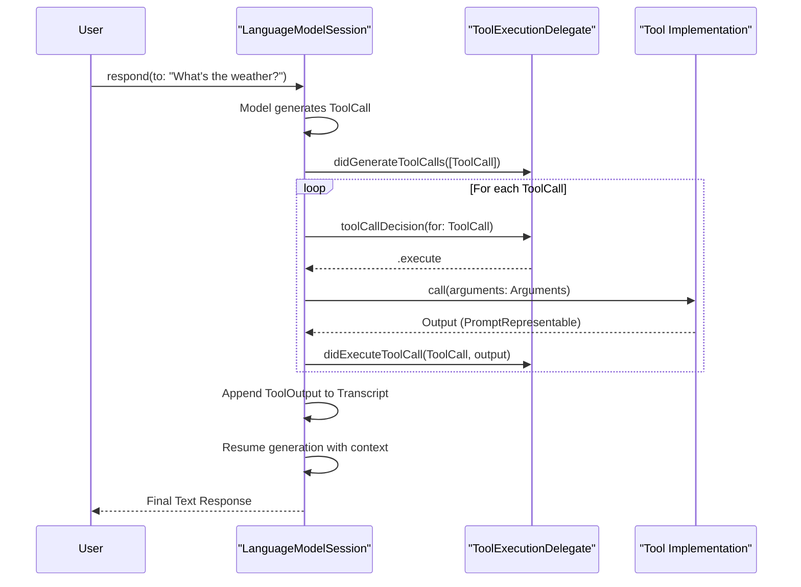

<!-- source: DeepWiki mcp.deepwiki.com · repo huggingface/AnyLanguageModel · page 4 Tool Calling System · fetched 2026-10-26 -->

# Tool Calling System

Relevant source files

The following files were used as context for generating this wiki page:

- [Sources/AnyLanguageModel/Generable.swift](Sources/AnyLanguageModel/Generable.swift)
- [Sources/AnyLanguageModel/Tool.swift](Sources/AnyLanguageModel/Tool.swift)
- [Sources/AnyLanguageModel/ToolExecution.swift](Sources/AnyLanguageModel/ToolExecution.swift)
- [Sources/AnyLanguageModelMacros/GenerableMacro.swift](Sources/AnyLanguageModelMacros/GenerableMacro.swift)
- [Tests/AnyLanguageModelTests/GenerableMacroTests.swift](Tests/AnyLanguageModelTests/GenerableMacroTests.swift)

The tool calling system in `AnyLanguageModel` allows models to gather real-time information or perform side effects by executing Swift code. This architecture bridges the gap between the model's natural language reasoning and your application's logic.

## Overview

The system is built around three core components:
1.  **The `Tool` Protocol**: Defines the interface for a single capability (e.g., fetching weather, searching contacts).
2.  **`ToolExecutionDelegate`**: An actor-based protocol that provides hooks for observing and controlling the execution lifecycle.
3.  **`LanguageModelSession` Orchestration**: The session manages the multi-turn loop where a model generates a `ToolCall`, the system executes it, and the resulting `ToolOutput` is fed back into the transcript for further reasoning.

### Tool Execution Flow

The following diagram illustrates how a `LanguageModelSession` coordinates with a `Tool` and a `ToolExecutionDelegate` to move from a natural language request to code execution.

**Tool Execution Lifecycle**

**Sources:** [Sources/AnyLanguageModel/ToolExecution.swift:24-65](), [Sources/AnyLanguageModel/Tool.swift:42-81](), [Sources/AnyLanguageModel/Tool.swift:112-130]()

---

## The Tool Protocol

A `Tool` is a `Sendable` unit of work. It specifies its own `Arguments` and `Output` types, which are automatically mapped to JSON schemas for the model.

*   **Arguments**: Must conform to `ConvertibleFromGeneratedContent`. When a tool uses a `@Generable` struct for its arguments, the `parameters` schema is automatically derived from the struct's properties and `@Guide` macros.
*   **Output**: Must conform to `PromptRepresentable`. Typically, this is a `String` or another `@Generable` type.
*   **Schema Injection**: By default, `includesSchemaInInstructions` is `true`, meaning the tool's name, description, and parameter schema are automatically injected into the system prompt.

For detailed information on defining tools and using macros to shape arguments, see **[Tool Protocol (#4.1)]**.

**Sources:** [Sources/AnyLanguageModel/Tool.swift:42-62](), [Sources/AnyLanguageModel/Tool.swift:103-108]()

---

## Tool Execution Delegate

The `ToolExecutionDelegate` provides fine-grained control over the tool loop. While the default behavior is to execute all tool calls immediately, the delegate allows you to:
*   **Intercept**: Observe tool calls before they run via `didGenerateToolCalls`.
*   **Decide**: Use `toolCallDecision` to return a `ToolExecutionDecision`. You can choose to `.execute`, `.stop` (halting the session), or `.provideOutput` (manually supplying data, perhaps from a cache, instead of running the tool).
*   **Handle Errors**: Use `didFailToolCall` to log or recover from execution errors.

> [!IMPORTANT]
> Using `ToolExecutionDelegate` is exclusive to `AnyLanguageModel`. Implementing this protocol breaks drop-in parity with Apple's `FoundationModels` framework, as the system-native sessions do not support this level of execution interception.

For details on implementing custom logic and the `ToolExecutionDecision` enum, see **[ToolExecutionDelegate (#4.2)]**.

**Sources:** [Sources/AnyLanguageModel/ToolExecution.swift:1-24](), [Sources/AnyLanguageModel/ToolExecution.swift:69-94]()

---

## Mapping Code Entities to Tool Space

The tool calling system maps Swift types and protocols to the "Natural Language Space" understood by the LLM.

| Code Entity | Role in Tool System |
| :--- | :--- |
| `Tool.name` | The unique identifier the model uses to trigger the tool. |
| `Tool.description` | The natural language "help text" the model uses to decide when to call the tool. |
| `@Generable Arguments` | Becomes the JSON Schema (`parameters`) describing valid inputs. |
| `@Guide` | Injects constraints (ranges, regex, descriptions) into the parameter schema. |
| `Tool.call(arguments:)` | The Swift function body executed when the model makes a request. |
| `Transcript.ToolCall` | A record in the conversation history representing the model's intent to call a tool. |
| `Transcript.ToolOutput` | The result of the Swift execution, formatted back into `Transcript.Segment`s. |

**Sources:** [Sources/AnyLanguageModel/Tool.swift:55-62](), [Sources/AnyLanguageModel/Tool.swift:112-130](), [Tests/AnyLanguageModelTests/GenerableMacroTests.swift:28-35]()

---

## Related Pages
- [Tool Protocol](#4.1) — Detailed documentation on the `Tool` protocol and `@Generable` integration.
- [ToolExecutionDelegate](#4.2) — Deep dive into the delegate lifecycle and execution decisions.
- [Transcript & Prompt Data Model](#2.3) — How `ToolCall` and `ToolOutput` are represented in the conversation history.

---

