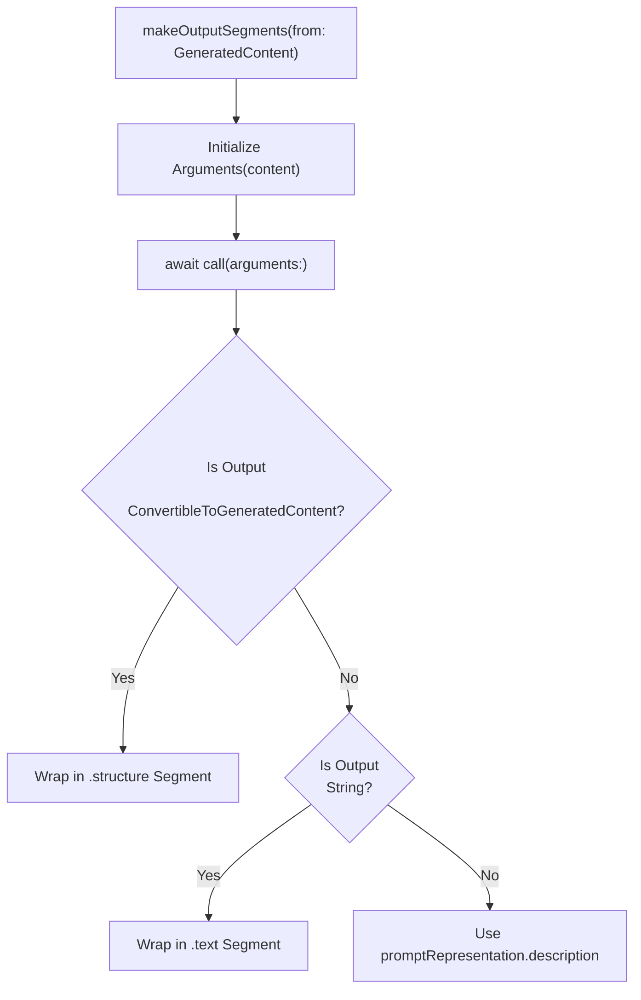

<!-- source: DeepWiki mcp.deepwiki.com · repo huggingface/AnyLanguageModel · page 4.1 Tool Protocol · fetched 2026-10-26 -->

# Tool Protocol

<details>
<summary>Relevant source files</summary>

The following files were used as context for generating this wiki page:

- [Sources/AnyLanguageModel/Generable.swift](Sources/AnyLanguageModel/Generable.swift)
- [Sources/AnyLanguageModel/Tool.swift](Sources/AnyLanguageModel/Tool.swift)
- [Sources/AnyLanguageModel/ToolExecution.swift](Sources/AnyLanguageModel/ToolExecution.swift)
- [Sources/AnyLanguageModelMacros/GenerableMacro.swift](Sources/AnyLanguageModelMacros/GenerableMacro.swift)
- [Tests/AnyLanguageModelTests/GenerableMacroTests.swift](Tests/AnyLanguageModelTests/GenerableMacroTests.swift)
- [Tests/AnyLanguageModelTests/Shared/ToolSpy.swift](Tests/AnyLanguageModelTests/Shared/ToolSpy.swift)
- [Tests/AnyLanguageModelTests/Shared/Tools.swift](Tests/AnyLanguageModelTests/Shared/Tools.swift)

</details>


The `Tool` protocol defines a mechanism for language models to interact with external systems, gather real-time information, or perform side effects during a conversation. By conforming to this protocol, developers can expose Swift functions to the model, which are then described in the prompt using a structured schema.

### The Tool Protocol Definition

A `Tool` is a `Sendable` unit of work that bridges the model's intent (expressed as JSON arguments) to Swift execution. It requires a name, a description, and a schema for its parameters.

| Property | Type | Description |
| :--- | :--- | :--- |
| `name` | `String` | A unique identifier for the tool (e.g., "getWeather"). [Sources/AnyLanguageModel/Tool.swift:55-56]() |
| `description` | `String` | Natural language text explaining when and how the model should use this tool. [Sources/AnyLanguageModel/Tool.swift:58-59]() |
| `Arguments` | `associatedtype` | Must conform to `ConvertibleFromGeneratedContent`. Typically a `@Generable` struct. [Sources/AnyLanguageModel/Tool.swift:53-54]() |
| `Output` | `associatedtype` | Must conform to `PromptRepresentable`. Usually a `String` or a `@Generable` type. [Sources/AnyLanguageModel/Tool.swift:48-49]() |
| `parameters` | `GenerationSchema` | The JSON schema describing the expected `Arguments`. [Sources/AnyLanguageModel/Tool.swift:61-62]() |
| `includesSchemaInInstructions` | `Bool` | Whether to inject the tool's definition into the system prompt. Defaults to `true`. [Sources/AnyLanguageModel/Tool.swift:64-71]() |

Sources: [Sources/AnyLanguageModel/Tool.swift:42-81]()

---

### Bridging Natural Language to Code Entities

The following diagram illustrates how a natural language request from a model is transformed into a typed Swift call through the `Tool` protocol abstractions.

**Tool Execution Data Flow**
```mermaid
graph TD
    subgraph "Natural Language Space (LLM)"
        A["Model Output: { 'name': 'getWeather', 'arguments': '{ \"city\": \"Paris\" }' }"]
    end

    subgraph "Code Entity Space (AnyLanguageModel)"
        B["Transcript.ToolCall"]
        C["Tool Protocol (WeatherTool)"]
        D["@Generable Arguments (WeatherTool.Arguments)"]
        E["Tool.call(arguments:)"]
        F["PromptRepresentable Output"]
    end

    A -->|"Parsed by Session"| B
    B -->|"Lookup by Name"| C
    B -->|"Initialize"| D
    D -->|"Pass to"| E
    E -->|"Return"| F
    F -->|"Convert to Segment"| G["Transcript.ToolOutput"]
```
Sources: [Sources/AnyLanguageModel/Tool.swift:8-32](), [Sources/AnyLanguageModel/Tool.swift:113-130]()

---

### Automatic Parameter Schema Generation

When a tool's `Arguments` type is annotated with the `@Generable` macro, the `parameters` property is automatically populated using the synthesized `generationSchema`.

1.  **Macro Expansion**: The `@Generable` macro inspects the properties of the `Arguments` struct. [Sources/AnyLanguageModelMacros/GenerableMacro.swift:101-124]()
2.  **Guide Metadata**: The `@Guide` macro attaches descriptions and constraints (like ranges or regex) to specific fields. [Sources/AnyLanguageModelMacros/GenerableMacro.swift:126-168]()
3.  **Schema Synthesis**: The macro generates a `static var generationSchema` which the `Tool` protocol uses by default if `Arguments` conforms to `Generable`. [Sources/AnyLanguageModel/Tool.swift:103-108]()

**Example Implementation:**
```swift
struct WeatherTool: Tool {
    let description = "Retrieve weather for a city"
    
    @Generable
    struct Arguments {
        @Guide(description: "The city name")
        var city: String
    }
    
    func call(arguments: Arguments) async throws -> String {
        "Sunny in \(arguments.city)"
    }
}
```
Sources: [Tests/AnyLanguageModelTests/Shared/Tools.swift:3-16](), [Sources/AnyLanguageModel/Tool.swift:103-108]()

---

### Output Processing & Segment Mapping

The `Tool` protocol provides a helper method, `makeOutputSegments(from:)`, which handles the lifecycle of converting raw model-generated JSON into typed arguments and then converting the tool's output back into `Transcript.Segment` objects.

**makeOutputSegments Logic**

Sources: [Sources/AnyLanguageModel/Tool.swift:112-130]()

### Key Helper Functions

*   **`makeOutputSegments(from:)`**: 
    *   Attempts to initialize the `Arguments` type from `GeneratedContent`. [Sources/AnyLanguageModel/Tool.swift:114]()
    *   Invokes the tool's `call` method. [Sources/AnyLanguageModel/Tool.swift:115]()
    *   If the result is `ConvertibleToGeneratedContent` (e.g., another `@Generable` struct), it returns a `.structure` segment. [Sources/AnyLanguageModel/Tool.swift:117-121]()
    *   If the result is a `String`, it returns a `.text` segment. [Sources/AnyLanguageModel/Tool.swift:123-125]()
    *   Otherwise, it falls back to the `promptRepresentation` string. [Sources/AnyLanguageModel/Tool.swift:127-128]()

### Testing Infrastructure: ToolSpy

For unit testing, the `ToolSpy` actor can wrap any `Tool` to record calls and results without modifying the underlying tool logic. It replicates the wrapped tool's `name`, `description`, and `parameters` while providing a thread-safe `calls` array for verification. [Tests/AnyLanguageModelTests/Shared/ToolSpy.swift:3-30]()

Sources: [Tests/AnyLanguageModelTests/Shared/ToolSpy.swift:1-35](), [Sources/AnyLanguageModel/Tool.swift:112-130]()

---

