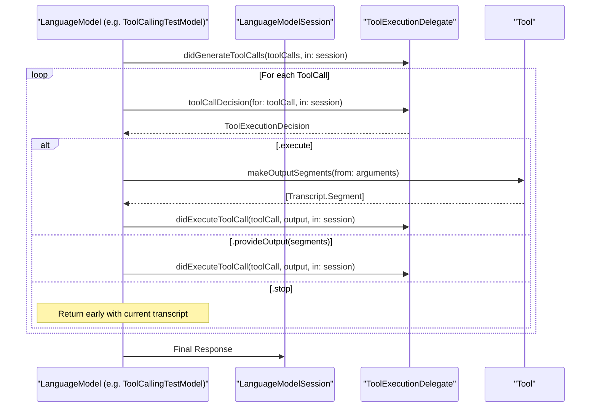

<!-- source: DeepWiki mcp.deepwiki.com · repo huggingface/AnyLanguageModel · page 4.2 ToolExecutionDelegate · fetched 2026-10-26 -->

# ToolExecutionDelegate

<details>
<summary>Relevant source files</summary>

The following files were used as context for generating this wiki page:

- [Sources/AnyLanguageModel/ToolExecution.swift](Sources/AnyLanguageModel/ToolExecution.swift)
- [Tests/AnyLanguageModelTests/ToolExecutionDelegateTests.swift](Tests/AnyLanguageModelTests/ToolExecutionDelegateTests.swift)

</details>


The `ToolExecutionDelegate` protocol provides a mechanism for observing and controlling the tool execution lifecycle within a `LanguageModelSession`. While `AnyLanguageModel` aims for drop-in parity with Apple's `FoundationModels`, this specific delegate is an extension exclusive to this library, allowing for fine-grained intervention in the tool-calling loop.

## ToolExecutionDelegate Protocol

The `ToolExecutionDelegate` is a `Sendable` protocol designed to be implemented by actors or thread-safe objects. it allows developers to intercept tool calls before they are executed, provide manual overrides, and observe the success or failure of tool operations [Sources/AnyLanguageModel/ToolExecution.swift:24-65]().

### Key Methods

| Method | Purpose |
| :--- | :--- |
| `didGenerateToolCalls(_:in:)` | Notifies the delegate that the model has requested one or more tool executions [Sources/AnyLanguageModel/ToolExecution.swift:30](). |
| `toolCallDecision(for:in:)` | **Control Point**: Asks the delegate whether to proceed with execution, stop, or provide a manual output [Sources/AnyLanguageModel/ToolExecution.swift:39-40](). |
| `didExecuteToolCall(_:output:in:)` | Notifies the delegate after a tool has successfully produced `Transcript.ToolOutput` [Sources/AnyLanguageModel/ToolExecution.swift:48-52](). |
| `didFailToolCall(_:error:in:)` | Notifies the delegate if a tool execution threw an error [Sources/AnyLanguageModel/ToolExecution.swift:60-64](). |

### Default Implementations
The protocol provides default no-op implementations for notification methods and a default `toolCallDecision` of `.execute` [Sources/AnyLanguageModel/ToolExecution.swift:69-94](). This allows developers to implement only the specific hooks they need.

**Sources:** [Sources/AnyLanguageModel/ToolExecution.swift:24-94]()

---

## ToolExecutionDecision

When `toolCallDecision(for:in:)` is invoked, the delegate must return a `ToolExecutionDecision` to determine the session's next steps [Sources/AnyLanguageModel/ToolExecution.swift:6-17]().

*   `.execute`: The session proceeds to call the `call(arguments:)` method on the corresponding `Tool` [Sources/AnyLanguageModel/ToolExecution.swift:8]().
*   `.stop`: The session halts immediately after the tool calls are recorded in the transcript, without executing them or requesting further model responses [Sources/AnyLanguageModel/ToolExecution.swift:11]().
*   `.provideOutput([Transcript.Segment])`: The session bypasses the actual `Tool` logic and uses the provided segments as the tool's result [Sources/AnyLanguageModel/ToolExecution.swift:16](). This is useful for caching or mocking external systems.

**Sources:** [Sources/AnyLanguageModel/ToolExecution.swift:6-17]()

---

## Tool Execution Lifecycle

The following diagram illustrates how a `LanguageModel` implementation (such as the one used in `ToolExecutionDelegateTests`) interacts with the delegate during a `respond` request.

### Logic Flow: Tool Call Interception
The `LanguageModel` implementation is responsible for checking the session's delegate and awaiting its decisions.


**Sources:** [Tests/AnyLanguageModelTests/ToolExecutionDelegateTests.swift:87-175](), [Sources/AnyLanguageModel/ToolExecution.swift:19-65]()

---

## Data Flow and Entity Mapping

The delegate acts as a bridge between the raw model output (`Transcript.ToolCall`) and the eventual execution result (`Transcript.ToolOutput`).

### Entity Mapping: Natural Language to Code
This diagram maps the concepts of tool invocation from the model's perspective to the internal code entities managed by the delegate.

```mermaid
graph TD
    subgraph "Natural Language Space (LLM Output)"
        A["Model requests 'get_weather'"]
    end

    subgraph "Code Entity Space (AnyLanguageModel)"
        B["Transcript.ToolCall"]
        C["ToolExecutionDelegate"]
        D["ToolExecutionDecision"]
        E["Transcript.ToolOutput"]
        F["LanguageModelSession.ToolCallError"]
    end

    A --> B
    B --> C
    C -- "Asks for" --> D
    D -- ".execute" --> E
    D -- "throws Error" --> F
    F --> C
    C -- "didFailToolCall" --> F
```


**Sources:** [Sources/AnyLanguageModel/ToolExecution.swift:6-65](), [Tests/AnyLanguageModelTests/ToolExecutionDelegateTests.swift:132-173]()

---

## Compatibility Note

> [!IMPORTANT]
> The `ToolExecutionDelegate` and `ToolExecutionDecision` APIs are exclusive to `AnyLanguageModel`. Using these features breaks drop-in parity with Apple's `FoundationModels` framework [Sources/AnyLanguageModel/ToolExecution.swift:3-5](), [Sources/AnyLanguageModel/ToolExecution.swift:21-23](). 

If your application requires switching between `SystemLanguageModel` (Apple Intelligence) and other backends while maintaining a single codebase, ensure that delegate assignments are wrapped in conditional checks or abstraction layers that account for the standard `FoundationModels` API surface.

**Sources:** [Sources/AnyLanguageModel/ToolExecution.swift:3-5](), [Sources/AnyLanguageModel/ToolExecution.swift:21-23]()

---

## Implementation Example: Spy Delegate

In testing scenarios, a delegate can be used to verify that specific tools were called without actually executing side-effect-heavy code.

```swift
private actor ToolExecutionDelegateSpy: ToolExecutionDelegate {
    private(set) var generatedToolCalls: [Transcript.ToolCall] = []
    
    func didGenerateToolCalls(_ toolCalls: [Transcript.ToolCall], in session: LanguageModelSession) async {
        generatedToolCalls.append(contentsOf: toolCalls)
    }

    func toolCallDecision(for toolCall: Transcript.ToolCall, in session: LanguageModelSession) async -> ToolExecutionDecision {
        // Force execution or override based on tool name
        return .execute
    }
}
```
**Sources:** [Tests/AnyLanguageModelTests/ToolExecutionDelegateTests.swift:5-26]()

---

