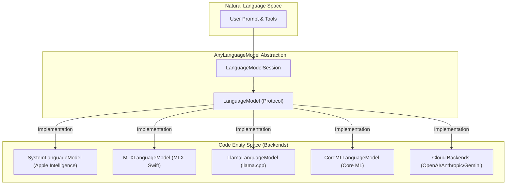
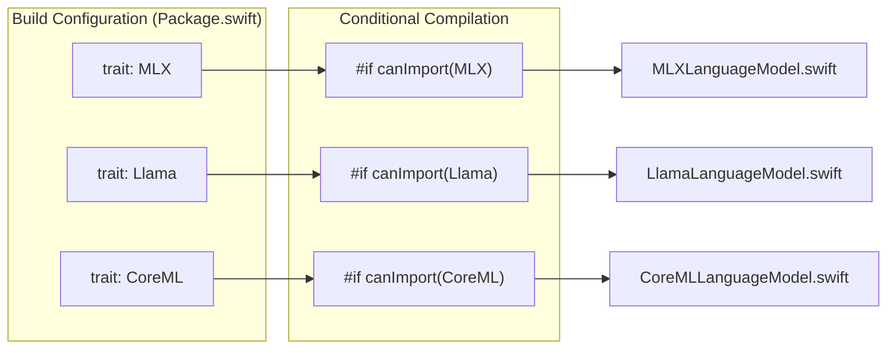

<!-- source: DeepWiki mcp.deepwiki.com · repo huggingface/AnyLanguageModel · page 5 Language Model Backends · fetched 2026-10-26 -->

# Language Model Backends

Relevant source files

The following files were used as context for generating this wiki page:

- [README.md](README.md)
- [Sources/AnyLanguageModel/Models/SystemLanguageModel.swift](Sources/AnyLanguageModel/Models/SystemLanguageModel.swift)
- [Tests/AnyLanguageModelTests/DynamicSchemaConversionTests.swift](Tests/AnyLanguageModelTests/DynamicSchemaConversionTests.swift)

AnyLanguageModel provides a unified interface for multiple inference backends, ranging from Apple's first-party Apple Intelligence to local open-source runners and cloud-hosted APIs. Each backend implements the `LanguageModel` protocol, allowing them to be swapped interchangeably within a `LanguageModelSession`.

### Backend Architecture Overview

The system bridges high-level Swift requests to specific backend implementations. Backends are categorized into three groups:
1.  **System**: Wraps Apple's `FoundationModels` framework.
2.  **Local**: Runs models on-device using MLX, llama.cpp, or Core ML.
3.  **Cloud**: Communicates with external providers via HTTPS and SSE.

#### System to Code Mapping

The following diagram illustrates how the `LanguageModel` protocol abstracts various backend entities.

**Sources:** [Sources/AnyLanguageModel/LanguageModel.swift:1-50](), [README.md:68-82]()

---

### Supported Backends

| Backend | Trait | Primary Use Case | Platform Support |
| :--- | :--- | :--- | :--- |
| **System** | None | Apple Intelligence (On-device) | iOS 18+/macOS 15+ |
| **MLX** | `MLX` | High-performance Apple Silicon inference | macOS, iOS |
| **Llama** | `Llama` | GGUF models via llama.cpp | macOS, iOS, Linux |
| **Core ML** | `CoreML` | Optimized A-series/M-series execution | Apple Platforms |
| **Cloud APIs** | None | OpenAI, Claude, Gemini, Ollama | All (inc. Linux) |

#### 5.1 SystemLanguageModel (Apple Intelligence)
The `SystemLanguageModel` acts as a proxy for Apple's `FoundationModels.SystemLanguageModel`. It requires macOS 26.0 / iOS 26.0 or later for full feature parity. It handles the conversion of AnyLanguageModel `Transcript` and `Tool` types into Apple's internal formats.
*   **Key Feature**: Zero-latency on-device processing with Apple-signed models.
*   **Details**: For details, see [SystemLanguageModel (Apple Intelligence)](#5.1).

**Sources:** [Sources/AnyLanguageModel/Models/SystemLanguageModel.swift:8-17](), [Sources/AnyLanguageModel/Models/SystemLanguageModel.swift:78-87]()

#### 5.2 MLXLanguageModel (Apple Silicon Local Inference)
Enabled via the `MLX` trait, this backend utilizes `mlx-swift-lm` for local inference. It supports KV-cache quantization and `GPUMemoryManager` for efficient resource handling. It also provides a `ConstrainedJSONGenerator` for structured output.
*   **Key Feature**: Native Apple Silicon optimization and VLM (multimodal) support.
*   **Details**: For details, see [MLXLanguageModel (Apple Silicon Local Inference)](#5.2).

**Sources:** [README.md:116-117](), [README.md:74-74]()

#### 5.3 LlamaLanguageModel (GGUF / llama.cpp)
Enabled via the `Llama` trait, this backend wraps `llama.cpp` to run GGUF models. It is the primary choice for cross-platform local execution (including Linux) and supports advanced sampling like Mirostat.
*   **Key Feature**: Wide model compatibility and CPU-only execution fallback.
*   **Details**: For details, see [LlamaLanguageModel (GGUF / llama.cpp)](#5.3).

**Sources:** [README.md:118-119](), [README.md:75-75]()

#### 5.4 CoreMLLanguageModel (Core ML)
Enabled via the `CoreML` trait, this backend loads compiled `.mlmodelc` files. It integrates with `swift-transformers` for tokenization and allows granular control over `MLComputeUnits` (Neural Engine vs GPU).
*   **Key Feature**: Hardware-accelerated inference via the Apple Neural Engine (ANE).
*   **Details**: For details, see [CoreMLLanguageModel (Core ML)](#5.4).

**Sources:** [README.md:114-115](), [README.md:73-73]()

#### 5.5 Cloud API Backends
These backends do not require special traits but may require `AsyncHTTPClient` on Linux. They implement common patterns for SSE (Server-Sent Events) streaming and tool-calling loops across OpenAI, Anthropic, Gemini, and Ollama.
*   **Key Feature**: Access to massive frontier models with no local hardware requirements.
*   **Details**: For details, see [Cloud API Backends](#5.5).

**Sources:** [README.md:76-81](), [README.md:105-110]()

---

### Trait-Based Loading Logic

The codebase uses Swift 6.1 traits to prevent "dependency bloat." The following diagram shows how the `LanguageModel` interface is resolved based on the enabled compilation traits.

**Sources:** [README.md:105-133](), [Sources/AnyLanguageModel/Models/SystemLanguageModel.swift:1-5]()

### Schema Compatibility
A critical role of the backends is bridging AnyLanguageModel's `GenerationSchema` to provider-specific formats. For example, the `SystemLanguageModel` uses `convertToDynamicSchema` to bridge to Apple's `JSONSchema` implementation.

**Sources:** [Tests/AnyLanguageModelTests/DynamicSchemaConversionTests.swift:22-27](), [Sources/AnyLanguageModel/Models/SystemLanguageModel.swift:99-105]()

---

