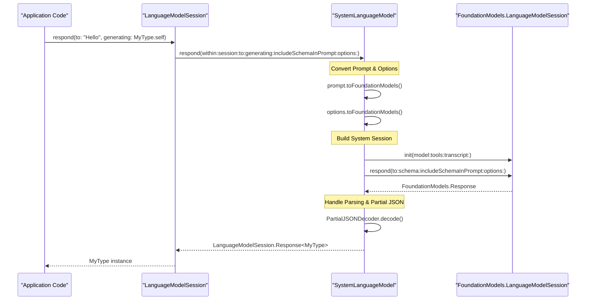

<!-- source: DeepWiki mcp.deepwiki.com · repo huggingface/AnyLanguageModel · page 5.1 SystemLanguageModel (Apple Intelligence) · fetched 2026-10-26 -->

# SystemLanguageModel (Apple Intelligence)

<details>
<summary>Relevant source files</summary>

The following files were used as context for generating this wiki page:

- [Sources/AnyLanguageModel/Models/SystemLanguageModel.swift](Sources/AnyLanguageModel/Models/SystemLanguageModel.swift)
- [Tests/AnyLanguageModelTests/APICompatibilityAnyLanguageModelTests.swift](Tests/AnyLanguageModelTests/APICompatibilityAnyLanguageModelTests.swift)
- [Tests/AnyLanguageModelTests/APICompatibilityFoundationModelsTests.swift](Tests/AnyLanguageModelTests/APICompatibilityFoundationModelsTests.swift)
- [Tests/AnyLanguageModelTests/DynamicSchemaConversionTests.swift](Tests/AnyLanguageModelTests/DynamicSchemaConversionTests.swift)
- [Tests/AnyLanguageModelTests/SystemLanguageModelTests.swift](Tests/AnyLanguageModelTests/SystemLanguageModelTests.swift)

</details>


The `SystemLanguageModel` acts as a bridge between the `AnyLanguageModel` protocol and Apple's native `FoundationModels` framework. It enables the use of on-device Apple Intelligence models while maintaining the unified API surface of the library. This backend is specifically designed for high-performance, privacy-focused inference on modern Apple hardware.

## Architecture & Availability

`SystemLanguageModel` is a thin wrapper around `FoundationModels.SystemLanguageModel` [Sources/AnyLanguageModel/Models/SystemLanguageModel.swift:21-21](). It is available on macOS 26.0, iOS 26.0, and corresponding OS versions [Sources/AnyLanguageModel/Models/SystemLanguageModel.swift:16-16]().

The model's availability is determined by the underlying system state, which can be checked via the `availability` property [Sources/AnyLanguageModel/Models/SystemLanguageModel.swift:59-66](). If the system model is unavailable (e.g., due to unsupported hardware or missing assets), it surfaces the specific `UnavailableReason` provided by Apple's framework [Sources/AnyLanguageModel/Models/SystemLanguageModel.swift:19-19]().

### Natural Language to Code Entity Mapping: Initialization
The following diagram shows how high-level configuration concepts map to specific Swift initializers and types within the `SystemLanguageModel`.

```mermaid
graph TD
    subgraph "Natural Language Concepts"
        "Default_Model"["Default Apple Intelligence"]
        "Specific_Task"["Specific Use Case (e.g. Summarization)"]
        "Safety_Rules"["Safety Guardrails"]
        "Custom_Weights"["Custom Adapter"]
    end

    subgraph "Code Entity Space (SystemLanguageModel.swift)"
        "Init_Default"["init()"]
        "Init_UseCase"["init(useCase:guardrails:)"]
        "Init_Adapter"["init(adapter:guardrails:)"]
        "FM_UseCase"["FoundationModels.SystemLanguageModel.UseCase"]
        "FM_Guardrails"["FoundationModels.SystemLanguageModel.Guardrails"]
        "FM_Adapter"["FoundationModels.SystemLanguageModel.Adapter"]
    end

    "Default_Model" --> "Init_Default"
    "Specific_Task" --> "FM_UseCase"
    "FM_UseCase" --> "Init_UseCase"
    "Safety_Rules" --> "FM_Guardrails"
    "FM_Guardrails" --> "Init_UseCase"
    "FM_Guardrails" --> "Init_Adapter"
    "Custom_Weights" --> "FM_Adapter"
    "FM_Adapter" --> "Init_Adapter"
```
Sources: [Sources/AnyLanguageModel/Models/SystemLanguageModel.swift:29-56]()

## Request Lifecycle and Bridging

When a request is made via `respond` or `streamResponse`, `SystemLanguageModel` performs a deep translation of `AnyLanguageModel` types into `FoundationModels` types.

1.  **Prompt Conversion**: The `Prompt` is converted using `toFoundationModels()` [Sources/AnyLanguageModel/Models/SystemLanguageModel.swift:75-75]().
2.  **Options Conversion**: `GenerationOptions` (like temperature and sampling) are mapped to Apple's native options [Sources/AnyLanguageModel/Models/SystemLanguageModel.swift:76-76]().
3.  **Session Orchestration**: A `FoundationModels.LanguageModelSession` is instantiated, bridging the current `Transcript` and any attached `Tools` [Sources/AnyLanguageModel/Models/SystemLanguageModel.swift:78-87]().
4.  **Schema Handling**: If a structured type is requested, the backend extracts the `generationSchema` and provides it to the system model to ensure constrained output [Sources/AnyLanguageModel/Models/SystemLanguageModel.swift:99-105]().

### Data Flow: Request Bridging
This diagram illustrates the flow of data from the generic `LanguageModelSession` through the `SystemLanguageModel` into the Apple-specific `FoundationModels` ecosystem.


Sources: [Sources/AnyLanguageModel/Models/SystemLanguageModel.swift:68-147]()

## Dynamic Schema Conversion

A critical component of the `SystemLanguageModel` is the ability to convert `JSONSchema` (used by `AnyLanguageModel`) into `FoundationModels.GenerationSchema`.

The `convertToDynamicSchema` function recursively maps schema nodes:
*   **Strings**: Supports `enum`, `const`, and `pattern` constraints [Tests/AnyLanguageModelTests/DynamicSchemaConversionTests.swift:22-52]().
*   **Numbers/Integers**: Maps `minimum`, `maximum`, and `enum` values [Tests/AnyLanguageModelTests/DynamicSchemaConversionTests.swift:54-92]().
*   **Objects**: Maps `properties` and `required` fields [Tests/AnyLanguageModelTests/DynamicSchemaConversionTests.swift:131-167]().
*   **Arrays**: Maps `items`, `minItems`, and `maxItems` [Tests/AnyLanguageModelTests/DynamicSchemaConversionTests.swift:104-126]().

## Robust Parsing and Error Handling

The system model's output is processed to ensure compatibility with Swift types, even when the model provides incomplete or slightly malformed JSON:

*   **Direct Initialization**: Attempts to initialize the `Generable` type directly from the response [Sources/AnyLanguageModel/Models/SystemLanguageModel.swift:128-131]().
*   **Partial Decoding**: If direct parsing fails, it uses `PartialJSONDecoder` to attempt recovery from truncated or streaming JSON strings [Sources/AnyLanguageModel/Models/SystemLanguageModel.swift:134-140]().
*   **Placeholder Fallback**: If all parsing attempts fail, it can provide a `placeholderContent` for the requested type to prevent a hard crash [Sources/AnyLanguageModel/Models/SystemLanguageModel.swift:141-143]().

## Testing and Compatibility

The backend includes a comprehensive test suite to verify "drop-in" parity with Apple's official APIs.

| Test Category | Description | File |
| :--- | :--- | :--- |
| **Basic Response** | Verifies text generation with default settings. | [Tests/AnyLanguageModelTests/SystemLanguageModelTests.swift:100-106]() |
| **Streaming** | Ensures `ResponseStream` correctly yields snapshots. | [Tests/AnyLanguageModelTests/SystemLanguageModelTests.swift:134-148]() |
| **Tool Integration** | Verifies tool-calling loops and weather tool interaction. | [Tests/AnyLanguageModelTests/SystemLanguageModelTests.swift:171-189]() |
| **API Compatibility** | Validates that `AnyLanguageModel` calls mirror `FoundationModels` behavior. | [Tests/AnyLanguageModelTests/APICompatibilityAnyLanguageModelTests.swift:15-37]() |
| **Schema Conversion** | Validates mapping of all `JSONSchema` types to Apple's schema. | [Tests/AnyLanguageModelTests/DynamicSchemaConversionTests.swift:22-170]() |

Sources: [Tests/AnyLanguageModelTests/SystemLanguageModelTests.swift](), [Tests/AnyLanguageModelTests/APICompatibilityAnyLanguageModelTests.swift](), [Tests/AnyLanguageModelTests/DynamicSchemaConversionTests.swift]()

---

