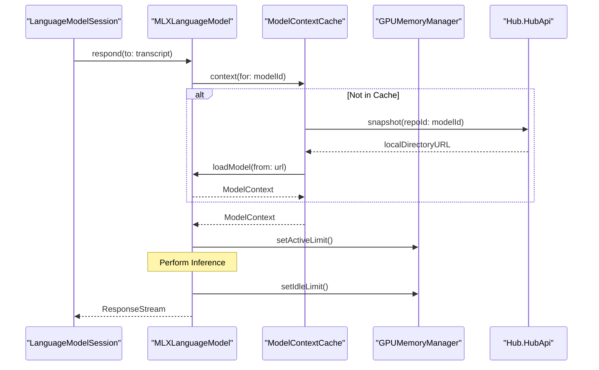
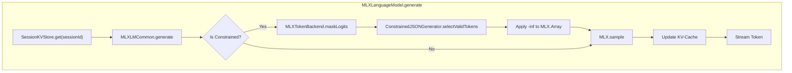

<!-- source: DeepWiki mcp.deepwiki.com · repo huggingface/AnyLanguageModel · page 5.2 MLXLanguageModel (Apple Silicon Local Inference) · fetched 2026-10-26 -->

# MLXLanguageModel (Apple Silicon Local Inference)

Relevant source files

The following files were used as context for generating this wiki page:

- [Sources/AnyLanguageModel/Models/MLXLanguageModel.swift](Sources/AnyLanguageModel/Models/MLXLanguageModel.swift)
- [Tests/AnyLanguageModelTests/MLXLanguageModelTests.swift](Tests/AnyLanguageModelTests/MLXLanguageModelTests.swift)

The `MLXLanguageModel` provides a local inference backend for Apple Silicon using the [MLX](https://github.com/ml-explore/mlx) framework. It supports high-performance execution of LLMs and VLMs (Vision Language Models) directly on device, with features like KV-cache quantization, tool calling, and constrained JSON generation.

## Initialization and Model Loading

`MLXLanguageModel` can be initialized using a Hugging Face model ID or a local file URL. It leverages `MLXLMCommon` and `MLXVLM` to handle various model architectures [Sources/AnyLanguageModel/Models/MLXLanguageModel.swift:177-185]().

### ModelContextCache
To prevent redundant memory usage and provide thread-safe loading, the backend uses a `ModelContextCache`.
- **Coalesced Loading**: If multiple requests for the same model ID arrive simultaneously, they await a single shared `Task` [Sources/AnyLanguageModel/Models/MLXLanguageModel.swift:59-71]().
- **Eviction Policy**: Uses `NSCache` with a `countLimit` (defaulting to 3) to manage resident models [Sources/AnyLanguageModel/Models/MLXLanguageModel.swift:41-45, 173]().
- **Error Persistence**: Failed load attempts are cached as `.failed(String)` to prevent repeated failing attempts until the cache is cleared [Sources/AnyLanguageModel/Models/MLXLanguageModel.swift:88-91, 119-127]().

### GPUMemoryManager
MLX manages memory through a unified buffer. `MLXLanguageModel` provides a `GPUMemoryManager` to control the MLX cache limits:
- **Active Limit**: The memory ceiling while the model is actively generating.
- **Idle Limit**: The reduced ceiling when the model is dormant, allowing other system processes to reclaim GPU memory [Sources/AnyLanguageModel/Models/MLXLanguageModel.swift:233-255]().

## Lifecycle and Concurrency Control

### SessionGenerationGate
Because MLX models are stateful and typically tied to a specific `LanguageModelSession` during a forward pass, the `SessionGenerationGate` ensures that a single session cannot trigger concurrent generations. If a second request is made while one is in progress, it throws `LanguageModelSession.GenerationError.concurrentRequests` [Tests/AnyLanguageModelTests/MLXLanguageModelTests.swift:81-105]().

### SessionKVStore
The `SessionKVStore` manages the `KVCache` objects for each session.
- **Quantization**: Supports `int4` or `float16` KV-cache quantization to save memory [Sources/AnyLanguageModel/Models/MLXLanguageModel.swift:211-218]().
- **State Persistence**: The KV-cache is maintained across turns in a `LanguageModelSession`, allowing for efficient multi-turn conversations without re-processing the entire transcript [Tests/AnyLanguageModelTests/MLXLanguageModelTests.swift:72-79]().

## Data Flow: From Transcript to MLX

The model converts the `Transcript` data model into MLX-compatible inputs.

### Multimodal Support (VLM)
For models like Qwen2-VL or Llama-3.2-Vision, the backend processes `ImageSegment` data:
- **Image Processing**: Supports loading from URLs or raw `Data` [Tests/AnyLanguageModelTests/MLXLanguageModelTests.swift:147-182]().
- **Resizing**: `CustomGenerationOptions` allow specifying `userInputProcessing` to resize images (e.g., to 512x512) before encoding to reduce latency [Sources/AnyLanguageModel/Models/MLXLanguageModel.swift:222-226]().

### Tool Calling Loop
`MLXLanguageModel` implements an internal loop to handle `ToolDefinition` and `ToolCall` sequences:
1. **Prompt Construction**: Injects tool definitions into the system prompt or uses the model's native chat template.
2. **Generation**: The model generates text or a structured tool call.
3. **Execution**: If a tool call is detected, the backend executes the tool via the `ToolExecutionDelegate`.
4. **Re-insertion**: Tool outputs are appended to the transcript, and the model is prompted again until a final response is reached [Tests/AnyLanguageModelTests/MLXLanguageModelTests.swift:122-145]().

## Constrained JSON Generation

MLX support includes strict schema enforcement using the `ConstrainedJSONGenerator`.

| Component | Role |
| :--- | :--- |
| `MLXTokenBackend` | Bridges MLX `Tokenizer` to the generator, providing vocabulary access and logit masking. |
| `ConstrainedJSONGenerator` | Logic for calculating valid next-token masks based on a `GenerationSchema`. |
| `logitBias` | Applied to the MLX `Array` before sampling to zero out invalid tokens. |

Sources: [Sources/AnyLanguageModel/Models/MLXLanguageModel.swift:13-19](), [Tests/AnyLanguageModelTests/MLXLanguageModelTests.swift:183-200]()

## Implementation Diagrams

### Model Loading and Cache Lifecycle
This diagram illustrates how `MLXLanguageModel` coordinates with `ModelContextCache` and `GPUMemoryManager`.

Sources: [Sources/AnyLanguageModel/Models/MLXLanguageModel.swift:36-95](), [Sources/AnyLanguageModel/Models/MLXLanguageModel.swift:233-255]()

### Generation Loop with Logit Masking
This diagram shows the relationship between the MLX sampling loop and the `ConstrainedJSONGenerator`.

Sources: [Sources/AnyLanguageModel/Models/MLXLanguageModel.swift:198-218](), [Tests/AnyLanguageModelTests/MLXLanguageModelTests.swift:183-200]()

## Custom Generation Options

MLX-specific settings are configured via `MLXLanguageModel.CustomGenerationOptions`:

- `KVCache.maxSize`: Limits the number of tokens stored in the KV cache [Sources/AnyLanguageModel/Models/MLXLanguageModel.swift:204-205]().
- `KVCache.quantization`: Options for `int4` or `float16` [Sources/AnyLanguageModel/Models/MLXLanguageModel.swift:211-218]().
- `userInputProcessing`: Controls image scaling for VLM models [Sources/AnyLanguageModel/Models/MLXLanguageModel.swift:222-226]().

Sources:
- `Sources/AnyLanguageModel/Models/MLXLanguageModel.swift`
- `Tests/AnyLanguageModelTests/MLXLanguageModelTests.swift`

---

