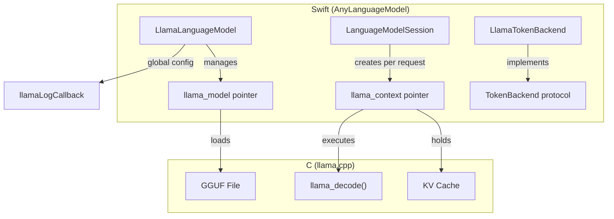
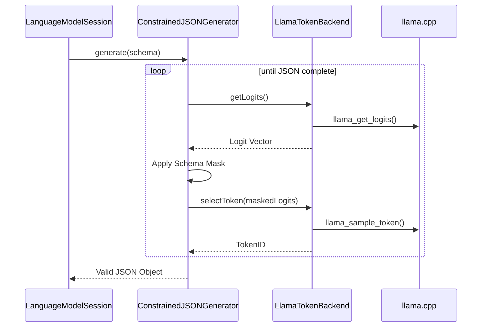

<!-- source: DeepWiki mcp.deepwiki.com · repo huggingface/AnyLanguageModel · page 5.3 LlamaLanguageModel (GGUF / llama.cpp) · fetched 2026-10-26 -->

# LlamaLanguageModel (GGUF / llama.cpp)

<details>
<summary>Relevant source files</summary>

The following files were used as context for generating this wiki page:

- [Sources/AnyLanguageModel/Models/LlamaLanguageModel.swift](Sources/AnyLanguageModel/Models/LlamaLanguageModel.swift)
- [Tests/AnyLanguageModelTests/LlamaLanguageModelTests.swift](Tests/AnyLanguageModelTests/LlamaLanguageModelTests.swift)

</details>


The `LlamaLanguageModel` provides local inference capabilities by wrapping the `llama.cpp` library. It is designed to load and run models in the **GGUF** format. This backend is particularly useful for CPU-based execution or when working with models optimized for the `llama.cpp` ecosystem.

## Overview and Initialization

The `LlamaLanguageModel` class implements the `LanguageModel` protocol and manages the lifecycle of the underlying C++ model and context [Sources/AnyLanguageModel/Models/LlamaLanguageModel.swift:33-36](). It is enabled via the `Llama` SwiftPM trait and depends on the `LlamaSwift` package [Sources/AnyLanguageModel/Models/LlamaLanguageModel.swift:2-4]().

### Initialization Parameters
When initializing the model, users specify the filesystem path to the GGUF file and default hardware/context parameters:
* **modelPath**: The absolute path to the `.gguf` file [Sources/AnyLanguageModel/Models/LlamaLanguageModel.swift:28-31]().
* **contextSize**: The maximum number of tokens the model can process (default: 2048) [Sources/AnyLanguageModel/Models/LlamaLanguageModel.swift:175]().
* **batchSize**: The number of tokens evaluated in a single batch (default: 512) [Sources/AnyLanguageModel/Models/LlamaLanguageModel.swift:176]().
* **threads**: The number of CPU threads used for computation (defaults to system processor count) [Sources/AnyLanguageModel/Models/LlamaLanguageModel.swift:177]().

### Logical to Physical Mapping
The following diagram illustrates how the Swift `LlamaLanguageModel` interacts with the underlying `llama.cpp` C entities.

**Diagram: Llama Backend Entity Mapping**

Sources: [Sources/AnyLanguageModel/Models/LlamaLanguageModel.swift:12-21](), [Sources/AnyLanguageModel/Models/LlamaLanguageModel.swift:33-65]().

## Lifecycle and Context Management

Unlike backends that maintain a persistent session context, `LlamaLanguageModel` manages the `llama_context` lifecycle per request. 

1.  **Model Loading**: The `llama_model` is loaded once upon initialization of `LlamaLanguageModel`.
2.  **Context Creation**: For every `respond` or `streamResponse` call, a new `llama_context` is initialized using the `CustomGenerationOptions` provided [Sources/AnyLanguageModel/Models/LlamaLanguageModel.swift:82-138]().
3.  **Chat Template Application**: The model automatically applies the chat template defined within the GGUF metadata to format the `Transcript` into a raw string for the tokenizer.
4.  **Execution**: Tokens are generated iteratively. The model handles both EOG (End of Generation) and EOS (End of Stream) tokens to determine when to stop.

## Sampling and Custom Options

`LlamaLanguageModel` supports a wide array of sampling parameters through its `CustomGenerationOptions` struct. These can be applied globally or per-request via the `GenerationOptions` subscript [Sources/AnyLanguageModel/Models/LlamaLanguageModel.swift:67-81]().

### Sampling Modes
| Mode | Description | Code Reference |
| :--- | :--- | :--- |
| **Greedy** | Selects the token with the highest probability. | [Sources/AnyLanguageModel/Models/LlamaLanguageModel.swift:96]() |
| **Nucleus (Top-P)** | Samples from the smallest set of tokens whose cumulative probability exceeds P. | [Sources/AnyLanguageModel/Models/LlamaLanguageModel.swift:102]() |
| **Top-K** | Limits sampling to the K most likely tokens. | [Sources/AnyLanguageModel/Models/LlamaLanguageModel.swift:99]() |
| **Mirostat v1/v2** | Adaptive perplexity control with target entropy (`tau`) and learning rate (`eta`). | [Sources/AnyLanguageModel/Models/LlamaLanguageModel.swift:129-138]() |

### Penalties
*   **Repeat Penalty**: Discourages repeating the same tokens [Sources/AnyLanguageModel/Models/LlamaLanguageModel.swift:108]().
*   **Frequency Penalty**: Penalizes tokens based on their existing frequency in the generated text [Sources/AnyLanguageModel/Models/LlamaLanguageModel.swift:120]().
*   **Presence Penalty**: Penalizes tokens if they have appeared at all [Sources/AnyLanguageModel/Models/LlamaLanguageModel.swift:126]().

Sources: [Sources/AnyLanguageModel/Models/LlamaLanguageModel.swift:82-167](), [Tests/AnyLanguageModelTests/LlamaLanguageModelTests.swift:30-65]().

## Constrained JSON Generation

The `LlamaLanguageModel` integrates with the `ConstrainedJSONGenerator` by providing a `LlamaTokenBackend`. This allows for type-safe, schema-conforming JSON output.

**Diagram: Constrained Generation Flow**

Sources: [Sources/AnyLanguageModel/Models/LlamaLanguageModel.swift:33-36](), [Tests/AnyLanguageModelTests/LlamaLanguageModelTests.swift:186-200]().

## Logging and Observability

Logging in `llama.cpp` is handled via a global C callback. `LlamaLanguageModel` wraps this with a Swift-friendly `LogLevel` enum to control verbosity [Sources/AnyLanguageModel/Models/LlamaLanguageModel.swift:39-60]().

*   **Log Levels**: `none`, `debug`, `info`, `warn`, `error` [Sources/AnyLanguageModel/Models/LlamaLanguageModel.swift:41-49]().
*   **Implementation**: A `nonisolated(unsafe)` private variable `currentLogLevel` stores the threshold, which the `llamaLogCallback` checks before printing to `stderr` [Sources/AnyLanguageModel/Models/LlamaLanguageModel.swift:9-21]().

Users can configure the global log level via:
```swift
LlamaLanguageModel.logLevel = .debug
```
Sources: [Sources/AnyLanguageModel/Models/LlamaLanguageModel.swift:6-21](), [Tests/AnyLanguageModelTests/LlamaLanguageModelTests.swift:108-121]().

## Testing

The backend is verified through a dedicated test suite in `LlamaLanguageModelTests.swift`. These tests require a local model path provided via the `LLAMA_MODEL_PATH` environment variable [Tests/AnyLanguageModelTests/LlamaLanguageModelTests.swift:10-14]().

Key test areas include:
*   **Initialization and Defaults**: Ensures parameters like `threads` and `contextSize` are correctly assigned [Tests/AnyLanguageModelTests/LlamaLanguageModelTests.swift:17-28]().
*   **Option Round-tripping**: Verifies that `CustomGenerationOptions` are correctly encoded and retrieved [Tests/AnyLanguageModelTests/LlamaLanguageModelTests.swift:30-65]().
*   **Inference**: Basic `respond` and `streamResponse` functionality [Tests/AnyLanguageModelTests/LlamaLanguageModelTests.swift:142-184]().

Sources: [Tests/AnyLanguageModelTests/LlamaLanguageModelTests.swift:1-184]().

---

