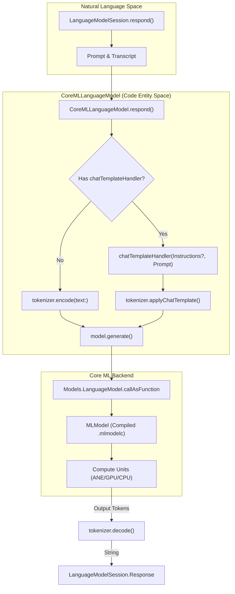
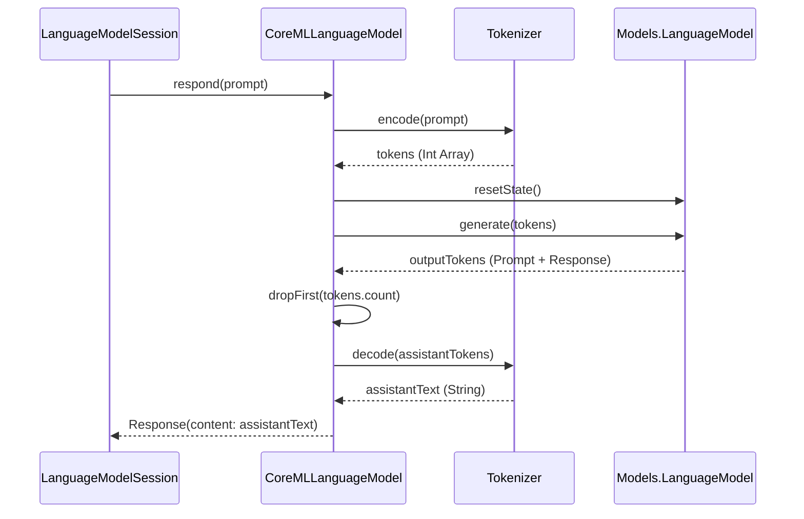

<!-- source: DeepWiki mcp.deepwiki.com · repo huggingface/AnyLanguageModel · page 5.4 CoreMLLanguageModel (Core ML) · fetched 2026-10-26 -->

# CoreMLLanguageModel (Core ML)

Relevant source files

The following files were used as context for generating this wiki page:

- [Sources/AnyLanguageModel/Models/CoreMLLanguageModel.swift](Sources/AnyLanguageModel/Models/CoreMLLanguageModel.swift)
- [Tests/AnyLanguageModelTests/CoreMLLanguageModelTests.swift](Tests/AnyLanguageModelTests/CoreMLLanguageModelTests.swift)

`CoreMLLanguageModel` provides a local inference backend for AnyLanguageModel using Apple's Core ML framework. It is designed to run compiled `.mlmodelc` files on-device, leveraging the Neural Engine, GPU, or CPU through configurable compute units. It integrates with the `swift-transformers` ecosystem for tokenization and chat template management.

## Architecture Overview

The `CoreMLLanguageModel` acts as a bridge between the `AnyLanguageModel.LanguageModel` protocol and the underlying `Models.LanguageModel` from the `swift-transformers` package. It handles the lifecycle of the model state, tokenization of prompts, and the mapping of generation options to Core ML execution parameters.

### Data Flow and System Mapping

The following diagram illustrates how a request flows from the natural language space into the Core ML execution environment.

**Diagram: Request Execution Flow**

Sources: [Sources/AnyLanguageModel/Models/CoreMLLanguageModel.swift:72-138](), [Sources/AnyLanguageModel/Models/CoreMLLanguageModel.swift:102-119]()

## Initialization and Configuration

To initialize a `CoreMLLanguageModel`, a compiled model directory (`.mlmodelc`) is required. The initializer validates the file extension and existence before attempting to load the model into memory.

### Compute Units
Users can specify `MLComputeUnits` to control which hardware accelerators are used [Sources/AnyLanguageModel/Models/CoreMLLanguageModel.swift:43-46]().
- `.all`: Uses all available engines (including Apple Neural Engine).
- `.cpuOnly`: Limits execution to the CPU.
- `.cpuAndGPU`: Uses CPU and GPU but excludes the ANE.

### Handlers for Customization
Because Core ML models vary in their expected input formats, two optional handlers are provided:
1.  **`chatTemplateHandler`**: A closure that converts `Instructions` and a `Prompt` into an array of `Message` objects [Sources/AnyLanguageModel/Models/CoreMLLanguageModel.swift:29-29]().
2.  **`toolsHandler`**: A closure that converts AnyLanguageModel `Tool` definitions into `ToolSpec` objects recognized by the model's tokenizer [Sources/AnyLanguageModel/Models/CoreMLLanguageModel.swift:30-30]().

Sources: [Sources/AnyLanguageModel/Models/CoreMLLanguageModel.swift:41-70]()

## Tokenizer Integration

`CoreMLLanguageModel` relies on the `Tokenizers` library (part of `swift-transformers`). During initialization, it asynchronously loads the tokenizer associated with the model [Sources/AnyLanguageModel/Models/CoreMLLanguageModel.swift:66-66]().

### Chat Templates
If a `chatTemplateHandler` is provided, the model uses `tokenizer.applyChatTemplate` to ensure that special tokens (like `<|im_start|>`) are correctly inserted according to the model's training configuration [Sources/AnyLanguageModel/Models/CoreMLLanguageModel.swift:102-106](). If no handler is provided, it falls back to direct string encoding of the prompt [Sources/AnyLanguageModel/Models/CoreMLLanguageModel.swift:109-109]().

## Generation Process

The generation process involves resetting the model's internal KV-cache state and iteratively predicting tokens.

### State Management
Before each generation, `model.resetState()` is called to ensure that previous conversation context stored in the model's internal buffers does not interfere with the new request [Sources/AnyLanguageModel/Models/CoreMLLanguageModel.swift:113-113]().

### Token Stripping
Core ML models often echo the input prompt in their output. `CoreMLLanguageModel` performs token-level slicing to extract only the assistant's response:
- It compares the `outputTokens` count against the input `tokens` count.
- It drops the first `n` tokens (where `n` is the prompt length) to avoid issues with normalization or whitespace differences that occur during string-level manipulation [Sources/AnyLanguageModel/Models/CoreMLLanguageModel.swift:121-131]().

**Diagram: Token Pipeline**

Sources: [Sources/AnyLanguageModel/Models/CoreMLLanguageModel.swift:113-137]()

## Structured Generation

`CoreMLLanguageModel` supports structured output (JSON) via the `generateStructuredJSON` helper.
- **Synchronous**: Supported for all `Generable` types [Sources/AnyLanguageModel/Models/CoreMLLanguageModel.swift:81-96]().
- **Streaming**: Currently, structured streaming is **not supported** for Core ML and will throw `CoreMLLanguageModelError.structuredStreamingUnsupported` [Sources/AnyLanguageModel/Models/CoreMLLanguageModel.swift:148-155]().

## Error Handling

The backend defines `CoreMLLanguageModelError` to handle specific failure modes:

| Error Case | Description |
| :--- | :--- |
| `.compiledModelRequired` | Thrown if the URL does not end in `.mlmodelc` [Sources/AnyLanguageModel/Models/CoreMLLanguageModel.swift:49-49](). |
| `.modelNotFound(URL)` | The file at the specified path does not exist [Sources/AnyLanguageModel/Models/CoreMLLanguageModel.swift:54-54](). |
| `.modelInvalid(URL, Error)` | Core ML failed to load the model (e.g., hardware incompatibility) [Sources/AnyLanguageModel/Models/CoreMLLanguageModel.swift:62-62](). |
| `.structuredStreamingUnsupported` | Attempted to stream a non-String `Generable` type [Sources/AnyLanguageModel/Models/CoreMLLanguageModel.swift:152-152](). |

### Multimodal Limitations
Current Core ML implementations in this backend do not support image segments. Any `Prompt` containing images will result in a validation error [Sources/AnyLanguageModel/Models/CoreMLLanguageModel.swift:79-79](), [Sources/AnyLanguageModelTests/CoreMLLanguageModelTests.swift:152-162]().

Sources: [Sources/AnyLanguageModel/Models/CoreMLLanguageModel.swift:1-200](), [Sources/AnyLanguageModelTests/CoreMLLanguageModelTests.swift:149-174]()

---

