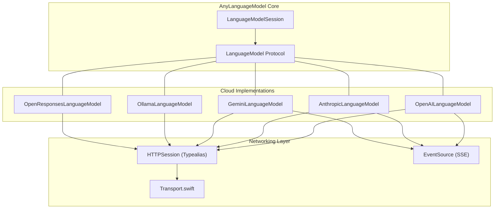
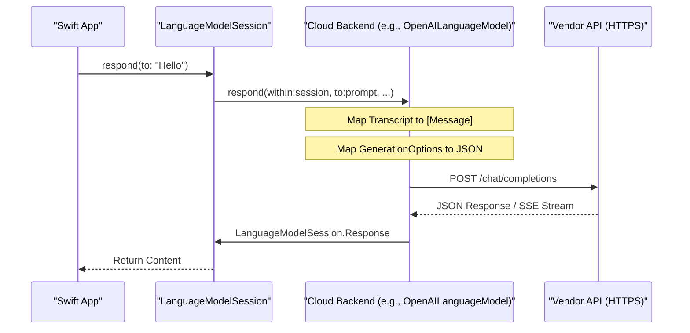

<!-- source: DeepWiki mcp.deepwiki.com · repo huggingface/AnyLanguageModel · page 5.5 Cloud API Backends · fetched 2026-10-26 -->

# Cloud API Backends

Relevant source files

The following files were used as context for generating this wiki page:

- [Sources/AnyLanguageModel/Models/AnthropicLanguageModel.swift](Sources/AnyLanguageModel/Models/AnthropicLanguageModel.swift)
- [Sources/AnyLanguageModel/Models/GeminiLanguageModel.swift](Sources/AnyLanguageModel/Models/GeminiLanguageModel.swift)
- [Sources/AnyLanguageModel/Models/OllamaLanguageModel.swift](Sources/AnyLanguageModel/Models/OllamaLanguageModel.swift)
- [Sources/AnyLanguageModel/Models/OpenAILanguageModel.swift](Sources/AnyLanguageModel/Models/OpenAILanguageModel.swift)
- [Tests/AnyLanguageModelTests/GeminiLanguageModelTests.swift](Tests/AnyLanguageModelTests/GeminiLanguageModelTests.swift)

Cloud API backends provide integration with major hosted Large Language Model (LLM) providers. Unlike local backends (MLX, Llama, CoreML), these implementations rely on network requests to external services. They share a common architecture for managing authentication, HTTP sessions, and Server-Sent Events (SSE) for streaming responses.

### Shared Infrastructure Patterns

All cloud backends in `AnyLanguageModel` follow a consistent implementation pattern to ensure they can be used interchangeably within a `LanguageModelSession` [Sources/AnyLanguageModel/LanguageModelSession.swift:1-10]().

*   **HTTPSession**: A type abstraction that allows the library to use `URLSession` by default or `AsyncHTTPClient` when the corresponding trait is enabled [Sources/AnyLanguageModel/Networking/Transport.swift:1-20]().
*   **Token Management**: Most providers (OpenAI, Anthropic, Gemini) use a `tokenProvider` closure to retrieve API keys dynamically, ensuring keys are not stored statically in the model instance [Sources/AnyLanguageModel/Models/OpenAILanguageModel.swift:234-236]().
*   **SSE Streaming**: Real-time response streaming is implemented using `EventSource` to parse incoming chunks into `ResponseStream` snapshots [Sources/AnyLanguageModel/Models/AnthropicLanguageModel.swift:1-5]().
*   **Tool Loops**: Cloud backends implement the `LanguageModel` protocol's `respond` and `streamResponse` methods, which include logic to detect tool calls in the API response and orchestrate the execution loop [Sources/AnyLanguageModel/Models/OllamaLanguageModel.swift:117-137]().

### Backend Entity Mapping

The following diagram maps the high-level cloud providers to their specific implementation classes and the shared networking components they utilize.

**Cloud Backend Architecture**

Sources: [Sources/AnyLanguageModel/LanguageModelSession.swift:19-25](), [Sources/AnyLanguageModel/Models/OpenAILanguageModel.swift:19-25](), [Sources/AnyLanguageModel/Models/AnthropicLanguageModel.swift:30-35](), [Sources/AnyLanguageModel/Models/GeminiLanguageModel.swift:10-15](), [Sources/AnyLanguageModel/Networking/Transport.swift:1-15]()

### Supported Providers

#### OpenAI (GPT-4, o1, o3)
The `OpenAILanguageModel` supports both the legacy Chat Completions API and the newer Responses API. It includes extensive support for `CustomGenerationOptions` such as `reasoningEffort` for o-series models and `serviceTier` for high-throughput requirements.
For details, see [OpenAILanguageModel](#5.5.1).

#### Anthropic (Claude 3.5, Claude 3)
The `AnthropicLanguageModel` integrates with the Messages API. It supports unique features like "Thinking" (extended reasoning) and custom beta headers for experimental features. It handles multimodal inputs by encoding images into base64 blocks within the message content.
For details, see [AnthropicLanguageModel](#5.5.2).

#### Google Gemini (Gemini 1.5, 2.0)
The `GeminiLanguageModel` provides access to Google's generative models. It includes native support for server-side tools like `googleSearch` and `codeExecution`. It also maps the `Generable` schema to Gemini's specific JSON schema format for constrained output.
For details, see [GeminiLanguageModel](#5.5.3).

#### Ollama & Open Responses
These backends focus on compatibility and local-cloud hybrids. `OllamaLanguageModel` connects to a local Ollama server, while `OpenResponsesLanguageModel` implements the provider-agnostic "Open Responses" specification.
For details, see [OllamaLanguageModel & OpenResponsesLanguageModel](#5.5.4).

### Data Flow: Transcript to API
Each cloud backend is responsible for transforming the internal `Transcript` [Sources/AnyLanguageModel/Transcript.swift:1-10]() (a collection of instructions, user prompts, and tool outputs) into the specific JSON format required by the vendor.

**Request Transformation Flow**

Sources: [Sources/AnyLanguageModel/LanguageModelSession.swift:150-165](), [Sources/AnyLanguageModel/Models/OpenAILanguageModel.swift:350-380](), [Sources/AnyLanguageModel/Models/OllamaLanguageModel.swift:79-105]()

| Feature | OpenAI | Anthropic | Gemini | Ollama |
| :--- | :--- | :--- | :--- | :--- |
| **Streaming** | SSE | SSE | SSE | ND-JSON |
| **Tool Calling** | Native | Native | Native | Native |
| **Reasoning Mode** | `reasoningEffort` | `thinking` | `thinking` | Model-dependent |
| **JSON Mode** | Strict/JSON | Native | JSON Schema | Format Key |

Sources: [Sources/AnyLanguageModel/Models/OpenAILanguageModel.swift:130-140](), [Sources/AnyLanguageModel/Models/AnthropicLanguageModel.swift:84-89](), [Sources/AnyLanguageModel/Models/GeminiLanguageModel.swift:30-45](), [Sources/AnyLanguageModel/Models/OllamaLanguageModel.swift:88-94]()

---

