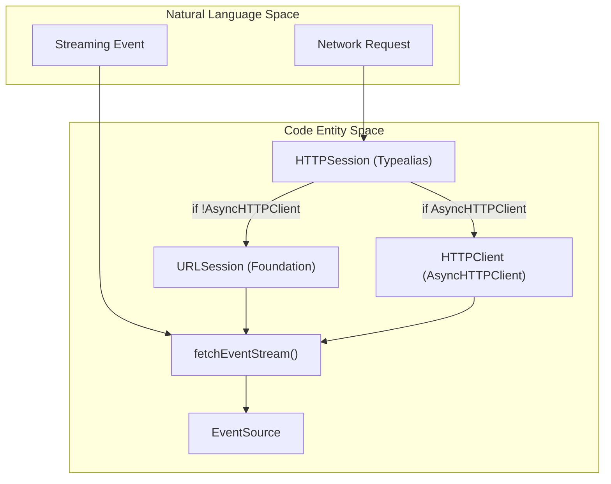
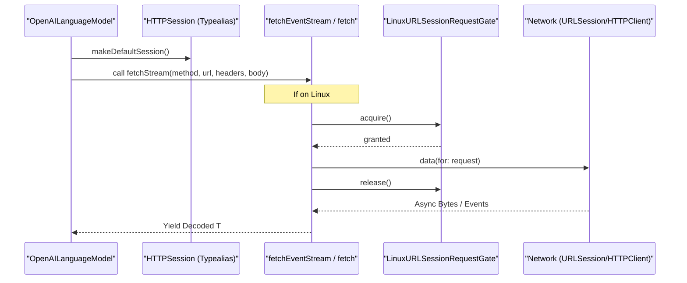

<!-- source: DeepWiki mcp.deepwiki.com · repo huggingface/AnyLanguageModel · page 6 Networking & Transport Layer · fetched 2026-10-26 -->

# Networking & Transport Layer

Relevant source files

The following files were used as context for generating this wiki page:

- [Package.resolved](Package.resolved)
- [Sources/AnyLanguageModel/Extensions/HTTPClient+Extensions.swift](Sources/AnyLanguageModel/Extensions/HTTPClient+Extensions.swift)
- [Sources/AnyLanguageModel/Extensions/URLSession+Extensions.swift](Sources/AnyLanguageModel/Extensions/URLSession+Extensions.swift)
- [Sources/AnyLanguageModel/Models/OpenResponsesLanguageModel.swift](Sources/AnyLanguageModel/Models/OpenResponsesLanguageModel.swift)
- [Sources/AnyLanguageModel/Shared/Transport.swift](Sources/AnyLanguageModel/Shared/Transport.swift)
- [Tests/AnyLanguageModelTests/URLSessionExtensionsTests.swift](Tests/AnyLanguageModelTests/URLSessionExtensionsTests.swift)

The **Networking & Transport Layer** provides a unified interface for making HTTP requests across different platforms and Swift environments. It abstracts the underlying networking library (standard `URLSession` vs. `AsyncHTTPClient`) and provides specialized support for Server-Sent Events (SSE), which is critical for streaming responses from Language Model backends.

### Transport Abstraction

To ensure compatibility across Apple platforms (iOS, macOS) and Linux, the codebase uses a `HTTPSession` typealias. This allows backends like `OpenAILanguageModel` or `AnthropicLanguageModel` to perform networking without worrying about the specific implementation details of the host environment.

*   **Platform Defaults**: On Apple platforms, `HTTPSession` defaults to `URLSession` [Sources/AnyLanguageModel/Shared/Transport.swift:15-15]().
*   **Server-Side Swift**: When the `AsyncHTTPClient` trait is enabled (typically on Linux), `HTTPSession` is aliased to `HTTPClient` [Sources/AnyLanguageModel/Shared/Transport.swift:4-4]().
*   **Linux Workarounds**: On Linux, `FoundationNetworking` has known thread-safety issues with concurrent `URLSession` operations. The layer includes a `LinuxURLSessionRequestGate` to serialize request setup and prevent crashes [Sources/AnyLanguageModel/Extensions/URLSession+Extensions.swift:36-42]().

For details on the typealias and session creation, see [HTTPSession & Transport Abstraction](#6.1).

### Streaming & EventSource Integration

LLM interactions often require real-time streaming of tokens. This layer extends both `URLSession` and `HTTPClient` with `fetchEventStream` methods [Sources/AnyLanguageModel/Extensions/URLSession+Extensions.swift:214-220]()[Sources/AnyLanguageModel/Extensions/HTTPClient+Extensions.swift:132-137](). These methods integrate with the `EventSource` library to parse `text/event-stream` responses into type-safe Swift models.

#### Networking Architecture: Code to Entity Mapping

The following diagram illustrates how the abstract `HTTPSession` maps to concrete implementations and how extensions provide the streaming capabilities used by backends.

**Transport Layer Abstraction**

Sources: [Sources/AnyLanguageModel/Shared/Transport.swift:1-21](), [Sources/AnyLanguageModel/Extensions/URLSession+Extensions.swift:214-230](), [Sources/AnyLanguageModel/Extensions/HTTPClient+Extensions.swift:132-150]()

### Extensions & Utilities

Beyond basic transport, this layer includes several critical utilities for handling LLM-specific data patterns:

*   **Partial JSON Decoding**: LLMs stream JSON incrementally. The layer utilizes `PartialJSONDecoder` to allow backends to parse incomplete JSON structures as they arrive [Package.resolved:32-38]().
*   **JSONValue**: A type-safe enum used to represent arbitrary JSON structures in `CustomGenerationOptions` [Sources/AnyLanguageModel/Models/OpenResponsesLanguageModel.swift:84-84]().
*   **Thread Safety**: The `Locked<State>` primitive is used throughout the networking extensions and sessions to ensure thread-safe access to internal state during asynchronous operations.

For details on these utilities, see [Extensions & Utilities](#6.2).

#### Request Lifecycle Flow

This diagram shows how a request moves from a Backend implementation through the Transport layer to the network.

**Request Execution Flow**

Sources: [Sources/AnyLanguageModel/Shared/Transport.swift:6-19](), [Sources/AnyLanguageModel/Extensions/URLSession+Extensions.swift:126-139](), [Sources/AnyLanguageModel/Extensions/URLSession+Extensions.swift:162-168]()

---

### Child Pages
*   [HTTPSession & Transport Abstraction](#6.1): Deep dive into the conditional compilation of networking clients and the `makeDefaultSession` factory.
*   [Extensions & Utilities](#6.2): Documentation for SSE streaming helpers, Linux-specific safety gates, and JSON utility types.

---

