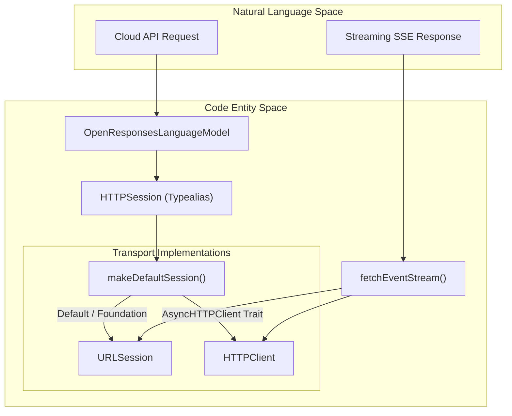
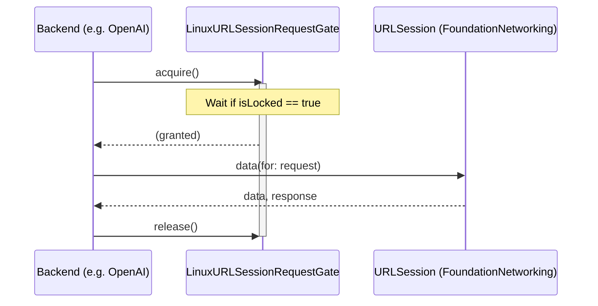

<!-- source: DeepWiki mcp.deepwiki.com · repo huggingface/AnyLanguageModel · page 6.1 HTTPSession & Transport Abstraction · fetched 2026-10-26 -->

# HTTPSession & Transport Abstraction

Relevant source files

The following files were used as context for generating this wiki page:

- [Package.swift](Package.swift)
- [Sources/AnyLanguageModel/Extensions/HTTPClient+Extensions.swift](Sources/AnyLanguageModel/Extensions/HTTPClient+Extensions.swift)
- [Sources/AnyLanguageModel/Extensions/URLSession+Extensions.swift](Sources/AnyLanguageModel/Extensions/URLSession+Extensions.swift)
- [Sources/AnyLanguageModel/Models/OpenResponsesLanguageModel.swift](Sources/AnyLanguageModel/Models/OpenResponsesLanguageModel.swift)
- [Sources/AnyLanguageModel/Shared/Transport.swift](Sources/AnyLanguageModel/Shared/Transport.swift)
- [Tests/AnyLanguageModelTests/URLSessionExtensionsTests.swift](Tests/AnyLanguageModelTests/URLSessionExtensionsTests.swift)

AnyLanguageModel provides a unified networking interface that abstracts away the underlying HTTP transport layer. This allows the library to support both Apple's `URLSession` (default) and Swift Server's `AsyncHTTPClient` (via the `AsyncHTTPClient` trait) while maintaining a consistent API for cloud-based backends like OpenAI, Anthropic, and Gemini.

## Transport Layer Overview

The transport layer is built around the `HTTPSession` typealias and a set of extensions that provide high-level methods for JSON fetching and Server-Sent Events (SSE) streaming. This abstraction ensures that backends can perform network requests without knowing whether they are running in a client-side app (iOS/macOS) or a server-side environment (Linux).

### Implementation and Data Flow

The library uses conditional compilation to swap the underlying implementation based on the available modules and enabled package traits.

| Entity | Implementation (Default) | Implementation (`AsyncHTTPClient` trait) |
| :--- | :--- | :--- |
| **`HTTPSession`** | `URLSession` [Sources/AnyLanguageModel/Shared/Transport.swift:15-15]() | `HTTPClient` [Sources/AnyLanguageModel/Shared/Transport.swift:4-4]() |
| **Default Factory** | `makeDefaultSession()` returns `URLSession(configuration: .default)` [Sources/AnyLanguageModel/Shared/Transport.swift:17-19]() | `makeDefaultSession()` returns `HTTPClient.shared` [Sources/AnyLanguageModel/Shared/Transport.swift:6-8]() |
| **Streaming** | `URLSession.fetchEventStream` [Sources/AnyLanguageModel/Extensions/URLSession+Extensions.swift:203-203]() | `HTTPClient.fetchEventStream` [Sources/AnyLanguageModel/Extensions/HTTPClient+Extensions.swift:132-132]() |

### Code Entity Relationship Diagram
The following diagram illustrates how the `HTTPSession` abstraction bridges the high-level backend models to the low-level networking implementations.

**Transport Abstraction Mapping**

**Sources:** [Sources/AnyLanguageModel/Shared/Transport.swift:1-21](), [Sources/AnyLanguageModel/Models/OpenResponsesLanguageModel.swift:23-23]()

---

## URLSession Implementation (Default)

On Apple platforms and standard Foundation environments, `HTTPSession` resolves to `URLSession`. The library extends `URLSession` to support modern `async/await` patterns and SSE streaming via the `EventSource` package.

### Key Functions
- `fetch<T: Decodable>(...)`: A convenience wrapper for standard POST/GET requests that handles JSON encoding/decoding and status code validation [Sources/AnyLanguageModel/Extensions/URLSession+Extensions.swift:106-160]().
- `fetchEventStream<T: Decodable>(...)`: Establishes a connection to an SSE endpoint and returns an `AsyncThrowingStream` of decoded objects [Sources/AnyLanguageModel/Extensions/URLSession+Extensions.swift:203-255]().

### Linux Thread-Safety: `LinuxURLSessionRequestGate`
On Linux, `FoundationNetworking` has a known thread-safety bug when performing concurrent operations on `URLSession`. AnyLanguageModel implements a synchronization primitive to mitigate this.

- **`LinuxURLSessionRequestGate`**: An actor that ensures only one request setup path occurs at a time on Linux [Sources/AnyLanguageModel/Extensions/URLSession+Extensions.swift:36-88]().
- **`withLinuxRequestLock(_:)`**: A helper function used within `fetch` and `fetchStream` to wrap the sensitive `data(for:)` calls [Sources/AnyLanguageModel/Extensions/URLSession+Extensions.swift:90-102]().

**Linux Request Flow**

**Sources:** [Sources/AnyLanguageModel/Extensions/URLSession+Extensions.swift:16-103](), [Tests/AnyLanguageModelTests/URLSessionExtensionsTests.swift:51-73]()

---

## AsyncHTTPClient Implementation

When the `AsyncHTTPClient` trait is enabled in `Package.swift`, `HTTPSession` is mapped to `HTTPClient` from the `swift-server/async-http-client` package. This is the preferred transport for server-side Swift deployments.

### Integration Details
- **Type Aliasing**: To avoid conflicts with Swift's native `Task` type, the library uses `typealias SwiftTask = Task` when importing `AsyncHTTPClient` [Sources/AnyLanguageModel/Extensions/HTTPClient+Extensions.swift:4-4]().
- **Memory Management**: The `HTTPClientBodyReaderTaskBox` is used to hold references to body-read tasks, ensuring that cancelling the `AsyncThrowingStream` correctly stops the underlying NIO body iteration [Sources/AnyLanguageModel/Extensions/HTTPClient+Extensions.swift:7-9]().
- **SSE Support**: Uses `EventSource` to parse the `text/event-stream` chunks received from the NIO-based client [Sources/AnyLanguageModel/Extensions/HTTPClient+Extensions.swift:132-161]().

**Sources:** [Package.swift:83-86](), [Sources/AnyLanguageModel/Extensions/HTTPClient+Extensions.swift:1-130]()

---

## Backend Usage

Cloud-based backends (OpenAI, Anthropic, Gemini, Ollama, OpenResponses) do not instantiate sessions directly. Instead, they accept an `HTTPSession` during initialization, defaulting to the result of `makeDefaultSession()`.

### Request Lifecycle Example
Using `OpenResponsesLanguageModel` as an example, the flow from a user request to the network is as follows:

1. **Initialization**: The model is created with a session (defaulting to `URLSession` or `HTTPClient`) [Sources/AnyLanguageModel/Models/OpenResponsesLanguageModel.swift:23-23]().
2. **Request Construction**: The model converts the `Transcript` into a provider-specific JSON body.
3. **Transport**: The model calls `session.fetch(...)` or `session.fetchEventStream(...)` [Sources/AnyLanguageModel/Extensions/URLSession+Extensions.swift:106-106]().
4. **Response Handling**: The transport layer validates the HTTP status code (200-299) and decodes the JSON response into the expected Swift types [Sources/AnyLanguageModel/Extensions/URLSession+Extensions.swift:148-159]().

### Error Handling
The transport layer throws specific errors that backends can catch or propagate:
- `URLSessionError`: Used by the Foundation implementation [Sources/AnyLanguageModel/Extensions/URLSession+Extensions.swift:135-158]().
- `HTTPClientError`: Used by the AsyncHTTPClient implementation [Sources/AnyLanguageModel/Extensions/HTTPClient+Extensions.swift:44-57]().

**Sources:** [Sources/AnyLanguageModel/Extensions/URLSession+Extensions.swift:106-160](), [Sources/AnyLanguageModel/Models/OpenResponsesLanguageModel.swift:23-33]()

---

