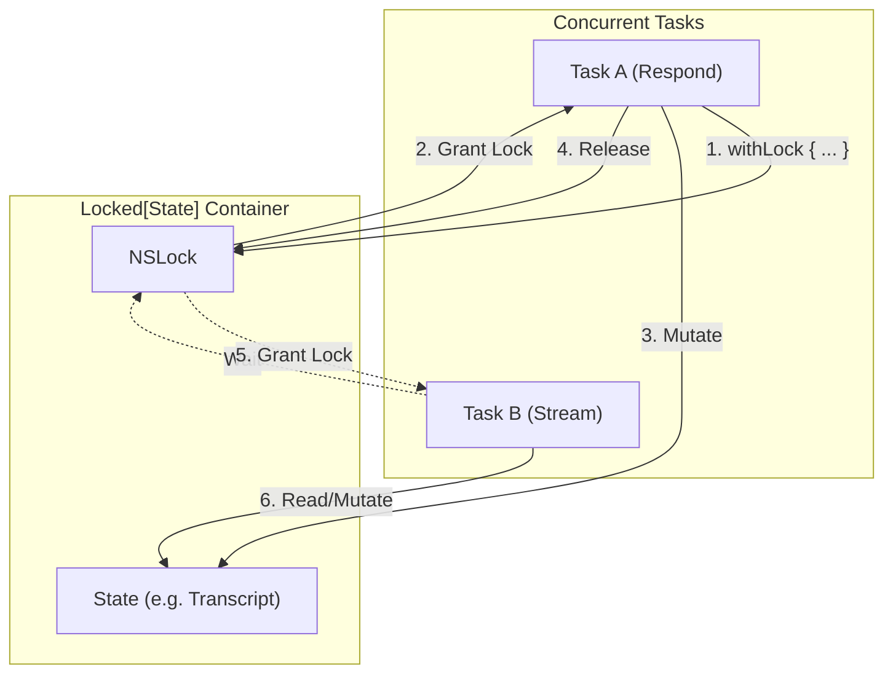
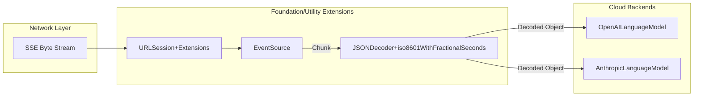

<!-- source: DeepWiki mcp.deepwiki.com · repo huggingface/AnyLanguageModel · page 6.2 Extensions & Utilities · fetched 2026-10-26 -->

# Extensions & Utilities

Relevant source files

The following files were used as context for generating this wiki page:

- [Sources/AnyLanguageModel/Extensions/Character+Extensions.swift](Sources/AnyLanguageModel/Extensions/Character+Extensions.swift)
- [Sources/AnyLanguageModel/Extensions/JSONDecoder+Extensions.swift](Sources/AnyLanguageModel/Extensions/JSONDecoder+Extensions.swift)
- [Sources/AnyLanguageModel/GenerationGuide.swift](Sources/AnyLanguageModel/GenerationGuide.swift)
- [Sources/AnyLanguageModel/Shared/JSONValue.swift](Sources/AnyLanguageModel/Shared/JSONValue.swift)
- [Sources/AnyLanguageModel/Shared/Locked.swift](Sources/AnyLanguageModel/Shared/Locked.swift)
- [Sources/AnyLanguageModel/Shared/StructuredGeneration.swift](Sources/AnyLanguageModel/Shared/StructuredGeneration.swift)
- [Tests/AnyLanguageModelTests/CharacterExtensionsTests.swift](Tests/AnyLanguageModelTests/CharacterExtensionsTests.swift)
- [Tests/AnyLanguageModelTests/CustomGenerationOptionsTests.swift](Tests/AnyLanguageModelTests/CustomGenerationOptionsTests.swift)
- [Tests/AnyLanguageModelTests/JSONDecoderExtensionsTests.swift](Tests/AnyLanguageModelTests/JSONDecoderExtensionsTests.swift)
- [Tests/AnyLanguageModelTests/LockedTests.swift](Tests/AnyLanguageModelTests/LockedTests.swift)
- [Tests/AnyLanguageModelTests/ObservationTests.swift](Tests/AnyLanguageModelTests/ObservationTests.swift)
- [Tests/AnyLanguageModelTests/OpenResponsesLanguageModelTests.swift](Tests/AnyLanguageModelTests/OpenResponsesLanguageModelTests.swift)

This page documents the shared utility types and extensions that provide the foundation for networking, concurrency, and data processing across the `AnyLanguageModel` package. These utilities ensure thread safety, robust JSON handling for streaming, and consistent date parsing.

## Concurrency: Locked<State>

The `Locked<State>` class is a thread-safety primitive used extensively throughout the codebase (e.g., in `LanguageModelSession` and `ConstrainedJSONGenerator`) to protect shared mutable state. It wraps an `NSLock` and provides a closure-based API to ensure that critical sections are kept small and synchronous [Sources/AnyLanguageModel/Shared/Locked.swift:4-22]().

### Implementation Details
- **Storage**: Uses `NSLock` for low-level mutual exclusion [Sources/AnyLanguageModel/Shared/Locked.swift:5]().
- **Access**: The `withLock` method yields an `inout` reference to the protected state [Sources/AnyLanguageModel/Shared/Locked.swift:19-21]().
- **Concurrency**: It is conditionally `@unchecked Sendable` when the underlying `State` is `Sendable` [Sources/AnyLanguageModel/Shared/Locked.swift:24]().

### Data Flow: Thread-Safe State Mutation
The following diagram illustrates how multiple tasks interact with a `Locked` resource, such as the `transcript` in a `LanguageModelSession`.

**Locked State Access Pattern**

**Sources:** [Sources/AnyLanguageModel/Shared/Locked.swift:4-22](), [Tests/AnyLanguageModelTests/LockedTests.swift:67-79]()

---

## JSON Handling & Streaming Utilities

### JSONValue
`JSONValue` is a type-alias for `JSONSchema.JSONValue`, providing a type-safe representation of JSON structures (null, bool, number, string, array, object) used in `CustomGenerationOptions` and `Tool` arguments [Sources/AnyLanguageModel/Shared/JSONValue.swift:1-4]().

### Character Extensions
The `Character` extension provides logic for validating characters during constrained JSON generation.
- **`isValidJSONStringCharacter`**: Determines if a character can be safely emitted within a JSON string without escaping. It rejects backslashes, control characters (scalar < 0x20), and various quote marks [Sources/AnyLanguageModel/Extensions/Character+Extensions.swift:11-24]().
- **`containsEmojiScalar`**: Detects if a character contains emoji properties to allow them in generated output [Sources/AnyLanguageModel/Extensions/Character+Extensions.swift:5-9]().

### JSONDecoder Extensions
To handle varying API response formats (especially from cloud providers), `JSONDecoder` includes a custom date decoding strategy:
- **`iso8601WithFractionalSeconds`**: Attempts to decode dates using ISO8601 with fractional seconds first, falling back to standard internet date-time if the fractional part is missing [Sources/AnyLanguageModel/Extensions/JSONDecoder+Extensions.swift:4-28]().

**Sources:** [Sources/AnyLanguageModel/Shared/JSONValue.swift:1-4](), [Sources/AnyLanguageModel/Extensions/Character+Extensions.swift:1-25](), [Sources/AnyLanguageModel/Extensions/JSONDecoder+Extensions.swift:1-29]()

---

## Constrained Generation Helpers

The `ConstrainedJSONGenerator` relies on internal utilities to manage token budgets and caching for efficiency during streaming.

### StringTokenCache
To avoid re-calculating valid JSON tokens for every request, the system uses a `StringTokenCache`. It stores sets of `Int` (token IDs) keyed by the tokenizer's vocabulary size and special tokens [Sources/AnyLanguageModel/Shared/StructuredGeneration.swift:38-57]().

### OptionalPropertyBudget
This utility defines heuristics for when the generator should attempt to generate optional fields in a schema.
- **Heuristics**: It requires a minimum of 8 remaining tokens or at least 1/10th of the total budget to prevent half-finished optional properties [Sources/AnyLanguageModel/Shared/StructuredGeneration.swift:24-36]().

**Sources:** [Sources/AnyLanguageModel/Shared/StructuredGeneration.swift:24-57]()

---

## Networking Extensions

While the networking layer is primarily abstracted via `HTTPSession`, specific extensions enable Server-Sent Events (SSE) and partial decoding.

### SSE & HTTP Utilities
The package extends `URLSession` (and `HTTPClient` when the `AsyncHTTPClient` trait is enabled) to support streaming.
- **SSE Fetching**: Helpers transform raw byte streams into `EventSource` events.
- **Partial Decoding**: Used to decode individual JSON chunks from a stream as they arrive, rather than waiting for the full payload.

**System Mapping: Network to Code Entities**

**Sources:** [Sources/AnyLanguageModel/Extensions/JSONDecoder+Extensions.swift:4-28](), [Sources/AnyLanguageModel/Shared/StructuredGeneration.swift:62-95]()

---

## Generation Guides

`GenerationGuide<Value>` provides a type-safe way to define constraints for the `@Generable` system. These are translated into `GenerationSchema` nodes used by the `ConstrainedJSONGenerator` [Sources/AnyLanguageModel/GenerationGuide.swift:5-22]().

| Type | Guide Method | Description |
| :--- | :--- | :--- |
| `Int` / `Double` | `.minimum(n)`, `.maximum(n)`, `.range(a...b)` | Inclusive numeric bounds [Sources/AnyLanguageModel/GenerationGuide.swift:46-107]() |
| `String` | `.constant(s)`, `.anyOf([s])`, `.pattern(regex)` | String value constraints [Sources/AnyLanguageModel/GenerationGuide.swift:26-42]() |
| `Array` | `.minimumCount(n)`, `.maximumCount(n)`, `.count(a...b)` | Collection size constraints [Sources/AnyLanguageModel/GenerationGuide.swift:184-204]() |

**Sources:** [Sources/AnyLanguageModel/GenerationGuide.swift:5-204]()

---

