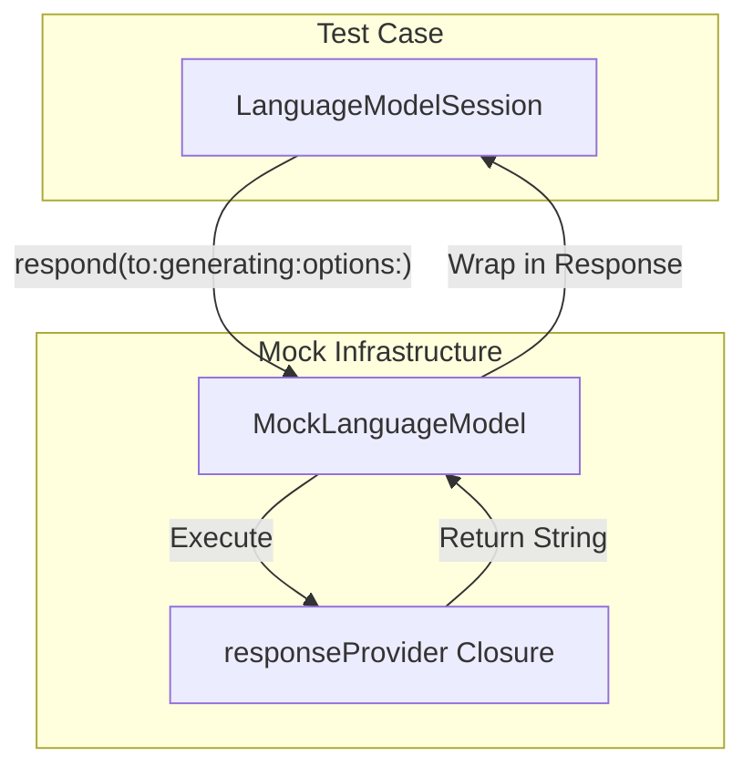
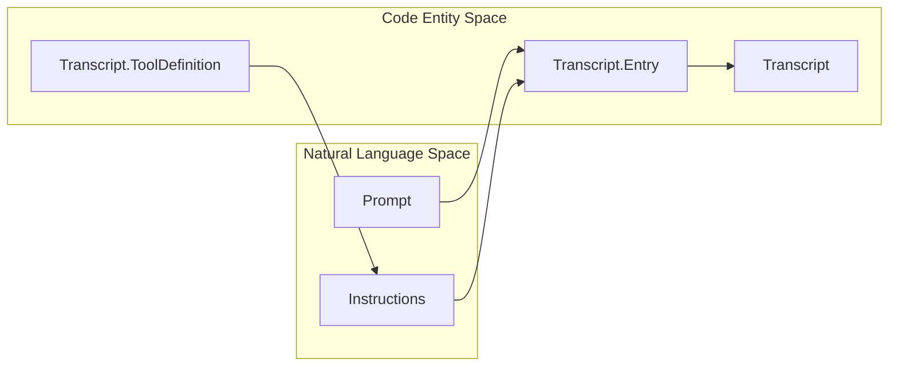

<!-- source: DeepWiki mcp.deepwiki.com · repo huggingface/AnyLanguageModel · page 7 Testing Infrastructure · fetched 2026-10-26 -->

# Testing Infrastructure

Relevant source files

The following files were used as context for generating this wiki page:

- [Sources/AnyLanguageModel/Availability.swift](Sources/AnyLanguageModel/Availability.swift)
- [Tests/AnyLanguageModelTests/MockLanguageModelTests.swift](Tests/AnyLanguageModelTests/MockLanguageModelTests.swift)
- [Tests/AnyLanguageModelTests/Shared/MockLanguageModel.swift](Tests/AnyLanguageModelTests/Shared/MockLanguageModel.swift)

The AnyLanguageModel test suite is designed to ensure parity across diverse backends (local and cloud-hosted) while maintaining the rigorous type-safety guarantees of the `Generable` and `Tool` systems. The infrastructure is divided into high-level integration tests, mock-based unit tests for core logic, and macro expansion verification.

## Mock & Shared Test Infrastructure

To facilitate testing without relying on expensive or slow LLM providers, the codebase provides a robust set of mock objects. The primary tool is `MockLanguageModel`, which allows developers to inject custom response logic or simulate specific availability states.

### Key Mock Components
*   **`MockLanguageModel`**: Implements the `LanguageModel` protocol. It can be configured with a `responseProvider` closure to simulate specific LLM behaviors like echoing prompts, returning fixed strings, or simulating latency [Tests/AnyLanguageModelTests/Shared/MockLanguageModel.swift:3-18]().
*   **Availability Simulation**: Mocks can simulate `unavailable` states with custom reasons, allowing tests to verify error handling in `LanguageModelSession` [Tests/AnyLanguageModelTests/Shared/MockLanguageModel.swift:95-99]().
*   **Tool Testing**: The infrastructure includes shared tool definitions (e.g., `WeatherTool`) and specialized test tools like `ToolSchemaOptOutTool` to verify how `Transcript.Instructions` handle tool definitions [Tests/AnyLanguageModelTests/MockLanguageModelTests.swift:5-19]().

### Mock Logic Flow
The following diagram illustrates how `MockLanguageModel` intercepts session requests to provide predictable outputs.

**Mock Response Lifecycle**

Sources: [Tests/AnyLanguageModelTests/Shared/MockLanguageModel.swift:24-44](), [Tests/AnyLanguageModelTests/MockLanguageModelTests.swift:38-49]()

For details on implementing new mocks, see [Mock & Shared Test Infrastructure](#7.1).

## Provider Integration Tests

Integration tests verify that specific backends (e.g., `MLXLanguageModel`, `OpenAILanguageModel`, `SystemLanguageModel`) adhere to the `LanguageModel` protocol and correctly handle provider-specific features.

*   **Parity Testing**: A core goal is verifying "drop-in parity" with Apple's `FoundationModels`. This ensures that switching from `SystemLanguageModel` to a cloud provider doesn't break transcript management or tool calling.
*   **Environment Requirements**: Many integration tests require specific environment variables (API keys) or local model files (GGUF for Llama, weights for MLX).
*   **Streaming & Concurrency**: Tests verify that `ResponseStream` snapshots are correctly yielded and that `isResponding` state transitions are thread-safe [Tests/AnyLanguageModelTests/MockLanguageModelTests.swift:197-205]().

For details on running and writing backend-specific tests, see [Provider Integration Tests](#7.2).

## Unit Tests: Core Types

Unit tests focus on the internal logic of the library's foundational types, ensuring that data transformations and macro expansions are correct.

| Component | Test Focus |
| :--- | :--- |
| **Generable Macros** | Verifies that `@Generable` and `@Guide` correctly synthesize `generationSchema` and `PartiallyGenerated` types. |
| **Transcript & Prompt** | Ensures that `Transcript.Entry` types (instructions, prompt, tool calls) are correctly appended and preserved [Tests/AnyLanguageModelTests/MockLanguageModelTests.swift:162-187](). |
| **Constrained Generation** | Tests the `ConstrainedJSONGenerator` against various `GenerationSchema` trees to ensure valid JSON output. |
| **Tool Execution** | Validates the `ToolExecutionDelegate` logic, ensuring tool outputs are correctly fed back into the session transcript. |

**Core Entity Association**

Sources: [Tests/AnyLanguageModelTests/MockLanguageModelTests.swift:122-148](), [Sources/AnyLanguageModel/Availability.swift:2-8]()

For details on core type testing, see [Unit Tests: Core Types](#7.3).

## Summary of Test Organization

| Test Category | Location | Purpose |
| :--- | :--- | :--- |
| **Mock Helpers** | `Tests/AnyLanguageModelTests/Shared/` | Shared primitives for unit testing. |
| **Logic Tests** | `Tests/AnyLanguageModelTests/` | Protocol conformance and session state management. |
| **Macro Tests** | `Tests/AnyLanguageModelMacrosTests/` | SwiftSyntax expansion verification. |

Sources: [Tests/AnyLanguageModelTests/MockLanguageModelTests.swift:1-37](), [Tests/AnyLanguageModelTests/Shared/MockLanguageModel.swift:1-3]()

---

