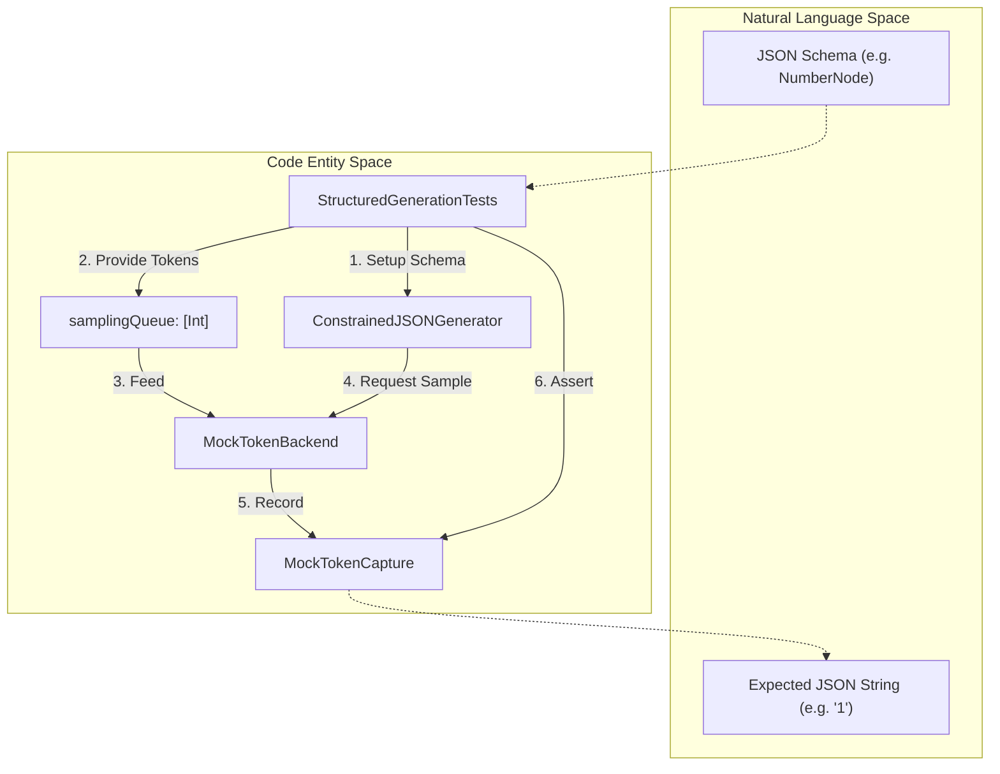
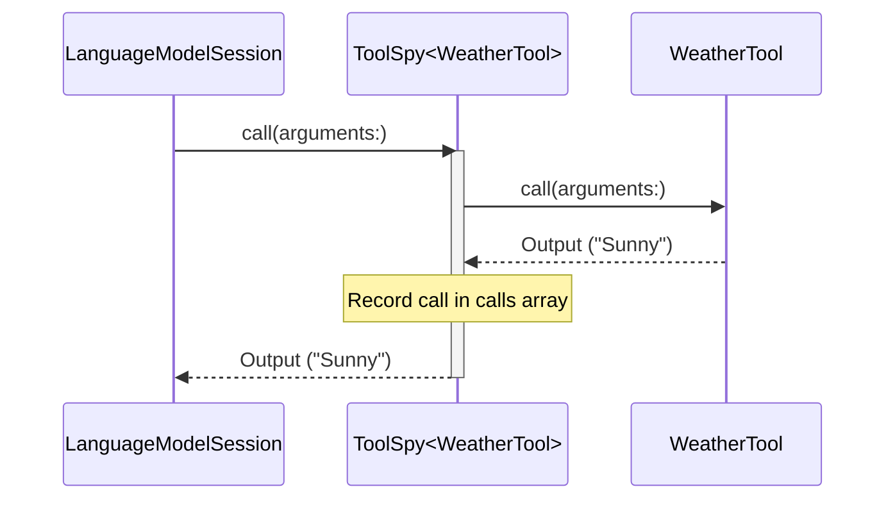

<!-- source: DeepWiki mcp.deepwiki.com · repo huggingface/AnyLanguageModel · page 7.1 Mock & Shared Test Infrastructure · fetched 2026-10-26 -->

# Mock & Shared Test Infrastructure

Relevant source files

The following files were used as context for generating this wiki page:

- [Sources/AnyLanguageModel/Availability.swift](Sources/AnyLanguageModel/Availability.swift)
- [Tests/AnyLanguageModelTests/Shared/Images.swift](Tests/AnyLanguageModelTests/Shared/Images.swift)
- [Tests/AnyLanguageModelTests/Shared/MockLanguageModel.swift](Tests/AnyLanguageModelTests/Shared/MockLanguageModel.swift)
- [Tests/AnyLanguageModelTests/Shared/MockTokenBackend.swift](Tests/AnyLanguageModelTests/Shared/MockTokenBackend.swift)
- [Tests/AnyLanguageModelTests/Shared/StructuredGenerationFixtures.swift](Tests/AnyLanguageModelTests/Shared/StructuredGenerationFixtures.swift)
- [Tests/AnyLanguageModelTests/Shared/ToolSpy.swift](Tests/AnyLanguageModelTests/Shared/ToolSpy.swift)
- [Tests/AnyLanguageModelTests/Shared/Tools.swift](Tests/AnyLanguageModelTests/Shared/Tools.swift)
- [Tests/AnyLanguageModelTests/StructuredGenerationTests.swift](Tests/AnyLanguageModelTests/StructuredGenerationTests.swift)

The `AnyLanguageModel` test suite relies on a robust set of mock implementations and shared fixtures to verify core logic without requiring live LLM backends or heavy local weights. These primitives allow for deterministic testing of structured generation, tool calling loops, and session state management.

## Mock Language Model

The `MockLanguageModel` is a flexible implementation of the `LanguageModel` protocol used to simulate various model behaviors, including successful responses, streaming, and unavailability.

### Implementation and Data Flow

`MockLanguageModel` uses closures to provide responses, allowing tests to inject specific logic at runtime. It currently specializes in `String` content generation for simplicity in unit testing [Tests/AnyLanguageModelTests/Shared/MockLanguageModel.swift:3-18]().

| Feature | Description |
| :--- | :--- |
| **Availability** | Controlled via `availabilityProvider`. Can return `.available` or `.unavailable(UnavailableReason)` [Tests/AnyLanguageModelTests/Shared/MockLanguageModel.swift:20-22](). |
| **Response Logic** | The `responseProvider` closure receives the `Prompt` and `GenerationOptions`, returning a `String` [Tests/AnyLanguageModelTests/Shared/MockLanguageModel.swift:9](). |
| **Instruction Handling** | Automatically prepends `LanguageModelSession` instructions to the prompt description before passing it to the provider [Tests/AnyLanguageModelTests/Shared/MockLanguageModel.swift:36-37](). |

### Static Factory Methods

Common test scenarios are encapsulated in static properties:
*   `echo`: Returns the prompt's description as the response [Tests/AnyLanguageModelTests/Shared/MockLanguageModel.swift:85-89]().
*   `fixed(_:)`: Returns a specific hardcoded string [Tests/AnyLanguageModelTests/Shared/MockLanguageModel.swift:91-93]().
*   `unavailable`: Simulates a model that is currently offline or unsupported [Tests/AnyLanguageModelTests/Shared/MockLanguageModel.swift:95-99]().
*   `streamingMock()`: Simulates a delayed response to test async stream handling [Tests/AnyLanguageModelTests/Shared/MockLanguageModel.swift:101-106]().

**Sources:** [Tests/AnyLanguageModelTests/Shared/MockLanguageModel.swift:1-107](), [Sources/AnyLanguageModel/Availability.swift:1-13]()

## Token Backend & Constrained Generation Mocks

Testing the `ConstrainedJSONGenerator` requires a way to simulate the tokenization and sampling process without a real tokenizer (like SentencePiece or Tiktoken).

### MockTokenBackend

`MockTokenBackend` implements the `TokenBackend` protocol. It uses manual mappings between integers and strings to simulate a vocabulary [Tests/AnyLanguageModelTests/Shared/MockTokenBackend.swift:22-32]().

*   **Sampling Queue**: Tests can provide a `samplingQueue` (an array of `Int`). The `sample(from:)` function will pull tokens from this queue sequentially, verifying that the requested token is within the `allowedTokens` set provided by the generator [Tests/AnyLanguageModelTests/Shared/MockTokenBackend.swift:78-93]().
*   **Token Capture**: The `MockTokenCapture` class records every token "decoded" by the backend, allowing tests to verify the exact sequence of tokens produced [Tests/AnyLanguageModelTests/Shared/MockTokenBackend.swift:5-20]().

### Structured Generation Testing Diagram

This diagram shows how `StructuredGenerationTests` uses `MockTokenBackend` to verify the `ConstrainedJSONGenerator` logic.

**Sources:** [Tests/AnyLanguageModelTests/Shared/MockTokenBackend.swift:1-94](), [Tests/AnyLanguageModelTests/StructuredGenerationTests.swift:65-96]()

## Tooling Infrastructure

Shared tools and spies allow for testing the orchestration of tool-calling loops within `LanguageModelSession`.

### ToolSpy
`ToolSpy` is an actor that wraps any `Tool` implementation. It records every call made to the tool, including arguments and results (success or failure), without modifying the tool's behavior [Tests/AnyLanguageModelTests/Shared/ToolSpy.swift:3-30](). This is essential for verifying that a model correctly triggered a tool with the expected parameters.

### Shared Tool Definitions
*   **WeatherTool**: A standard tool used across provider integration tests. It defines its arguments using a `@Generable` struct, allowing it to automatically produce a `GenerationSchema` [Tests/AnyLanguageModelTests/Shared/Tools.swift:3-16]().

### Tool Execution Flow

**Sources:** [Tests/AnyLanguageModelTests/Shared/ToolSpy.swift:1-35](), [Tests/AnyLanguageModelTests/Shared/Tools.swift:1-17]()

## Shared Fixtures

To ensure consistency across tests, the codebase provides standard data fixtures.

### Structured Generation Fixtures
The `StructuredGenerationFixtures.swift` file contains a variety of `@Generable` types used to test the schema generation and decoding pipeline [Tests/AnyLanguageModelTests/Shared/StructuredGenerationFixtures.swift:1-125]():
*   **Primitives**: `SimpleString`, `SimpleInt`, `SimpleBool`, `SimpleDouble`.
*   **Complex Types**: `BasicStruct`, `Address`, `StructuredPerson`.
*   **Enums**: `Priority`.
*   **Collections**: `SimpleArray`, `MultiChoiceQuestion` (testing `.count` constraints).

### Image Helpers
For multimodal testing, `Images.swift` provides a minimal 1x1 PNG encoded as `Data` (`testImageData`) and a sample `testImageURL` [Tests/AnyLanguageModelTests/Shared/Images.swift:3-33](). This avoids large binary assets in the repository while providing valid image data for backend consumption.

**Sources:** [Tests/AnyLanguageModelTests/Shared/StructuredGenerationFixtures.swift:1-125](), [Tests/AnyLanguageModelTests/Shared/Images.swift:1-34]()

---

