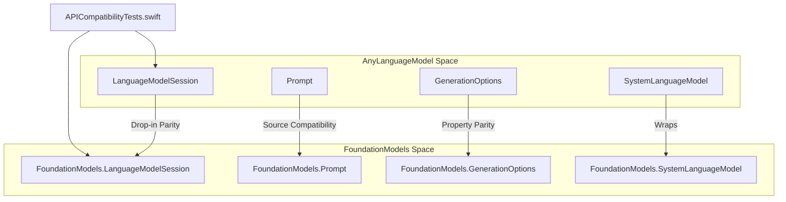
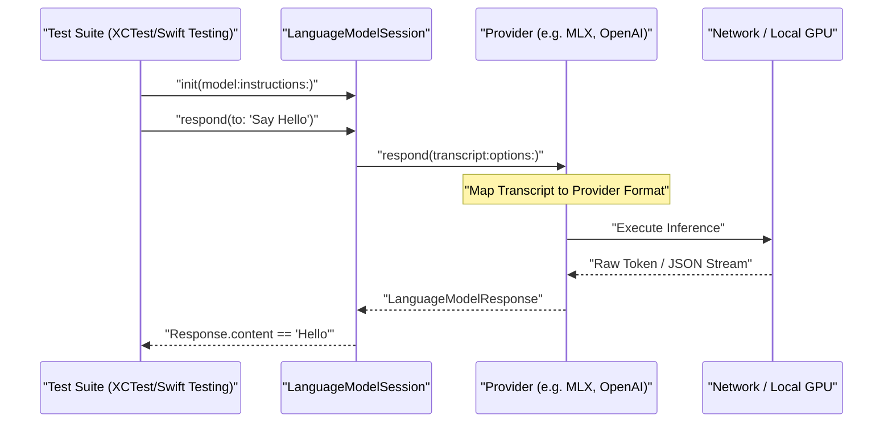

<!-- source: DeepWiki mcp.deepwiki.com · repo huggingface/AnyLanguageModel · page 7.2 Provider Integration Tests · fetched 2026-10-26 -->

# Provider Integration Tests

Relevant source files

The following files were used as context for generating this wiki page:

- [.github/workflows/ci.yml](.github/workflows/ci.yml)
- [Tests/AnyLanguageModelTests/APICompatibilityAnyLanguageModelTests.swift](Tests/AnyLanguageModelTests/APICompatibilityAnyLanguageModelTests.swift)
- [Tests/AnyLanguageModelTests/APICompatibilityFoundationModelsTests.swift](Tests/AnyLanguageModelTests/APICompatibilityFoundationModelsTests.swift)
- [Tests/AnyLanguageModelTests/AnthropicLanguageModelTests.swift](Tests/AnyLanguageModelTests/AnthropicLanguageModelTests.swift)
- [Tests/AnyLanguageModelTests/InstructionsTests.swift](Tests/AnyLanguageModelTests/InstructionsTests.swift)
- [Tests/AnyLanguageModelTests/MLXLanguageModelTests.swift](Tests/AnyLanguageModelTests/MLXLanguageModelTests.swift)
- [Tests/AnyLanguageModelTests/OllamaLanguageModelTests.swift](Tests/AnyLanguageModelTests/OllamaLanguageModelTests.swift)
- [Tests/AnyLanguageModelTests/OpenAILanguageModelTests.swift](Tests/AnyLanguageModelTests/OpenAILanguageModelTests.swift)
- [Tests/AnyLanguageModelTests/SystemLanguageModelTests.swift](Tests/AnyLanguageModelTests/SystemLanguageModelTests.swift)

The `AnyLanguageModel` test suite employs a multi-tiered integration testing strategy to ensure that all backends (local, system, and cloud) adhere to the core `LanguageModel` protocol and maintain drop-in parity with Apple's `FoundationModels` framework. These tests verify end-to-end data flow from `LanguageModelSession` through provider-specific implementations and back to the user.

## Test Infrastructure & Environment

Integration tests are categorized by backend and often require specific environment variables or hardware capabilities to execute. The CI pipeline dynamically enables or skips these suites based on the available environment [Tests/AnyLanguageModelTests/MLXLanguageModelTests.swift:7-30]().

### Required Environment Variables

| Backend | Variable | Purpose |
| :--- | :--- | :--- |
| **OpenAI** | `OPENAI_API_KEY` | Required for `OpenAILanguageModelTests` [.github/workflows/ci.yml:17-18](). |
| **Anthropic** | `ANTHROPIC_API_KEY` | Required for `AnthropicLanguageModelTests` [Tests/AnyLanguageModelTests/AnthropicLanguageModelTests.swift:6](). |
| **MLX** | `HF_TOKEN` | Hugging Face token for downloading gated models [Tests/AnyLanguageModelTests/MLXLanguageModelTests.swift:19-21](). |
| **MLX** | `ENABLE_MLX_TESTS` | Explicit override to run heavy local inference tests [Tests/AnyLanguageModelTests/MLXLanguageModelTests.swift:9-11](). |

### Hardware & Trait Requirements
Local inference tests (MLX, Llama, CoreML) are gated by SwiftPM traits. The CI builds these traits on macOS but skips them in standard Linux runs unless specified [.github/workflows/ci.yml:58-61](). `SystemLanguageModel` tests only run on macOS 15+ / iOS 18+ environments where `FoundationModels` is available [Tests/AnyLanguageModelTests/SystemLanguageModelTests.swift:4-11]().

## Provider Test Patterns

Every backend integration test suite follows a standardized pattern to ensure consistent behavior across the library.

### 1. Basic Response & Streaming
Verifies that `LanguageModelSession.respond(to:)` and `LanguageModelSession.streamResponse(to:)` correctly return content and that the `isResponding` state transitions appropriately [Tests/AnyLanguageModelTests/OpenAILanguageModelTests.swift:33-61]().

### 2. Multi-Turn Conversation
Ensures that the `Transcript` is correctly appended and sent back to the provider in subsequent turns, allowing the model to reference previous context [Tests/AnyLanguageModelTests/OpenAILanguageModelTests.swift:129-137]().

### 3. Tool Calling Orchestration
Tests verify that models can trigger tools (e.g., `WeatherTool`), receive the `ToolOutput`, and generate a final summary. Tests use a `spy` on tools to verify that the model passed the correct arguments [Tests/AnyLanguageModelTests/MLXLanguageModelTests.swift:122-145]().

### 4. Multimodal Inputs
Verifies that images provided via `URL` or `Data` (Base64) are correctly encoded and processed by vision-capable models like `Qwen2-VL` or `gpt-4o` [Tests/AnyLanguageModelTests/MLXLanguageModelTests.swift:147-181]().

### 5. Structured Generation
Tests verify that backends correctly apply `GenerationSchema`. For cloud providers, this often tests "Strict Mode" or JSON mode; for local providers (MLX/Llama), it tests the `ConstrainedJSONGenerator` logit masking [Tests/AnyLanguageModelTests/OllamaLanguageModelTests.swift:70-98]().

## API Compatibility Tests

A critical requirement of `AnyLanguageModel` is drop-in parity with Apple's `FoundationModels`. The suite includes "Twin Tests" that run identical code against both frameworks to ensure behavior is indistinguishable.

### Compatibility Verification Flow

The diagram below illustrates how the test suite verifies that `AnyLanguageModel` entities map correctly to `FoundationModels` entities.

"API Compatibility Mapping"

Sources: [Tests/AnyLanguageModelTests/APICompatibilityAnyLanguageModelTests.swift:13-37](), [Tests/AnyLanguageModelTests/APICompatibilityFoundationModelsTests.swift:13-40]()

### Implementation of Parity Tests
The compatibility tests utilize `@available` checks to run only on supported OS versions. They execute a standard `respond` and `streamResponse` loop, asserting that the `Response` structure and `Transcript` behavior match exactly between the two implementations [Tests/AnyLanguageModelTests/APICompatibilityAnyLanguageModelTests.swift:15-37]().

## Provider-Specific Details

### MLX Integration Tests
MLX tests focus on lifecycle management, specifically verifying that the model's `availability` state changes from `.unavailable(.notLoaded)` to `.available` after the first successful inference [Tests/AnyLanguageModelTests/MLXLanguageModelTests.swift:38-50](). It also enforces a `serialized` execution to prevent GPU memory contention during testing [Tests/AnyLanguageModelTests/MLXLanguageModelTests.swift:32]().

### Cloud Provider Integration
Cloud tests (OpenAI, Anthropic, Gemini) include logic for:
* **Custom Base URLs**: Verifying that the model correctly appends paths to custom hosts (e.g., for local proxies) [Tests/AnyLanguageModelTests/OpenAILanguageModelTests.swift:11-15]().
* **Rate Limit Handling**: Some tests use `withOpenAIRateLimitRetry` to handle the volatile nature of shared API keys in CI [Tests/AnyLanguageModelTests/OpenAILanguageModelTests.swift:148-153]().
* **Variant Parameterization**: Verifying that `OpenAILanguageModel` correctly switches between `/v1/chat/completions` and `/v1/responses` endpoints [Tests/AnyLanguageModelTests/OpenAILanguageModelTests.swift:17-23]().

### Integration Test Data Flow

"Integration Test Execution Path"

Sources: [Tests/AnyLanguageModelTests/OpenAILanguageModelTests.swift:33-38](), [Tests/AnyLanguageModelTests/MLXLanguageModelTests.swift:52-57](), [Tests/AnyLanguageModelTests/OllamaLanguageModelTests.swift:26-31]()

Sources:
- `Tests/AnyLanguageModelTests/MLXLanguageModelTests.swift`
- `Tests/AnyLanguageModelTests/OpenAILanguageModelTests.swift`
- `Tests/AnyLanguageModelTests/SystemLanguageModelTests.swift`
- `Tests/AnyLanguageModelTests/OllamaLanguageModelTests.swift`
- `Tests/AnyLanguageModelTests/AnthropicLanguageModelTests.swift`
- `Tests/AnyLanguageModelTests/APICompatibilityAnyLanguageModelTests.swift`
- `Tests/AnyLanguageModelTests/APICompatibilityFoundationModelsTests.swift`
- `.github/workflows/ci.yml`

---

