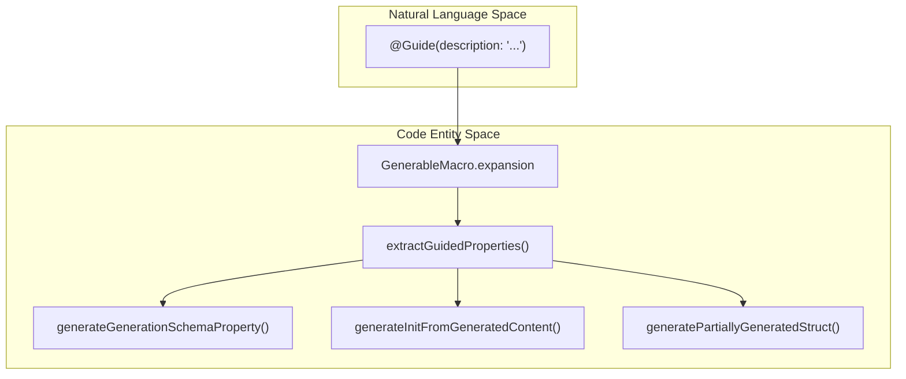
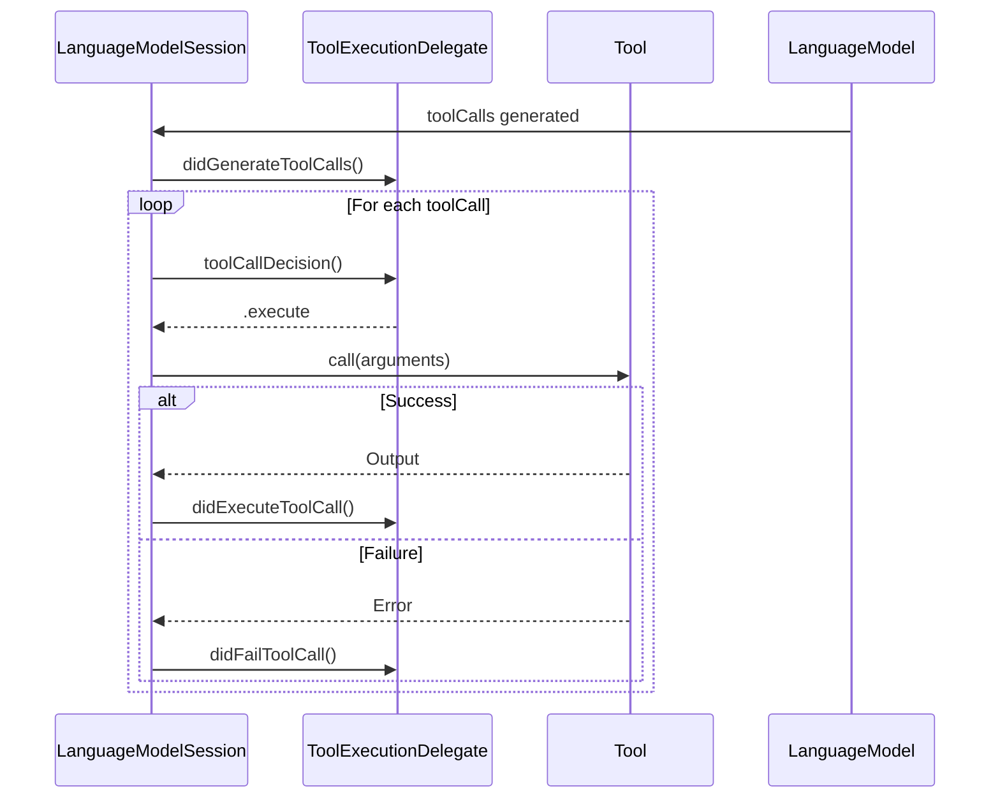

<!-- source: DeepWiki mcp.deepwiki.com · repo huggingface/AnyLanguageModel · page 7.3 Unit Tests: Core Types · fetched 2026-10-26 -->

# Unit Tests: Core Types

Relevant source files

The following files were used as context for generating this wiki page:

- [.github/workflows/ci.yml](.github/workflows/ci.yml)
- [Sources/AnyLanguageModel/Generable.swift](Sources/AnyLanguageModel/Generable.swift)
- [Sources/AnyLanguageModel/Shared/Locked.swift](Sources/AnyLanguageModel/Shared/Locked.swift)
- [Sources/AnyLanguageModel/Shared/StructuredGeneration.swift](Sources/AnyLanguageModel/Shared/StructuredGeneration.swift)
- [Sources/AnyLanguageModel/Tool.swift](Sources/AnyLanguageModel/Tool.swift)
- [Sources/AnyLanguageModelMacros/GenerableMacro.swift](Sources/AnyLanguageModelMacros/GenerableMacro.swift)
- [Tests/AnyLanguageModelTests/GenerableMacroTests.swift](Tests/AnyLanguageModelTests/GenerableMacroTests.swift)
- [Tests/AnyLanguageModelTests/InstructionsTests.swift](Tests/AnyLanguageModelTests/InstructionsTests.swift)
- [Tests/AnyLanguageModelTests/LanguageModelFeedbackTests.swift](Tests/AnyLanguageModelTests/LanguageModelFeedbackTests.swift)
- [Tests/AnyLanguageModelTests/LockedTests.swift](Tests/AnyLanguageModelTests/LockedTests.swift)
- [Tests/AnyLanguageModelTests/ObservationTests.swift](Tests/AnyLanguageModelTests/ObservationTests.swift)
- [Tests/AnyLanguageModelTests/ToolExecutionDelegateTests.swift](Tests/AnyLanguageModelTests/ToolExecutionDelegateTests.swift)

This page documents the unit test suites for the core types and abstractions in `AnyLanguageModel`. These tests ensure the correctness of macro expansion, structured generation constraints, data model integrity, and tool execution orchestration.

## Generable Macro Tests

The `GenerableMacroTests` suite verifies that the `@Generable` and `@Guide` macros correctly expand into Swift code that implements the `Generable` protocol. This includes synthesizing initializers, schema generation, and `GeneratedContent` conversion.

### Key Test Cases
*   **Schema Correctness**: Verifies that `@Guide` descriptions containing multiline strings, special characters (quotes, backslashes), and newlines are correctly escaped in the generated `GenerationSchema` [Tests/AnyLanguageModelTests/GenerableMacroTests.swift:135-179]().
*   **Memberwise Initialization**: Ensures that the synthesized memberwise initializer correctly populates properties and that the `generatedContent` property reflects these values [Tests/AnyLanguageModelTests/GenerableMacroTests.swift:209-220]().
*   **Actor Isolation**: Confirms that types annotated with `@MainActor` maintain their isolation after macro expansion, specifically for the `init(_ generatedContent:)` and `asPartiallyGenerated()` methods [Tests/AnyLanguageModelTests/GenerableMacroTests.swift:182-206]().
*   **Nested & Recursive Types**: Validates that properties using other `@Generable` types (including arrays and optionals) correctly use the `PartiallyGenerated` variants of those types [Tests/AnyLanguageModelTests/GenerableMacroTests.swift:239-247]().

### Macro Expansion Flow
The following diagram illustrates how the `GenerableMacro` processes a struct declaration into the final protocol implementation.

**Macro Expansion Pipeline**

Sources: [Sources/AnyLanguageModelMacros/GenerableMacro.swift:7-64](), [Tests/AnyLanguageModelTests/GenerableMacroTests.swift:5-132]()

---

## Structured Generation & Constraints

The `ConstrainedJSONGenerator` is tested to ensure it can guide a `TokenBackend` to produce valid JSON according to a `GenerationSchema`.

### Implementation Details
The generator uses a set of token caches and terminators to restrict sampling:
*   **String Cache**: `StringTokenCache` stores allowed tokens for JSON strings to avoid re-scanning the entire vocabulary [Sources/AnyLanguageModel/Shared/StructuredGeneration.swift:38-57]().
*   **Terminators**: The generator pre-calculates tokens for structural JSON characters like `,`, `}`, `]`, and `:` [Sources/AnyLanguageModel/Shared/StructuredGeneration.swift:104-112]().
*   **Budgeting**: `OptionalPropertyBudget` heuristics determine if there are enough remaining tokens to include optional keys in an object [Sources/AnyLanguageModel/Shared/StructuredGeneration.swift:24-36]().

Sources: [Sources/AnyLanguageModel/Shared/StructuredGeneration.swift:62-132]()

---

## Data Model Tests: Instructions, Transcript, and Feedback

These tests cover the fundamental building blocks of a conversation session.

### Instructions & Prompts
The `InstructionsTests` verify the `Instructions` builder, which allows for DSL-like construction of system prompts using string literals and conditionals [Tests/AnyLanguageModelTests/InstructionsTests.swift:18-44]().

### Observation & Thread Safety
*   **ObservationTests**: Verifies that `LanguageModelSession` correctly notifies observers when `transcript` or `isResponding` changes. This ensures compatibility with SwiftUI and the `Observation` framework [Tests/AnyLanguageModelTests/ObservationTests.swift:7-54]().
*   **LockedTests**: Exhaustively tests the `Locked<State>` primitive, ensuring thread-safe access to shared state across concurrent tasks, including high-contention scenarios and error propagation [Tests/AnyLanguageModelTests/LockedTests.swift:7-112]().

### Language Model Feedback
`LanguageModelFeedbackTests` ensure that the feedback enums (`Sentiment`, `Issue.Category`) cover all required cases for user-reported model performance [Tests/AnyLanguageModelTests/LanguageModelFeedbackTests.swift:7-45]().

Sources: [Tests/AnyLanguageModelTests/InstructionsTests.swift:5-50](), [Tests/AnyLanguageModelTests/ObservationTests.swift:6-95](), [Tests/AnyLanguageModelTests/LockedTests.swift:6-152](), [Tests/AnyLanguageModelTests/LanguageModelFeedbackTests.swift:5-46]()

---

## Tool Execution Delegate Tests

The `ToolExecutionDelegateTests` verify the orchestration of tool calls within a `LanguageModelSession`. This suite uses a `ToolCallingTestModel` and a `ToolExecutionDelegateSpy` to track the lifecycle of a tool call.

### Execution Flow
1.  **Generation**: The model generates tool calls.
2.  **Decision**: The `ToolExecutionDelegate` is asked for a `ToolExecutionDecision` (`.execute`, `.stop`, or `.provideOutput`) [Tests/AnyLanguageModelTests/ToolExecutionDelegateTests.swift:21-26]().
3.  **Execution**: If `.execute` is chosen, the `Tool.call(arguments:)` method is invoked [Sources/AnyLanguageModel/Tool.swift:80]().
4.  **Reporting**: Success or failure is reported back to the delegate via `didExecuteToolCall` or `didFailToolCall` [Tests/AnyLanguageModelTests/ToolExecutionDelegateTests.swift:28-43]().

**Tool Execution Lifecycle**

### Specialized Tests
*   **Error Handling**: Confirms that if a tool throws, the error is caught, reported to the delegate, and wrapped in a `LanguageModelSession.ToolCallError` [Tests/AnyLanguageModelTests/ToolExecutionDelegateTests.swift:168-173]().
*   **Decision Interruption**: Tests that returning `.stop` from the delegate halts further tool execution and returns the current transcript [Tests/AnyLanguageModelTests/ToolExecutionDelegateTests.swift:98-105]().

Sources: [Tests/AnyLanguageModelTests/ToolExecutionDelegateTests.swift:5-175](), [Sources/AnyLanguageModel/Tool.swift:113-130]()

---

