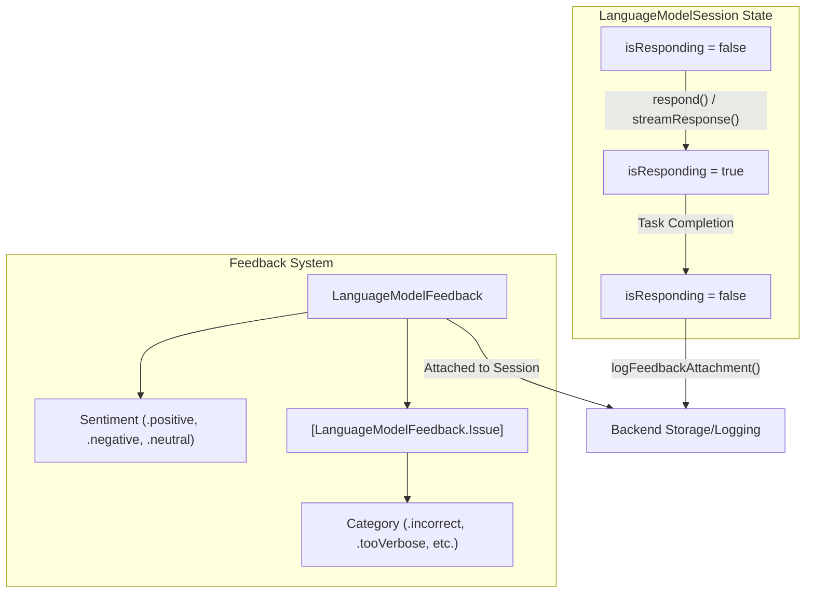
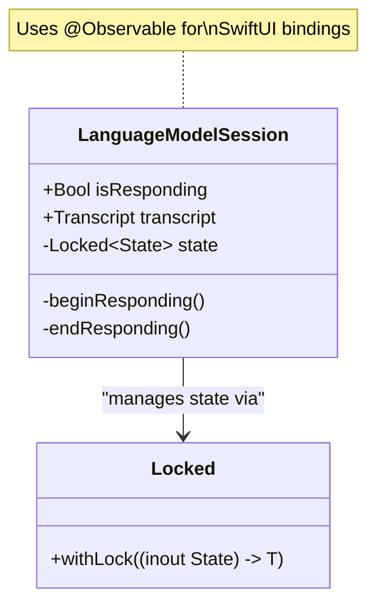

<!-- source: DeepWiki mcp.deepwiki.com · repo huggingface/AnyLanguageModel · page 8 Feedback & Observability · fetched 2026-10-26 -->

# Feedback & Observability

Relevant source files

The following files were used as context for generating this wiki page:

- [Sources/AnyLanguageModel/LanguageModelFeedback.swift](Sources/AnyLanguageModel/LanguageModelFeedback.swift)
- [Sources/AnyLanguageModel/LanguageModelSession.swift](Sources/AnyLanguageModel/LanguageModelSession.swift)
- [Tests/AnyLanguageModelTests/LanguageModelFeedbackTests.swift](Tests/AnyLanguageModelTests/LanguageModelFeedbackTests.swift)

The AnyLanguageModel framework provides built-in mechanisms for monitoring the state of a model session and collecting user feedback on model outputs. This system is designed to be compatible with modern Swift concurrency and UI frameworks like SwiftUI, while offering a structured way to report model performance issues.

### System Overview

The observability and feedback system consists of two primary components:
1.  **State Observability**: Real-time tracking of the model's status (e.g., whether it is currently generating a response) using Swift's `@Observable` macro.
2.  **Structured Feedback**: A formal data model for capturing user sentiments and specific categories of model failure (e.g., "Too Verbose" or "Incorrect").

### Logic Flow: Session State & Feedback

The following diagram illustrates how `LanguageModelSession` manages its internal state during a request and how feedback is associated with the resulting transcript.

**Session Lifecycle and Feedback Integration**

**Sources:** [Sources/AnyLanguageModel/LanguageModelSession.swift:5-15](), [Sources/AnyLanguageModel/LanguageModelFeedback.swift:1-20]()

---

## 8.1 LanguageModelFeedback

The `LanguageModelFeedback` struct is the primary data container for reporting the quality of a model's response. It allows developers to capture both a general `Sentiment` and a collection of specific `Issue` objects.

### Sentiment and Issues
- **Sentiment**: An enum representing the overall user feeling: `.positive`, `.negative`, or `.neutral` [Sources/AnyLanguageModel/LanguageModelFeedback.swift:3-12]().
- **Issue Categories**: A granular list of potential problems, including `.didNotFollowInstructions`, `.tooVerbose`, `.incorrect`, and `.triggeredGuardrailUnexpectedly` [Sources/AnyLanguageModel/LanguageModelFeedback.swift:20-68]().

### Logging Feedback
Feedback is submitted through the `LanguageModel` protocol's `logFeedbackAttachment` method. This allows backends to receive structured data about how well they performed for a specific session or prompt.

| Component | Description |
| :--- | :--- |
| `LanguageModelFeedback` | Root container for sentiment and issues [Sources/AnyLanguageModel/LanguageModelFeedback.swift:1-12](). |
| `Issue.Category` | Enumeration of 8 distinct failure modes [Sources/AnyLanguageModel/LanguageModelFeedback.swift:20-68](). |
| `logFeedbackAttachment` | Protocol method for transmitting feedback to the backend [Sources/AnyLanguageModel/LanguageModelSession.swift:100-102](). |

For details, see [LanguageModelFeedback](#8.1).

**Sources:** [Sources/AnyLanguageModel/LanguageModelFeedback.swift:1-100](), [Tests/AnyLanguageModelTests/LanguageModelFeedbackTests.swift:5-45]()

---

## 8.2 Observable State & SwiftUI Integration

`LanguageModelSession` is marked with the `@Observable` macro, making it a first-class citizen in SwiftUI and modern UIKit applications. This allows the UI to react automatically to changes in the session's state without manual notification code.

### The isResponding State
The `isResponding` property tracks whether the model is currently processing a request or streaming a response [Sources/AnyLanguageModel/LanguageModelSession.swift:6-9](). The session automatically manages this state:
- It calls `beginResponding()` when a `respond` or `streamResponse` task starts [Sources/AnyLanguageModel/LanguageModelSession.swift:104-108]().
- It calls `endResponding()` once the task completes or throws an error [Sources/AnyLanguageModel/LanguageModelSession.swift:110-114]().

### Thread Safety and Concurrency
To ensure thread safety across asynchronous calls, the session utilizes a `Locked<State>` primitive [Sources/AnyLanguageModel/LanguageModelSession.swift:16-17](). This allows the `@Observable` properties to be updated safely from background tasks while remaining accessible to the main-thread UI.

**Code Entity Mapping: Observability**

**Sources:** [Sources/AnyLanguageModel/LanguageModelSession.swift:4-17](), [Sources/AnyLanguageModel/LanguageModelSession.swift:104-126]()

For details, see [Observable State & SwiftUI Integration](#8.2).

**Sources:** [Sources/AnyLanguageModel/LanguageModelSession.swift:1-126]()

---

