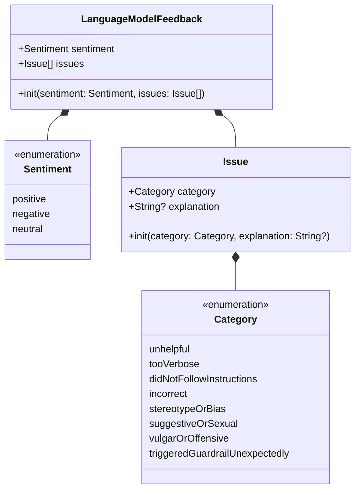
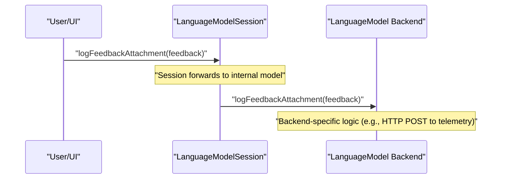

<!-- source: DeepWiki mcp.deepwiki.com · repo huggingface/AnyLanguageModel · page 8.1 LanguageModelFeedback · fetched 2026-10-26 -->

# LanguageModelFeedback

Relevant source files

The following files were used as context for generating this wiki page:

- [Sources/AnyLanguageModel/LanguageModelFeedback.swift](Sources/AnyLanguageModel/LanguageModelFeedback.swift)
- [Tests/AnyLanguageModelTests/LanguageModelFeedbackTests.swift](Tests/AnyLanguageModelTests/LanguageModelFeedbackTests.swift)

The `LanguageModelFeedback` system provides a structured way for users and developers to report the quality of model generations. It mirrors the feedback capabilities found in Apple's `FoundationModels` framework, allowing for granular reporting of sentiments and specific issue categories. This metadata can be used by backend implementations to improve model performance, log telemetry, or trigger fine-tuning workflows.

### Core Data Structures

The feedback system is built around three primary types: the top-level `LanguageModelFeedback` struct, the `Sentiment` enum, and the `Issue` struct containing a `Category` enum.

#### Sentiment
The `Sentiment` enum represents the high-level user reaction to a model's response.

| Case | Description |
| :--- | :--- |
| `.positive` | Indicates the response was helpful and accurate. |
| `.negative` | Indicates the response was problematic or unhelpful. |
| `.neutral` | Indicates a neutral or indifferent reaction. |

Sources: [Sources/AnyLanguageModel/LanguageModelFeedback.swift:3-12]()

#### Issue Categories
When a response is suboptimal, the `Issue.Category` enum allows for precise classification of the failure mode.

| Category | Description | Example |
| :--- | :--- | :--- |
| `.unhelpful` | Response lacks necessary detail. | Asking for a recipe and getting ingredients but no amounts. |
| `.tooVerbose` | Response contains unnecessary filler. | Asking for a simple recipe and getting several introductory paragraphs. |
| `.didNotFollowInstructions` | Model ignored specific constraints. | Asking for numbered steps and getting a bulleted list instead. |
| `.incorrect` | Model provided factually wrong info. | Asking how to make pizza and the model suggests using glue. |
| `.stereotypeOrBias` | Model exhibited harmful bias. | Using gendered pronouns when the context was neutral. |
| `.suggestiveOrSexual` | Response contained inappropriate content. | Including adult themes in a request for a school play script. |
| `.vulgarOrOffensive` | Response used profanity or insults. | Using vulgarity in a draft for a customer service complaint. |
| `.triggeredGuardrailUnexpectedly` | False positive safety block. | Getting a safety violation error when asking for a cake recipe. |

Sources: [Sources/AnyLanguageModel/LanguageModelFeedback.swift:20-68]()

### Implementation Detail

The `LanguageModelFeedback` struct is a `Sendable` container that aggregates a `Sentiment` and an array of `Issue` objects. Each `Issue` optionally contains a string `explanation` for free-form text feedback.

#### Entity Relationship Diagram
This diagram shows how the feedback types are structured in the code.

Sources: [Sources/AnyLanguageModel/LanguageModelFeedback.swift:1-99]()

### Submitting Feedback

Feedback is submitted via the `logFeedbackAttachment` method. While the feedback types are defined in `LanguageModelFeedback.swift`, the submission entry point is defined on the `LanguageModel` protocol and typically called through a `LanguageModelSession`.

#### Data Flow: Feedback Submission
This diagram illustrates the flow from a UI-triggered feedback event to the backend implementation.

Sources: [Sources/AnyLanguageModel/LanguageModelFeedback.swift:1-99](), [Tests/AnyLanguageModelTests/LanguageModelFeedbackTests.swift:36-44]()

### Testing and Validation

The feedback system is verified through unit tests in `LanguageModelFeedbackTests.swift`. These tests ensure that all enum cases are present and that the initializers correctly store provided data.

- **Exhaustiveness**: Tests verify that `Sentiment` contains 3 cases and `Issue.Category` contains 8 cases using `CaseIterable` [Tests/AnyLanguageModelTests/LanguageModelFeedbackTests.swift:7-24]().
- **Data Integrity**: Tests confirm that `explanation` strings and `Sentiment` values are preserved through the struct initializers [Tests/AnyLanguageModelTests/LanguageModelFeedbackTests.swift:26-44]().

Sources: [Tests/AnyLanguageModelTests/LanguageModelFeedbackTests.swift:5-45]()

---

