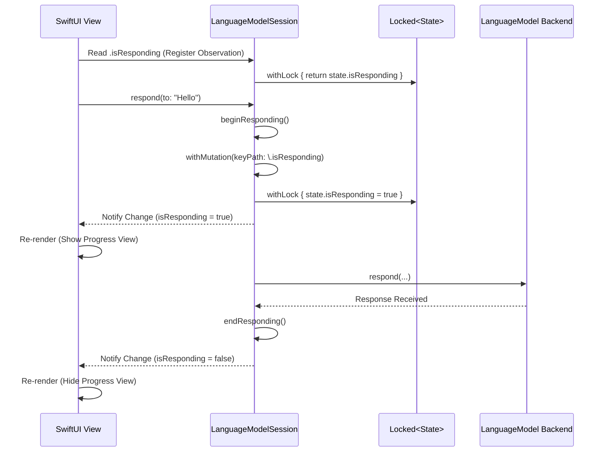
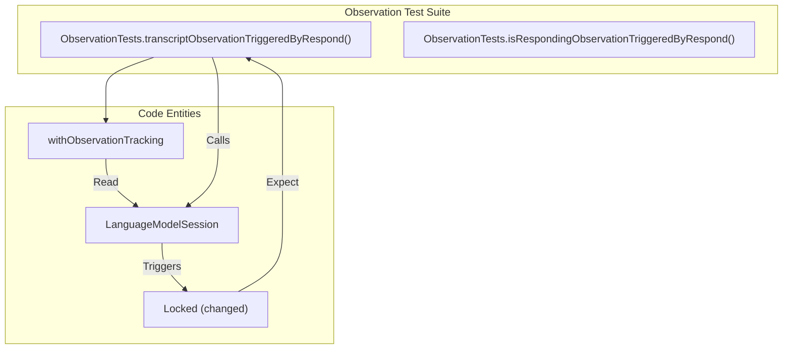

<!-- source: DeepWiki mcp.deepwiki.com · repo huggingface/AnyLanguageModel · page 8.2 Observable State & SwiftUI Integration · fetched 2026-10-26 -->

# Observable State & SwiftUI Integration

<details>
<summary>Relevant source files</summary>

The following files were used as context for generating this wiki page:

- [Sources/AnyLanguageModel/LanguageModelSession.swift](Sources/AnyLanguageModel/LanguageModelSession.swift)
- [Sources/AnyLanguageModel/SendableMetatype.swift](Sources/AnyLanguageModel/SendableMetatype.swift)
- [Sources/AnyLanguageModel/Shared/Locked.swift](Sources/AnyLanguageModel/Shared/Locked.swift)
- [Sources/AnyLanguageModel/Shared/StructuredGeneration.swift](Sources/AnyLanguageModel/Shared/StructuredGeneration.swift)
- [Tests/AnyLanguageModelTests/LockedTests.swift](Tests/AnyLanguageModelTests/LockedTests.swift)
- [Tests/AnyLanguageModelTests/ObservationTests.swift](Tests/AnyLanguageModelTests/ObservationTests.swift)

</details>


The `LanguageModelSession` is designed to be a reactive, thread-safe bridge between asynchronous LLM backends and synchronous UI frameworks like SwiftUI. It leverages the modern Swift `Observation` framework to provide seamless state updates while using internal synchronization primitives to maintain consistency across concurrent generation tasks.

## Observable Session State

`LanguageModelSession` is marked with the `@Observable` macro [Sources/AnyLanguageModel/LanguageModelSession.swift:4-5](), allowing SwiftUI views to automatically track and respond to changes in its properties.

### Key Observable Properties

| Property | Type | Description |
| :--- | :--- | :--- |
| `isResponding` | `Bool` | Indicates if the model is currently generating a response or executing tools [Sources/AnyLanguageModel/LanguageModelSession.swift:6-9](). |
| `transcript` | `Transcript` | The full history of the conversation, including instructions, prompts, and responses [Sources/AnyLanguageModel/LanguageModelSession.swift:11-14](). |

### Implementation Detail: Manual Access/Mutation
Because the session manages state internally using a `Locked` primitive for thread safety, it manually calls `access(keyPath:)` in getters [Sources/AnyLanguageModel/LanguageModelSession.swift:7,12]() and `withMutation(keyPath:operation:)` during updates [Sources/AnyLanguageModel/LanguageModelSession.swift:105,111,161](). This ensures that the `Observation` system is notified even though the underlying data is stored within a private `Locked<State>` container [Sources/AnyLanguageModel/LanguageModelSession.swift:16]().

### Data Flow: Session State to SwiftUI
The following diagram illustrates how a user interaction triggers a state change that propagates back to the UI.

**Session Observation Lifecycle**

Sources: [Sources/AnyLanguageModel/LanguageModelSession.swift:104-114](), [Tests/AnyLanguageModelTests/ObservationTests.swift:42-54]()

---

## Thread Safety with `Locked<State>`

The `Locked<T>` class is a fundamental utility used throughout the codebase to protect shared mutable state from race conditions [Sources/AnyLanguageModel/Shared/Locked.swift:4-6](). It wraps an `NSLock` and provides a `withLock` method for safe access [Sources/AnyLanguageModel/Shared/Locked.swift:19-21]().

### Features of `Locked`
- **Synchronous Access**: Ensures only one thread can mutate the state at a time [Sources/AnyLanguageModel/Shared/Locked.swift:20]().
- **Rethrows Errors**: If the closure passed to `withLock` throws, the error is propagated while safely releasing the lock [Sources/AnyLanguageModel/Shared/Locked.swift:19-21]().
- **Sendable Support**: It is conditionally `@unchecked Sendable` when the wrapped state is `Sendable` [Sources/AnyLanguageModel/Shared/Locked.swift:24]().

### Usage in Code Entities
`Locked` is used for high-frequency state management where actors might introduce unnecessary overhead or reentrancy issues.

| Entity | Purpose of `Locked` |
| :--- | :--- |
| `LanguageModelSession` | Synchronizes `isResponding` and `Transcript` updates [Sources/AnyLanguageModel/LanguageModelSession.swift:16](). |
| `StringTokenCache` | Manages a shared cache of tokenized strings across backend instances [Sources/AnyLanguageModel/Shared/StructuredGeneration.swift:38-48](). |
| `MockLanguageModel` | Tracks call counts and recorded prompts in test suites [Tests/AnyLanguageModelTests/ObservationTests.swift:11,74](). |

Sources: [Sources/AnyLanguageModel/Shared/Locked.swift:1-25](), [Tests/AnyLanguageModelTests/LockedTests.swift:8-32]()

---

## Swift 6 Concurrency Helpers

### `SendableMetatype`
The `SendableMetatype` protocol is a marker protocol used to allow types to be passed as metatypes (e.g., `MyStruct.self`) in strict concurrency contexts [Sources/AnyLanguageModel/SendableMetatype.swift:1-3](). This is particularly useful when passing `Generable` types to sessions where the type identity must be preserved across actor boundaries.

### Concurrency and `LanguageModelSession`
The session is marked `@unchecked Sendable` [Sources/AnyLanguageModel/LanguageModelSession.swift:5](). This design choice was made because:
1. Internal state is already protected by `Locked<State>` [Sources/AnyLanguageModel/LanguageModelSession.swift:16,97]().
2. The `Observation` framework requires specific access patterns that are difficult to express with standard `Actor` isolation when bridging to SwiftUI's main-thread requirements.
3. It allows `nonisolated` methods to safely trigger mutations via the `Locked` container [Sources/AnyLanguageModel/LanguageModelSession.swift:104,110]().

---

## Integration Examples

### Binding to SwiftUI
A typical implementation involves observing the session's state to drive UI elements like "Stop" buttons or typing indicators.

```swift
struct ChatView: View {
    @State var session: LanguageModelSession

    var body: some View {
        List(session.transcript) { entry in
            // Render transcript entries
        }
        if session.isResponding {
            ProgressView("Model is thinking...")
        }
    }
}
```
Sources: [Sources/AnyLanguageModel/LanguageModelSession.swift:4-14](), [Tests/AnyLanguageModelTests/ObservationTests.swift:9-21]()

### Testing Observation
The test suite verifies that mutations to the transcript or responding state correctly trigger the observation machinery.

**Observation Verification Flow**

Sources: [Tests/AnyLanguageModelTests/ObservationTests.swift:9-54]()

---

