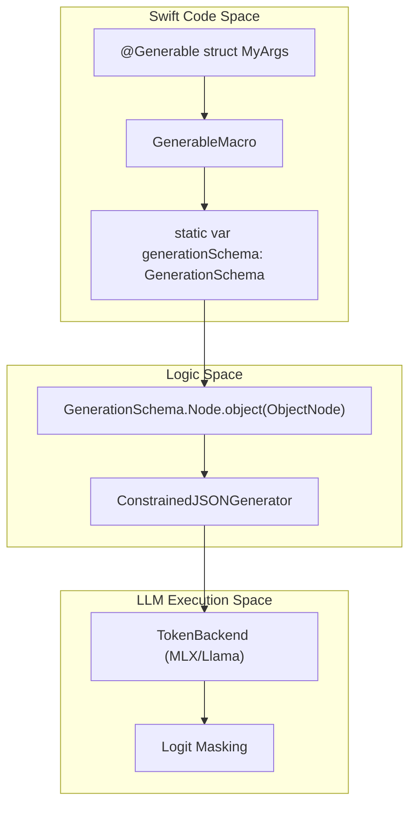
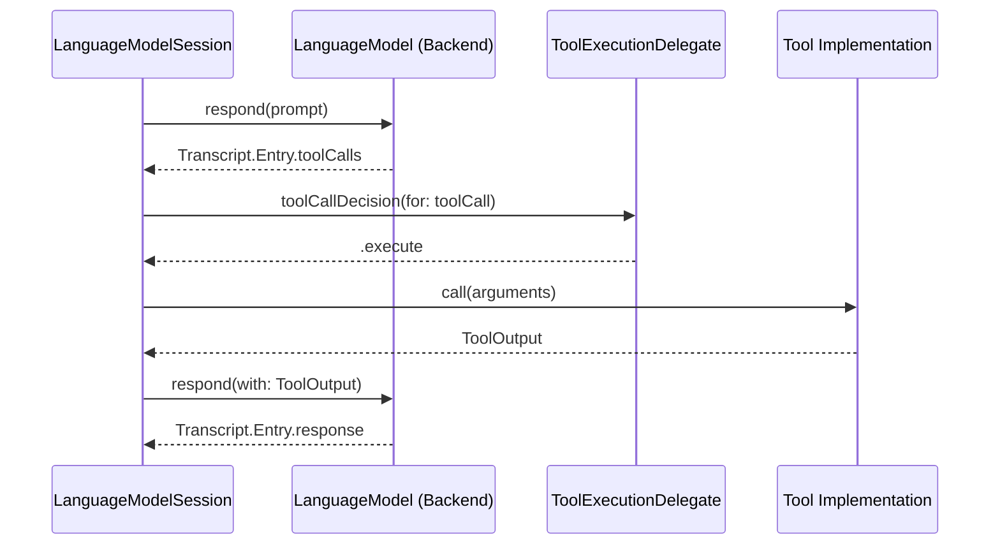

<!-- source: DeepWiki mcp.deepwiki.com · repo huggingface/AnyLanguageModel · page 9 Glossary · fetched 2026-10-26 -->

# Glossary

Relevant source files

The following files were used as context for generating this wiki page:

- [README.md](README.md)
- [Sources/AnyLanguageModel/Generable.swift](Sources/AnyLanguageModel/Generable.swift)
- [Sources/AnyLanguageModel/GeneratedContent.swift](Sources/AnyLanguageModel/GeneratedContent.swift)
- [Sources/AnyLanguageModel/GenerationID.swift](Sources/AnyLanguageModel/GenerationID.swift)
- [Sources/AnyLanguageModel/GenerationOptions.swift](Sources/AnyLanguageModel/GenerationOptions.swift)
- [Sources/AnyLanguageModel/GenerationSchema.swift](Sources/AnyLanguageModel/GenerationSchema.swift)
- [Sources/AnyLanguageModel/LanguageModel.swift](Sources/AnyLanguageModel/LanguageModel.swift)
- [Sources/AnyLanguageModel/LanguageModelSession.swift](Sources/AnyLanguageModel/LanguageModelSession.swift)
- [Sources/AnyLanguageModel/Models/GeminiLanguageModel.swift](Sources/AnyLanguageModel/Models/GeminiLanguageModel.swift)
- [Sources/AnyLanguageModel/Models/LlamaLanguageModel.swift](Sources/AnyLanguageModel/Models/LlamaLanguageModel.swift)
- [Sources/AnyLanguageModel/Models/MLXLanguageModel.swift](Sources/AnyLanguageModel/Models/MLXLanguageModel.swift)
- [Sources/AnyLanguageModel/Models/OpenAILanguageModel.swift](Sources/AnyLanguageModel/Models/OpenAILanguageModel.swift)
- [Sources/AnyLanguageModel/Tool.swift](Sources/AnyLanguageModel/Tool.swift)
- [Sources/AnyLanguageModel/Transcript.swift](Sources/AnyLanguageModel/Transcript.swift)
- [Sources/AnyLanguageModelMacros/GenerableMacro.swift](Sources/AnyLanguageModelMacros/GenerableMacro.swift)
- [Tests/AnyLanguageModelTests/GeminiLanguageModelTests.swift](Tests/AnyLanguageModelTests/GeminiLanguageModelTests.swift)
- [Tests/AnyLanguageModelTests/GenerableMacroTests.swift](Tests/AnyLanguageModelTests/GenerableMacroTests.swift)
- [Tests/AnyLanguageModelTests/LlamaLanguageModelTests.swift](Tests/AnyLanguageModelTests/LlamaLanguageModelTests.swift)

This glossary defines the technical terms, architectural components, and domain-specific concepts used throughout the **AnyLanguageModel** codebase. It serves as a reference for onboarding engineers to bridge the gap between high-level LLM concepts and their specific implementations in Swift.

## Core Abstractions

### LanguageModel
The foundational protocol that all backends (MLX, Llama, OpenAI, etc.) must implement. It defines the interface for generating responses and streaming content.
*   **Implementation**: [Sources/AnyLanguageModel/LanguageModel.swift:14-48]()
*   **Key Methods**: `respond`, `streamResponse`, and `prewarm`.

### LanguageModelSession
A stateful manager for a conversation. It handles the `Transcript`, manages tool execution loops, and provides `@Observable` state for UI integration.
*   **Implementation**: [Sources/AnyLanguageModel/LanguageModelSession.swift:5-15]()
*   **State Management**: Uses a `Locked<State>` primitive to ensure thread-safe updates to `isResponding` and `transcript` [Sources/AnyLanguageModel/LanguageModelSession.swift:16-17]().

### Transcript
The data model representing the full history of a conversation. It is composed of a sequence of `Entry` objects.
*   **Implementation**: [Sources/AnyLanguageModel/Transcript.swift:4-24]()
*   **Entry Types**: `instructions`, `prompt`, `toolCalls`, `toolOutput`, and `response` [Sources/AnyLanguageModel/Transcript.swift:26-57]().

---

## Structured Generation System

### Generable
A protocol and associated macro system that enables type-safe, schema-constrained generation. When a type is marked `@Generable`, the macro synthesizes a `GenerationSchema` and initializers to map LLM JSON output directly to Swift structs or enums.
*   **Protocol**: [Sources/AnyLanguageModel/Generable.swift:5-15]()
*   **Macro**: [Sources/AnyLanguageModelMacros/GenerableMacro.swift:7-64]()

### GenerationSchema
A recursive tree structure (using `Node`) that describes the expected shape of JSON output. It supports objects, arrays, strings (with regex patterns), numbers, and booleans.
*   **Implementation**: [Sources/AnyLanguageModel/GenerationSchema.swift:11-56]()
*   **Node Types**: `object`, `array`, `string`, `number`, `boolean`, `anyOf`, and `ref` [Sources/AnyLanguageModel/GenerationSchema.swift:12-20]().

### GeneratedContent
A type-erased container for values produced by the model (strings, numbers, arrays, or structured objects). It acts as the intermediary between raw LLM output and `Generable` Swift types.
*   **Implementation**: [Sources/AnyLanguageModel/GeneratedContent.swift:5-15]()

### Code Entity Relationship: Structured Generation
The following diagram shows how a Swift `struct` marked with `@Generable` moves through the system to become a constraint for the LLM.

**Schema Generation Flow**

*Sources: [Sources/AnyLanguageModelMacros/GenerableMacro.swift:29-33](), [Sources/AnyLanguageModel/GenerationSchema.swift:12-20]()*

---

## Tool Calling & Execution

### Tool
A protocol representing a function the model can invoke. It defines `Arguments` (which must be `Generable`) and a `call` function.
*   **Implementation**: [Sources/AnyLanguageModel/Tool.swift:5-25]()

### ToolExecutionDelegate
An actor-based protocol that allows the host application to intercept, approve, or provide manual overrides for tool calls generated by the model.
*   **Implementation**: [Sources/AnyLanguageModel/ToolExecutionDelegate.swift:5-30]()
*   **Decisions**: `.execute`, `.stop`, or `.provideOutput` [Sources/AnyLanguageModel/ToolExecutionDelegate.swift:35-45]().

### Tool Loop Lifecycle

*Sources: [Sources/AnyLanguageModel/LanguageModelSession.swift:210-250](), [Sources/AnyLanguageModel/ToolExecutionDelegate.swift:35-45]()*

---

## Backend-Specific Terms

| Term | Backend | Definition | Code Pointer |
| :--- | :--- | :--- | :--- |
| **GGUF** | Llama | The binary format used by `llama.cpp` for model weights. | [Sources/AnyLanguageModel/Models/LlamaLanguageModel.swift:23-32]() |
| **Mirostat** | Llama | An algorithm for controlling perplexity during generation. | [Sources/AnyLanguageModel/Models/LlamaLanguageModel.swift:129-138]() |
| **ModelContextCache** | MLX | A coalesced loader that prevents redundant loading of heavy MLX models. | [Sources/AnyLanguageModel/Models/MLXLanguageModel.swift:36-45]() |
| **Thinking Mode** | Gemini/OpenAI | Extended reasoning/CoT (Chain of Thought) before the final response. | [Sources/AnyLanguageModel/Models/GeminiLanguageModel.swift:30-57]() |
| **JSON Mode** | Gemini | Server-side constraint to ensure the output is valid JSON. | [Sources/AnyLanguageModel/Models/GeminiLanguageModel.swift:91-109]() |

---

## Infrastructure & Utilities

### Locked<State>
A thread-safety primitive used to protect mutable state in `LanguageModelSession` and various backends.
*   **Implementation**: [Sources/AnyLanguageModel/Utilities/Locked.swift]() (referenced in [Sources/AnyLanguageModel/LanguageModelSession.swift:16]())

### ResponseStream
An `AsyncSequence` of snapshots returned during streaming. Each snapshot contains the partially generated `Content`.
*   **Implementation**: [Sources/AnyLanguageModel/LanguageModelSession.swift:128-172]()

### Prewarming
The process of loading model weights into memory or preparing the KV cache before a user prompt is sent.
*   **Implementation**: [Sources/AnyLanguageModel/LanguageModel.swift:45-48]()
*   **Usage**: [Sources/AnyLanguageModel/LanguageModelSession.swift:100-102]()

---
**Sources**:
*   [Sources/AnyLanguageModel/LanguageModel.swift:14-48]()
*   [Sources/AnyLanguageModel/LanguageModelSession.swift:5-172]()
*   [Sources/AnyLanguageModel/Transcript.swift:4-112]()
*   [Sources/AnyLanguageModel/GenerationSchema.swift:11-138]()
*   [Sources/AnyLanguageModel/Models/LlamaLanguageModel.swift:23-138]()
*   [Sources/AnyLanguageModel/Models/MLXLanguageModel.swift:36-45]()
*   [Sources/AnyLanguageModel/Models/GeminiLanguageModel.swift:30-109]()
*   [Sources/AnyLanguageModelMacros/GenerableMacro.swift:7-64]()