# Page: AnyLanguageModel Overview

# AnyLanguageModel Overview

<details>
<summary>Relevant source files</summary>

The following files were used as context for generating this wiki page:

- [Package.resolved](Package.resolved)
- [Package.swift](Package.swift)
- [README.md](README.md)

</details>


`AnyLanguageModel` is a Swift package designed as a drop-in replacement for [Apple's Foundation Models framework](https://developer.apple.com/documentation/FoundationModels). It extends the native developer experience to a wide array of local and remote Large Language Model (LLM) providers, allowing developers to switch between Apple Intelligence, local inference engines (MLX, llama.cpp, Core ML), and cloud APIs (OpenAI, Anthropic, Gemini) by changing a single import statement [README.md:1-11]().

## Design Philosophy

The library follows a "protocol-first" architecture where all backends conform to a unified `LanguageModel` interface. This allows the `LanguageModelSession` to manage conversation state, tool execution, and structured generation regardless of the underlying model's implementation [README.md:29-36]().

### Drop-in Parity
The API is designed to match `FoundationModels` exactly where possible. For example, the `respond` and `streamResponse` methods on `LanguageModelSession` use the same `Transcript` and `Prompt` data structures found in Apple's framework [README.md:32-36]().

### Trait-Based Dependencies
To keep binary sizes small and build times fast, `AnyLanguageModel` utilizes Swift 6.1 traits. Heavy dependencies like `mlx-swift-lm` or `llama.swift` are only included if the user explicitly opts into the `MLX` or `Llama` traits [Package.swift:24-30]().

## System Architecture

The following diagram illustrates how the high-level Swift entities map to the internal subsystems and external providers.

### Code Entity Mapping
| Entity | Role | Source |
| :--- | :--- | :--- |
| `LanguageModel` | The central protocol all backends implement. | `Sources/AnyLanguageModel/LanguageModel.swift` |
| `LanguageModelSession` | Manages state, tools, and the request lifecycle. | `Sources/AnyLanguageModel/LanguageModelSession.swift` |
| `Transcript` | The conversation history model (Entries, Segments). | `Sources/AnyLanguageModel/Transcript.swift` |
| `Generable` | Protocol/Macro for structured JSON output. | `Sources/AnyLanguageModel/Generable.swift` |
| `Tool` | Protocol for defining executable functions for the LLM. | `Sources/AnyLanguageModel/Tool.swift` |

### Architecture Diagram

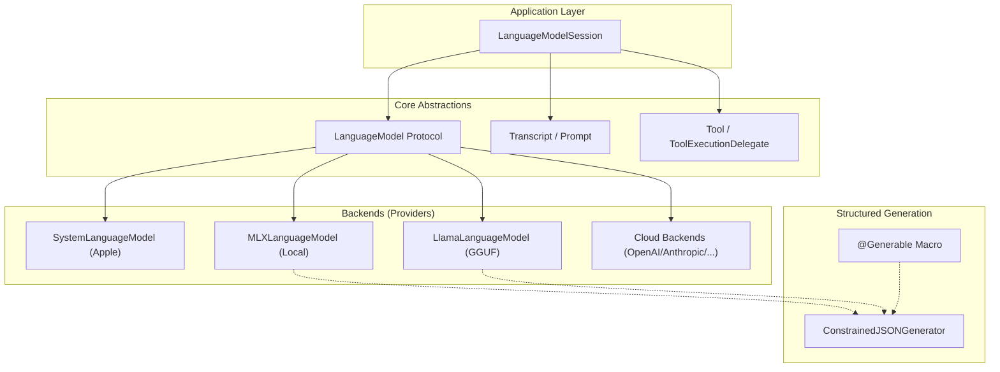
Sources: [README.md:14-66](), [Package.swift:50-88]()

## Major Subsystems

### 1. Backend Providers
`AnyLanguageModel` supports a diverse set of backends categorized by their execution environment:
*   **Native:** `SystemLanguageModel` wraps Apple's `FoundationModels.SystemLanguageModel` [README.md:72]().
*   **Local Inference:** `MLXLanguageModel`, `LlamaLanguageModel`, and `CoreMLLanguageModel` enable running models on-device via Apple Silicon, GGUF, or Core ML [README.md:73-75]().
*   **Cloud APIs:** Support for OpenAI (Chat & Responses), Anthropic, Gemini, Ollama, and the Open Responses standard [README.md:76-81]().

### 2. Structured Generation & Tooling
The library provides a robust system for ensuring LLM outputs conform to Swift types.
*   **Macros:** The `@Generable` macro automatically generates JSON schemas from Swift structs [README.md:18-22]().
*   **Constrained Generation:** For local backends (MLX/Llama), the `ConstrainedJSONGenerator` performs logit masking to force the model to follow a specific `GenerationSchema`.
*   **Tools:** Models can call Swift functions via the `Tool` protocol, with `LanguageModelSession` handling the multi-turn execution loop [README.md:14-27]().

### 3. Networking & Traits
The networking layer is abstracted via `HTTPSession`, allowing the library to use `URLSession` by default or `AsyncHTTPClient` when the `AsyncHTTPClient` trait is enabled [Package.swift:28, 82-86]().

## Child Pages Map

For detailed technical documentation on specific areas, refer to the following pages:

*   **[Getting Started & Package Configuration](#1.1)**: Detailed guide on adding the package, configuring Swift 6.1 traits, and resolving dependency graph issues [README.md:95-156]().
*   **[CI/CD & Development Workflow](#1.2)**: Information on the GitHub Actions pipeline, testing across platforms (macOS/Linux), and contribution guidelines.

Sources: [README.md:1-156](), [Package.swift:1-110]()

---

# Page: Getting Started & Package Configuration

# Getting Started & Package Configuration

<details>
<summary>Relevant source files</summary>

The following files were used as context for generating this wiki page:

- [Package.resolved](Package.resolved)
- [Package.swift](Package.swift)
- [README.md](README.md)

</details>


AnyLanguageModel is designed as a drop-in replacement for Apple's `FoundationModels` framework, providing a unified Swift interface for local and cloud-based Large Language Models (LLMs). This page covers the initial setup, dependency management via Swift Package Manager (SwiftPM) traits, and configuration for different platforms.

## Installation

To add AnyLanguageModel to a Swift project, include it as a dependency in your `Package.swift` file.

```swift
dependencies: [
    .package(url: "https://github.com/huggingface/AnyLanguageModel", from: "0.8.0")
]
```
Sources: [README.md:97-103](), [Package.swift:7-16]()

### Requirements
- **Swift**: 6.1+ [README.md:85]()
- **Platforms**: iOS 17.0+, macOS 14.0+, visionOS 1.0+, and Linux [README.md:86](), [Package.swift:9-16]()
- **Xcode**: Xcode 16 is recommended for building projects targeting macOS 15 / iOS 18 to avoid known macro expansion bugs in newer toolchains [README.md:88-93]().

## Package Traits & Optional Dependencies

AnyLanguageModel utilizes the Swift 6.1 Trait system to manage heavy dependencies. By default, the package includes only the core abstractions and cloud-based providers to keep the binary size minimal. Support for local inference engines must be explicitly enabled via traits.

### Available Traits

| Trait | Description | Primary Dependency |
| :--- | :--- | :--- |
| `CoreML` | Enables Core ML model support | `huggingface/swift-transformers` |
| `MLX` | Enables MLX (Apple Silicon) support | `ml-explore/mlx-swift-lm` |
| `Llama` | Enables llama.cpp (GGUF) support | `mattt/llama.swift` |
| `AsyncHTTPClient` | Uses SwiftNIO-based networking instead of `URLSession` | `swift-server/async-http-client` |

Sources: [README.md:105-121](), [Package.swift:24-30]()

### Enabling Traits in Package.swift

To enable specific backends, specify the traits in your package dependency declaration:

```swift
.package(
    url: "https://github.com/huggingface/AnyLanguageModel.git",
    from: "0.8.0",
    traits: ["MLX", "CoreML"] 
)
```
Sources: [README.md:124-133]()

### Dependency Resolution Workaround
Due to an upstream SwiftPM issue (exhausted attempts to resolve the dependency graph), it is often necessary to explicitly add the underlying repositories of the enabled traits to your own `Package.swift` [README.md:135-156]().

## Dependency Graph & Implementation

The package is structured into two primary targets: `AnyLanguageModel` (the main library) and `AnyLanguageModelMacros` (providing `@Generable` and `@Guide` functionality) [Package.swift:49-97]().

### Dependency Flow Diagram

This diagram illustrates how traits pull in external codebases to satisfy specific `LanguageModel` implementations.

"Dependency Graph & Trait Mapping"
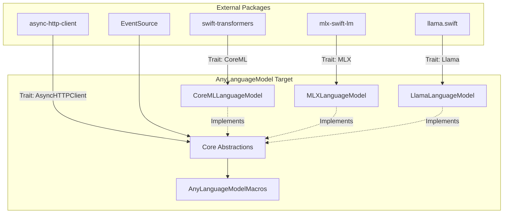
Sources: [Package.swift:49-109](), [README.md:105-121]()

## Usage in Xcode Projects

Xcode (as of version 16) does not natively support selecting traits for package dependencies through the GUI. To use AnyLanguageModel with specific traits in an app project, use a **Shim Package** approach:

1. Create a local Swift package (e.g., `MyAppKit`).
2. Add `AnyLanguageModel` as a dependency in that local package's `Package.swift` with the required `traits`.
3. In the local package's source, use `@_exported import AnyLanguageModel` to make the library available to your main app.
4. Add the local package to your Xcode project.

Sources: [README.md:158-220]()

## Quick Start Configuration

Once configured, initializing a model and session follows a standard pattern regardless of the backend.

### Code-to-System Mapping

This diagram maps the high-level configuration concepts to the specific classes used during initialization.

"Initialization Sequence & Entity Mapping"
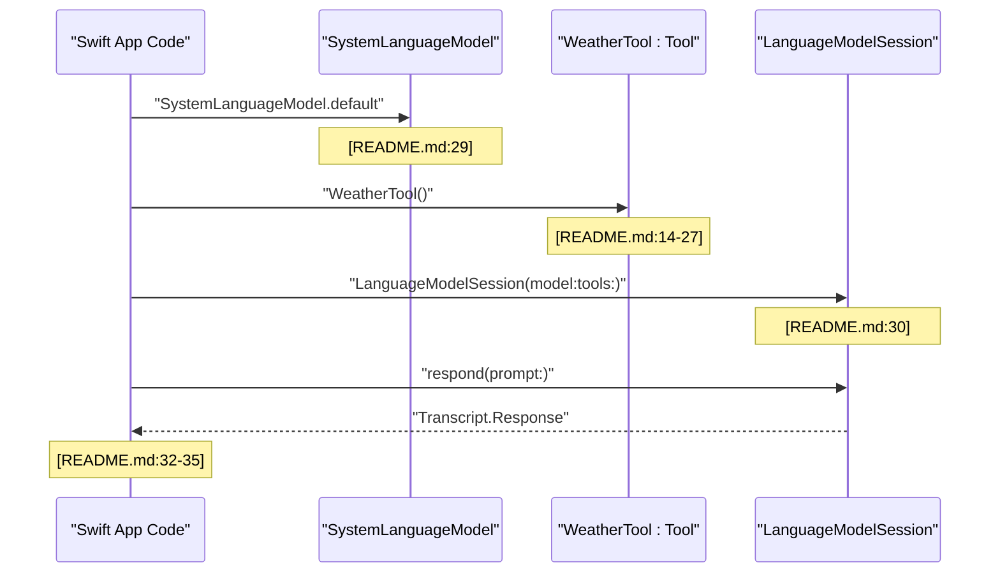
Sources: [README.md:13-36]()

### Basic Implementation Example
```swift
import AnyLanguageModel

// 1. Choose a backend (requires appropriate trait if not System)
let model = SystemLanguageModel.default 

// 2. Initialize a session with optional tools
let session = LanguageModelSession(model: model, tools: [])

// 3. Generate a response
let response = try await session.respond {
    Prompt("Hello, world!")
}
```
Sources: [README.md:29-35]()

---

# Page: CI/CD & Development Workflow

# CI/CD & Development Workflow

<details>
<summary>Relevant source files</summary>

The following files were used as context for generating this wiki page:

- [.github/workflows/ci.yml](.github/workflows/ci.yml)
- [Package.swift](Package.swift)
- [Tests/AnyLanguageModelTests/InstructionsTests.swift](Tests/AnyLanguageModelTests/InstructionsTests.swift)

</details>


This page details the automated pipelines and development practices used to maintain `AnyLanguageModel`. The project utilizes GitHub Actions to ensure cross-platform compatibility across macOS and Linux, supporting multiple Swift toolchain versions and a modular trait-based build system.

## CI Pipeline Overview

The Continuous Integration (CI) suite is defined in `.github/workflows/ci.yml`. It triggers on every push or pull request to the `main` branch [ .github/workflows/ci.yml:3-7 ](). The pipeline is split into two primary jobs: `test-macos` and `test-linux`.

### Matrix Strategy and Environments

The CI utilizes a matrix strategy to verify the codebase against different operating systems, Swift versions, and feature sets (traits).

| Platform | Swift Version | Xcode Version | Traits Tested |
| :--- | :--- | :--- | :--- |
| macOS 15 | 6.1 | 16.3 | Default, `AsyncHTTPClient` |
| macOS 15 | 6.2 | 26.0 | Default, `AsyncHTTPClient` |
| Linux (Ubuntu) | 6.1.3 | N/A | Default |
| Linux (Ubuntu) | 6.2.4 | N/A | Default, `AsyncHTTPClient` |

**Sources:** [ .github/workflows/ci.yml:14-38 ](), [ .github/workflows/ci.yml:63-81 ]()

### Workflow Execution Flow

The following diagram illustrates the lifecycle of a single CI job run, from checkout to testing.

**CI Job Lifecycle**
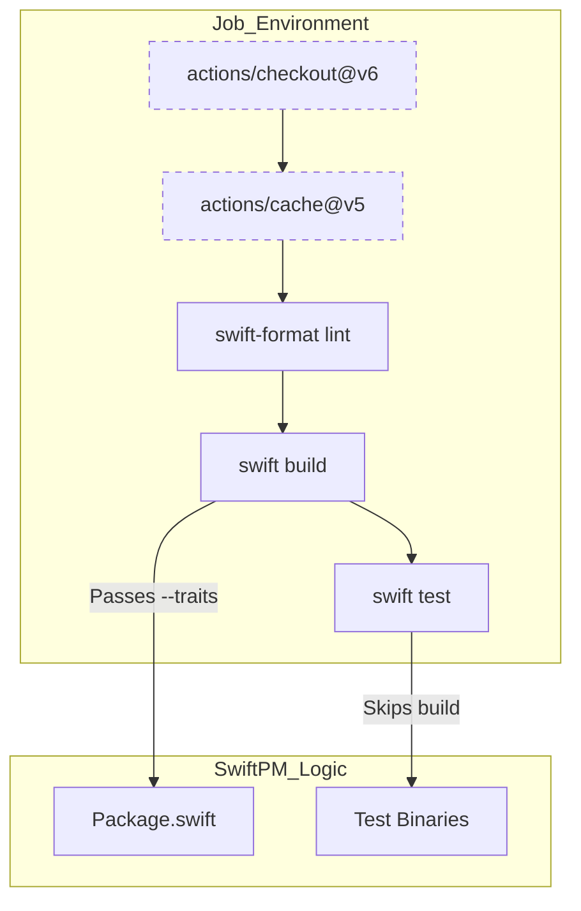
**Sources:** [ .github/workflows/ci.yml:41-61 ]()

---

## Build Configuration & Traits

`AnyLanguageModel` uses Swift Package Manager (SwiftPM) traits to manage optional dependencies and backend-specific code. This allows the core library to remain lightweight while supporting heavy dependencies like MLX or Llama.cpp only when requested.

### Trait Combinations in CI

The CI pipeline explicitly enables backend traits during the build and test phases to ensure that conditional compilation blocks (e.g., `#if hasTrait(MLX)`) are correctly exercised.

*   **macOS Builds:** Run with `--traits MLX,Llama,CoreML` plus an optional `AsyncHTTPClient` trait [ .github/workflows/ci.yml:58-61 ]().
*   **Linux Builds:** Run primarily with the `AsyncHTTPClient` trait, as Apple-specific backends like `CoreML` and `MLX` are platform-restricted [ .github/workflows/ci.yml:101-104 ]().

### Dependency Caching

To optimize CI duration, the workflow caches the `.build` directory and the SwiftPM cache [ .github/workflows/ci.yml:47-50 ](). The cache key is derived from the runner OS, Swift version, trait status, and a hash of `Package.swift` and `Package.resolved` [ .github/workflows/ci.yml:50 ]().

**Sources:** [ Package.swift:24-30 ](), [ .github/workflows/ci.yml:44-53 ]()

---

## Code Quality & Linting

Before building, the CI enforces code style using `swift-format`.

*   **Command:** `swift format lint --strict --recursive .` [ .github/workflows/ci.yml:55 ]().
*   **Strict Mode:** The `--strict` flag ensures that linting warnings are treated as errors, failing the build if the style guide is not followed.

---

## Testing Infrastructure

Tests are executed using the Swift Testing framework. The CI separates the build and test steps using the `--skip-build` flag in the test phase to avoid redundant compilation [ .github/workflows/ci.yml:61 ]().

### Test Suite Organization

The project includes unit tests for core logic and integration tests for specific backends. For example, `InstructionsTests` verifies the `Instructions` builder logic:

*   `initializesFromStringRepresentable()`: Validates basic string initialization [ Tests/AnyLanguageModelTests/InstructionsTests.swift:7-10 ]().
*   `builderCombinesLines()`: Validates that the `@InstructionsBuilder` correctly joins lines with newlines [ Tests/AnyLanguageModelTests/InstructionsTests.swift:18-25 ]().
*   `builderSupportsConditionalsAndOptionals()`: Ensures logic inside the builder (if/else) functions correctly [ Tests/AnyLanguageModelTests/InstructionsTests.swift:27-44 ]().

### Trait-Based Testing Logic

The following diagram bridges the "Natural Language" requirements of a developer to the "Code Entity" execution path within the CI.

**Developer Workflow to Code Execution**
```mermaid
graph LR
    subgraph "Developer_Intent"
        "Add_MLX_Support" --> "Edit_Package.swift"
        "Run_Local_Tests" --> "CLI_Command"
    end

    subgraph "Code_Entity_Space"
        "CLI_Command" -- "swift test --traits MLX" --> "Package.swift"
        "Package.swift" -- "condition: .when(traits: ['MLX'])" --> "MLXLLM_Product"
        "MLXLLM_Product" --> "AnyLanguageModel_Target"
        "AnyLanguageModel_Target" --> "MLXLanguageModel.swift"
    end
```
**Sources:** [ Package.swift:58-61 ](), [ Package.swift:26 ]()

---

## Contribution Workflow

To contribute to `AnyLanguageModel`, follow these steps:

1.  **Fork and Clone:** Create a local copy of the repository.
2.  **Select Traits:** Depending on the backend you are modifying, enable the relevant traits in your environment.
    *   Example: `swift build --traits MLX`
3.  **Implement Changes:** Ensure new logic is covered by unit tests in `Tests/AnyLanguageModelTests/`.
4.  **Format Code:** Run `swift format --in-place --recursive .` before committing.
5.  **Verify Locally:** Run the test suite for both default and trait-enabled configurations.
    *   `swift test`
    *   `swift test --traits AsyncHTTPClient`
6.  **Submit PR:** Ensure the GitHub Actions CI passes for all matrix combinations.

### Known Limitations in CI
*   **Linux Swift 6.1:** `AsyncHTTPClient` is currently disabled on Linux for Swift 6.1 due to an upstream toolchain linker failure related to `libswiftObservation.so` [ .github/workflows/ci.yml:73-77 ](). Coverage for this trait is maintained on Swift 6.2+.

**Sources:** [ .github/workflows/ci.yml:73-81 ](), [ Package.swift:102-106 ]()

---

# Page: Core Architecture

# Core Architecture

<details>
<summary>Relevant source files</summary>

The following files were used as context for generating this wiki page:

- [Sources/AnyLanguageModel/GeneratedContent.swift](Sources/AnyLanguageModel/GeneratedContent.swift)
- [Sources/AnyLanguageModel/GenerationID.swift](Sources/AnyLanguageModel/GenerationID.swift)
- [Sources/AnyLanguageModel/GenerationOptions.swift](Sources/AnyLanguageModel/GenerationOptions.swift)
- [Sources/AnyLanguageModel/LanguageModel.swift](Sources/AnyLanguageModel/LanguageModel.swift)
- [Sources/AnyLanguageModel/LanguageModelSession.swift](Sources/AnyLanguageModel/LanguageModelSession.swift)
- [Sources/AnyLanguageModel/Transcript.swift](Sources/AnyLanguageModel/Transcript.swift)

</details>


The AnyLanguageModel framework is built around a set of core abstractions that provide a unified interface for interacting with diverse language model backends—ranging from local Apple Silicon inference (MLX) to cloud APIs (OpenAI, Anthropic). 

The architecture is designed for "drop-in" parity with Apple's Foundation Models framework while extending capabilities for cross-platform support and structured generation.

### System Overview

The following diagram illustrates how the high-level system components interact during a typical generation lifecycle.

**Request & Response Lifecycle**
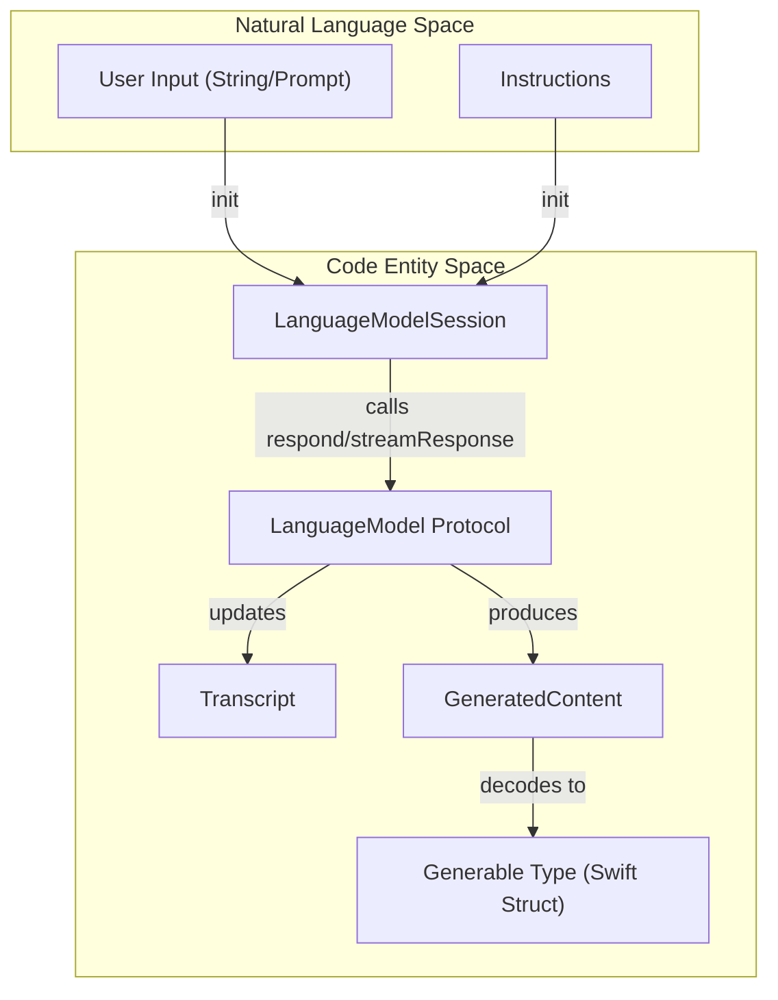
Sources: [Sources/AnyLanguageModel/LanguageModelSession.swift:32-62](), [Sources/AnyLanguageModel/LanguageModel.swift:20-34]()

---

### LanguageModel Protocol

The `LanguageModel` protocol is the central interface that every backend must implement. It abstracts the complexities of different providers into a standard set of methods for generating responses, handling streaming, and reporting availability.

*   **Availability**: Models use the `availability` property to signal if they are ready for use (e.g., checking if an API key is present or if the hardware supports local inference).
*   **Generation**: The protocol defines `respond` for one-shot completion and `streamResponse` for incremental updates.
*   **Customization**: Each model can define an `associatedtype CustomGenerationOptions` to expose provider-specific features (like OpenAI's `reasoning_effort`) without breaking the common interface.

For details, see [LanguageModel Protocol & Availability](#2.1).

Sources: [Sources/AnyLanguageModel/LanguageModel.swift:3-42]()

---

### LanguageModelSession

The `LanguageModelSession` is the primary object developers interact with. It maintains the state of a conversation, manages the `Transcript`, and coordinates with a specific `LanguageModel` implementation.

*   **State Management**: It tracks `isResponding` using the `@Observable` macro, making it easy to bind UI loading states in SwiftUI.
*   **Thread Safety**: Internal state is protected by a `Locked<State>` primitive to ensure concurrency safety across asynchronous calls.
*   **Tool Orchestration**: It holds a collection of `tools` and an optional `toolExecutionDelegate` to manage multi-turn tool-calling loops.

For details, see [LanguageModelSession](#2.2).

Sources: [Sources/AnyLanguageModel/LanguageModelSession.swift:4-31](), [Sources/AnyLanguageModel/LanguageModelSession.swift:104-126]()

---

### Transcript & Data Model

The `Transcript` serves as the "source of truth" for the conversation history. It is a collection of `Entry` objects that represent the different turns in a dialogue.

**Data Model Mapping**
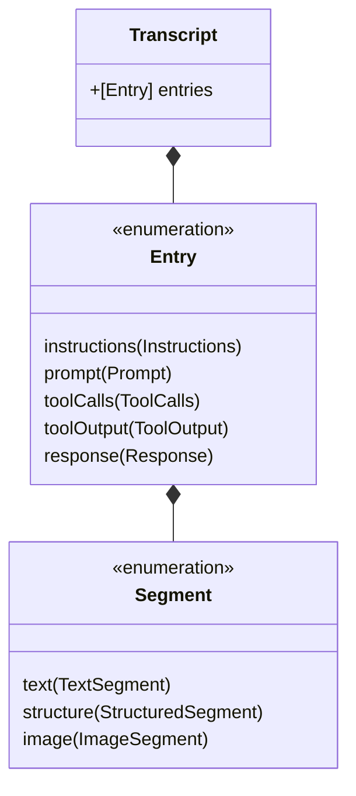

*   **Entries**: Represent logical turns, such as a user `prompt` or a model `response`.
*   **Segments**: Entries are composed of segments, allowing for multimodal content (text, images, or structured data) within a single message.
*   **GeneratedContent**: A type-safe intermediate representation used to bridge raw model output to Swift types.

For details, see [Transcript & Prompt Data Model](#2.3).

Sources: [Sources/AnyLanguageModel/Transcript.swift:4-81](), [Sources/AnyLanguageModel/GeneratedContent.swift:7-34]()

---

### Generation Options

Generation behavior is controlled via the `GenerationOptions` struct. This allows developers to tune the "creativity" and constraints of the model in a provider-agnostic way.

| Option | Role |
| :--- | :--- |
| `SamplingMode` | Determines if the model uses `greedy`, `topK`, or `nucleus` (top-p) sampling. |
| `Temperature` | Adjusts the probability distribution (0.0 to 1.0) to influence confidence. |
| `MaxTokens` | Prevents runaway generations by setting a hard limit on output length. |
| `CustomOptions` | A type-safe mechanism to pass backend-specific parameters using a model-type subscript. |

For details, see [GenerationOptions & Custom Options](#2.4).

Sources: [Sources/AnyLanguageModel/GenerationOptions.swift:10-123](), [Sources/AnyLanguageModel/GenerationOptions.swift:141-150]()

---

# Page: LanguageModel Protocol & Availability

# LanguageModel Protocol & Availability

<details>
<summary>Relevant source files</summary>

The following files were used as context for generating this wiki page:

- [Sources/AnyLanguageModel/Availability.swift](Sources/AnyLanguageModel/Availability.swift)
- [Sources/AnyLanguageModel/GeneratedContent.swift](Sources/AnyLanguageModel/GeneratedContent.swift)
- [Sources/AnyLanguageModel/GenerationID.swift](Sources/AnyLanguageModel/GenerationID.swift)
- [Sources/AnyLanguageModel/GenerationOptions.swift](Sources/AnyLanguageModel/GenerationOptions.swift)
- [Sources/AnyLanguageModel/LanguageModel.swift](Sources/AnyLanguageModel/LanguageModel.swift)
- [Sources/AnyLanguageModel/Transcript.swift](Sources/AnyLanguageModel/Transcript.swift)
- [Tests/AnyLanguageModelTests/MockLanguageModelTests.swift](Tests/AnyLanguageModelTests/MockLanguageModelTests.swift)
- [Tests/AnyLanguageModelTests/Shared/MockLanguageModel.swift](Tests/AnyLanguageModelTests/Shared/MockLanguageModel.swift)

</details>


The `LanguageModel` protocol is the central abstraction of the `AnyLanguageModel` library. It defines a unified interface for interacting with diverse LLM backends—ranging from local Apple Silicon inference (MLX, Core ML) to remote cloud APIs (OpenAI, Anthropic). This page details the protocol's requirements, the availability system, and how backends provide custom generation options.

## The LanguageModel Protocol

The `LanguageModel` protocol ensures that any backend can be swapped into a `LanguageModelSession` without changing the application-level code. It handles both single-turn responses and streaming, while managing model-specific lifecycle events like prewarming and feedback logging.

### Key Requirements

| Requirement | Description |
| :--- | :--- |
| `UnavailableReason` | An associated type defining why a model might be offline (e.g., missing API keys, unsupported hardware). |
| `CustomGenerationOptions` | An associated type for provider-specific settings (e.g., OpenAI's `reasoning_effort`). Defaults to `Never`. |
| `availability` | A property returning the current `Availability<UnavailableReason>` status. |
| `respond(...)` | Generates a complete response for a given prompt and type. |
| `streamResponse(...)` | Returns a `ResponseStream` that yields partial updates as they are generated. |
| `prewarm(...)` | Optional hook to load weights or initialize buffers before the first request. |
| `logFeedbackAttachment(...)` | Generates a `Data` payload containing debug info for a specific generation. |

### Protocol Definition
[Sources/AnyLanguageModel/LanguageModel.swift:3-42]()

### Default Implementations
The protocol provides convenience properties and default no-op implementations:
*   **`isAvailable`**: A boolean convenience that checks if `availability` is `.available`. [Sources/AnyLanguageModel/LanguageModel.swift:47-53]()
*   **`prewarm`**: Defaults to a no-op. [Sources/AnyLanguageModel/LanguageModel.swift:55-60]()
*   **`logFeedbackAttachment`**: Defaults to returning empty `Data`. [Sources/AnyLanguageModel/LanguageModel.swift:62-69]()

**Sources:** [Sources/AnyLanguageModel/LanguageModel.swift:3-77]()

---

## Availability & UnavailableReason

The `Availability` enum represents the readiness of a backend. Unlike a simple boolean, it uses an associated type `UnavailableReason` to provide diagnostic information when a model cannot be used.

### Availability Enum
[Sources/AnyLanguageModel/Availability.swift:2-8]()
```swift
public enum Availability<UnavailableReason> {
    case available
    case unavailable(UnavailableReason)
}
```

### Implementing UnavailableReason
Backends define their own reasons for being unavailable. For example, a mock model might use a custom string:
[Tests/AnyLanguageModel/Shared/MockLanguageModel.swift:4-6]()

If a model is always available (common for Cloud APIs where availability is checked at request time), the `UnavailableReason` can be set to `Never`. The protocol provides a default implementation for this case. [Sources/AnyLanguageModel/LanguageModel.swift:72-76]()

**Sources:** [Sources/AnyLanguageModel/Availability.swift:1-13](), [Sources/AnyLanguageModel/LanguageModel.swift:46-53](), [Tests/AnyLanguageModel/Shared/MockLanguageModel.swift:4-6]()

---

## Custom Generation Options

While `GenerationOptions` provides common settings like `temperature` and `maximumResponseTokens`, many providers offer unique features. The `LanguageModel` protocol uses an associated type and a type-safe subscript to support these without breaking the core abstraction.

### CustomGenerationOptions Protocol
Backends define a type conforming to `CustomGenerationOptions` (which inherits from `Sendable`, `Equatable`, and `Codable`). 

### Usage in GenerationOptions
Users can set these options using the model type as a key:
[Sources/AnyLanguageModel/GenerationOptions.swift:127-150]()
```swift
var options = GenerationOptions(temperature: 0.7)
options[custom: OpenAILanguageModel.self] = .init(
    reasoningEffort: .high
)
```

**Sources:** [Sources/AnyLanguageModel/LanguageModel.swift:6-11](), [Sources/AnyLanguageModel/GenerationOptions.swift:127-150]()

---

## Data Flow: Request Lifecycle

The following diagram illustrates how the `LanguageModel` protocol bridges the high-level `LanguageModelSession` requests to specific backend implementations.

### Request Execution Flow
"Natural Language Space" (Prompt/Instructions) is transformed into "Code Entity Space" (Transcript/GeneratedContent) via the backend's implementation of the protocol.

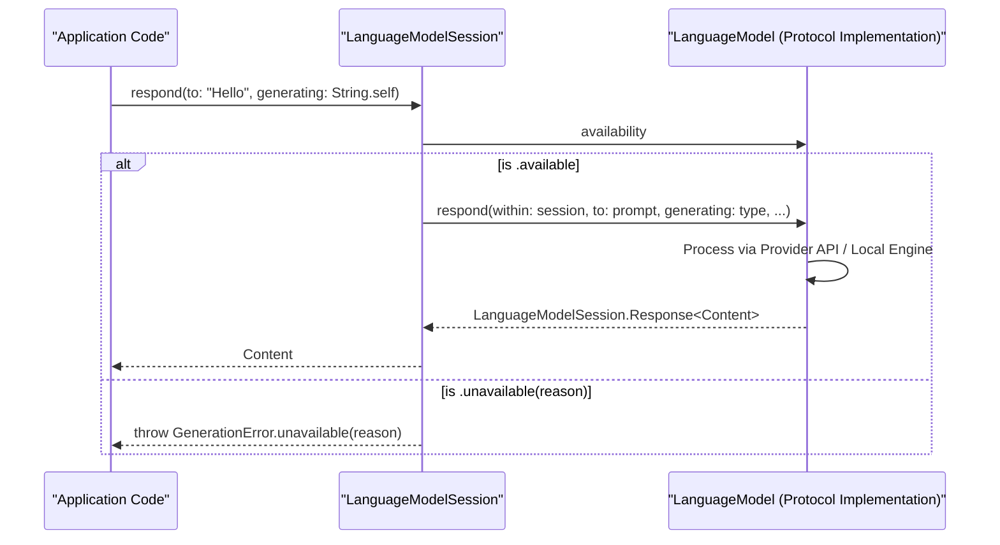
**Sources:** [Sources/AnyLanguageModel/LanguageModel.swift:20-34](), [Tests/AnyLanguageModel/Shared/MockLanguageModel.swift:24-44]()

---

## Backend Implementation Example

The `MockLanguageModel` demonstrates how a backend implements the protocol. It stores a `responseProvider` closure to simulate model behavior during testing.

### Mock Implementation Logic
[Tests/AnyLanguageModel/Shared/MockLanguageModel.swift:24-44]()

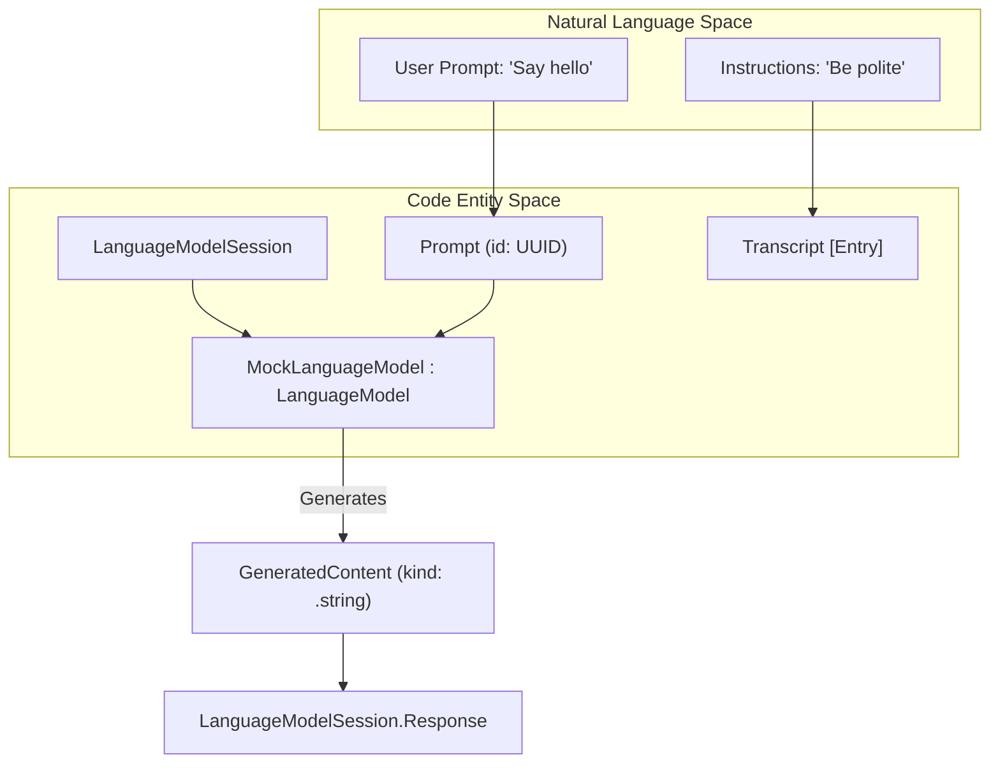

### Response vs. StreamResponse
*   **`respond`**: Returns a single `LanguageModelSession.Response` containing the final `Content` and `Transcript.Entry` objects. [Sources/AnyLanguageModel/LanguageModel.swift:20-26]()
*   **`streamResponse`**: Returns a `ResponseStream`, yielding `Snapshot` objects. Snapshots contain `PartiallyGenerated` content, allowing UI updates before the full response is ready. [Sources/AnyLanguageModel/LanguageModel.swift:28-34]()

**Sources:** [Tests/AnyLanguageModel/Shared/MockLanguageModel.swift:3-80](), [Sources/AnyLanguageModel/LanguageModel.swift:20-34]()

---

# Page: LanguageModelSession

# LanguageModelSession

<details>
<summary>Relevant source files</summary>

The following files were used as context for generating this wiki page:

- [Sources/AnyLanguageModel/LanguageModelSession.swift](Sources/AnyLanguageModel/LanguageModelSession.swift)
- [Sources/AnyLanguageModel/Shared/Locked.swift](Sources/AnyLanguageModel/Shared/Locked.swift)
- [Sources/AnyLanguageModel/Shared/StructuredGeneration.swift](Sources/AnyLanguageModel/Shared/StructuredGeneration.swift)
- [Tests/AnyLanguageModelTests/APICompatibilityAnyLanguageModelTests.swift](Tests/AnyLanguageModelTests/APICompatibilityAnyLanguageModelTests.swift)
- [Tests/AnyLanguageModelTests/APICompatibilityFoundationModelsTests.swift](Tests/AnyLanguageModelTests/APICompatibilityFoundationModelsTests.swift)
- [Tests/AnyLanguageModelTests/LockedTests.swift](Tests/AnyLanguageModelTests/LockedTests.swift)
- [Tests/AnyLanguageModelTests/ObservationTests.swift](Tests/AnyLanguageModelTests/ObservationTests.swift)

</details>


`LanguageModelSession` is the primary interface for interacting with a `LanguageModel`. It manages the conversation state through a `Transcript`, handles the lifecycle of generation requests (both one-off and streaming), and provides observable state for UI integration.

## Overview and Initialization

A session acts as a stateful wrapper around a stateless or context-clearing `LanguageModel` implementation. It maintains a `Transcript` of the conversation and can be configured with system instructions and available tools.

### Initialization Patterns

The session provides several initializers to accommodate different starting points:
- **With Instructions**: Accepts a `String` or an `@InstructionsBuilder` closure to set the system persona [Sources/AnyLanguageModel/LanguageModelSession.swift:32-54]().
- **With Tools**: Accepts an array of `any Tool` objects. If a tool's `includesSchemaInInstructions` property is true, its definition is automatically injected into the transcript's initial instructions entry [Sources/AnyLanguageModel/LanguageModelSession.swift:88-91]().
- **From Existing Transcript**: Allows resuming a previous session by passing a `Transcript` object [Sources/AnyLanguageModel/LanguageModelSession.swift:56-62]().

### Prewarming
The `prewarm(promptPrefix:)` method allows backends to prepare resources (like loading weights into GPU memory or initializing a KV cache) before a formal request is made [Sources/AnyLanguageModel/LanguageModelSession.swift:100-102]().

## Concurrency and State Management

`LanguageModelSession` is marked as `@Observable` and uses a custom concurrency primitive, `Locked<State>`, to ensure thread safety while allowing the UI to react to state changes.

### The Locked<State> Primitive
`Locked<T>` is a synchronization wrapper around `NSLock`. It provides a `withLock` method to safely read or mutate the internal state [Sources/AnyLanguageModel/Shared/Locked.swift:4-22]().

### Observable Properties
The session exposes two main observable properties:
1.  **`isResponding`**: A `Bool` indicating if the model is currently generating content [Sources/AnyLanguageModel/LanguageModelSession.swift:6-9]().
2.  **`transcript`**: The history of the conversation, including instructions, prompts, and responses [Sources/AnyLanguageModel/LanguageModelSession.swift:11-14]().

### State Transition Lifecycle
The following diagram illustrates how the session manages internal state during a generation request.

**Session Request Lifecycle**
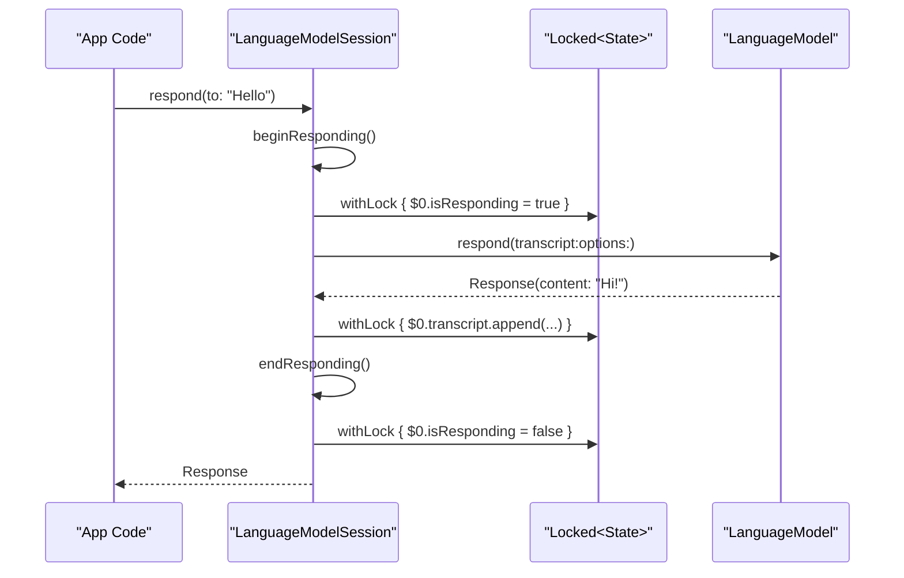
Sources: [Sources/AnyLanguageModel/LanguageModelSession.swift:104-126](), [Sources/AnyLanguageModel/Shared/Locked.swift:19-21]()

## Generation Lifecycle

The session provides two primary methods for generating content: `respond` and `streamResponse`.

### The `respond` Lifecycle
When `respond` is called, the session:
1.  Appends the user's `Prompt` to the transcript [Sources/AnyLanguageModel/LanguageModelSession.swift:203-207]().
2.  Sets `isResponding` to `true` [Sources/AnyLanguageModel/LanguageModelSession.swift:117]().
3.  Calls the underlying `LanguageModel.respond` method [Sources/AnyLanguageModel/LanguageModelSession.swift:209]().
4.  Appends the resulting `Response` to the transcript [Sources/AnyLanguageModel/LanguageModelSession.swift:214-221]().
5.  Sets `isResponding` to `false` [Sources/AnyLanguageModel/LanguageModelSession.swift:120]().

### The `streamResponse` Lifecycle
Streaming utilizes the `ResponseStream<Content>` type, which wraps an `AsyncThrowingStream`.
- **Relay Mechanism**: The session creates a "relay" stream. It yields snapshots to the caller as they arrive from the backend [Sources/AnyLanguageModel/LanguageModelSession.swift:133-143]().
- **Finalization**: Only after the stream completes (finishes or throws) does the session append the final accumulated response to the transcript [Sources/AnyLanguageModel/LanguageModelSession.swift:146-164]().

**Response Data Flow**
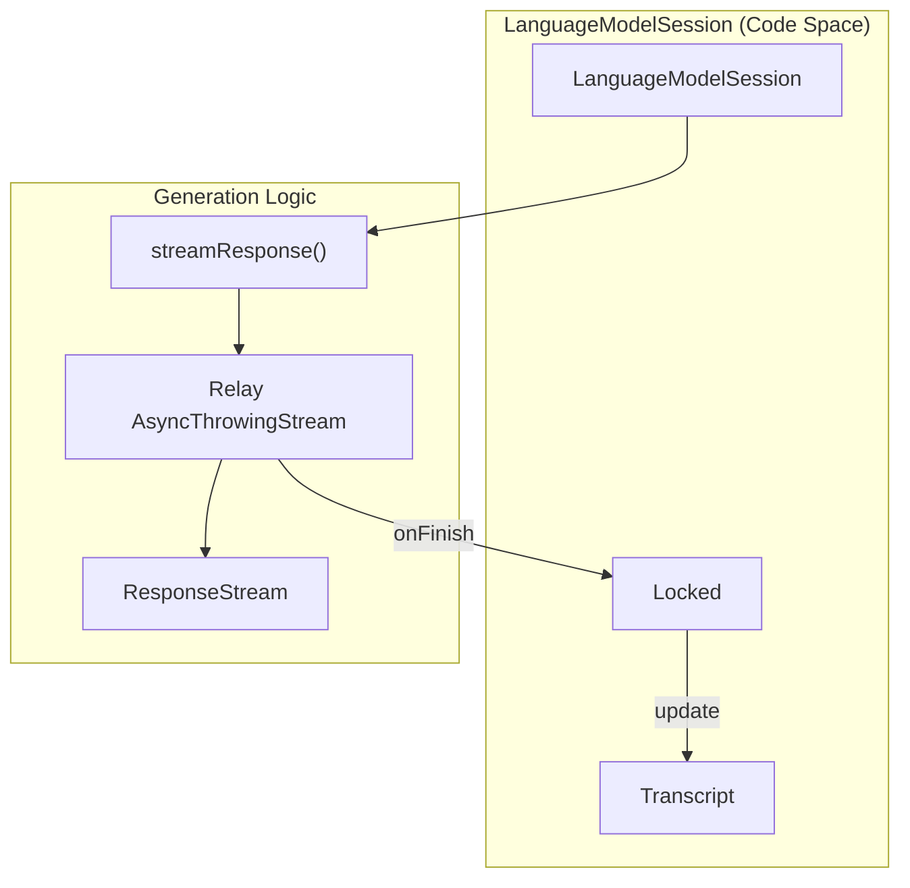
Sources: [Sources/AnyLanguageModel/LanguageModelSession.swift:128-172](), [Sources/AnyLanguageModel/Shared/Locked.swift:4-11]()

## Error Handling

The session propagates errors from the underlying `LanguageModel`. Common error types include:

| Error Type | Description |
| :--- | :--- |
| `GenerationError` | General failures in the model's ability to produce text (e.g., context overflow, hardware failure). |
| `Refusal` | When a model's safety filters prevent it from answering a specific prompt. |
| `ConstrainedGenerationError` | Thrown by the `ConstrainedJSONGenerator` if the model fails to adhere to a schema [Sources/AnyLanguageModel/Shared/StructuredGeneration.swift:126-131](). |

In all cases, the `wrapRespond` and `wrapStream` helpers ensure that `endResponding()` is called even if an error occurs, preventing the session from being stuck in a "responding" state [Sources/AnyLanguageModel/LanguageModelSession.swift:122-124]().

## Tool Execution Integration

`LanguageModelSession` supports multi-turn tool calling. If a `toolExecutionDelegate` is provided, the session yields control to the delegate to decide whether to execute generated tool calls or provide custom output [Sources/AnyLanguageModel/LanguageModelSession.swift:22-30]().

- **Compatibility Note**: Setting a `toolExecutionDelegate` breaks drop-in parity with Apple's `FoundationModels` framework, as this is an extension specific to `AnyLanguageModel` [Sources/AnyLanguageModel/LanguageModelSession.swift:27-29]().

Sources:
- [Sources/AnyLanguageModel/LanguageModelSession.swift:1-221]()
- [Sources/AnyLanguageModel/Shared/Locked.swift:1-25]()
- [Sources/AnyLanguageModel/Shared/StructuredGeneration.swift:123-140]()
- [Tests/AnyLanguageModelTests/ObservationTests.swift:1-96]()

---

# Page: Transcript & Prompt Data Model

# Transcript & Prompt Data Model

<details>
<summary>Relevant source files</summary>

The following files were used as context for generating this wiki page:

- [Sources/AnyLanguageModel/GeneratedContent.swift](Sources/AnyLanguageModel/GeneratedContent.swift)
- [Sources/AnyLanguageModel/GenerationID.swift](Sources/AnyLanguageModel/GenerationID.swift)
- [Sources/AnyLanguageModel/GenerationOptions.swift](Sources/AnyLanguageModel/GenerationOptions.swift)
- [Sources/AnyLanguageModel/Instructions.swift](Sources/AnyLanguageModel/Instructions.swift)
- [Sources/AnyLanguageModel/LanguageModel.swift](Sources/AnyLanguageModel/LanguageModel.swift)
- [Sources/AnyLanguageModel/Prompt.swift](Sources/AnyLanguageModel/Prompt.swift)
- [Sources/AnyLanguageModel/Transcript.swift](Sources/AnyLanguageModel/Transcript.swift)
- [Tests/AnyLanguageModelTests/PromptTests.swift](Tests/AnyLanguageModelTests/PromptTests.swift)
- [Tests/AnyLanguageModelTests/TranscriptTests.swift](Tests/AnyLanguageModelTests/TranscriptTests.swift)

</details>


This page documents the data structures used to represent conversation history, user inputs, and model outputs within `AnyLanguageModel`. The core of this system is the `Transcript`, which acts as a type-safe, multi-modal container for the entire lifecycle of a language model session.

## Overview of the Data Hierarchy

The data model is designed to bridge high-level natural language concepts with structured code entities. At the top level, a `Transcript` contains a sequence of `Entry` objects, each representing a specific turn or action in the conversation.

### Natural Language to Code Entity Mapping

The following diagram illustrates how conceptual conversation components map to specific Swift types in the `AnyLanguageModel` framework.

| Natural Language Concept | Code Entity (Swift Type) | File Path |
| :--- | :--- | :--- |
| System Role / Instructions | `Transcript.Instructions` | [Sources/AnyLanguageModel/Transcript.swift:234-236]() |
| User Input | `Transcript.Prompt` | [Sources/AnyLanguageModel/Transcript.swift:257-259]() |
| Assistant Message | `Transcript.Response` | [Sources/AnyLanguageModel/Transcript.swift:370-372]() |
| Function Execution Request | `Transcript.ToolCalls` | [Sources/AnyLanguageModel/Transcript.swift:302-304]() |
| Function Result | `Transcript.ToolOutput` | [Sources/AnyLanguageModel/Transcript.swift:336-338]() |

### Data Flow Diagram

This diagram shows how different entities are nested within the `Transcript` structure.

"Transcript Data Hierarchy"
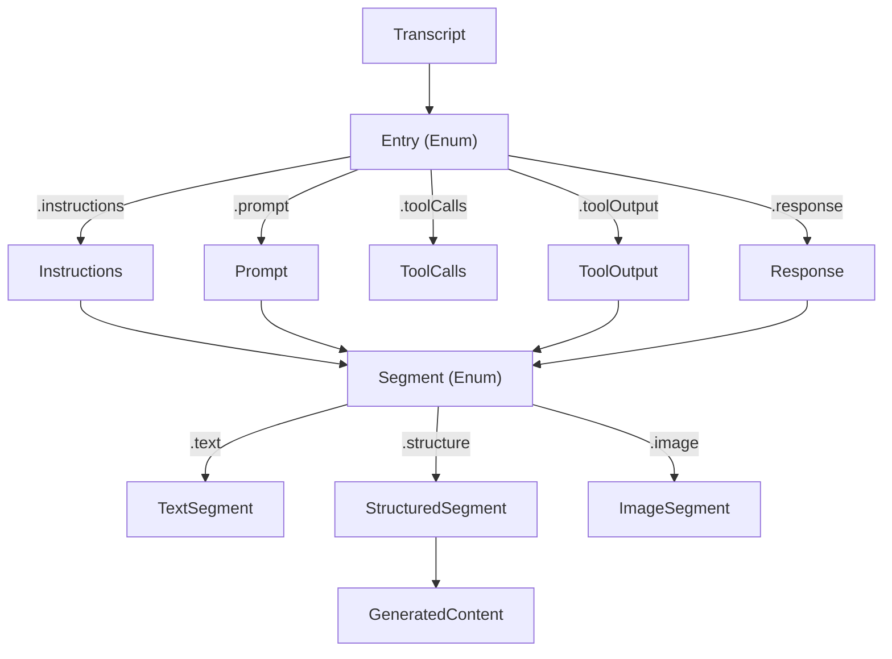
Sources: [Sources/AnyLanguageModel/Transcript.swift:4-81]()

---

## The Transcript and Entry Types

The `Transcript` is a `Codable` and `Sendable` struct that maintains an ordered collection of `Entry` enums [Sources/AnyLanguageModel/Transcript.swift:4-26]().

### Entry Variants
- **`instructions`**: Developer-provided guidance defining model behavior [Sources/AnyLanguageModel/Transcript.swift:28]().
- **`prompt`**: Sourced from the end user [Sources/AnyLanguageModel/Transcript.swift:31]().
- **`toolCalls`**: Generated by the model when it needs to invoke external functions [Sources/AnyLanguageModel/Transcript.swift:34]().
- **`toolOutput`**: The result of a tool execution sent back to the model [Sources/AnyLanguageModel/Transcript.swift:37]().
- **`response`**: The final textual or structured output from the model [Sources/AnyLanguageModel/Transcript.swift:40]().

Each entry has a stable `id` property that routes to the underlying ID of its associated value [Sources/AnyLanguageModel/Transcript.swift:43-57]().

---

## Multi-modal Segments

`AnyLanguageModel` supports multi-modal interactions through the `Segment` type. Instead of simple strings, entries like `Prompt` and `Response` contain arrays of segments [Sources/AnyLanguageModel/Transcript.swift:60-69]().

### Segment Types
| Type | Purpose | Key Properties |
| :--- | :--- | :--- |
| `TextSegment` | Raw text content | `content: String` |
| `StructuredSegment` | JSON-like data | `content: GeneratedContent`, `source: String` |
| `ImageSegment` | Visual data | `source: ImageSegment.Source` |

### ImageSegment Implementation
`ImageSegment` handles images via two sources: raw `Data` (with a MIME type) or a `URL` [Sources/AnyLanguageModel/Transcript.swift:127-132](). 

On Apple platforms, `ImageSegment` provides convenience initializers for system types:
- **UIKit**: `init(id:image:compressionQuality:)` [Sources/AnyLanguageModel/Transcript.swift:195-197]()
- **AppKit**: `init(id:image:compressionFactor:)` [Sources/AnyLanguageModel/Transcript.swift:214-216]()
- **CoreGraphics**: `init(id:cgImage:mimeType:metadata:)` [Sources/AnyLanguageModel/Transcript.swift:227-229]()

Sources: [Sources/AnyLanguageModel/Transcript.swift:84-230]()

---

## Prompt & Instructions DSL

While `Transcript` is the internal storage format, developers typically interact with `Prompt` and `Instructions` using a Result Builder DSL.

### PromptBuilder and InstructionsBuilder
These builders allow for conditional logic and clean syntax when constructing inputs:

```swift
let prompt = Prompt {
    "Answer the following:"
    if userIsPremium {
        "Provide a detailed technical analysis."
    }
    userInput
}
```

- **`Prompt`**: Represents a user message. It can be initialized from a `String`, an `Array`, or a `@PromptBuilder` closure [Sources/AnyLanguageModel/Prompt.swift:26-48]().
- **`Instructions`**: Represents the system persona. It follows the same builder pattern as `Prompt` [Sources/AnyLanguageModel/Instructions.swift:21-43]().

Sources: [Sources/AnyLanguageModel/Prompt.swift:59-94](), [Sources/AnyLanguageModel/Instructions.swift:54-91]()

---

## Tool Definitions and Calls

The transcript models the full tool-calling lifecycle through three specific types:

1.  **`ToolDefinition`**: Defines the tool's schema (name, description, parameters) for the model [Sources/AnyLanguageModel/Transcript.swift:277-285]().
2.  **`ToolCall`**: Represents a single request from the model, including a unique `id`, the `toolName`, and the `arguments` as `GeneratedContent` [Sources/AnyLanguageModel/Transcript.swift:316-324]().
3.  **`ToolOutput`**: Pairs the result of the tool execution back to the specific `id` of the `ToolCall` [Sources/AnyLanguageModel/Transcript.swift:336-348]().

"Tool Calling Lifecycle in Code"
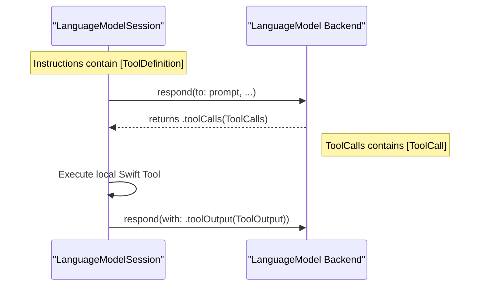
Sources: [Sources/AnyLanguageModel/Transcript.swift:277-360](), [Sources/AnyLanguageModel/LanguageModel.swift:20-35]()

---

## GeneratedContent and ResponseFormat

### GeneratedContent
`GeneratedContent` is the framework's internal representation of structured data (JSON). It can represent strings, numbers, booleans, arrays, or complex structures [Sources/AnyLanguageModel/GeneratedContent.swift:7-34](). It is used for:
- Tool call arguments.
- Structured segments in responses.
- Partial generations during streaming.

### ResponseFormat
`ResponseFormat` tells the model how to constrain its output. It wraps a `GenerationSchema` and can be initialized directly from a `Generable` type [Sources/AnyLanguageModel/Transcript.swift:396-410]().

Sources: [Sources/AnyLanguageModel/GeneratedContent.swift:46-61](), [Sources/AnyLanguageModel/Transcript.swift:391-415]()

---

# Page: GenerationOptions & Custom Options

# GenerationOptions & Custom Options

<details>
<summary>Relevant source files</summary>

The following files were used as context for generating this wiki page:

- [Sources/AnyLanguageModel/GeneratedContent.swift](Sources/AnyLanguageModel/GeneratedContent.swift)
- [Sources/AnyLanguageModel/GenerationID.swift](Sources/AnyLanguageModel/GenerationID.swift)
- [Sources/AnyLanguageModel/GenerationOptions.swift](Sources/AnyLanguageModel/GenerationOptions.swift)
- [Sources/AnyLanguageModel/LanguageModel.swift](Sources/AnyLanguageModel/LanguageModel.swift)
- [Sources/AnyLanguageModel/Shared/JSONValue.swift](Sources/AnyLanguageModel/Shared/JSONValue.swift)
- [Sources/AnyLanguageModel/Transcript.swift](Sources/AnyLanguageModel/Transcript.swift)
- [Tests/AnyLanguageModelTests/CustomGenerationOptionsTests.swift](Tests/AnyLanguageModelTests/CustomGenerationOptionsTests.swift)
- [Tests/AnyLanguageModelTests/OpenResponsesLanguageModelTests.swift](Tests/AnyLanguageModelTests/OpenResponsesLanguageModelTests.swift)

</details>


Generation options control the behavior of a language model during the inference process. `AnyLanguageModel` provides a unified set of standard options (sampling, temperature, token limits) while allowing backends to expose provider-specific features through a type-safe custom options mechanism.

## GenerationOptions

The `GenerationOptions` struct is the primary configuration object passed to `respond` and `streamResponse` calls [Sources/AnyLanguageModel/LanguageModel.swift:20-34](). It encapsulates common parameters supported by most LLM engines.

### Sampling Modes
Sampling determines how the model selects the next token from its predicted probability distribution [Sources/AnyLanguageModel/GenerationOptions.swift:11-16]().

| Mode | Function | Description |
| :--- | :--- | :--- |
| **Greedy** | `.greedy` | Always selects the most likely token. Results in deterministic output [Sources/AnyLanguageModel/GenerationOptions.swift:32-34](). |
| **Top-K** | `.random(top:seed:)` | Filters the top $K$ most likely tokens and samples from them. Balances confidence and variety [Sources/AnyLanguageModel/GenerationOptions.swift:52-54](). |
| **Nucleus (Top-P)** | `.random(probabilityThreshold:seed:)` | Samples from the smallest set of tokens whose cumulative probability exceeds $P$. Adapts to the "flatness" of the distribution [Sources/AnyLanguageModel/GenerationOptions.swift:77-79](). |

### Core Parameters
*   **`temperature`**: A Double between `0.0` and `1.0`. Lower values make the distribution "sharper" (more predictable), while higher values increase creativity [Sources/AnyLanguageModel/GenerationOptions.swift:96-107]().
*   **`maximumResponseTokens`**: An Integer limit on the generated length. If the model reaches this limit, it terminates early without throwing an error, protecting against runaway generations [Sources/AnyLanguageModel/GenerationOptions.swift:113-122]().

**Sources:** [Sources/AnyLanguageModel/GenerationOptions.swift:10-122]()

---

## Custom Options Architecture

Because different providers (OpenAI, Anthropic, MLX, etc.) support unique features like "Thinking" modes, "Reasoning Effort," or "Service Tiers," `AnyLanguageModel` uses a type-erased storage system that maintains type safety at the call site.

### The CustomGenerationOptions Protocol
Every `LanguageModel` implementation defines an associated type `CustomGenerationOptions` [Sources/AnyLanguageModel/LanguageModel.swift:6-11](). This type must conform to the `CustomGenerationOptions` protocol, which requires `Sendable`, `Equatable`, and `Codable` conformance.

### Type-Safe Subscript
`GenerationOptions` provides a specialized subscript that uses the `LanguageModel` type as a key to retrieve or set provider-specific options [Sources/AnyLanguageModel/GenerationOptions.swift:141-150]().

```swift
var options = GenerationOptions(temperature: 0.7)

// Setting OpenAI-specific options
options[custom: OpenAILanguageModel.self] = .init(
    extraBody: ["reasoning": .bool(true)]
)
```

### Data Flow: From Options to Provider
The following diagram illustrates how standard and custom options are bridged from the user-facing `GenerationOptions` to the specific backend implementation.

**Option Dispatch Flow**
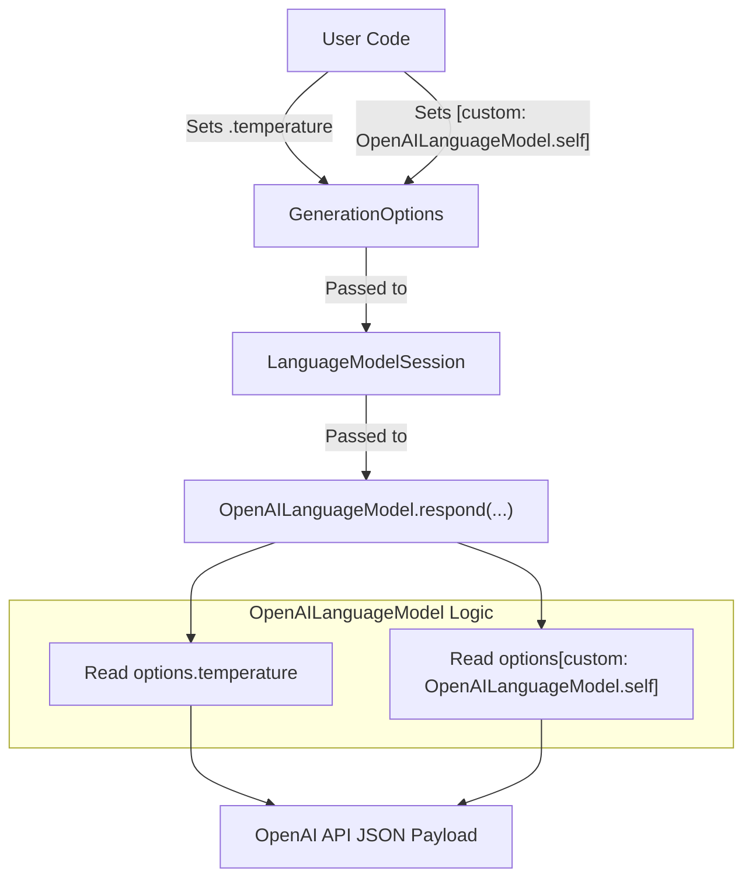
**Sources:** [Sources/AnyLanguageModel/GenerationOptions.swift:127-150](), [Sources/AnyLanguageModel/LanguageModel.swift:20-26](), [Tests/AnyLanguageModelTests/CustomGenerationOptionsTests.swift:24-35]()

---

## AnyCustomOptions & Type Erasure

To store various disparate types (like `OpenAI.CustomOptions` and `Anthropic.CustomOptions`) within a single `GenerationOptions` instance, the framework uses a private `CustomOptionsStorage` and a type-erasing wrapper called `AnyCustomOptions`.

### Implementation Details
*   **Storage**: Custom options are stored in a dictionary keyed by the string representation of the model type [Sources/AnyLanguageModel/GenerationOptions.swift:125]().
*   **Equality**: `GenerationOptions` remains `Equatable` because `AnyCustomOptions` uses a boxed comparison strategy to check if the underlying custom options match [Tests/AnyLanguageModelTests/CustomGenerationOptionsTests.swift:75-83]().
*   **Persistence**: While `GenerationOptions` is `Codable`, custom options are currently lost during a decoding round-trip to prevent crashes if the specific model type is not linked in the decoding environment [Tests/AnyLanguageModelTests/CustomGenerationOptionsTests.swift:126-143]().

### Mapping Providers to Entities
This diagram maps the natural language concept of "Provider Options" to the specific code entities in the `AnyLanguageModel` ecosystem.

**Code Entity Mapping**
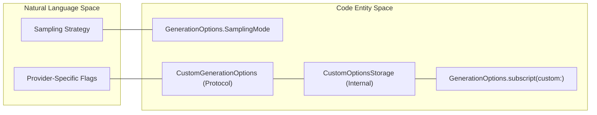

**Sources:** [Sources/AnyLanguageModel/GenerationOptions.swift:17-80](), [Sources/AnyLanguageModel/LanguageModel.swift:6-11](), [Tests/AnyLanguageModelTests/CustomGenerationOptionsTests.swift:48-64]()

---

## Provider Implementation Examples

### OpenAI
The `OpenAILanguageModel` supports `extraBody` for passing arbitrary JSON to the endpoint, alongside specific flags like `reasoningEffort` or `serviceTier` [Tests/AnyLanguageModelTests/CustomGenerationOptionsTests.swift:26-35]().

### Anthropic
The `AnthropicLanguageModel` includes fields for `topP`, `topK`, `stopSequences`, and the `thinking` budget for Claude 3.7+ models [Tests/AnyLanguageModelTests/CustomGenerationOptionsTests.swift:149-168]().

### OpenResponses
A provider-agnostic backend that supports an `extraBody` dictionary of `JSONValue` for pass-through parameters [Tests/AnyLanguageModelTests/OpenResponsesLanguageModelTests.swift:96-102]().

**Sources:** [Tests/AnyLanguageModelTests/CustomGenerationOptionsTests.swift:146-202](), [Tests/AnyLanguageModelTests/OpenResponsesLanguageModelTests.swift:90-104](), [Sources/AnyLanguageModel/Shared/JSONValue.swift:4]()

---

# Page: Structured Generation System

# Structured Generation System

<details>
<summary>Relevant source files</summary>

The following files were used as context for generating this wiki page:

- [Sources/AnyLanguageModel/Generable.swift](Sources/AnyLanguageModel/Generable.swift)
- [Sources/AnyLanguageModel/GenerationSchema.swift](Sources/AnyLanguageModel/GenerationSchema.swift)
- [Sources/AnyLanguageModel/Tool.swift](Sources/AnyLanguageModel/Tool.swift)
- [Sources/AnyLanguageModelMacros/GenerableMacro.swift](Sources/AnyLanguageModelMacros/GenerableMacro.swift)
- [Tests/AnyLanguageModelTests/GenerableMacroTests.swift](Tests/AnyLanguageModelTests/GenerableMacroTests.swift)

</details>


The Structured Generation System in `AnyLanguageModel` allows developers to define strongly-typed Swift structures and enumerations that Large Language Models (LLMs) can populate with guaranteed schema adherence. By bridging the gap between natural language prompts and the type-safe world of Swift, the system enables reliable tool calling, data extraction, and complex agentic workflows.

### System Architecture

The system operates across three primary layers: the **Macro Layer** (for developer ergonomics), the **Schema Layer** (for intermediate representation), and the **Generation Layer** (for real-time constraint enforcement).

#### From Code to Constraints
The following diagram illustrates how a Swift `struct` is transformed into a constrained generation process.

"Natural Language Space to Code Entity Space"
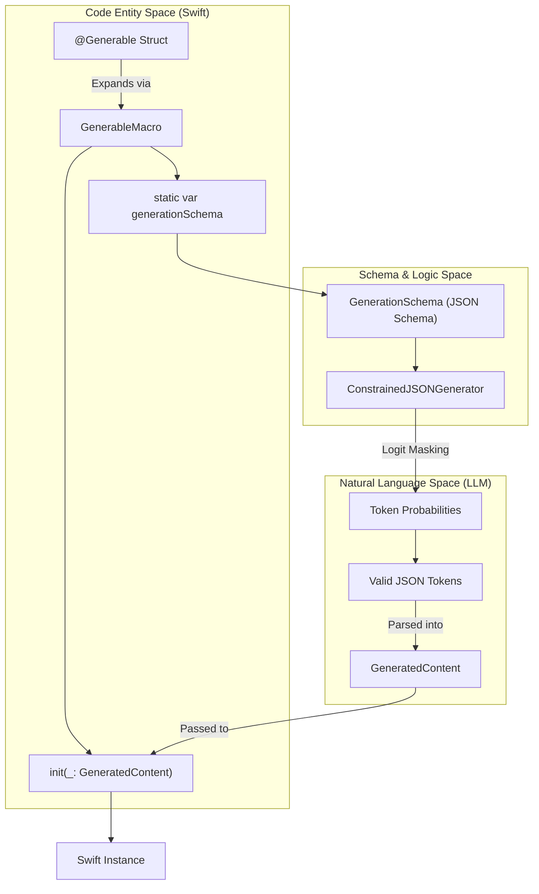
Sources: [Sources/AnyLanguageModel/Generable.swift:6-33](), [Sources/AnyLanguageModelMacros/GenerableMacro.swift:7-38](), [Sources/AnyLanguageModel/GenerationSchema.swift:11-138]()

---

### Core Components

#### 1. Generable Protocol & Macros
The `@Generable` macro is the primary entry point for developers. It automatically conforms a type to the `Generable` protocol and synthesizes the necessary logic to convert between the LLM's raw output and Swift types. Developers use the `@Guide` macro to provide natural language hints and validation constraints (like regex or ranges) directly on properties.

*   **@Generable**: Attached to `struct` or `enum`. Synthesizes `init(_: GeneratedContent)`, a memberwise initializer, and the `generationSchema` property.
*   **@Guide**: Attached to properties to define descriptions, string patterns, or numeric ranges that the LLM must follow.

For details, see [Generable Protocol & @Generable Macro](#3.1).

Sources: [Sources/AnyLanguageModel/Generable.swift:44-74](), [Sources/AnyLanguageModelMacros/GenerableMacro.swift:101-124]()

#### 2. GenerationSchema
`GenerationSchema` is a recursive tree structure (using `Node`) that represents a subset of JSON Schema. It acts as the "source of truth" for what the model is allowed to generate. It supports objects, arrays, strings (with regex/enums), numbers (with ranges), and booleans.

*   **ObjectNode**: Defines required properties and property types.
*   **DynamicGenerationSchema**: Allows building schemas at runtime for cases where types aren't known at compile-time.

For details, see [GenerationSchema & DynamicGenerationSchema](#3.2).

Sources: [Sources/AnyLanguageModel/GenerationSchema.swift:11-20](), [Sources/AnyLanguageModel/GenerationSchema.swift:72-138]()

#### 3. Constrained JSON Generation
This is the engine that enforces the schema during the LLM's inference phase. Instead of letting the model pick any token, the `ConstrainedJSONGenerator` calculates a "logit mask" for every step. This ensures the model can only choose tokens that continue a valid JSON string according to the `GenerationSchema`.

*   **TokenBackend**: An abstraction that allows different LLM backends (MLX, Llama.cpp, etc.) to provide their vocabulary and logit-biasing capabilities.
*   **Logit Masking**: The process of setting the probability of invalid tokens to `-infinity`.

For details, see [ConstrainedJSONGenerator & TokenBackend](#3.3).

Sources: [Sources/AnyLanguageModel/GenerationSchema.swift:9-10](), [Tests/AnyLanguageModelTests/GenerableMacroTests.swift:134-147]()

#### 4. GeneratedContent & Conversion
`GeneratedContent` is an intermediate, type-safe representation of the data returned by the model. It uses a `kind` enum (string, number, bool, array, structure) to store values before they are initialized into final Swift types via the `ConvertibleFromGeneratedContent` protocol.

For details, see [GeneratedContent & Conversion Protocols](#3.4).

Sources: [Sources/AnyLanguageModel/Generable.swift:27-33](), [Sources/AnyLanguageModel/Generable.swift:115-126]()

---

### Integration with Tool Calling
The structured generation system is the backbone of the `Tool` protocol. When a model decides to call a tool, it uses the tool's `Arguments` (which must be `Generable`) to construct a `GenerationSchema`. This schema is then used to force the model to generate valid arguments that match the tool's `call(arguments:)` signature.

"Tool Argument Schema Flow"
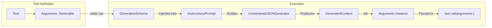
Sources: [Sources/AnyLanguageModel/Tool.swift:42-81](), [Sources/AnyLanguageModel/Tool.swift:103-108]()

### Summary Table

| Component | Responsibility | Primary File |
| :--- | :--- | :--- |
| `@Generable` | Code generation for Swift types | [Sources/AnyLanguageModelMacros/GenerableMacro.swift]() |
| `GenerationSchema` | JSON Schema intermediate representation | [Sources/AnyLanguageModel/GenerationSchema.swift]() |
| `Generable` | Protocol defining schema and conversion requirements | [Sources/AnyLanguageModel/Generable.swift]() |
| `Tool.parameters` | Links tool definitions to the schema system | [Sources/AnyLanguageModel/Tool.swift]() |

---

# Page: Generable Protocol & @Generable Macro

# Generable Protocol & @Generable Macro

<details>
<summary>Relevant source files</summary>

The following files were used as context for generating this wiki page:

- [.gitignore](.gitignore)
- [.swift-format](.swift-format)
- [Sources/AnyLanguageModel/ConvertibleFromGeneratedContent.swift](Sources/AnyLanguageModel/ConvertibleFromGeneratedContent.swift)
- [Sources/AnyLanguageModel/ConvertibleToGeneratedContent.swift](Sources/AnyLanguageModel/ConvertibleToGeneratedContent.swift)
- [Sources/AnyLanguageModel/DynamicGenerationSchema.swift](Sources/AnyLanguageModel/DynamicGenerationSchema.swift)
- [Sources/AnyLanguageModel/Generable.swift](Sources/AnyLanguageModel/Generable.swift)
- [Sources/AnyLanguageModel/Tool.swift](Sources/AnyLanguageModel/Tool.swift)
- [Sources/AnyLanguageModelMacros/GenerableMacro.swift](Sources/AnyLanguageModelMacros/GenerableMacro.swift)
- [Sources/AnyLanguageModelMacros/GuideMacro.swift](Sources/AnyLanguageModelMacros/GuideMacro.swift)
- [Sources/AnyLanguageModelMacros/Plugin.swift](Sources/AnyLanguageModelMacros/Plugin.swift)
- [Tests/AnyLanguageModelTests/GenerableMacroTests.swift](Tests/AnyLanguageModelTests/GenerableMacroTests.swift)

</details>


The structured generation system in `AnyLanguageModel` allows Swift types to be used as both the input and output schema for Language Model responses. This is primarily achieved through the `Generable` protocol and the `@Generable` macro, which bridge the gap between Swift's type system and the JSON-based schemas expected by constrained generation engines.

## The Generable Protocol

The `Generable` protocol is the central abstraction for any type that can be produced by a language model. It inherits from conversion protocols that handle the translation between raw `GeneratedContent` and Swift instances [Sources/AnyLanguageModel/Generable.swift:27-33]().

### Protocol Definition
```swift
public protocol Generable: ConvertibleFromGeneratedContent, ConvertibleToGeneratedContent {
    associatedtype PartiallyGenerated: ConvertibleFromGeneratedContent = Self
    static var generationSchema: GenerationSchema { get }
}
```
[Sources/AnyLanguageModel/Generable.swift:27-33]()

### Key Components
- **`generationSchema`**: A static property providing a `GenerationSchema` tree. This tree is used by backends to build logit filters or JSON schemas [Sources/AnyLanguageModel/Generable.swift:32]().
- **`PartiallyGenerated`**: An associated type representing a version of the struct where all fields are optional. This allows the framework to represent an object that is still in the process of being streamed from the model [Sources/AnyLanguageModel/Generable.swift:29]().
- **`ConvertibleFromGeneratedContent`**: Requires an initializer `init(_ content: GeneratedContent)` to reconstruct the type from model output [Sources/AnyLanguageModel/ConvertibleFromGeneratedContent.swift:2-5]().
- **`ConvertibleToGeneratedContent`**: Requires a `generatedContent` property to turn a Swift instance back into a structured format [Sources/AnyLanguageModel/ConvertibleToGeneratedContent.swift:2-5]().

### Standard Library Support
The framework provides default `Generable` conformances for primitive types, allowing them to be used as fields within larger `@Generable` structures:
- `Bool`: Mapped to `.boolean` schema [Sources/AnyLanguageModel/Generable.swift:106-112]().
- `String`: Mapped to `.string` schema [Sources/AnyLanguageModel/Generable.swift:130-137]().
- `Int`, `Float`, `Double`: Mapped to `.number` schema with `integerOnly` flags where appropriate [Sources/AnyLanguageModel/Generable.swift:155-210]().

---

## The @Generable Macro

The `@Generable` macro is a composite macro (`MemberMacro` and `ExtensionMacro`) that automates the boilerplate required to conform a `struct` or `enum` to the `Generable` protocol [Sources/AnyLanguageModelMacros/GenerableMacro.swift:7-13]().

### Expansion Pipeline
When the Swift compiler encounters `@Generable`, the `GenerableMacro.expansion` function performs the following steps:

1.  **Inspection**: It inspects the `DeclGroupSyntax` to determine if it is a `struct` or `enum` [Sources/AnyLanguageModelMacros/GenerableMacro.swift:14-39]().
2.  **Extraction**: It extracts property information (name, type) and searches for `@Guide` attributes on members to gather constraints [Sources/AnyLanguageModelMacros/GenerableMacro.swift:101-124]().
3.  **Synthesis**: It generates several code blocks:
    -   **Memberwise Initializer**: A standard Swift initializer [Sources/AnyLanguageModelMacros/GenerableMacro.swift:22]().
    -   **`init(_ generatedContent:)`**: An initializer that pulls values from a `GeneratedContent` dictionary using the property names as keys [Sources/AnyLanguageModelMacros/GenerableMacro.swift:23]().
    -   **`generationSchema`**: A static property that builds a `GenerationSchema` tree reflecting the struct's layout [Sources/AnyLanguageModelMacros/GenerableMacro.swift:29-33]().
    -   **`PartiallyGenerated` Struct**: A nested struct where every property of the parent is made optional, used for streaming [Sources/AnyLanguageModelMacros/GenerableMacro.swift:34]().

### Macro Data Flow
The following diagram illustrates how the macro transforms a Swift definition into the protocol requirements.

**Diagram: @Generable Macro Expansion Flow**
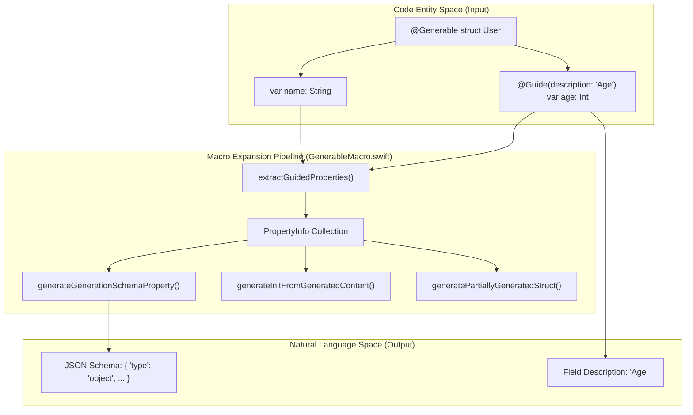
Sources: [Sources/AnyLanguageModelMacros/GenerableMacro.swift:14-38](), [Sources/AnyLanguageModelMacros/GenerableMacro.swift:101-124]()

---

## The @Guide Macro & Constraints

The `@Guide` macro is a `peer` macro used to annotate properties within a `@Generable` type. It provides natural language hints and programmatic constraints to the model [Sources/AnyLanguageModel/Generable.swift:59-74]().

### Usage and Parameters
- **Description**: Provides a string that is injected into the `GenerationSchema`'s description field, helping the LLM understand the purpose of the field [Sources/AnyLanguageModel/Generable.swift:61]().
- **Constraints**: Supports specific constraints like `.count(n)` for arrays or `.range(min...max)` for numbers [Sources/AnyLanguageModel/Generable.swift:66-67]().
- **Regex**: Allows passing a `Regex` object to enforce string patterns [Sources/AnyLanguageModel/Generable.swift:71-74]().

### Implementation Detail
The `GenerableMacro` searches for these attributes using `extractGuideInfo` [Sources/AnyLanguageModelMacros/GenerableMacro.swift:126-160](). It parses the arguments of the `@Guide` attribute to populate a `Constraints` object, which is then embedded into the synthesized `GenerationSchema`.

**Table: Guide Constraints to Schema Mapping**
| Guide Syntax | Target Type | Schema Impact |
| :--- | :--- | :--- |
| `@Guide(description: "...")` | Any | `node.description` is set |
| `@Guide(.count(5))` | `Array` | `minItems` and `maxItems` set to 5 |
| `@Guide(.range(1...10))` | `Int`/`Double` | `minimum` and `maximum` set |
| `@Guide(regex)` | `String` | `pattern` property set in `StringNode` |

Sources: [Sources/AnyLanguageModelMacros/GenerableMacro.swift:131-165](), [Sources/AnyLanguageModel/Generable.swift:61-74]()

---

## Data Flow: From Code to Model

This diagram bridges the "Code Entity Space" (Swift types) to the "Natural Language Space" (the model's understanding via schema).

**Diagram: Entity Mapping via Generable**
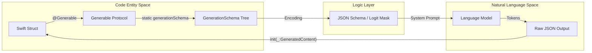
Sources: [Sources/AnyLanguageModel/Generable.swift:31-33](), [Sources/AnyLanguageModel/Tool.swift:103-108](), [Sources/AnyLanguageModelMacros/GenerableMacro.swift:29-33]()

### Handling Enums
When `@Generable` is applied to an `enum`, the macro ensures the enum is treated as a string-based choice (enumeration) in the schema [Sources/AnyLanguageModelMacros/GenerableMacro.swift:39-60]().
- It extracts all cases using `extractEnumCases` [Sources/AnyLanguageModelMacros/GenerableMacro.swift:43]().
- It synthesizes a `generationSchema` that uses `choices` (the case names) to restrict the model's output to only valid enum members [Sources/AnyLanguageModelMacros/GenerableMacro.swift:52-56]().

Sources: [Sources/AnyLanguageModelMacros/GenerableMacro.swift:39-60](), [Tests/AnyLanguageModelTests/GenerableMacroTests.swift:58-63]()

---

# Page: GenerationSchema & DynamicGenerationSchema

# GenerationSchema & DynamicGenerationSchema

<details>
<summary>Relevant source files</summary>

The following files were used as context for generating this wiki page:

- [.gitignore](.gitignore)
- [.swift-format](.swift-format)
- [Sources/AnyLanguageModel/ConvertibleFromGeneratedContent.swift](Sources/AnyLanguageModel/ConvertibleFromGeneratedContent.swift)
- [Sources/AnyLanguageModel/ConvertibleToGeneratedContent.swift](Sources/AnyLanguageModel/ConvertibleToGeneratedContent.swift)
- [Sources/AnyLanguageModel/DynamicGenerationSchema.swift](Sources/AnyLanguageModel/DynamicGenerationSchema.swift)
- [Sources/AnyLanguageModel/Extensions/Character+Extensions.swift](Sources/AnyLanguageModel/Extensions/Character+Extensions.swift)
- [Sources/AnyLanguageModel/Extensions/JSONDecoder+Extensions.swift](Sources/AnyLanguageModel/Extensions/JSONDecoder+Extensions.swift)
- [Sources/AnyLanguageModel/GenerationGuide.swift](Sources/AnyLanguageModel/GenerationGuide.swift)
- [Sources/AnyLanguageModel/GenerationSchema.swift](Sources/AnyLanguageModel/GenerationSchema.swift)
- [Tests/AnyLanguageModelTests/DynamicGenerationSchemaTests.swift](Tests/AnyLanguageModelTests/DynamicGenerationSchemaTests.swift)
- [Tests/AnyLanguageModelTests/GenerationGuideTests.swift](Tests/AnyLanguageModelTests/GenerationGuideTests.swift)

</details>


The `GenerationSchema` system provides a structured, tree-based representation of JSON schemas used to constrain Large Language Model (LLM) outputs. It serves as the intermediate representation between Swift types (via the `Generable` protocol) and the various backend-specific schema formats (e.g., OpenAI's Structured Outputs, Gemini's JSON schema, or the internal `ConstrainedJSONGenerator`).

## GenerationSchema Structure

`GenerationSchema` is a recursive structure that defines the expected shape of a JSON response. It is composed of a root `Node` and a dictionary of definitions (`defs`) for shared references. [Sources/AnyLanguageModel/GenerationSchema.swift:11-20]()

### Node Types
The core of the schema is the `Node` enum, which covers standard JSON types and schema-specific logic:

| Node Case | Associated Type | Description |
| :--- | :--- | :--- |
| `.object` | `ObjectNode` | A JSON object with named properties and required fields. |
| `.array` | `ArrayNode` | A JSON array with a specific item schema and length constraints. |
| `.string` | `StringNode` | A string with optional regex patterns or enum choices. |
| `.number` | `NumberNode` | A numeric value (integer or floating point) with range bounds. |
| `.boolean` | N/A | A simple boolean `true`/`false`. |
| `.anyOf` | `[Node]` | A union type where the output must match one of the provided schemas. |
| `.ref` | `String` | A reference to a named schema in the `defs` dictionary. |

**Sources:** [Sources/AnyLanguageModel/GenerationSchema.swift:12-19]()

### Specialized Node Structures

#### ObjectNode
Defines a JSON object. It includes a `properties` dictionary mapping keys to `Node` values and a `required` set of keys. [Sources/AnyLanguageModel/GenerationSchema.swift:233-238]()
- **Additional Properties**: By default, `additionalProperties` is set to `false` during encoding to ensure strict schema adherence. [Sources/AnyLanguageModel/GenerationSchema.swift:87-91]()

#### ArrayNode
Defines a JSON array. It contains an `items` `Node` defining the element type, and optional `minItems`/`maxItems` constraints. [Sources/AnyLanguageModel/GenerationSchema.swift:245-250]()

#### StringNode & NumberNode
These nodes support "Guides" for fine-grained validation:
- **StringNode**: Supports `pattern` (Regex) and `enumChoices` (String array). [Sources/AnyLanguageModel/GenerationSchema.swift:257-261]()
- **NumberNode**: Supports `minimum`, `maximum`, and an `integerOnly` flag (which determines if the JSON type is `integer` or `number`). [Sources/AnyLanguageModel/GenerationSchema.swift:268-273]()

## DynamicGenerationSchema

While `GenerationSchema` is optimized for encoding and consumption by generators, `DynamicGenerationSchema` is designed for runtime construction. This is particularly useful when schemas are built programmatically rather than derived from static Swift types via macros.

### Conversion Logic
`DynamicGenerationSchema` uses a `Body` enum to represent its state before being flattened into a `GenerationSchema`. [Sources/AnyLanguageModel/DynamicGenerationSchema.swift:10-17]()

### Natural Language to Code Entity Mapping: Schema Construction

This diagram illustrates how high-level "Dynamic" definitions are transformed into the formal "GenerationSchema" used by backends.

Title: Dynamic Schema Transformation Flow
```mermaid
graph TD
    subgraph "Natural Language Space (Input)"
        UserDesc["'A person with a name and age'"]
    end

    subgraph "Code Entity Space (Dynamic)"
        DGS["DynamicGenerationSchema(name: 'Person')"]
        DGP1["DynamicGenerationSchema.Property(name: 'name')"]
        DGP2["DynamicGenerationSchema.Property(name: 'age')"]
    end

    subgraph "Code Entity Space (Formal)"
        GS["GenerationSchema"]
        OBJ["ObjectNode"]
        STR["StringNode"]
        NUM["NumberNode"]
    end

    UserDesc --> DGS
    DGS -->|contains| DGP1
    DGS -->|contains| DGP2
    
    DGS -.->|converted via init(root:dependencies:)| GS
    GS -->|root| OBJ
    OBJ -->|properties['name']| STR
    OBJ -->|properties['age']| NUM
```
**Sources:** [Sources/AnyLanguageModel/DynamicGenerationSchema.swift:43-49](), [Sources/AnyLanguageModel/GenerationSchema.swift:316-320]()

## The omitAdditionalPropertiesKey Encoder Option

Some LLM providers (notably Google Gemini) have specific requirements for JSON schemas that conflict with the strict `additionalProperties: false` default used for OpenAI or local generators.

To handle this, the system provides a `userInfo` key for `JSONEncoder`:
`public static let omitAdditionalPropertiesKey = CodingUserInfoKey(rawValue: "omitAdditionalProperties")!` [Sources/AnyLanguageModel/GenerationSchema.swift:229]()

When this key is set to `true` in the encoder's `userInfo`, the `ObjectNode` encoding logic skips the `additionalProperties` key entirely. [Sources/AnyLanguageModel/GenerationSchema.swift:88-91]()

## Generation Guides

`GenerationGuide<Value>` provides a type-safe way to specify constraints during schema construction. These are typically applied via the `@Guide` macro but can be used manually with `DynamicGenerationSchema`. [Sources/AnyLanguageModel/GenerationGuide.swift:5-10]()

### Supported Constraints
- **Numeric**: `.minimum(Value)`, `.maximum(Value)`, `.range(ClosedRange<Value>)`. [Sources/AnyLanguageModel/GenerationGuide.swift:64-106]()
- **String**: `.constant(String)`, `.anyOf([String])`, `.pattern(Regex)`. [Sources/AnyLanguageModel/GenerationGuide.swift:29-41]()
- **Array**: `.minimumCount(Int)`, `.maximumCount(Int)`, `.count(ClosedRange<Int>)`. [Sources/AnyLanguageModel/GenerationGuide.swift:189-204]()

## Data Flow: Swift Type to JSON Schema

This diagram shows the path from a Swift struct to the final encoded JSON schema sent to an API.

Title: Schema Generation Lifecycle
```mermaid
graph LR
    subgraph "Swift Type"
        ST["@Generable struct User"]
    end

    subgraph "Internal Representation"
        DGS["DynamicGenerationSchema"]
        GS["GenerationSchema"]
    end

    subgraph "Backend Encoders"
        OAI["OpenAI Strict Mode"]
        GEM["Gemini Schema"]
    end

    ST -->|Macro Expansion| DGS
    DGS -->|Resolution| GS
    GS -->|JSONEncoder| OAI
    GS -->|JSONEncoder + omitAdditionalProperties| GEM
```
**Sources:** [Sources/AnyLanguageModel/GenerationSchema.swift:69-139](), [Tests/AnyLanguageModelTests/DynamicGenerationSchemaTests.swift:8-22]()

### Implementation Details
- **References**: References are encoded as `#/$defs/TypeName`. [Sources/AnyLanguageModel/GenerationSchema.swift:137]()
- **Recursion**: The `Node` enum is `indirect` to allow nested objects and arrays of arbitrary depth. [Sources/AnyLanguageModel/GenerationSchema.swift:12]()
- **Validation**: The `GenerationSchema` initializer validates that all `.ref` nodes have corresponding definitions in the `dependencies` provided during construction. [Tests/AnyLanguageModelTests/DynamicGenerationSchemaTests.swift:105-111]()

**Sources:**
- `Sources/AnyLanguageModel/GenerationSchema.swift`
- `Sources/AnyLanguageModel/DynamicGenerationSchema.swift`
- `Sources/AnyLanguageModel/GenerationGuide.swift`
- `Tests/AnyLanguageModelTests/DynamicGenerationSchemaTests.swift`

---

# Page: ConstrainedJSONGenerator & TokenBackend

# ConstrainedJSONGenerator & TokenBackend

<details>
<summary>Relevant source files</summary>

The following files were used as context for generating this wiki page:

- [Tests/AnyLanguageModelTests/Shared/MockTokenBackend.swift](Tests/AnyLanguageModelTests/Shared/MockTokenBackend.swift)
- [Tests/AnyLanguageModelTests/Shared/StructuredGenerationFixtures.swift](Tests/AnyLanguageModelTests/Shared/StructuredGenerationFixtures.swift)
- [Tests/AnyLanguageModelTests/StructuredGenerationTests.swift](Tests/AnyLanguageModelTests/StructuredGenerationTests.swift)

</details>


The `ConstrainedJSONGenerator` is the core engine responsible for forcing a Language Model to produce valid JSON that strictly adheres to a provided `GenerationSchema`. It operates by intercepting the token sampling process, applying logit masks to ensure only tokens that advance a valid JSON state are selectable.

## TokenBackend Protocol

The `TokenBackend` protocol abstracts the specific inference engine (e.g., MLX, Llama.cpp) from the JSON constraint logic. It defines the interface for tokenization, vocabulary inspection, and sampling.

| Requirement | Description |
| :--- | :--- |
| `vocabSize: Int` | The total number of tokens in the model's vocabulary. |
| `eosToken: Int` | The primary End-Of-Sequence token ID. |
| `endTokens: Set<Int>` | A set of all tokens that should signal the end of generation. |
| `remainingTokens: Int` | A budget of tokens left for the current generation task. |
| `tokenize(String) -> [Int]` | Converts a raw string into a sequence of token IDs. |
| `tokenText(Int) -> String?` | Retrieves the string representation of a specific token ID. |
| `sample(Set<Int>) -> Int` | Selects a token from the provided set of allowed token IDs. |
| `decode(Int) -> Void` | Informs the backend that a token has been selected to update its internal state. |

Sources: `Tests/AnyLanguageModelTests/Shared/MockTokenBackend.swift:22-33` (), `Tests/AnyLanguageModelTests/Shared/MockTokenBackend.swift:55-93` ()

## ConstrainedJSONGenerator

The `ConstrainedJSONGenerator` maintains a state machine that tracks the current position within the JSON structure. It recursively processes the `GenerationSchema` to determine which characters are valid next, then maps those characters back to valid tokens in the model's vocabulary.

### Key Implementation Details

*   **Logit Masking**: Before each token is generated, the generator identifies the "allowed" set of tokens. If the next expected character is a structural element (like `{`, `[`, `:`, or `,`), it restricts the selection to tokens representing those characters.
*   **Prefix Trie Collision Detection**: When generating strings or keys, the generator uses a `StringTokenCache` to find all tokens that start with or match the required prefix.
*   **OptionalPropertyBudget**: A heuristic used to decide whether the model should continue generating optional properties in an object or close the object.
*   **Prefix-based Enum Selection**: For `StringNode` with `enumChoices`, the generator deterministically selects the longest valid candidate if multiple choices share a prefix.

### Data Flow: Natural Language to Code Entity Space

The following diagram illustrates how the abstract concept of "Constrained Generation" is mapped to specific code entities within the engine.

**Engine Architecture & Entity Mapping**

```mermaid
graph TD
    subgraph "Natural Language Space (Intent)"
        Schema["JSON Schema Definition"]
        Inference["Next Token Prediction"]
    end

    subgraph "Code Entity Space (Implementation)"
        Gen["ConstrainedJSONGenerator"]
        SchemaNode["GenerationSchema.Node"]
        Backend["TokenBackend Protocol"]
        Cache["StringTokenCache"]
        Error["ConstrainedGenerationError"]
    end

    Schema -->|Defines| SchemaNode
    SchemaNode -->|Input to| Gen
    Gen -->|Queries Vocab| Backend
    Gen -->|Optimizes Lookups| Cache
    Inference -->|Intercepted by| Backend
    Backend -->|Throws| Error
    
    style Gen stroke-width:2px
    style Backend stroke-width:2px
```

Sources: `Tests/AnyLanguageModelTests/StructuredGenerationTests.swift:86-88` (), `Tests/AnyLanguageModelTests/StructuredGenerationTests.swift:154-174` ()

## ConstrainedGenerationError

The engine defines specific error cases when the model fails to satisfy the schema constraints or when the tokenization logic encounters an edge case.

| Error Case | Description |
| :--- | :--- |
| `.tokenizationFailed` | Occurs if the backend cannot provide a token for a required structural character. |
| `.numberOutOfRange` | Thrown if a generated number violates `minimum` or `maximum` constraints in `NumberNode`. |
| `.patternMismatch` | Thrown if a generated string fails to match the `regex` pattern in `StringNode`. |
| `.invalidSequence` | Triggered if the model generates a sequence that is mathematically impossible to parse as JSON. |

Sources: `Tests/AnyLanguageModelTests/StructuredGenerationTests.swift:65-96` (), `Tests/AnyLanguageModelTests/StructuredGenerationTests.swift:98-130` ()

## Implementation Lifecycle

The lifecycle of a constrained generation request involves a tight loop between the generator and the backend.

**Request Lifecycle Sequence**

```mermaid
sequenceDiagram
    participant App as "LanguageModelSession"
    participant Gen as "ConstrainedJSONGenerator"
    participant BE as "TokenBackend (e.g. MLXTokenBackend)"

    App->>Gen: init(backend, schema)
    Gen->>BE: tokenize structural chars ("{", ":", etc)
    
    loop until JSON Complete
        Gen->>Gen: determineAllowedCharacters()
        Gen->>BE: vocabSize / tokenText()
        Gen->>Gen: filterTokens(allowedChars)
        Gen->>BE: sample(allowedTokens)
        BE-->>Gen: selectedToken
        Gen->>BE: decode(selectedToken)
        Gen->>Gen: updateState(selectedToken)
    end
    
    Gen-->>App: JSON String Result
```

Sources: `Tests/AnyLanguageModelTests/StructuredGenerationTests.swift:195-198` (), `Tests/AnyLanguageModelTests/Shared/MockTokenBackend.swift:78-93` ()

## StringTokenCache & Performance

To avoid re-scanning the entire model vocabulary (often 32k to 128k tokens) for every character generated, the `ConstrainedJSONGenerator` utilizes a `StringTokenCache`. 

1.  **Initialization**: On first use, the cache categorizes the vocabulary by their string representations.
2.  **Structural Mapping**: It pre-calculates the token IDs for common JSON delimiters: `{`, `}`, `[`, `]`, `,`, `:`, and `"`.
3.  **Validation**: It ensures that structural tokens are "pure"—meaning a comma token contains only a comma and no leading/trailing whitespace that might break the JSON parser.

Sources: `Tests/AnyLanguageModelTests/StructuredGenerationTests.swift:200-211` (), `Tests/AnyLanguageModelTests/Shared/MockTokenBackend.swift:23-28` ()

---

# Page: GeneratedContent & Conversion Protocols

# GeneratedContent & Conversion Protocols

<details>
<summary>Relevant source files</summary>

The following files were used as context for generating this wiki page:

- [.gitignore](.gitignore)
- [.swift-format](.swift-format)
- [Sources/AnyLanguageModel/ConvertibleFromGeneratedContent.swift](Sources/AnyLanguageModel/ConvertibleFromGeneratedContent.swift)
- [Sources/AnyLanguageModel/ConvertibleToGeneratedContent.swift](Sources/AnyLanguageModel/ConvertibleToGeneratedContent.swift)
- [Sources/AnyLanguageModel/DynamicGenerationSchema.swift](Sources/AnyLanguageModel/DynamicGenerationSchema.swift)
- [Sources/AnyLanguageModel/GeneratedContent.swift](Sources/AnyLanguageModel/GeneratedContent.swift)
- [Sources/AnyLanguageModel/GenerationID.swift](Sources/AnyLanguageModel/GenerationID.swift)
- [Sources/AnyLanguageModel/GenerationOptions.swift](Sources/AnyLanguageModel/GenerationOptions.swift)
- [Sources/AnyLanguageModel/LanguageModel.swift](Sources/AnyLanguageModel/LanguageModel.swift)
- [Sources/AnyLanguageModel/Transcript.swift](Sources/AnyLanguageModel/Transcript.swift)
- [Tests/AnyLanguageModelTests/ConvertibleToGeneratedContentTests.swift](Tests/AnyLanguageModelTests/ConvertibleToGeneratedContentTests.swift)

</details>


The structured generation system in `AnyLanguageModel` relies on a specialized intermediate representation to bridge the gap between raw LLM outputs (typically JSON strings) and strongly-typed Swift models. This page documents `GeneratedContent`, the unique `GenerationID`, and the conversion protocols that facilitate this transformation.

## GeneratedContent

`GeneratedContent` is a recursive, type-safe container that represents structured data produced by a language model [Sources/AnyLanguageModel/GeneratedContent.swift:7-7](). It acts as a middle layer that can hold primitives, arrays, or complex key-value structures while maintaining the stability of identifiers during streaming.

### The Kind Enum
The core data is stored in the `Kind` enum, which mirrors JSON types but adds support for tracking property order and specific generation IDs for sub-elements [Sources/AnyLanguageModel/GeneratedContent.swift:34-34]().

| Kind | Description | Swift Mapping |
| :--- | :--- | :--- |
| `string` | A simple text string. | `String` |
| `number` | A numeric value (integer or decimal). | `Double`, `Int`, `Decimal` |
| `bool` | A boolean value. | `Bool` |
| `array` | A sequence of `GeneratedContent` items. | `[GeneratedContent]` |
| `structure` | Key-value pairs with stable key ordering. | `[String: GeneratedContent]` |
| `null` | Represents an empty or null value. | `Optional.none` |

### Partial JSON Parsing
A critical feature of `GeneratedContent` is its ability to be initialized from incomplete JSON strings [Sources/AnyLanguageModel/GeneratedContent.swift:156-160](). This is essential for streaming responses where the model might have only emitted half of a JSON object. The initializer attempts to "heal" the JSON by appending necessary closing braces or brackets to create a valid structure for the `Generable` type to consume [Sources/AnyLanguageModel/GeneratedContent.swift:168-173]().

### Data Flow: From LLM to Swift Entity
The following diagram illustrates how raw text from a `LanguageModel` is transformed into a `GeneratedContent` tree and finally into a Swift struct.

**Data Transformation Pipeline**
```mermaid
graph TD
    subgraph "Natural Language Space (LLM Output)"
        A["Raw JSON String: '{\"name\": \"Swift\", \"ver\": 6}'"]
    end

    subgraph "Code Entity Space (AnyLanguageModel Core)"
        B["GeneratedContent(json:)"]
        C["GeneratedContent.Kind.structure"]
        D["ConvertibleFromGeneratedContent.init(_:)"]
    end

    subgraph "Swift Application Space"
        E["@Generable struct Language"]
    end

    A --> B
    B --> C
    C --> D
    D --> E
```
Sources: [Sources/AnyLanguageModel/GeneratedContent.swift:156-173](), [Sources/AnyLanguageModel/ConvertibleFromGeneratedContent.swift:1-5](), [Sources/AnyLanguageModel/Transcript.swift:97-112]()

## GenerationID

A `GenerationID` is a unique, stable identifier associated with a specific piece of generated content [Sources/AnyLanguageModel/GenerationID.swift:44-44](). 

- **Stability**: Within a single `LanguageModelSession` response stream, the `id` for a specific entity remains constant even as its properties are being filled in [Sources/AnyLanguageModel/GeneratedContent.swift:20-24]().
- **Usage**: It is primarily used to identify items in SwiftUI `List` or `ForEach` views when the content itself (like a name) is still changing [Sources/AnyLanguageModel/GenerationID.swift:15-30]().
- **Manual Creation**: When `GeneratedContent` is created manually (e.g., for a prompt), the `id` is typically `nil` because it was not produced by a generation engine [Sources/AnyLanguageModel/GeneratedContent.swift:26-28]().

Sources: [Sources/AnyLanguageModel/GenerationID.swift:1-51](), [Sources/AnyLanguageModel/GeneratedContent.swift:20-28]()

## Conversion Protocols

Two primary protocols define how types move in and out of the `GeneratedContent` ecosystem.

### ConvertibleToGeneratedContent
Types conforming to this protocol can be turned into `GeneratedContent` for use in `Transcript` entries or tool outputs [Sources/AnyLanguageModel/ConvertibleToGeneratedContent.swift:2-5](). 

- **Automatic Conformance**: `Optional` and `Array` automatically conform if their wrapped/element types conform [Sources/AnyLanguageModel/ConvertibleToGeneratedContent.swift:23-41]().
- **Prompt Integration**: This protocol inherits from `InstructionsRepresentable` and `PromptRepresentable`, providing default implementations that convert the structured content into a JSON string for the LLM context [Sources/AnyLanguageModel/ConvertibleToGeneratedContent.swift:9-19]().

### ConvertibleFromGeneratedContent
This protocol allows a type to be initialized from `GeneratedContent` [Sources/AnyLanguageModel/ConvertibleFromGeneratedContent.swift:1-5](). 

- **Implementation**: The `@Generable` macro typically synthesizes this implementation, mapping keys in a `.structure` kind to the struct's properties.
- **Error Handling**: If the `GeneratedContent.Kind` does not match the expected structure (e.g., expecting an array but receiving a string), a `GeneratedContentConversionError.typeMismatch` is thrown [Sources/AnyLanguageModel/ConvertibleFromGeneratedContent.swift:13-15]().

**Protocol Interaction Diagram**
```mermaid
graph LR
    subgraph "Protocol Definitions"
        CTGC["ConvertibleToGeneratedContent"]
        CFGC["ConvertibleFromGeneratedContent"]
    end

    subgraph "Standard Library Extensions"
        OPT["Optional<T>"]
        ARR["Array<T>"]
    end

    subgraph "System Types"
        GC["GeneratedContent"]
        GID["GenerationID"]
    end

    CTGC -- "generatedContent" --> GC
    GC -- "init(_:)" --> CFGC
    OPT -- "Conditional Conformance" --> CTGC
    ARR -- "Conditional Conformance" --> CTGC
    ARR -- "Conditional Conformance" --> CFGC
    GC -- "has" --> GID
```
Sources: [Sources/AnyLanguageModel/ConvertibleToGeneratedContent.swift:2-5](), [Sources/AnyLanguageModel/ConvertibleFromGeneratedContent.swift:1-5](), [Sources/AnyLanguageModel/GeneratedContent.swift:28-34]()

## Usage in Transcripts

Structured content is integrated into the conversation history via `Transcript.StructuredSegment` [Sources/AnyLanguageModel/Transcript.swift:97-97]().

- **Source**: Every structured segment includes a `source` string, which identifies the type or schema that the content represents [Sources/AnyLanguageModel/Transcript.swift:102-102]().
- **Content**: The `content` property holds the `GeneratedContent` instance [Sources/AnyLanguageModel/Transcript.swift:105-105]().

This allows the `Transcript` to maintain a high-fidelity record of generated objects rather than just raw strings, enabling features like feedback logging on specific generated entities [Sources/AnyLanguageModel/LanguageModel.swift:36-41]().

Sources: [Sources/AnyLanguageModel/Transcript.swift:97-112](), [Sources/AnyLanguageModel/LanguageModel.swift:36-41]()

---

# Page: Tool Calling System

# Tool Calling System

<details>
<summary>Relevant source files</summary>

The following files were used as context for generating this wiki page:

- [Sources/AnyLanguageModel/Generable.swift](Sources/AnyLanguageModel/Generable.swift)
- [Sources/AnyLanguageModel/Tool.swift](Sources/AnyLanguageModel/Tool.swift)
- [Sources/AnyLanguageModel/ToolExecution.swift](Sources/AnyLanguageModel/ToolExecution.swift)
- [Sources/AnyLanguageModelMacros/GenerableMacro.swift](Sources/AnyLanguageModelMacros/GenerableMacro.swift)
- [Tests/AnyLanguageModelTests/GenerableMacroTests.swift](Tests/AnyLanguageModelTests/GenerableMacroTests.swift)

</details>


The tool calling system in `AnyLanguageModel` allows models to gather real-time information or perform side effects by executing Swift code. This architecture bridges the gap between the model's natural language reasoning and your application's logic.

## Overview

The system is built around three core components:
1.  **The `Tool` Protocol**: Defines the interface for a single capability (e.g., fetching weather, searching contacts).
2.  **`ToolExecutionDelegate`**: An actor-based protocol that provides hooks for observing and controlling the execution lifecycle.
3.  **`LanguageModelSession` Orchestration**: The session manages the multi-turn loop where a model generates a `ToolCall`, the system executes it, and the resulting `ToolOutput` is fed back into the transcript for further reasoning.

### Tool Execution Flow

The following diagram illustrates how a `LanguageModelSession` coordinates with a `Tool` and a `ToolExecutionDelegate` to move from a natural language request to code execution.

**Tool Execution Lifecycle**
```mermaid
sequenceDiagram
    participant User
    participant Session as "LanguageModelSession"
    participant Delegate as "ToolExecutionDelegate"
    participant Tool as "Tool Implementation"

    User->>Session: respond(to: "What's the weather?")
    Session->>Session: Model generates ToolCall
    Session->>Delegate: didGenerateToolCalls([ToolCall])
    
    loop For each ToolCall
        Session->>Delegate: toolCallDecision(for: ToolCall)
        Delegate-->>Session: .execute
        Session->>Tool: call(arguments: Arguments)
        Tool-->>Session: Output (PromptRepresentable)
        Session->>Delegate: didExecuteToolCall(ToolCall, output)
    end

    Session->>Session: Append ToolOutput to Transcript
    Session->>Session: Resume generation with context
    Session-->>User: Final Text Response
```
**Sources:** [Sources/AnyLanguageModel/ToolExecution.swift:24-65](), [Sources/AnyLanguageModel/Tool.swift:42-81](), [Sources/AnyLanguageModel/Tool.swift:112-130]()

---

## The Tool Protocol

A `Tool` is a `Sendable` unit of work. It specifies its own `Arguments` and `Output` types, which are automatically mapped to JSON schemas for the model.

*   **Arguments**: Must conform to `ConvertibleFromGeneratedContent`. When a tool uses a `@Generable` struct for its arguments, the `parameters` schema is automatically derived from the struct's properties and `@Guide` macros.
*   **Output**: Must conform to `PromptRepresentable`. Typically, this is a `String` or another `@Generable` type.
*   **Schema Injection**: By default, `includesSchemaInInstructions` is `true`, meaning the tool's name, description, and parameter schema are automatically injected into the system prompt.

For detailed information on defining tools and using macros to shape arguments, see **[Tool Protocol (#4.1)]**.

**Sources:** [Sources/AnyLanguageModel/Tool.swift:42-62](), [Sources/AnyLanguageModel/Tool.swift:103-108]()

---

## Tool Execution Delegate

The `ToolExecutionDelegate` provides fine-grained control over the tool loop. While the default behavior is to execute all tool calls immediately, the delegate allows you to:
*   **Intercept**: Observe tool calls before they run via `didGenerateToolCalls`.
*   **Decide**: Use `toolCallDecision` to return a `ToolExecutionDecision`. You can choose to `.execute`, `.stop` (halting the session), or `.provideOutput` (manually supplying data, perhaps from a cache, instead of running the tool).
*   **Handle Errors**: Use `didFailToolCall` to log or recover from execution errors.

> [!IMPORTANT]
> Using `ToolExecutionDelegate` is exclusive to `AnyLanguageModel`. Implementing this protocol breaks drop-in parity with Apple's `FoundationModels` framework, as the system-native sessions do not support this level of execution interception.

For details on implementing custom logic and the `ToolExecutionDecision` enum, see **[ToolExecutionDelegate (#4.2)]**.

**Sources:** [Sources/AnyLanguageModel/ToolExecution.swift:1-24](), [Sources/AnyLanguageModel/ToolExecution.swift:69-94]()

---

## Mapping Code Entities to Tool Space

The tool calling system maps Swift types and protocols to the "Natural Language Space" understood by the LLM.

| Code Entity | Role in Tool System |
| :--- | :--- |
| `Tool.name` | The unique identifier the model uses to trigger the tool. |
| `Tool.description` | The natural language "help text" the model uses to decide when to call the tool. |
| `@Generable Arguments` | Becomes the JSON Schema (`parameters`) describing valid inputs. |
| `@Guide` | Injects constraints (ranges, regex, descriptions) into the parameter schema. |
| `Tool.call(arguments:)` | The Swift function body executed when the model makes a request. |
| `Transcript.ToolCall` | A record in the conversation history representing the model's intent to call a tool. |
| `Transcript.ToolOutput` | The result of the Swift execution, formatted back into `Transcript.Segment`s. |

**Sources:** [Sources/AnyLanguageModel/Tool.swift:55-62](), [Sources/AnyLanguageModel/Tool.swift:112-130](), [Tests/AnyLanguageModelTests/GenerableMacroTests.swift:28-35]()

---

## Related Pages
- [Tool Protocol](#4.1) — Detailed documentation on the `Tool` protocol and `@Generable` integration.
- [ToolExecutionDelegate](#4.2) — Deep dive into the delegate lifecycle and execution decisions.
- [Transcript & Prompt Data Model](#2.3) — How `ToolCall` and `ToolOutput` are represented in the conversation history.

---

# Page: Tool Protocol

# Tool Protocol

<details>
<summary>Relevant source files</summary>

The following files were used as context for generating this wiki page:

- [Sources/AnyLanguageModel/Generable.swift](Sources/AnyLanguageModel/Generable.swift)
- [Sources/AnyLanguageModel/Tool.swift](Sources/AnyLanguageModel/Tool.swift)
- [Sources/AnyLanguageModel/ToolExecution.swift](Sources/AnyLanguageModel/ToolExecution.swift)
- [Sources/AnyLanguageModelMacros/GenerableMacro.swift](Sources/AnyLanguageModelMacros/GenerableMacro.swift)
- [Tests/AnyLanguageModelTests/GenerableMacroTests.swift](Tests/AnyLanguageModelTests/GenerableMacroTests.swift)
- [Tests/AnyLanguageModelTests/Shared/ToolSpy.swift](Tests/AnyLanguageModelTests/Shared/ToolSpy.swift)
- [Tests/AnyLanguageModelTests/Shared/Tools.swift](Tests/AnyLanguageModelTests/Shared/Tools.swift)

</details>


The `Tool` protocol defines a mechanism for language models to interact with external systems, gather real-time information, or perform side effects during a conversation. By conforming to this protocol, developers can expose Swift functions to the model, which are then described in the prompt using a structured schema.

### The Tool Protocol Definition

A `Tool` is a `Sendable` unit of work that bridges the model's intent (expressed as JSON arguments) to Swift execution. It requires a name, a description, and a schema for its parameters.

| Property | Type | Description |
| :--- | :--- | :--- |
| `name` | `String` | A unique identifier for the tool (e.g., "getWeather"). [Sources/AnyLanguageModel/Tool.swift:55-56]() |
| `description` | `String` | Natural language text explaining when and how the model should use this tool. [Sources/AnyLanguageModel/Tool.swift:58-59]() |
| `Arguments` | `associatedtype` | Must conform to `ConvertibleFromGeneratedContent`. Typically a `@Generable` struct. [Sources/AnyLanguageModel/Tool.swift:53-54]() |
| `Output` | `associatedtype` | Must conform to `PromptRepresentable`. Usually a `String` or a `@Generable` type. [Sources/AnyLanguageModel/Tool.swift:48-49]() |
| `parameters` | `GenerationSchema` | The JSON schema describing the expected `Arguments`. [Sources/AnyLanguageModel/Tool.swift:61-62]() |
| `includesSchemaInInstructions` | `Bool` | Whether to inject the tool's definition into the system prompt. Defaults to `true`. [Sources/AnyLanguageModel/Tool.swift:64-71]() |

Sources: [Sources/AnyLanguageModel/Tool.swift:42-81]()

---

### Bridging Natural Language to Code Entities

The following diagram illustrates how a natural language request from a model is transformed into a typed Swift call through the `Tool` protocol abstractions.

**Tool Execution Data Flow**
```mermaid
graph TD
    subgraph "Natural Language Space (LLM)"
        A["Model Output: { 'name': 'getWeather', 'arguments': '{ \"city\": \"Paris\" }' }"]
    end

    subgraph "Code Entity Space (AnyLanguageModel)"
        B["Transcript.ToolCall"]
        C["Tool Protocol (WeatherTool)"]
        D["@Generable Arguments (WeatherTool.Arguments)"]
        E["Tool.call(arguments:)"]
        F["PromptRepresentable Output"]
    end

    A -->|"Parsed by Session"| B
    B -->|"Lookup by Name"| C
    B -->|"Initialize"| D
    D -->|"Pass to"| E
    E -->|"Return"| F
    F -->|"Convert to Segment"| G["Transcript.ToolOutput"]
```
Sources: [Sources/AnyLanguageModel/Tool.swift:8-32](), [Sources/AnyLanguageModel/Tool.swift:113-130]()

---

### Automatic Parameter Schema Generation

When a tool's `Arguments` type is annotated with the `@Generable` macro, the `parameters` property is automatically populated using the synthesized `generationSchema`.

1.  **Macro Expansion**: The `@Generable` macro inspects the properties of the `Arguments` struct. [Sources/AnyLanguageModelMacros/GenerableMacro.swift:101-124]()
2.  **Guide Metadata**: The `@Guide` macro attaches descriptions and constraints (like ranges or regex) to specific fields. [Sources/AnyLanguageModelMacros/GenerableMacro.swift:126-168]()
3.  **Schema Synthesis**: The macro generates a `static var generationSchema` which the `Tool` protocol uses by default if `Arguments` conforms to `Generable`. [Sources/AnyLanguageModel/Tool.swift:103-108]()

**Example Implementation:**
```swift
struct WeatherTool: Tool {
    let description = "Retrieve weather for a city"
    
    @Generable
    struct Arguments {
        @Guide(description: "The city name")
        var city: String
    }
    
    func call(arguments: Arguments) async throws -> String {
        "Sunny in \(arguments.city)"
    }
}
```
Sources: [Tests/AnyLanguageModelTests/Shared/Tools.swift:3-16](), [Sources/AnyLanguageModel/Tool.swift:103-108]()

---

### Output Processing & Segment Mapping

The `Tool` protocol provides a helper method, `makeOutputSegments(from:)`, which handles the lifecycle of converting raw model-generated JSON into typed arguments and then converting the tool's output back into `Transcript.Segment` objects.

**makeOutputSegments Logic**
```mermaid
flowchart TD
    Start["makeOutputSegments(from: GeneratedContent)"]
    Parse["Initialize Arguments(content)"]
    Exec["await call(arguments:)"]
    CheckType{"Is Output
    ConvertibleToGeneratedContent?"}
    
    Structured["Wrap in .structure Segment"]
    IsString{"Is Output
    String?"}
    Text["Wrap in .text Segment"]
    Fallback["Use promptRepresentation.description"]

    Start --> Parse
    Parse --> Exec
    Exec --> CheckType
    CheckType -- Yes --> Structured
    CheckType -- No --> IsString
    IsString -- Yes --> Text
    IsString -- No --> Fallback
```
Sources: [Sources/AnyLanguageModel/Tool.swift:112-130]()

### Key Helper Functions

*   **`makeOutputSegments(from:)`**: 
    *   Attempts to initialize the `Arguments` type from `GeneratedContent`. [Sources/AnyLanguageModel/Tool.swift:114]()
    *   Invokes the tool's `call` method. [Sources/AnyLanguageModel/Tool.swift:115]()
    *   If the result is `ConvertibleToGeneratedContent` (e.g., another `@Generable` struct), it returns a `.structure` segment. [Sources/AnyLanguageModel/Tool.swift:117-121]()
    *   If the result is a `String`, it returns a `.text` segment. [Sources/AnyLanguageModel/Tool.swift:123-125]()
    *   Otherwise, it falls back to the `promptRepresentation` string. [Sources/AnyLanguageModel/Tool.swift:127-128]()

### Testing Infrastructure: ToolSpy

For unit testing, the `ToolSpy` actor can wrap any `Tool` to record calls and results without modifying the underlying tool logic. It replicates the wrapped tool's `name`, `description`, and `parameters` while providing a thread-safe `calls` array for verification. [Tests/AnyLanguageModelTests/Shared/ToolSpy.swift:3-30]()

Sources: [Tests/AnyLanguageModelTests/Shared/ToolSpy.swift:1-35](), [Sources/AnyLanguageModel/Tool.swift:112-130]()

---

# Page: ToolExecutionDelegate

# ToolExecutionDelegate

<details>
<summary>Relevant source files</summary>

The following files were used as context for generating this wiki page:

- [Sources/AnyLanguageModel/ToolExecution.swift](Sources/AnyLanguageModel/ToolExecution.swift)
- [Tests/AnyLanguageModelTests/ToolExecutionDelegateTests.swift](Tests/AnyLanguageModelTests/ToolExecutionDelegateTests.swift)

</details>


The `ToolExecutionDelegate` protocol provides a mechanism for observing and controlling the tool execution lifecycle within a `LanguageModelSession`. While `AnyLanguageModel` aims for drop-in parity with Apple's `FoundationModels`, this specific delegate is an extension exclusive to this library, allowing for fine-grained intervention in the tool-calling loop.

## ToolExecutionDelegate Protocol

The `ToolExecutionDelegate` is a `Sendable` protocol designed to be implemented by actors or thread-safe objects. it allows developers to intercept tool calls before they are executed, provide manual overrides, and observe the success or failure of tool operations [Sources/AnyLanguageModel/ToolExecution.swift:24-65]().

### Key Methods

| Method | Purpose |
| :--- | :--- |
| `didGenerateToolCalls(_:in:)` | Notifies the delegate that the model has requested one or more tool executions [Sources/AnyLanguageModel/ToolExecution.swift:30](). |
| `toolCallDecision(for:in:)` | **Control Point**: Asks the delegate whether to proceed with execution, stop, or provide a manual output [Sources/AnyLanguageModel/ToolExecution.swift:39-40](). |
| `didExecuteToolCall(_:output:in:)` | Notifies the delegate after a tool has successfully produced `Transcript.ToolOutput` [Sources/AnyLanguageModel/ToolExecution.swift:48-52](). |
| `didFailToolCall(_:error:in:)` | Notifies the delegate if a tool execution threw an error [Sources/AnyLanguageModel/ToolExecution.swift:60-64](). |

### Default Implementations
The protocol provides default no-op implementations for notification methods and a default `toolCallDecision` of `.execute` [Sources/AnyLanguageModel/ToolExecution.swift:69-94](). This allows developers to implement only the specific hooks they need.

**Sources:** [Sources/AnyLanguageModel/ToolExecution.swift:24-94]()

---

## ToolExecutionDecision

When `toolCallDecision(for:in:)` is invoked, the delegate must return a `ToolExecutionDecision` to determine the session's next steps [Sources/AnyLanguageModel/ToolExecution.swift:6-17]().

*   `.execute`: The session proceeds to call the `call(arguments:)` method on the corresponding `Tool` [Sources/AnyLanguageModel/ToolExecution.swift:8]().
*   `.stop`: The session halts immediately after the tool calls are recorded in the transcript, without executing them or requesting further model responses [Sources/AnyLanguageModel/ToolExecution.swift:11]().
*   `.provideOutput([Transcript.Segment])`: The session bypasses the actual `Tool` logic and uses the provided segments as the tool's result [Sources/AnyLanguageModel/ToolExecution.swift:16](). This is useful for caching or mocking external systems.

**Sources:** [Sources/AnyLanguageModel/ToolExecution.swift:6-17]()

---

## Tool Execution Lifecycle

The following diagram illustrates how a `LanguageModel` implementation (such as the one used in `ToolExecutionDelegateTests`) interacts with the delegate during a `respond` request.

### Logic Flow: Tool Call Interception
The `LanguageModel` implementation is responsible for checking the session's delegate and awaiting its decisions.

```mermaid
sequenceDiagram
    participant LM as "LanguageModel (e.g. ToolCallingTestModel)"
    participant LMS as "LanguageModelSession"
    participant TED as "ToolExecutionDelegate"
    participant T as "Tool"

    LM->>TED: didGenerateToolCalls(toolCalls, in: session)
    loop For each ToolCall
        LM->>TED: toolCallDecision(for: toolCall, in: session)
        TED-->>LM: ToolExecutionDecision
        
        alt .execute
            LM->>T: makeOutputSegments(from: arguments)
            T-->>LM: [Transcript.Segment]
            LM->>TED: didExecuteToolCall(toolCall, output, in: session)
        else .provideOutput(segments)
            LM->>TED: didExecuteToolCall(toolCall, output, in: session)
        else .stop
            Note over LM: Return early with current transcript
        end
    end
    LM->>LMS: Final Response
```
**Sources:** [Tests/AnyLanguageModelTests/ToolExecutionDelegateTests.swift:87-175](), [Sources/AnyLanguageModel/ToolExecution.swift:19-65]()

---

## Data Flow and Entity Mapping

The delegate acts as a bridge between the raw model output (`Transcript.ToolCall`) and the eventual execution result (`Transcript.ToolOutput`).

### Entity Mapping: Natural Language to Code
This diagram maps the concepts of tool invocation from the model's perspective to the internal code entities managed by the delegate.

```mermaid
graph TD
    subgraph "Natural Language Space (LLM Output)"
        A["Model requests 'get_weather'"]
    end

    subgraph "Code Entity Space (AnyLanguageModel)"
        B["Transcript.ToolCall"]
        C["ToolExecutionDelegate"]
        D["ToolExecutionDecision"]
        E["Transcript.ToolOutput"]
        F["LanguageModelSession.ToolCallError"]
    end

    A --> B
    B --> C
    C -- "Asks for" --> D
    D -- ".execute" --> E
    D -- "throws Error" --> F
    F --> C
    C -- "didFailToolCall" --> F
```
**Sources:** [Sources/AnyLanguageModel/ToolExecution.swift:6-65](), [Tests/AnyLanguageModelTests/ToolExecutionDelegateTests.swift:132-173]()

---

## Compatibility Note

> [!IMPORTANT]
> The `ToolExecutionDelegate` and `ToolExecutionDecision` APIs are exclusive to `AnyLanguageModel`. Using these features breaks drop-in parity with Apple's `FoundationModels` framework [Sources/AnyLanguageModel/ToolExecution.swift:3-5](), [Sources/AnyLanguageModel/ToolExecution.swift:21-23](). 

If your application requires switching between `SystemLanguageModel` (Apple Intelligence) and other backends while maintaining a single codebase, ensure that delegate assignments are wrapped in conditional checks or abstraction layers that account for the standard `FoundationModels` API surface.

**Sources:** [Sources/AnyLanguageModel/ToolExecution.swift:3-5](), [Sources/AnyLanguageModel/ToolExecution.swift:21-23]()

---

## Implementation Example: Spy Delegate

In testing scenarios, a delegate can be used to verify that specific tools were called without actually executing side-effect-heavy code.

```swift
private actor ToolExecutionDelegateSpy: ToolExecutionDelegate {
    private(set) var generatedToolCalls: [Transcript.ToolCall] = []
    
    func didGenerateToolCalls(_ toolCalls: [Transcript.ToolCall], in session: LanguageModelSession) async {
        generatedToolCalls.append(contentsOf: toolCalls)
    }

    func toolCallDecision(for toolCall: Transcript.ToolCall, in session: LanguageModelSession) async -> ToolExecutionDecision {
        // Force execution or override based on tool name
        return .execute
    }
}
```
**Sources:** [Tests/AnyLanguageModelTests/ToolExecutionDelegateTests.swift:5-26]()

---

# Page: Language Model Backends

# Language Model Backends

<details>
<summary>Relevant source files</summary>

The following files were used as context for generating this wiki page:

- [README.md](README.md)
- [Sources/AnyLanguageModel/Models/SystemLanguageModel.swift](Sources/AnyLanguageModel/Models/SystemLanguageModel.swift)
- [Tests/AnyLanguageModelTests/DynamicSchemaConversionTests.swift](Tests/AnyLanguageModelTests/DynamicSchemaConversionTests.swift)

</details>


AnyLanguageModel provides a unified interface for multiple inference backends, ranging from Apple's first-party Apple Intelligence to local open-source runners and cloud-hosted APIs. Each backend implements the `LanguageModel` protocol, allowing them to be swapped interchangeably within a `LanguageModelSession`.

### Backend Architecture Overview

The system bridges high-level Swift requests to specific backend implementations. Backends are categorized into three groups:
1.  **System**: Wraps Apple's `FoundationModels` framework.
2.  **Local**: Runs models on-device using MLX, llama.cpp, or Core ML.
3.  **Cloud**: Communicates with external providers via HTTPS and SSE.

#### System to Code Mapping

The following diagram illustrates how the `LanguageModel` protocol abstracts various backend entities.

```mermaid
graph TD
    subgraph "Natural Language Space"
        UserRequest["User Prompt & Tools"]
    end

    subgraph "AnyLanguageModel Abstraction"
        LMSession["LanguageModelSession"]
        LMProtocol["LanguageModel (Protocol)"]
    end

    subgraph "Code Entity Space (Backends)"
        SystemLM["SystemLanguageModel (Apple Intelligence)"]
        MLXLM["MLXLanguageModel (MLX-Swift)"]
        LlamaLM["LlamaLanguageModel (llama.cpp)"]
        CoreMLLM["CoreMLLanguageModel (Core ML)"]
        CloudLM["Cloud Backends (OpenAI/Anthropic/Gemini)"]
    end

    UserRequest --> LMSession
    LMSession --> LMProtocol
    LMProtocol -- "Implementation" --> SystemLM
    LMProtocol -- "Implementation" --> MLXLM
    LMProtocol -- "Implementation" --> LlamaLM
    LMProtocol -- "Implementation" --> CoreMLLM
    LMProtocol -- "Implementation" --> CloudLM
```
**Sources:** [Sources/AnyLanguageModel/LanguageModel.swift:1-50](), [README.md:68-82]()

---

### Supported Backends

| Backend | Trait | Primary Use Case | Platform Support |
| :--- | :--- | :--- | :--- |
| **System** | None | Apple Intelligence (On-device) | iOS 18+/macOS 15+ |
| **MLX** | `MLX` | High-performance Apple Silicon inference | macOS, iOS |
| **Llama** | `Llama` | GGUF models via llama.cpp | macOS, iOS, Linux |
| **Core ML** | `CoreML` | Optimized A-series/M-series execution | Apple Platforms |
| **Cloud APIs** | None | OpenAI, Claude, Gemini, Ollama | All (inc. Linux) |

#### 5.1 SystemLanguageModel (Apple Intelligence)
The `SystemLanguageModel` acts as a proxy for Apple's `FoundationModels.SystemLanguageModel`. It requires macOS 26.0 / iOS 26.0 or later for full feature parity. It handles the conversion of AnyLanguageModel `Transcript` and `Tool` types into Apple's internal formats.
*   **Key Feature**: Zero-latency on-device processing with Apple-signed models.
*   **Details**: For details, see [SystemLanguageModel (Apple Intelligence)](#5.1).

**Sources:** [Sources/AnyLanguageModel/Models/SystemLanguageModel.swift:8-17](), [Sources/AnyLanguageModel/Models/SystemLanguageModel.swift:78-87]()

#### 5.2 MLXLanguageModel (Apple Silicon Local Inference)
Enabled via the `MLX` trait, this backend utilizes `mlx-swift-lm` for local inference. It supports KV-cache quantization and `GPUMemoryManager` for efficient resource handling. It also provides a `ConstrainedJSONGenerator` for structured output.
*   **Key Feature**: Native Apple Silicon optimization and VLM (multimodal) support.
*   **Details**: For details, see [MLXLanguageModel (Apple Silicon Local Inference)](#5.2).

**Sources:** [README.md:116-117](), [README.md:74-74]()

#### 5.3 LlamaLanguageModel (GGUF / llama.cpp)
Enabled via the `Llama` trait, this backend wraps `llama.cpp` to run GGUF models. It is the primary choice for cross-platform local execution (including Linux) and supports advanced sampling like Mirostat.
*   **Key Feature**: Wide model compatibility and CPU-only execution fallback.
*   **Details**: For details, see [LlamaLanguageModel (GGUF / llama.cpp)](#5.3).

**Sources:** [README.md:118-119](), [README.md:75-75]()

#### 5.4 CoreMLLanguageModel (Core ML)
Enabled via the `CoreML` trait, this backend loads compiled `.mlmodelc` files. It integrates with `swift-transformers` for tokenization and allows granular control over `MLComputeUnits` (Neural Engine vs GPU).
*   **Key Feature**: Hardware-accelerated inference via the Apple Neural Engine (ANE).
*   **Details**: For details, see [CoreMLLanguageModel (Core ML)](#5.4).

**Sources:** [README.md:114-115](), [README.md:73-73]()

#### 5.5 Cloud API Backends
These backends do not require special traits but may require `AsyncHTTPClient` on Linux. They implement common patterns for SSE (Server-Sent Events) streaming and tool-calling loops across OpenAI, Anthropic, Gemini, and Ollama.
*   **Key Feature**: Access to massive frontier models with no local hardware requirements.
*   **Details**: For details, see [Cloud API Backends](#5.5).

**Sources:** [README.md:76-81](), [README.md:105-110]()

---

### Trait-Based Loading Logic

The codebase uses Swift 6.1 traits to prevent "dependency bloat." The following diagram shows how the `LanguageModel` interface is resolved based on the enabled compilation traits.

```mermaid
graph LR
    subgraph "Build Configuration (Package.swift)"
        T_MLX["trait: MLX"]
        T_Llama["trait: Llama"]
        T_CoreML["trait: CoreML"]
    end

    subgraph "Conditional Compilation"
        IF_MLX["#if canImport(MLX)"]
        IF_Llama["#if canImport(Llama)"]
        IF_CoreML["#if canImport(CoreML)"]
    end

    T_MLX --> IF_MLX
    T_Llama --> IF_Llama
    T_CoreML --> IF_CoreML

    IF_MLX --> MLX_Entity["MLXLanguageModel.swift"]
    IF_Llama --> Llama_Entity["LlamaLanguageModel.swift"]
    IF_CoreML --> CoreML_Entity["CoreMLLanguageModel.swift"]
```
**Sources:** [README.md:105-133](), [Sources/AnyLanguageModel/Models/SystemLanguageModel.swift:1-5]()

### Schema Compatibility
A critical role of the backends is bridging AnyLanguageModel's `GenerationSchema` to provider-specific formats. For example, the `SystemLanguageModel` uses `convertToDynamicSchema` to bridge to Apple's `JSONSchema` implementation.

**Sources:** [Tests/AnyLanguageModelTests/DynamicSchemaConversionTests.swift:22-27](), [Sources/AnyLanguageModel/Models/SystemLanguageModel.swift:99-105]()

---

# Page: SystemLanguageModel (Apple Intelligence)

# SystemLanguageModel (Apple Intelligence)

<details>
<summary>Relevant source files</summary>

The following files were used as context for generating this wiki page:

- [Sources/AnyLanguageModel/Models/SystemLanguageModel.swift](Sources/AnyLanguageModel/Models/SystemLanguageModel.swift)
- [Tests/AnyLanguageModelTests/APICompatibilityAnyLanguageModelTests.swift](Tests/AnyLanguageModelTests/APICompatibilityAnyLanguageModelTests.swift)
- [Tests/AnyLanguageModelTests/APICompatibilityFoundationModelsTests.swift](Tests/AnyLanguageModelTests/APICompatibilityFoundationModelsTests.swift)
- [Tests/AnyLanguageModelTests/DynamicSchemaConversionTests.swift](Tests/AnyLanguageModelTests/DynamicSchemaConversionTests.swift)
- [Tests/AnyLanguageModelTests/SystemLanguageModelTests.swift](Tests/AnyLanguageModelTests/SystemLanguageModelTests.swift)

</details>


The `SystemLanguageModel` acts as a bridge between the `AnyLanguageModel` protocol and Apple's native `FoundationModels` framework. It enables the use of on-device Apple Intelligence models while maintaining the unified API surface of the library. This backend is specifically designed for high-performance, privacy-focused inference on modern Apple hardware.

## Architecture & Availability

`SystemLanguageModel` is a thin wrapper around `FoundationModels.SystemLanguageModel` [Sources/AnyLanguageModel/Models/SystemLanguageModel.swift:21-21](). It is available on macOS 26.0, iOS 26.0, and corresponding OS versions [Sources/AnyLanguageModel/Models/SystemLanguageModel.swift:16-16]().

The model's availability is determined by the underlying system state, which can be checked via the `availability` property [Sources/AnyLanguageModel/Models/SystemLanguageModel.swift:59-66](). If the system model is unavailable (e.g., due to unsupported hardware or missing assets), it surfaces the specific `UnavailableReason` provided by Apple's framework [Sources/AnyLanguageModel/Models/SystemLanguageModel.swift:19-19]().

### Natural Language to Code Entity Mapping: Initialization
The following diagram shows how high-level configuration concepts map to specific Swift initializers and types within the `SystemLanguageModel`.

```mermaid
graph TD
    subgraph "Natural Language Concepts"
        "Default_Model"["Default Apple Intelligence"]
        "Specific_Task"["Specific Use Case (e.g. Summarization)"]
        "Safety_Rules"["Safety Guardrails"]
        "Custom_Weights"["Custom Adapter"]
    end

    subgraph "Code Entity Space (SystemLanguageModel.swift)"
        "Init_Default"["init()"]
        "Init_UseCase"["init(useCase:guardrails:)"]
        "Init_Adapter"["init(adapter:guardrails:)"]
        "FM_UseCase"["FoundationModels.SystemLanguageModel.UseCase"]
        "FM_Guardrails"["FoundationModels.SystemLanguageModel.Guardrails"]
        "FM_Adapter"["FoundationModels.SystemLanguageModel.Adapter"]
    end

    "Default_Model" --> "Init_Default"
    "Specific_Task" --> "FM_UseCase"
    "FM_UseCase" --> "Init_UseCase"
    "Safety_Rules" --> "FM_Guardrails"
    "FM_Guardrails" --> "Init_UseCase"
    "FM_Guardrails" --> "Init_Adapter"
    "Custom_Weights" --> "FM_Adapter"
    "FM_Adapter" --> "Init_Adapter"
```
Sources: [Sources/AnyLanguageModel/Models/SystemLanguageModel.swift:29-56]()

## Request Lifecycle and Bridging

When a request is made via `respond` or `streamResponse`, `SystemLanguageModel` performs a deep translation of `AnyLanguageModel` types into `FoundationModels` types.

1.  **Prompt Conversion**: The `Prompt` is converted using `toFoundationModels()` [Sources/AnyLanguageModel/Models/SystemLanguageModel.swift:75-75]().
2.  **Options Conversion**: `GenerationOptions` (like temperature and sampling) are mapped to Apple's native options [Sources/AnyLanguageModel/Models/SystemLanguageModel.swift:76-76]().
3.  **Session Orchestration**: A `FoundationModels.LanguageModelSession` is instantiated, bridging the current `Transcript` and any attached `Tools` [Sources/AnyLanguageModel/Models/SystemLanguageModel.swift:78-87]().
4.  **Schema Handling**: If a structured type is requested, the backend extracts the `generationSchema` and provides it to the system model to ensure constrained output [Sources/AnyLanguageModel/Models/SystemLanguageModel.swift:99-105]().

### Data Flow: Request Bridging
This diagram illustrates the flow of data from the generic `LanguageModelSession` through the `SystemLanguageModel` into the Apple-specific `FoundationModels` ecosystem.

```mermaid
sequenceDiagram
    participant App as "Application Code"
    participant ALM as "LanguageModelSession"
    participant SLM as "SystemLanguageModel"
    participant FM as "FoundationModels.LanguageModelSession"

    App->>ALM: respond(to: "Hello", generating: MyType.self)
    ALM->>SLM: respond(within:session:to:generating:includeSchemaInPrompt:options:)
    
    Note over SLM: Convert Prompt & Options
    SLM->>SLM: prompt.toFoundationModels()
    SLM->>SLM: options.toFoundationModels()
    
    Note over SLM: Build System Session
    SLM->>FM: init(model:tools:transcript:)
    
    SLM->>FM: respond(to:schema:includeSchemaInPrompt:options:)
    FM-->>SLM: FoundationModels.Response
    
    Note over SLM: Handle Parsing & Partial JSON
    SLM->>SLM: PartialJSONDecoder.decode()
    
    SLM-->>ALM: LanguageModelSession.Response<MyType>
    ALM-->>App: MyType instance
```
Sources: [Sources/AnyLanguageModel/Models/SystemLanguageModel.swift:68-147]()

## Dynamic Schema Conversion

A critical component of the `SystemLanguageModel` is the ability to convert `JSONSchema` (used by `AnyLanguageModel`) into `FoundationModels.GenerationSchema`.

The `convertToDynamicSchema` function recursively maps schema nodes:
*   **Strings**: Supports `enum`, `const`, and `pattern` constraints [Tests/AnyLanguageModelTests/DynamicSchemaConversionTests.swift:22-52]().
*   **Numbers/Integers**: Maps `minimum`, `maximum`, and `enum` values [Tests/AnyLanguageModelTests/DynamicSchemaConversionTests.swift:54-92]().
*   **Objects**: Maps `properties` and `required` fields [Tests/AnyLanguageModelTests/DynamicSchemaConversionTests.swift:131-167]().
*   **Arrays**: Maps `items`, `minItems`, and `maxItems` [Tests/AnyLanguageModelTests/DynamicSchemaConversionTests.swift:104-126]().

## Robust Parsing and Error Handling

The system model's output is processed to ensure compatibility with Swift types, even when the model provides incomplete or slightly malformed JSON:

*   **Direct Initialization**: Attempts to initialize the `Generable` type directly from the response [Sources/AnyLanguageModel/Models/SystemLanguageModel.swift:128-131]().
*   **Partial Decoding**: If direct parsing fails, it uses `PartialJSONDecoder` to attempt recovery from truncated or streaming JSON strings [Sources/AnyLanguageModel/Models/SystemLanguageModel.swift:134-140]().
*   **Placeholder Fallback**: If all parsing attempts fail, it can provide a `placeholderContent` for the requested type to prevent a hard crash [Sources/AnyLanguageModel/Models/SystemLanguageModel.swift:141-143]().

## Testing and Compatibility

The backend includes a comprehensive test suite to verify "drop-in" parity with Apple's official APIs.

| Test Category | Description | File |
| :--- | :--- | :--- |
| **Basic Response** | Verifies text generation with default settings. | [Tests/AnyLanguageModelTests/SystemLanguageModelTests.swift:100-106]() |
| **Streaming** | Ensures `ResponseStream` correctly yields snapshots. | [Tests/AnyLanguageModelTests/SystemLanguageModelTests.swift:134-148]() |
| **Tool Integration** | Verifies tool-calling loops and weather tool interaction. | [Tests/AnyLanguageModelTests/SystemLanguageModelTests.swift:171-189]() |
| **API Compatibility** | Validates that `AnyLanguageModel` calls mirror `FoundationModels` behavior. | [Tests/AnyLanguageModelTests/APICompatibilityAnyLanguageModelTests.swift:15-37]() |
| **Schema Conversion** | Validates mapping of all `JSONSchema` types to Apple's schema. | [Tests/AnyLanguageModelTests/DynamicSchemaConversionTests.swift:22-170]() |

Sources: [Tests/AnyLanguageModelTests/SystemLanguageModelTests.swift](), [Tests/AnyLanguageModelTests/APICompatibilityAnyLanguageModelTests.swift](), [Tests/AnyLanguageModelTests/DynamicSchemaConversionTests.swift]()

---

# Page: MLXLanguageModel (Apple Silicon Local Inference)

# MLXLanguageModel (Apple Silicon Local Inference)

<details>
<summary>Relevant source files</summary>

The following files were used as context for generating this wiki page:

- [Sources/AnyLanguageModel/Models/MLXLanguageModel.swift](Sources/AnyLanguageModel/Models/MLXLanguageModel.swift)
- [Tests/AnyLanguageModelTests/MLXLanguageModelTests.swift](Tests/AnyLanguageModelTests/MLXLanguageModelTests.swift)

</details>


The `MLXLanguageModel` provides a local inference backend for Apple Silicon using the [MLX](https://github.com/ml-explore/mlx) framework. It supports high-performance execution of LLMs and VLMs (Vision Language Models) directly on device, with features like KV-cache quantization, tool calling, and constrained JSON generation.

## Initialization and Model Loading

`MLXLanguageModel` can be initialized using a Hugging Face model ID or a local file URL. It leverages `MLXLMCommon` and `MLXVLM` to handle various model architectures [Sources/AnyLanguageModel/Models/MLXLanguageModel.swift:177-185]().

### ModelContextCache
To prevent redundant memory usage and provide thread-safe loading, the backend uses a `ModelContextCache`.
- **Coalesced Loading**: If multiple requests for the same model ID arrive simultaneously, they await a single shared `Task` [Sources/AnyLanguageModel/Models/MLXLanguageModel.swift:59-71]().
- **Eviction Policy**: Uses `NSCache` with a `countLimit` (defaulting to 3) to manage resident models [Sources/AnyLanguageModel/Models/MLXLanguageModel.swift:41-45, 173]().
- **Error Persistence**: Failed load attempts are cached as `.failed(String)` to prevent repeated failing attempts until the cache is cleared [Sources/AnyLanguageModel/Models/MLXLanguageModel.swift:88-91, 119-127]().

### GPUMemoryManager
MLX manages memory through a unified buffer. `MLXLanguageModel` provides a `GPUMemoryManager` to control the MLX cache limits:
- **Active Limit**: The memory ceiling while the model is actively generating.
- **Idle Limit**: The reduced ceiling when the model is dormant, allowing other system processes to reclaim GPU memory [Sources/AnyLanguageModel/Models/MLXLanguageModel.swift:233-255]().

## Lifecycle and Concurrency Control

### SessionGenerationGate
Because MLX models are stateful and typically tied to a specific `LanguageModelSession` during a forward pass, the `SessionGenerationGate` ensures that a single session cannot trigger concurrent generations. If a second request is made while one is in progress, it throws `LanguageModelSession.GenerationError.concurrentRequests` [Tests/AnyLanguageModelTests/MLXLanguageModelTests.swift:81-105]().

### SessionKVStore
The `SessionKVStore` manages the `KVCache` objects for each session.
- **Quantization**: Supports `int4` or `float16` KV-cache quantization to save memory [Sources/AnyLanguageModel/Models/MLXLanguageModel.swift:211-218]().
- **State Persistence**: The KV-cache is maintained across turns in a `LanguageModelSession`, allowing for efficient multi-turn conversations without re-processing the entire transcript [Tests/AnyLanguageModelTests/MLXLanguageModelTests.swift:72-79]().

## Data Flow: From Transcript to MLX

The model converts the `Transcript` data model into MLX-compatible inputs.

### Multimodal Support (VLM)
For models like Qwen2-VL or Llama-3.2-Vision, the backend processes `ImageSegment` data:
- **Image Processing**: Supports loading from URLs or raw `Data` [Tests/AnyLanguageModelTests/MLXLanguageModelTests.swift:147-182]().
- **Resizing**: `CustomGenerationOptions` allow specifying `userInputProcessing` to resize images (e.g., to 512x512) before encoding to reduce latency [Sources/AnyLanguageModel/Models/MLXLanguageModel.swift:222-226]().

### Tool Calling Loop
`MLXLanguageModel` implements an internal loop to handle `ToolDefinition` and `ToolCall` sequences:
1. **Prompt Construction**: Injects tool definitions into the system prompt or uses the model's native chat template.
2. **Generation**: The model generates text or a structured tool call.
3. **Execution**: If a tool call is detected, the backend executes the tool via the `ToolExecutionDelegate`.
4. **Re-insertion**: Tool outputs are appended to the transcript, and the model is prompted again until a final response is reached [Tests/AnyLanguageModelTests/MLXLanguageModelTests.swift:122-145]().

## Constrained JSON Generation

MLX support includes strict schema enforcement using the `ConstrainedJSONGenerator`.

| Component | Role |
| :--- | :--- |
| `MLXTokenBackend` | Bridges MLX `Tokenizer` to the generator, providing vocabulary access and logit masking. |
| `ConstrainedJSONGenerator` | Logic for calculating valid next-token masks based on a `GenerationSchema`. |
| `logitBias` | Applied to the MLX `Array` before sampling to zero out invalid tokens. |

Sources: [Sources/AnyLanguageModel/Models/MLXLanguageModel.swift:13-19](), [Tests/AnyLanguageModelTests/MLXLanguageModelTests.swift:183-200]()

## Implementation Diagrams

### Model Loading and Cache Lifecycle
This diagram illustrates how `MLXLanguageModel` coordinates with `ModelContextCache` and `GPUMemoryManager`.

```mermaid
sequenceDiagram
    participant App as "LanguageModelSession"
    participant MLX as "MLXLanguageModel"
    participant Cache as "ModelContextCache"
    participant GPU as "GPUMemoryManager"
    participant Hub as "Hub.HubApi"

    App->>MLX: respond(to: transcript)
    MLX->>Cache: context(for: modelId)
    alt Not in Cache
        Cache->>Hub: snapshot(repoId: modelId)
        Hub-->>Cache: localDirectoryURL
        Cache->>MLX: loadModel(from: url)
        MLX-->>Cache: ModelContext
    end
    Cache-->>MLX: ModelContext
    MLX->>GPU: setActiveLimit()
    Note over MLX: Perform Inference
    MLX->>GPU: setIdleLimit()
    MLX-->>App: ResponseStream
```
Sources: [Sources/AnyLanguageModel/Models/MLXLanguageModel.swift:36-95](), [Sources/AnyLanguageModel/Models/MLXLanguageModel.swift:233-255]()

### Generation Loop with Logit Masking
This diagram shows the relationship between the MLX sampling loop and the `ConstrainedJSONGenerator`.

```mermaid
graph TD
    subgraph "MLXLanguageModel.generate"
        A["SessionKVStore.get(sessionId)"] --> B["MLXLMCommon.generate"]
        B --> C{"Is Constrained?"}
        C -- "Yes" --> D["MLXTokenBackend.maskLogits"]
        D --> E["ConstrainedJSONGenerator.selectValidTokens"]
        E --> F["Apply -inf to MLX.Array"]
        F --> G["MLX.sample"]
        C -- "No" --> G
        G --> H["Update KV-Cache"]
        H --> I["Stream Token"]
    end
```
Sources: [Sources/AnyLanguageModel/Models/MLXLanguageModel.swift:198-218](), [Tests/AnyLanguageModelTests/MLXLanguageModelTests.swift:183-200]()

## Custom Generation Options

MLX-specific settings are configured via `MLXLanguageModel.CustomGenerationOptions`:

- `KVCache.maxSize`: Limits the number of tokens stored in the KV cache [Sources/AnyLanguageModel/Models/MLXLanguageModel.swift:204-205]().
- `KVCache.quantization`: Options for `int4` or `float16` [Sources/AnyLanguageModel/Models/MLXLanguageModel.swift:211-218]().
- `userInputProcessing`: Controls image scaling for VLM models [Sources/AnyLanguageModel/Models/MLXLanguageModel.swift:222-226]().

Sources:
- `Sources/AnyLanguageModel/Models/MLXLanguageModel.swift`
- `Tests/AnyLanguageModelTests/MLXLanguageModelTests.swift`

---

# Page: LlamaLanguageModel (GGUF / llama.cpp)

# LlamaLanguageModel (GGUF / llama.cpp)

<details>
<summary>Relevant source files</summary>

The following files were used as context for generating this wiki page:

- [Sources/AnyLanguageModel/Models/LlamaLanguageModel.swift](Sources/AnyLanguageModel/Models/LlamaLanguageModel.swift)
- [Tests/AnyLanguageModelTests/LlamaLanguageModelTests.swift](Tests/AnyLanguageModelTests/LlamaLanguageModelTests.swift)

</details>


The `LlamaLanguageModel` provides local inference capabilities by wrapping the `llama.cpp` library. It is designed to load and run models in the **GGUF** format. This backend is particularly useful for CPU-based execution or when working with models optimized for the `llama.cpp` ecosystem.

## Overview and Initialization

The `LlamaLanguageModel` class implements the `LanguageModel` protocol and manages the lifecycle of the underlying C++ model and context [Sources/AnyLanguageModel/Models/LlamaLanguageModel.swift:33-36](). It is enabled via the `Llama` SwiftPM trait and depends on the `LlamaSwift` package [Sources/AnyLanguageModel/Models/LlamaLanguageModel.swift:2-4]().

### Initialization Parameters
When initializing the model, users specify the filesystem path to the GGUF file and default hardware/context parameters:
* **modelPath**: The absolute path to the `.gguf` file [Sources/AnyLanguageModel/Models/LlamaLanguageModel.swift:28-31]().
* **contextSize**: The maximum number of tokens the model can process (default: 2048) [Sources/AnyLanguageModel/Models/LlamaLanguageModel.swift:175]().
* **batchSize**: The number of tokens evaluated in a single batch (default: 512) [Sources/AnyLanguageModel/Models/LlamaLanguageModel.swift:176]().
* **threads**: The number of CPU threads used for computation (defaults to system processor count) [Sources/AnyLanguageModel/Models/LlamaLanguageModel.swift:177]().

### Logical to Physical Mapping
The following diagram illustrates how the Swift `LlamaLanguageModel` interacts with the underlying `llama.cpp` C entities.

**Diagram: Llama Backend Entity Mapping**
```mermaid
graph TD
    subgraph "Swift (AnyLanguageModel)"
        A["LlamaLanguageModel"] -- "manages" --> B["llama_model pointer"]
        C["LanguageModelSession"] -- "creates per request" --> D["llama_context pointer"]
        E["LlamaTokenBackend"] -- "implements" --> F["TokenBackend protocol"]
    end

    subgraph "C (llama.cpp)"
        B -- "loads" --> G["GGUF File"]
        D -- "holds" --> H["KV Cache"]
        D -- "executes" --> I["llama_decode()"]
    end

    A -- "global config" --> J["llamaLogCallback"]
```
Sources: [Sources/AnyLanguageModel/Models/LlamaLanguageModel.swift:12-21](), [Sources/AnyLanguageModel/Models/LlamaLanguageModel.swift:33-65]().

## Lifecycle and Context Management

Unlike backends that maintain a persistent session context, `LlamaLanguageModel` manages the `llama_context` lifecycle per request. 

1.  **Model Loading**: The `llama_model` is loaded once upon initialization of `LlamaLanguageModel`.
2.  **Context Creation**: For every `respond` or `streamResponse` call, a new `llama_context` is initialized using the `CustomGenerationOptions` provided [Sources/AnyLanguageModel/Models/LlamaLanguageModel.swift:82-138]().
3.  **Chat Template Application**: The model automatically applies the chat template defined within the GGUF metadata to format the `Transcript` into a raw string for the tokenizer.
4.  **Execution**: Tokens are generated iteratively. The model handles both EOG (End of Generation) and EOS (End of Stream) tokens to determine when to stop.

## Sampling and Custom Options

`LlamaLanguageModel` supports a wide array of sampling parameters through its `CustomGenerationOptions` struct. These can be applied globally or per-request via the `GenerationOptions` subscript [Sources/AnyLanguageModel/Models/LlamaLanguageModel.swift:67-81]().

### Sampling Modes
| Mode | Description | Code Reference |
| :--- | :--- | :--- |
| **Greedy** | Selects the token with the highest probability. | [Sources/AnyLanguageModel/Models/LlamaLanguageModel.swift:96]() |
| **Nucleus (Top-P)** | Samples from the smallest set of tokens whose cumulative probability exceeds P. | [Sources/AnyLanguageModel/Models/LlamaLanguageModel.swift:102]() |
| **Top-K** | Limits sampling to the K most likely tokens. | [Sources/AnyLanguageModel/Models/LlamaLanguageModel.swift:99]() |
| **Mirostat v1/v2** | Adaptive perplexity control with target entropy (`tau`) and learning rate (`eta`). | [Sources/AnyLanguageModel/Models/LlamaLanguageModel.swift:129-138]() |

### Penalties
*   **Repeat Penalty**: Discourages repeating the same tokens [Sources/AnyLanguageModel/Models/LlamaLanguageModel.swift:108]().
*   **Frequency Penalty**: Penalizes tokens based on their existing frequency in the generated text [Sources/AnyLanguageModel/Models/LlamaLanguageModel.swift:120]().
*   **Presence Penalty**: Penalizes tokens if they have appeared at all [Sources/AnyLanguageModel/Models/LlamaLanguageModel.swift:126]().

Sources: [Sources/AnyLanguageModel/Models/LlamaLanguageModel.swift:82-167](), [Tests/AnyLanguageModelTests/LlamaLanguageModelTests.swift:30-65]().

## Constrained JSON Generation

The `LlamaLanguageModel` integrates with the `ConstrainedJSONGenerator` by providing a `LlamaTokenBackend`. This allows for type-safe, schema-conforming JSON output.

**Diagram: Constrained Generation Flow**
```mermaid
sequenceDiagram
    participant S as LanguageModelSession
    participant G as ConstrainedJSONGenerator
    participant B as LlamaTokenBackend
    participant L as llama.cpp

    S->>G: generate(schema)
    loop until JSON complete
        G->>B: getLogits()
        B->>L: llama_get_logits()
        B-->>G: Logit Vector
        G->>G: Apply Schema Mask
        G->>B: selectToken(maskedLogits)
        B->>L: llama_sample_token()
        B-->>G: TokenID
    end
    G-->>S: Valid JSON Object
```
Sources: [Sources/AnyLanguageModel/Models/LlamaLanguageModel.swift:33-36](), [Tests/AnyLanguageModelTests/LlamaLanguageModelTests.swift:186-200]().

## Logging and Observability

Logging in `llama.cpp` is handled via a global C callback. `LlamaLanguageModel` wraps this with a Swift-friendly `LogLevel` enum to control verbosity [Sources/AnyLanguageModel/Models/LlamaLanguageModel.swift:39-60]().

*   **Log Levels**: `none`, `debug`, `info`, `warn`, `error` [Sources/AnyLanguageModel/Models/LlamaLanguageModel.swift:41-49]().
*   **Implementation**: A `nonisolated(unsafe)` private variable `currentLogLevel` stores the threshold, which the `llamaLogCallback` checks before printing to `stderr` [Sources/AnyLanguageModel/Models/LlamaLanguageModel.swift:9-21]().

Users can configure the global log level via:
```swift
LlamaLanguageModel.logLevel = .debug
```
Sources: [Sources/AnyLanguageModel/Models/LlamaLanguageModel.swift:6-21](), [Tests/AnyLanguageModelTests/LlamaLanguageModelTests.swift:108-121]().

## Testing

The backend is verified through a dedicated test suite in `LlamaLanguageModelTests.swift`. These tests require a local model path provided via the `LLAMA_MODEL_PATH` environment variable [Tests/AnyLanguageModelTests/LlamaLanguageModelTests.swift:10-14]().

Key test areas include:
*   **Initialization and Defaults**: Ensures parameters like `threads` and `contextSize` are correctly assigned [Tests/AnyLanguageModelTests/LlamaLanguageModelTests.swift:17-28]().
*   **Option Round-tripping**: Verifies that `CustomGenerationOptions` are correctly encoded and retrieved [Tests/AnyLanguageModelTests/LlamaLanguageModelTests.swift:30-65]().
*   **Inference**: Basic `respond` and `streamResponse` functionality [Tests/AnyLanguageModelTests/LlamaLanguageModelTests.swift:142-184]().

Sources: [Tests/AnyLanguageModelTests/LlamaLanguageModelTests.swift:1-184]().

---

# Page: CoreMLLanguageModel (Core ML)

# CoreMLLanguageModel (Core ML)

<details>
<summary>Relevant source files</summary>

The following files were used as context for generating this wiki page:

- [Sources/AnyLanguageModel/Models/CoreMLLanguageModel.swift](Sources/AnyLanguageModel/Models/CoreMLLanguageModel.swift)
- [Tests/AnyLanguageModelTests/CoreMLLanguageModelTests.swift](Tests/AnyLanguageModelTests/CoreMLLanguageModelTests.swift)

</details>


`CoreMLLanguageModel` provides a local inference backend for AnyLanguageModel using Apple's Core ML framework. It is designed to run compiled `.mlmodelc` files on-device, leveraging the Neural Engine, GPU, or CPU through configurable compute units. It integrates with the `swift-transformers` ecosystem for tokenization and chat template management.

## Architecture Overview

The `CoreMLLanguageModel` acts as a bridge between the `AnyLanguageModel.LanguageModel` protocol and the underlying `Models.LanguageModel` from the `swift-transformers` package. It handles the lifecycle of the model state, tokenization of prompts, and the mapping of generation options to Core ML execution parameters.

### Data Flow and System Mapping

The following diagram illustrates how a request flows from the natural language space into the Core ML execution environment.

**Diagram: Request Execution Flow**
```mermaid
graph TD
    subgraph "Natural Language Space"
        A["LanguageModelSession.respond()"] --> B["Prompt & Transcript"]
    end

    subgraph "CoreMLLanguageModel (Code Entity Space)"
        B --> C["CoreMLLanguageModel.respond()"]
        C --> D{"Has chatTemplateHandler?"}
        D -- "Yes" --> E["chatTemplateHandler(Instructions?, Prompt)"]
        D -- "No" --> F["tokenizer.encode(text:)"]
        E --> G["tokenizer.applyChatTemplate()"]
        F --> H["model.generate()"]
        G --> H
    end

    subgraph "Core ML Backend"
        H --> I["Models.LanguageModel.callAsFunction"]
        I --> J["MLModel (Compiled .mlmodelc)"]
        J --> K["Compute Units (ANE/GPU/CPU)"]
    end

    K -- "Output Tokens" --> L["tokenizer.decode()"]
    L -- "String" --> M["LanguageModelSession.Response"]
```
Sources: [Sources/AnyLanguageModel/Models/CoreMLLanguageModel.swift:72-138](), [Sources/AnyLanguageModel/Models/CoreMLLanguageModel.swift:102-119]()

## Initialization and Configuration

To initialize a `CoreMLLanguageModel`, a compiled model directory (`.mlmodelc`) is required. The initializer validates the file extension and existence before attempting to load the model into memory.

### Compute Units
Users can specify `MLComputeUnits` to control which hardware accelerators are used [Sources/AnyLanguageModel/Models/CoreMLLanguageModel.swift:43-46]().
- `.all`: Uses all available engines (including Apple Neural Engine).
- `.cpuOnly`: Limits execution to the CPU.
- `.cpuAndGPU`: Uses CPU and GPU but excludes the ANE.

### Handlers for Customization
Because Core ML models vary in their expected input formats, two optional handlers are provided:
1.  **`chatTemplateHandler`**: A closure that converts `Instructions` and a `Prompt` into an array of `Message` objects [Sources/AnyLanguageModel/Models/CoreMLLanguageModel.swift:29-29]().
2.  **`toolsHandler`**: A closure that converts AnyLanguageModel `Tool` definitions into `ToolSpec` objects recognized by the model's tokenizer [Sources/AnyLanguageModel/Models/CoreMLLanguageModel.swift:30-30]().

Sources: [Sources/AnyLanguageModel/Models/CoreMLLanguageModel.swift:41-70]()

## Tokenizer Integration

`CoreMLLanguageModel` relies on the `Tokenizers` library (part of `swift-transformers`). During initialization, it asynchronously loads the tokenizer associated with the model [Sources/AnyLanguageModel/Models/CoreMLLanguageModel.swift:66-66]().

### Chat Templates
If a `chatTemplateHandler` is provided, the model uses `tokenizer.applyChatTemplate` to ensure that special tokens (like `<|im_start|>`) are correctly inserted according to the model's training configuration [Sources/AnyLanguageModel/Models/CoreMLLanguageModel.swift:102-106](). If no handler is provided, it falls back to direct string encoding of the prompt [Sources/AnyLanguageModel/Models/CoreMLLanguageModel.swift:109-109]().

## Generation Process

The generation process involves resetting the model's internal KV-cache state and iteratively predicting tokens.

### State Management
Before each generation, `model.resetState()` is called to ensure that previous conversation context stored in the model's internal buffers does not interfere with the new request [Sources/AnyLanguageModel/Models/CoreMLLanguageModel.swift:113-113]().

### Token Stripping
Core ML models often echo the input prompt in their output. `CoreMLLanguageModel` performs token-level slicing to extract only the assistant's response:
- It compares the `outputTokens` count against the input `tokens` count.
- It drops the first `n` tokens (where `n` is the prompt length) to avoid issues with normalization or whitespace differences that occur during string-level manipulation [Sources/AnyLanguageModel/Models/CoreMLLanguageModel.swift:121-131]().

**Diagram: Token Pipeline**
```mermaid
sequenceDiagram
    participant S as LanguageModelSession
    participant M as CoreMLLanguageModel
    participant T as Tokenizer
    participant C as Models.LanguageModel

    S->>M: respond(prompt)
    M->>T: encode(prompt)
    T-->>M: tokens (Int Array)
    M->>C: resetState()
    M->>C: generate(tokens)
    C-->>M: outputTokens (Prompt + Response)
    M->>M: dropFirst(tokens.count)
    M->>T: decode(assistantTokens)
    T-->>M: assistantText (String)
    M-->>S: Response(content: assistantText)
```
Sources: [Sources/AnyLanguageModel/Models/CoreMLLanguageModel.swift:113-137]()

## Structured Generation

`CoreMLLanguageModel` supports structured output (JSON) via the `generateStructuredJSON` helper.
- **Synchronous**: Supported for all `Generable` types [Sources/AnyLanguageModel/Models/CoreMLLanguageModel.swift:81-96]().
- **Streaming**: Currently, structured streaming is **not supported** for Core ML and will throw `CoreMLLanguageModelError.structuredStreamingUnsupported` [Sources/AnyLanguageModel/Models/CoreMLLanguageModel.swift:148-155]().

## Error Handling

The backend defines `CoreMLLanguageModelError` to handle specific failure modes:

| Error Case | Description |
| :--- | :--- |
| `.compiledModelRequired` | Thrown if the URL does not end in `.mlmodelc` [Sources/AnyLanguageModel/Models/CoreMLLanguageModel.swift:49-49](). |
| `.modelNotFound(URL)` | The file at the specified path does not exist [Sources/AnyLanguageModel/Models/CoreMLLanguageModel.swift:54-54](). |
| `.modelInvalid(URL, Error)` | Core ML failed to load the model (e.g., hardware incompatibility) [Sources/AnyLanguageModel/Models/CoreMLLanguageModel.swift:62-62](). |
| `.structuredStreamingUnsupported` | Attempted to stream a non-String `Generable` type [Sources/AnyLanguageModel/Models/CoreMLLanguageModel.swift:152-152](). |

### Multimodal Limitations
Current Core ML implementations in this backend do not support image segments. Any `Prompt` containing images will result in a validation error [Sources/AnyLanguageModel/Models/CoreMLLanguageModel.swift:79-79](), [Sources/AnyLanguageModelTests/CoreMLLanguageModelTests.swift:152-162]().

Sources: [Sources/AnyLanguageModel/Models/CoreMLLanguageModel.swift:1-200](), [Sources/AnyLanguageModelTests/CoreMLLanguageModelTests.swift:149-174]()

---

# Page: Cloud API Backends

# Cloud API Backends

<details>
<summary>Relevant source files</summary>

The following files were used as context for generating this wiki page:

- [Sources/AnyLanguageModel/Models/AnthropicLanguageModel.swift](Sources/AnyLanguageModel/Models/AnthropicLanguageModel.swift)
- [Sources/AnyLanguageModel/Models/GeminiLanguageModel.swift](Sources/AnyLanguageModel/Models/GeminiLanguageModel.swift)
- [Sources/AnyLanguageModel/Models/OllamaLanguageModel.swift](Sources/AnyLanguageModel/Models/OllamaLanguageModel.swift)
- [Sources/AnyLanguageModel/Models/OpenAILanguageModel.swift](Sources/AnyLanguageModel/Models/OpenAILanguageModel.swift)
- [Tests/AnyLanguageModelTests/GeminiLanguageModelTests.swift](Tests/AnyLanguageModelTests/GeminiLanguageModelTests.swift)

</details>


Cloud API backends provide integration with major hosted Large Language Model (LLM) providers. Unlike local backends (MLX, Llama, CoreML), these implementations rely on network requests to external services. They share a common architecture for managing authentication, HTTP sessions, and Server-Sent Events (SSE) for streaming responses.

### Shared Infrastructure Patterns

All cloud backends in `AnyLanguageModel` follow a consistent implementation pattern to ensure they can be used interchangeably within a `LanguageModelSession` [Sources/AnyLanguageModel/LanguageModelSession.swift:1-10]().

*   **HTTPSession**: A type abstraction that allows the library to use `URLSession` by default or `AsyncHTTPClient` when the corresponding trait is enabled [Sources/AnyLanguageModel/Networking/Transport.swift:1-20]().
*   **Token Management**: Most providers (OpenAI, Anthropic, Gemini) use a `tokenProvider` closure to retrieve API keys dynamically, ensuring keys are not stored statically in the model instance [Sources/AnyLanguageModel/Models/OpenAILanguageModel.swift:234-236]().
*   **SSE Streaming**: Real-time response streaming is implemented using `EventSource` to parse incoming chunks into `ResponseStream` snapshots [Sources/AnyLanguageModel/Models/AnthropicLanguageModel.swift:1-5]().
*   **Tool Loops**: Cloud backends implement the `LanguageModel` protocol's `respond` and `streamResponse` methods, which include logic to detect tool calls in the API response and orchestrate the execution loop [Sources/AnyLanguageModel/Models/OllamaLanguageModel.swift:117-137]().

### Backend Entity Mapping

The following diagram maps the high-level cloud providers to their specific implementation classes and the shared networking components they utilize.

**Cloud Backend Architecture**
```mermaid
graph TD
    subgraph "AnyLanguageModel Core"
        LMSession["LanguageModelSession"]
        Protocol["LanguageModel Protocol"]
    end

    subgraph "Cloud Implementations"
        OpenAI["OpenAILanguageModel"]
        Anthropic["AnthropicLanguageModel"]
        Gemini["GeminiLanguageModel"]
        Ollama["OllamaLanguageModel"]
        OpenResp["OpenResponsesLanguageModel"]
    end

    subgraph "Networking Layer"
        HTTP["HTTPSession (Typealias)"]
        SSE["EventSource (SSE)"]
        Transport["Transport.swift"]
    end

    LMSession --> Protocol
    Protocol --- OpenAI
    Protocol --- Anthropic
    Protocol --- Gemini
    Protocol --- Ollama
    Protocol --- OpenResp

    OpenAI & Anthropic & Gemini & Ollama & OpenResp --> HTTP
    OpenAI & Anthropic & Gemini --> SSE
    HTTP --> Transport
```
Sources: [Sources/AnyLanguageModel/LanguageModelSession.swift:19-25](), [Sources/AnyLanguageModel/Models/OpenAILanguageModel.swift:19-25](), [Sources/AnyLanguageModel/Models/AnthropicLanguageModel.swift:30-35](), [Sources/AnyLanguageModel/Models/GeminiLanguageModel.swift:10-15](), [Sources/AnyLanguageModel/Networking/Transport.swift:1-15]()

### Supported Providers

#### OpenAI (GPT-4, o1, o3)
The `OpenAILanguageModel` supports both the legacy Chat Completions API and the newer Responses API. It includes extensive support for `CustomGenerationOptions` such as `reasoningEffort` for o-series models and `serviceTier` for high-throughput requirements.
For details, see [OpenAILanguageModel](#5.5.1).

#### Anthropic (Claude 3.5, Claude 3)
The `AnthropicLanguageModel` integrates with the Messages API. It supports unique features like "Thinking" (extended reasoning) and custom beta headers for experimental features. It handles multimodal inputs by encoding images into base64 blocks within the message content.
For details, see [AnthropicLanguageModel](#5.5.2).

#### Google Gemini (Gemini 1.5, 2.0)
The `GeminiLanguageModel` provides access to Google's generative models. It includes native support for server-side tools like `googleSearch` and `codeExecution`. It also maps the `Generable` schema to Gemini's specific JSON schema format for constrained output.
For details, see [GeminiLanguageModel](#5.5.3).

#### Ollama & Open Responses
These backends focus on compatibility and local-cloud hybrids. `OllamaLanguageModel` connects to a local Ollama server, while `OpenResponsesLanguageModel` implements the provider-agnostic "Open Responses" specification.
For details, see [OllamaLanguageModel & OpenResponsesLanguageModel](#5.5.4).

### Data Flow: Transcript to API
Each cloud backend is responsible for transforming the internal `Transcript` [Sources/AnyLanguageModel/Transcript.swift:1-10]() (a collection of instructions, user prompts, and tool outputs) into the specific JSON format required by the vendor.

**Request Transformation Flow**
```mermaid
sequenceDiagram
    participant App as "Swift App"
    participant Session as "LanguageModelSession"
    participant Backend as "Cloud Backend (e.g., OpenAILanguageModel)"
    participant API as "Vendor API (HTTPS)"

    App->>Session: respond(to: "Hello")
    Session->>Backend: respond(within:session, to:prompt, ...)
    Note over Backend: Map Transcript to [Message]
    Note over Backend: Map GenerationOptions to JSON
    Backend->>API: POST /chat/completions
    API-->>Backend: JSON Response / SSE Stream
    Backend->>Session: LanguageModelSession.Response
    Session-->>App: Return Content
```
Sources: [Sources/AnyLanguageModel/LanguageModelSession.swift:150-165](), [Sources/AnyLanguageModel/Models/OpenAILanguageModel.swift:350-380](), [Sources/AnyLanguageModel/Models/OllamaLanguageModel.swift:79-105]()

| Feature | OpenAI | Anthropic | Gemini | Ollama |
| :--- | :--- | :--- | :--- | :--- |
| **Streaming** | SSE | SSE | SSE | ND-JSON |
| **Tool Calling** | Native | Native | Native | Native |
| **Reasoning Mode** | `reasoningEffort` | `thinking` | `thinking` | Model-dependent |
| **JSON Mode** | Strict/JSON | Native | JSON Schema | Format Key |

Sources: [Sources/AnyLanguageModel/Models/OpenAILanguageModel.swift:130-140](), [Sources/AnyLanguageModel/Models/AnthropicLanguageModel.swift:84-89](), [Sources/AnyLanguageModel/Models/GeminiLanguageModel.swift:30-45](), [Sources/AnyLanguageModel/Models/OllamaLanguageModel.swift:88-94]()

---

# Page: OpenAILanguageModel

# OpenAILanguageModel

<details>
<summary>Relevant source files</summary>

The following files were used as context for generating this wiki page:

- [Sources/AnyLanguageModel/Models/OpenAILanguageModel.swift](Sources/AnyLanguageModel/Models/OpenAILanguageModel.swift)
- [Tests/AnyLanguageModelTests/OpenAILanguageModelTests.swift](Tests/AnyLanguageModelTests/OpenAILanguageModelTests.swift)

</details>


`OpenAILanguageModel` is a backend implementation of the `LanguageModel` protocol designed to interface with OpenAI's official APIs and any third-party services that maintain OpenAI compatibility (e.g., Together AI, Perplexity, or local proxies). It supports both the legacy Chat Completions API and the newer Responses API, providing full support for streaming, tool calling, and multimodal inputs.

## API Variants

The model supports two primary API interaction patterns through the `APIVariant` enum [Sources/AnyLanguageModel/Models/OpenAILanguageModel.swift:28-36]():

| Variant | Description |
| :--- | :--- |
| `.chatCompletions` | Uses the standard `/v1/chat/completions` endpoint. This is the default for most models. [Sources/AnyLanguageModel/Models/OpenAILanguageModel.swift:31](). |
| `.responses` | Uses the `/v1/responses` endpoint, typically required for advanced reasoning models like `o1` and `o3`. [Sources/AnyLanguageModel/Models/OpenAILanguageModel.swift:35](). |

## Custom Generation Options

`OpenAILanguageModel.CustomGenerationOptions` allows developers to access OpenAI-specific features that are not part of the core `GenerationOptions` abstraction [Sources/AnyLanguageModel/Models/OpenAILanguageModel.swift:57]().

### Reasoning & Performance
- **Reasoning Effort**: For reasoning models (o-series), `reasoningEffort` can be set to `.low`, `.medium`, or `.high` to balance speed and depth of thought [Sources/AnyLanguageModel/Models/OpenAILanguageModel.swift:134]().
- **Service Tier**: Supports specifying `serviceTier` (e.g., `.scale` or `.default`) for latency and throughput guarantees [Sources/AnyLanguageModel/Models/OpenAILanguageModel.swift:161]().
- **Logit Bias**: A dictionary `[Int: Int]` to modify the likelihood of specific tokens appearing in the completion [Sources/AnyLanguageModel/Models/OpenAILanguageModel.swift:92]().

### Verbosity & Reasoning Configuration
- **Verbosity**: Constrains the model's output length via a `Verbosity` enum [Sources/AnyLanguageModel/Models/OpenAILanguageModel.swift:126]().
- **ReasoningConfiguration**: Specifically for the Responses API, allowing detailed control over how reasoning is performed [Sources/AnyLanguageModel/Models/OpenAILanguageModel.swift:139]().

### Extensibility
- **extraBody**: A `[String: JSONValue]` dictionary that allows passing arbitrary top-level fields in the JSON request body. This is useful for experimental parameters or vendor-specific extensions (like those provided by Together AI or Perplexity) [Sources/AnyLanguageModel/Models/OpenAILanguageModel.swift:181-185]().

## Data Flow: Transcript to OpenAI Message Mapping

The `OpenAILanguageModel` transforms the internal `Transcript` data model into the JSON format expected by OpenAI. This involves mapping `Transcript.Entry` types to OpenAI "messages".

### Mapping Logic Diagram
This diagram illustrates how the "Natural Language Space" (Transcript) is mapped to the "Code Entity Space" (OpenAI API JSON).

Title: Transcript to OpenAI Message Mapping
```mermaid
graph TD
    subgraph "Natural Language Space (Transcript)"
        T_Inst["Transcript.Entry.instructions"]
        T_Prompt["Transcript.Entry.prompt"]
        T_Resp["Transcript.Entry.response"]
        T_ToolC["Transcript.Entry.toolCalls"]
        T_ToolO["Transcript.Entry.toolOutput"]
    end

    subgraph "Code Entity Space (OpenAILanguageModel Request)"
        O_Sys["role: 'developer' (or 'system')"]
        O_User["role: 'user'"]
        O_Asst["role: 'assistant'"]
        O_Tool["role: 'tool'"]
        O_Call["tool_calls array"]
    end

    T_Inst -->|mapped to| O_Sys
    T_Prompt -->|mapped to| O_User
    T_Resp -->|mapped to| O_Asst
    T_ToolC -->|mapped to| O_Call
    T_ToolO -->|mapped to| O_Tool
```
Sources: [Sources/AnyLanguageModel/Models/OpenAILanguageModel.swift:19-36](), [Sources/AnyLanguageModel/Models/OpenAILanguageModel.swift:57-185]()

## Structured Generation & Strict Mode

When using the `Generable` protocol or providing a `ResponseFormat.jsonSchema`, `OpenAILanguageModel` attempts to use OpenAI's "Strict Mode" for JSON schemas.

1.  **Schema Transformation**: The model converts the `GenerationSchema` into a JSON Schema.
2.  **Strict Enforcement**: If `strict` is supported for the specific schema, it sets `"strict": true` in the `response_format` object. This ensures the model's output adheres exactly to the provided schema.
3.  **Tool Integration**: When tools are provided, their parameters are similarly transformed into OpenAI's `tools` array format, leveraging the `parameters` schema defined in the `Tool` protocol.

## Streaming Implementation

Streaming is implemented using Server-Sent Events (SSE).

- **Lifecycle**: The model initiates an HTTPS request with `stream: true`.
- **Chunk Processing**: As chunks arrive via the `HTTPSession`, they are parsed as `text/event-stream`.
- **SSE Mapping**: Each chunk is decoded into a `ChatCompletionChunk` (or equivalent for Responses API).
- **Yielding**: The content (text or tool call fragments) is extracted and yielded back to the `LanguageModelSession` as a `ResponseStream<Content>`.

Title: OpenAI Streaming Sequence
```mermaid
sequenceDiagram
    participant S as LanguageModelSession
    participant M as OpenAILanguageModel
    participant API as OpenAI API (SSE)

    S->>M: streamResponse(to: transcript)
    M->>API: POST /v1/chat/completions { stream: true }
    loop For each SSE Chunk
        API-->>M: "data: {...}"
        M->>M: Parse JSON Chunk
        M->>S: Yield Partial Content
    end
    API-->>M: "data: [DONE]"
    M->>S: Finish Stream
```
Sources: [Sources/AnyLanguageModel/Models/OpenAILanguageModel.swift:8-19](), [Tests/AnyLanguageModelTests/OpenAILanguageModelTests.swift:50-75]()

## OpenAI-Compatible Base URL Support

A key feature of `OpenAILanguageModel` is the ability to override the `baseURL`. While it defaults to `https://api.openai.com/v1/` [Sources/AnyLanguageModel/Models/OpenAILanguageModel.swift:25](), it can be initialized with any valid URL to point at local or alternative providers [Tests/AnyLanguageModelTests/OpenAILanguageModelTests.swift:11-15]().

```swift
let localModel = OpenAILanguageModel(
    baseURL: URL(string: "http://localhost:1234/v1/")!,
    apiKey: "lm-studio",
    model: "local-model"
)
```

## Testing and Verification

The implementation is verified through `OpenAILanguageModelTests`, which covers:
- **Basic Responses**: Ensuring simple text generation works [Tests/AnyLanguageModelTests/OpenAILanguageModelTests.swift:33-38]().
- **Streaming**: Validating that SSE chunks are correctly aggregated [Tests/AnyLanguageModelTests/OpenAILanguageModelTests.swift:50-61]().
- **Multimodal**: Testing image inputs via both URL and raw data [Tests/AnyLanguageModelTests/OpenAILanguageModelTests.swift:111-128]().
- **Tool Calling**: Verifying that the model can call tools and process the resulting `toolOutput` in subsequent turns [Tests/AnyLanguageModelTests/OpenAILanguageModelTests.swift:139-181]().

Sources: [Tests/AnyLanguageModelTests/OpenAILanguageModelTests.swift:9-181]()

---

# Page: AnthropicLanguageModel

# AnthropicLanguageModel

<details>
<summary>Relevant source files</summary>

The following files were used as context for generating this wiki page:

- [Sources/AnyLanguageModel/Models/AnthropicLanguageModel.swift](Sources/AnyLanguageModel/Models/AnthropicLanguageModel.swift)
- [Tests/AnyLanguageModelTests/AnthropicLanguageModelTests.swift](Tests/AnyLanguageModelTests/AnthropicLanguageModelTests.swift)
- [Tests/AnyLanguageModelTests/OllamaLanguageModelTests.swift](Tests/AnyLanguageModelTests/OllamaLanguageModelTests.swift)

</details>


The `AnthropicLanguageModel` provides integration with Anthropic's Claude API, supporting the Messages API for text generation, multimodal inputs, and tool calling. It implements the `LanguageModel` protocol, allowing it to be used as a drop-in replacement for other backends in `LanguageModelSession`.

### Configuration and Initialization

The model is initialized with an API key and a model identifier (e.g., `claude-3-5-sonnet-20241022`). It also supports optional beta headers to enable experimental features like extended reasoning (thinking) or specific API versions [[Sources/AnyLanguageModel/Models/AnthropicLanguageModel.swift:10-30]]().

```swift
let model = AnthropicLanguageModel(
    apiKey: "your-api-key",
    model: "claude-3-5-sonnet-20241022",
    betas: ["anthropic-beta-header"]
)
```

**Sources:**
- `Sources/AnyLanguageModel/Models/AnthropicLanguageModel.swift:10-30`

---

### Custom Generation Options

Anthropic-specific parameters are encapsulated in the `CustomGenerationOptions` struct. These options allow fine-tuning of the model's behavior beyond the standard `GenerationOptions` [[Sources/AnyLanguageModel/Models/AnthropicLanguageModel.swift:31-45]]().

| Property | Type | Description |
| :--- | :--- | :--- |
| `topP` | `Double?` | Nucleus sampling probability mass [[Sources/AnyLanguageModel/Models/AnthropicLanguageModel.swift:54]](). |
| `topK` | `Int?` | Limits sampling to the top K options [[Sources/AnyLanguageModel/Models/AnthropicLanguageModel.swift:62]](). |
| `stopSequences` | `[String]?` | Custom text sequences that trigger generation halt [[Sources/AnyLanguageModel/Models/AnthropicLanguageModel.swift:74]](). |
| `metadata` | `Metadata?` | Includes `userID` for abuse detection [[Sources/AnyLanguageModel/Models/AnthropicLanguageModel.swift:77,105-123]](). |
| `thinking` | `Thinking?` | Configuration for extended reasoning/internal thinking [[Sources/AnyLanguageModel/Models/AnthropicLanguageModel.swift:88,182-200]](). |
| `toolChoice` | `ToolChoice?` | Controls tool usage (`auto`, `any`, `tool(name:)`, `disabled`) [[Sources/AnyLanguageModel/Models/AnthropicLanguageModel.swift:82,126-179]](). |
| `extraBody` | `[String: JSONValue]?` | Arbitrary keys merged into the request JSON [[Sources/AnyLanguageModel/Models/AnthropicLanguageModel.swift:100]](). |

**Sources:**
- `Sources/AnyLanguageModel/Models/AnthropicLanguageModel.swift:31-200`

---

### Data Flow: Request and Response

The `AnthropicLanguageModel` maps the internal `Transcript` and `Prompt` types to the Anthropic Messages API format. This includes handling system instructions separately from the message array and converting multimodal segments into base64 inline objects.

#### Request Mapping Diagram
The following diagram illustrates how high-level Swift entities are transformed into the Anthropic API wire format.

"Anthropic Request Transformation"
```mermaid
graph TD
    subgraph "Natural Language Space (AnyLanguageModel Entities)"
        T["Transcript"]
        I["Instructions"]
        P["Prompt Segment"]
        IMG["ImageSegment"]
    end

    subgraph "Code Entity Space (AnthropicLanguageModel Implementation)"
        ALM["AnthropicLanguageModel"]
        MSG["Messages API Request"]
        B64["Base64 Encoding"]
    end

    T --> ALM
    I -->|Map to 'system' field| MSG
    P -->|Map to 'content' array| MSG
    IMG -->|Extract Data| B64
    B64 -->|Map to 'image' block| MSG
```
**Sources:**
- `Sources/AnyLanguageModel/Models/AnthropicLanguageModel.swift:10-30`
- `Tests/AnyLanguageModelTests/AnthropicLanguageModelTests.swift:140-156`

---

### Multimodal Support

`AnthropicLanguageModel` supports inline image data. When a `Transcript.Segment.image` is encountered, the model encodes the image data as a base64 string and identifies the media type (e.g., `image/png`, `image/jpeg`) for the Anthropic payload [[Tests/AnyLanguageModelTests/AnthropicLanguageModelTests.swift:149-156]]().

```swift
let response = try await session.respond(
    to: "Describe this image",
    image: .init(data: imageData, mimeType: "image/png")
)
```

**Sources:**
- `Tests/AnyLanguageModelTests/AnthropicLanguageModelTests.swift:140-156`

---

### Tool Calling and Streaming

The model integrates with the `Tool` protocol. It provides tool definitions to the API and parses `tool_use` blocks from the response. It also supports Server-Sent Events (SSE) for streaming responses through `streamResponse` [[Tests/AnyLanguageModelTests/AnthropicLanguageModelTests.swift:43-54, 125-138]]().

#### Tool Execution Flow
"Anthropic Tool Calling Sequence"
```mermaid
sequenceDiagram
    participant S as LanguageModelSession
    participant A as AnthropicLanguageModel
    participant API as Anthropic API
    participant T as Tool (e.g. WeatherTool)

    S->>A: respond(to: "Weather in SF")
    A->>API: POST /messages (with tools)
    API-->>A: tool_use: getWeather(city: "SF")
    A-->>S: return toolCall
    S->>T: call(arguments)
    T-->>S: ToolOutput
    S->>A: respond(with: ToolOutput)
    A->>API: POST /messages (with tool_result)
    API-->>A: Final Text Response
    A-->>S: Final TranscriptEntry
```
**Sources:**
- `Tests/AnyLanguageModelTests/AnthropicLanguageModelTests.swift:125-138`
- `Sources/AnyLanguageModel/Models/AnthropicLanguageModel.swift:82`

---

### Testing Infrastructure

The implementation is verified via `AnthropicLanguageModelTests`, which require an `ANTHROPIC_API_KEY` environment variable [[Tests/AnyLanguageModelTests/AnthropicLanguageModelTests.swift:6]]().

*   **Basic Response**: Validates simple text generation [[Tests/AnyLanguageModelTests/AnthropicLanguageModelTests.swift:27-31]]().
*   **Streaming**: Ensures SSE chunks are correctly aggregated [[Tests/AnyLanguageModelTests/AnthropicLanguageModelTests.swift:43-54]]().
*   **Structured Output**: Uses `@Generable` types to verify JSON schema adherence [[Tests/AnyLanguageModelTests/AnthropicLanguageModelTests.swift:103-113]]().
*   **Conversation Context**: Confirms the model retains state across multiple `respond` calls in a session [[Tests/AnyLanguageModelTests/AnthropicLanguageModelTests.swift:115-123]]().

**Sources:**
- `Tests/AnyLanguageModelTests/AnthropicLanguageModelTests.swift:1-158`

---

# Page: GeminiLanguageModel

# GeminiLanguageModel

<details>
<summary>Relevant source files</summary>

The following files were used as context for generating this wiki page:

- [Sources/AnyLanguageModel/Models/GeminiLanguageModel.swift](Sources/AnyLanguageModel/Models/GeminiLanguageModel.swift)
- [Tests/AnyLanguageModelTests/GeminiLanguageModelTests.swift](Tests/AnyLanguageModelTests/GeminiLanguageModelTests.swift)

</details>


`GeminiLanguageModel` provides a Swift implementation for interacting with Google's Gemini family of models via the Google Generative AI REST API. It supports advanced features including native "Thinking" (reasoning) modes, server-side tools (Google Search, Maps, etc.), and strict JSON schema enforcement for structured output.

## Overview

The `GeminiLanguageModel` implements the `LanguageModel` protocol, allowing it to be used as a drop-in replacement for other backends in `LanguageModelSession` [Sources/AnyLanguageModel/Models/GeminiLanguageModel.swift:10-12](). It handles the conversion of the library's internal `Transcript` and `Segment` types into the `Content` and `Part` structures required by the Gemini API [Sources/AnyLanguageModel/Models/GeminiLanguageModel.swift:346-350]().

### Key Features
- **Thinking Mode**: Configurable reasoning budget (disabled, dynamic, or specific token count) [Sources/AnyLanguageModel/Models/GeminiLanguageModel.swift:34-57]().
- **Server-Side Tools**: Native integration with Google Search, Google Maps, Code Execution, and URL Context [Sources/AnyLanguageModel/Models/GeminiLanguageModel.swift:63-75]().
- **Structured Output**: Support for `JSONMode` and schema-constrained generation using `JSONSchema` [Sources/AnyLanguageModel/Models/GeminiLanguageModel.swift:96-109]().
- **Multimodal Support**: Handling of inline image data and file-based data [Sources/AnyLanguageModel/Models/GeminiLanguageModel.swift:423-445]().

## Configuration and Initialization

The model is initialized with an API key and a model identifier (e.g., "gemini-1.5-pro"). It defaults to the `v1beta` API version to support the latest features like thinking mode [Sources/AnyLanguageModel/Models/GeminiLanguageModel.swift:13-16]().

```swift
let model = GeminiLanguageModel(
    apiKey: "YOUR_API_KEY",
    model: "gemini-2.0-flash-exp"
)
```

### Thinking Mode
Gemini's "Thinking" mode allows the model to generate a chain of thought before providing a final answer. This is managed via `CustomGenerationOptions` [Sources/AnyLanguageModel/Models/GeminiLanguageModel.swift:29-33]().

| Mode | Description | Implementation |
| :--- | :--- | :--- |
| `.disabled` | Standard generation. | `budgetValue: 0` |
| `.dynamic` | Google-managed reasoning budget. | `budgetValue: -1` |
| `.budget(Int)` | Explicit token limit for reasoning. | `budgetValue: value` |

Sources: [Sources/AnyLanguageModel/Models/GeminiLanguageModel.swift:34-57]()

## Data Flow: Transcript to Gemini Request

The `GeminiLanguageModel` bridges the `AnyLanguageModel` domain to the Gemini API domain. The following diagram illustrates how internal entities map to the Gemini request structure.

### Request Mapping Architecture
"This diagram shows the conversion of a LanguageModelSession request into a Gemini-compatible JSON payload."

```mermaid
graph TD
    subgraph "AnyLanguageModel Domain"
        A["LanguageModelSession"] -- "calls" --> B["GeminiLanguageModel.respond()"]
        C["Transcript"] -- "contains" --> D["Transcript.Entry"]
        D -- "contains" --> E["Segment"]
    end

    subgraph "Gemini API Domain"
        F["Gemini Request JSON"]
        G["contents: [Content]"]
        H["tools: [Tool]"]
        I["generationConfig"]
    end

    B -- "map(Transcript)" --> G
    E -- "toPart()" --> G
    B -- "map(serverTools)" --> H
    B -- "map(CustomGenerationOptions)" --> I
```
Sources: [Sources/AnyLanguageModel/Models/GeminiLanguageModel.swift:346-445](), [Sources/AnyLanguageModel/Models/GeminiLanguageModel.swift:512-580]()

### Content Conversion Logic
The conversion process iterates through `Transcript.Entry` items, mapping them based on their `role`:
- **System Instructions**: Mapped to the `system_instruction` field in the request [Sources/AnyLanguageModel/Models/GeminiLanguageModel.swift:518-525]().
- **User/Assistant Content**: Mapped to the `contents` array.
- **Segments**:
    - `.text`: Converted to Gemini `text` parts [Sources/AnyLanguageModel/Models/GeminiLanguageModel.swift:415-417]().
    - `.image`: Converted to `inline_data` (base64) or `file_data` (URI) [Sources/AnyLanguageModel/Models/GeminiLanguageModel.swift:423-445]().
    - `.structure`: Serialized to JSON text [Sources/AnyLanguageModel/Models/GeminiLanguageModel.swift:418-422]().

## Server-Side Tools

Unlike client-side tools (which require the `ToolExecutionDelegate` loop), Gemini's `ServerTool` options are executed directly by Google's infrastructure [Sources/AnyLanguageModel/Models/GeminiLanguageModel.swift:59-62]().

| Tool | Code Entity | Purpose |
| :--- | :--- | :--- |
| Google Search | `.googleSearch` | Real-time web search results. |
| URL Context | `.urlContext` | Fetching specific web content. |
| Code Execution | `.codeExecution` | Running Python code in a sandbox. |
| Google Maps | `.googleMaps(lat:long:)` | Location-based intelligence. |

Sources: [Sources/AnyLanguageModel/Models/GeminiLanguageModel.swift:63-75](), [Tests/AnyLanguageModelTests/GeminiLanguageModelTests.swift:107-120]()

## Structured Output and JSON Mode

`GeminiLanguageModel` supports two ways to enforce structure:
1.  **JSON Mode**: Setting `jsonMode` to `.enabled` ensures the model output is valid JSON [Sources/AnyLanguageModel/Models/GeminiLanguageModel.swift:100-101]().
2.  **Schema Enforcement**: Passing a `JSONSchema` to `.schema(JSONSchema)` or using a `@Generable` type [Sources/AnyLanguageModel/Models/GeminiLanguageModel.swift:103-104]().

### Schema Conversion
When a schema is provided, the model uses `omitAdditionalPropertiesKey` during encoding to ensure the resulting JSON schema strictly follows Gemini's requirements for tool and response formatting [Sources/AnyLanguageModel/Models/GeminiLanguageModel.swift:560-575]().

```mermaid
graph LR
    subgraph "Swift Type Space"
        A["@Generable struct"] -- "reflection" --> B["GenerationSchema"]
    end

    subgraph "Gemini Schema Space"
        B -- "omitAdditionalPropertiesKey" --> C["Gemini JSON Schema"]
        C -- "response_mime_type" --> D["application/json"]
    end
```
Sources: [Sources/AnyLanguageModel/Models/GeminiLanguageModel.swift:560-580](), [Tests/AnyLanguageModelTests/GeminiLanguageModelTests.swift:184-210]()

## Streaming Implementation

Streaming is implemented via `streamGenerateContent` using Server-Sent Events (SSE).

1.  **Request**: The model sends a POST request to the `streamGenerateContent` endpoint [Sources/AnyLanguageModel/Models/GeminiLanguageModel.swift:460-465]().
2.  **Event Processing**: It uses `EventSource` to listen for chunks [Sources/AnyLanguageModel/Models/GeminiLanguageModel.swift:470-475]().
3.  **Parsing**: Each chunk is parsed into a `GeminiResponse`. The text content is extracted from `candidates[0].content.parts[0].text` and yielded to the `ResponseStream` [Sources/AnyLanguageModel/Models/GeminiLanguageModel.swift:485-500]().

### Usage Example: Streaming
```swift
let stream = session.streamResponse(to: "Explain quantum physics")
for try await snapshot in stream {
    print(snapshot.content) // Partial updates
}
```
Sources: [Tests/AnyLanguageModelTests/GeminiLanguageModelTests.swift:38-63]()

## Technical Details

### Endpoint Construction
The model constructs URLs dynamically based on the `baseURL`, `apiVersion`, and `model` name. It appends the API key as a query parameter `key` to every request [Sources/AnyLanguageModel/Models/GeminiLanguageModel.swift:330-345]().

### Error Handling
The model handles API-specific errors through the standard `LanguageModel` interface. It maps Gemini's `FinishReason` (like `SAFETY` or `RECITATION`) to appropriate internal states, though the primary response path focuses on content extraction from the `candidates` array [Sources/AnyLanguageModel/Models/GeminiLanguageModel.swift:400-410]().

Sources: [Sources/AnyLanguageModel/Models/GeminiLanguageModel.swift:10-153](), [Tests/AnyLanguageModelTests/GeminiLanguageModelTests.swift:1-215]()

---

# Page: OllamaLanguageModel & OpenResponsesLanguageModel

# OllamaLanguageModel & OpenResponsesLanguageModel

<details>
<summary>Relevant source files</summary>

The following files were used as context for generating this wiki page:

- [Sources/AnyLanguageModel/Extensions/HTTPClient+Extensions.swift](Sources/AnyLanguageModel/Extensions/HTTPClient+Extensions.swift)
- [Sources/AnyLanguageModel/Extensions/URLSession+Extensions.swift](Sources/AnyLanguageModel/Extensions/URLSession+Extensions.swift)
- [Sources/AnyLanguageModel/Models/OllamaLanguageModel.swift](Sources/AnyLanguageModel/Models/OllamaLanguageModel.swift)
- [Sources/AnyLanguageModel/Models/OpenResponsesLanguageModel.swift](Sources/AnyLanguageModel/Models/OpenResponsesLanguageModel.swift)
- [Sources/AnyLanguageModel/Shared/JSONValue.swift](Sources/AnyLanguageModel/Shared/JSONValue.swift)
- [Sources/AnyLanguageModel/Shared/Transport.swift](Sources/AnyLanguageModel/Shared/Transport.swift)
- [Tests/AnyLanguageModelTests/CustomGenerationOptionsTests.swift](Tests/AnyLanguageModelTests/CustomGenerationOptionsTests.swift)
- [Tests/AnyLanguageModelTests/OpenResponsesLanguageModelTests.swift](Tests/AnyLanguageModelTests/OpenResponsesLanguageModelTests.swift)
- [Tests/AnyLanguageModelTests/URLSessionExtensionsTests.swift](Tests/AnyLanguageModelTests/URLSessionExtensionsTests.swift)

</details>


This page documents the `OllamaLanguageModel` and `OpenResponsesLanguageModel` backends. `OllamaLanguageModel` provides integration with local Ollama servers, supporting both text and multimodal generation. `OpenResponsesLanguageModel` implements the [Open Responses](https://www.openresponses.org) specification, providing a provider-agnostic interface for any API that adheres to the standardized Responses API schema.

## OllamaLanguageModel

The `OllamaLanguageModel` allows the `LanguageModelSession` to communicate with a local Ollama instance. It defaults to `http://localhost:11434` and uses the `/api/chat` endpoint for generation [Sources/AnyLanguageModel/Models/OllamaLanguageModel.swift:40-44]().

### Configuration and Initialization

The model is initialized with a model identifier (e.g., "llama3.3") and an optional base URL [Sources/AnyLanguageModel/Models/OllamaLanguageModel.swift:57-70]().

```swift
let model = OllamaLanguageModel(model: "qwen2.5")
let session = LanguageModelSession(model: model)
```

### Custom Generation Options

Ollama supports a wide variety of model-specific parameters via its `options` field. `OllamaLanguageModel` exposes these through a `CustomGenerationOptions` typealias to `[String: JSONValue]` [Sources/AnyLanguageModel/Models/OllamaLanguageModel.swift:38-38]().

| Option | Type | Description |
| :--- | :--- | :--- |
| `seed` | `Int` | Sets the random number seed for generation. |
| `repeat_penalty` | `Double` | Sets how strongly to penalize repetitions. |
| `stop` | `[String]` | Sets the stop sequences to use. |

Users apply these using the type-safe subscript on `GenerationOptions` [Sources/AnyLanguageModel/Models/OllamaLanguageModel.swift:29-35]():

```swift
var options = GenerationOptions()
options[custom: OllamaLanguageModel.self] = [
    "seed": 42,
    "num_predict": 128
]
```

### Data Flow: Request Transformation

When `respond` or `streamResponse` is called, the internal `Transcript` and `Prompt` are converted into Ollama's native JSON format.

**Ollama Request Flow**

```mermaid
graph TD
    subgraph "Natural Language Space"
        A["LanguageModelSession.respond()"] --> B["Prompt & Transcript"]
    end

    subgraph "Code Entity Space"
        B --> C["OllamaLanguageModel.convertSegmentsToOllama()"]
        C --> D["OllamaLanguageModel.createChatParams()"]
        D --> E["JSONEncoder.encode(ChatParams)"]
        E --> F["HTTPSession.fetch('/api/chat')"]
    end
    
    F --> G["Ollama Server"]
```
Sources: [Sources/AnyLanguageModel/Models/OllamaLanguageModel.swift:72-104](), [Sources/AnyLanguageModel/Models/OllamaLanguageModel.swift:164-171]()

### Structured Output

Ollama supports structured generation via a `format` parameter. If a `Generable` type is requested, `OllamaLanguageModel` converts the `type.generationSchema` into a JSON schema compatible with Ollama's requirements [Sources/AnyLanguageModel/Models/OllamaLanguageModel.swift:88-94]().

## OpenResponsesLanguageModel

`OpenResponsesLanguageModel` is designed for interoperability with any provider implementing the Open Responses specification (e.g., OpenRouter). It extends the OpenAI-style API with standardized fields for reasoning effort and tool constraints [Sources/AnyLanguageModel/Models/OpenResponsesLanguageModel.swift:8-23]().

### CustomGenerationOptions

The `CustomGenerationOptions` for Open Responses include specific controls for reasoning models and tool execution [Sources/AnyLanguageModel/Models/OpenResponsesLanguageModel.swift:33-84]().

*   **`reasoningEffort`**: Controls the depth of thought for reasoning-capable models (e.g., `low`, `medium`, `high`) [Sources/AnyLanguageModel/Models/OpenResponsesLanguageModel.swift:58-58]().
*   **`toolChoice`**: A highly granular enum that can restrict the model to specific tools or force a tool call [Sources/AnyLanguageModel/Models/OpenResponsesLanguageModel.swift:88-98]().
*   **`allowedTools`**: An explicit list of tool names permitted for the request [Sources/AnyLanguageModel/Models/OpenResponsesLanguageModel.swift:39-39]().
*   **`extraBody`**: A dictionary of `[String: JSONValue]` for passing experimental or provider-specific parameters not yet in the spec [Sources/AnyLanguageModel/Models/OpenResponsesLanguageModel.swift:84-84]().

### Tool Choice Implementation

The `ToolChoice` enum handles complex serialization logic to support both simple strings (`"auto"`, `"required"`) and structured tool descriptors [Sources/AnyLanguageModel/Models/OpenResponsesLanguageModel.swift:88-150]().

| Case | JSON Representation |
| :--- | :--- |
| `.none` | `"none"` |
| `.auto` | `"auto"` |
| `.function(name: "x")` | `{"type": "function", "function": {"name": "x"}}` |
| `.allowedTools(tools: ["t1"], mode: .required)` | `{"type": "allowed_tools", "tools": [...], "mode": "required"}` |

Sources: [Sources/AnyLanguageModel/Models/OpenResponsesLanguageModel.swift:88-167]()

## Networking and Transport

Both models utilize the `HTTPSession` abstraction, which resolves to either `URLSession` or `AsyncHTTPClient` depending on the active traits [Sources/AnyLanguageModel/Shared/Transport.swift:1-21]().

### Linux Thread Safety

On Linux, `URLSession` (via `FoundationNetworking`) is not thread-safe for concurrent request setup. The backends utilize `withLinuxRequestLock` to serialize the initialization of network tasks [Sources/AnyLanguageModel/Extensions/URLSession+Extensions.swift:16-36](), [Sources/AnyLanguageModel/Extensions/URLSession+Extensions.swift:126-133]().

**Transport Layer Execution**

```mermaid
graph TD
    subgraph "Code Entity Space"
        A["OllamaLanguageModel"] --> B["HTTPSession (Typealias)"]
        C["OpenResponsesLanguageModel"] --> B
        
        B -- "Linux" --> D["withLinuxRequestLock"]
        B -- "macOS/iOS" --> E["URLSession.data(for:)"]
        
        D --> F["LinuxURLSessionRequestGate.acquire()"]
        F --> E
        E --> G["JSONDecoder.decode()"]
    end
```
Sources: [Sources/AnyLanguageModel/Shared/Transport.swift:1-21](), [Sources/AnyLanguageModel/Extensions/URLSession+Extensions.swift:105-145]()

### Response Streaming

Streaming is implemented by consuming newline-delimited JSON (Ollama) or Server-Sent Events (Open Responses).
*   **Ollama**: Transforms a stream of `ChatResponse` chunks into `ResponseStream<Content>.Snapshot` objects [Sources/AnyLanguageModel/Models/OllamaLanguageModel.swift:172-185]().
*   **Open Responses**: Uses `URLSession.fetchEventStream` or `HTTPClient.fetchEventStream` to parse the `text/event-stream` protocol [Sources/AnyLanguageModel/Extensions/URLSession+Extensions.swift:162-168](), [Sources/AnyLanguageModel/Extensions/HTTPClient+Extensions.swift:132-137]().

## Comparison Table

| Feature | OllamaLanguageModel | OpenResponsesLanguageModel |
| :--- | :--- | :--- |
| **Target** | Local Ollama Server | Open Responses / OpenAI compatible APIs |
| **Custom Options** | `[String: JSONValue]` | Typed `CustomGenerationOptions` struct |
| **Structured Output** | `format` parameter (JSON Schema) | `response_format` (JSON Schema) |
| **Multimodal** | Inline base64 images | Image URLs or base64 |
| **Tool Calling** | Supported via `/api/chat` | Supported with `toolChoice` control |

Sources: [Sources/AnyLanguageModel/Models/OllamaLanguageModel.swift:16-38](), [Sources/AnyLanguageModel/Models/OpenResponsesLanguageModel.swift:23-84]()

---

# Page: Networking & Transport Layer

# Networking & Transport Layer

<details>
<summary>Relevant source files</summary>

The following files were used as context for generating this wiki page:

- [Package.resolved](Package.resolved)
- [Sources/AnyLanguageModel/Extensions/HTTPClient+Extensions.swift](Sources/AnyLanguageModel/Extensions/HTTPClient+Extensions.swift)
- [Sources/AnyLanguageModel/Extensions/URLSession+Extensions.swift](Sources/AnyLanguageModel/Extensions/URLSession+Extensions.swift)
- [Sources/AnyLanguageModel/Models/OpenResponsesLanguageModel.swift](Sources/AnyLanguageModel/Models/OpenResponsesLanguageModel.swift)
- [Sources/AnyLanguageModel/Shared/Transport.swift](Sources/AnyLanguageModel/Shared/Transport.swift)
- [Tests/AnyLanguageModelTests/URLSessionExtensionsTests.swift](Tests/AnyLanguageModelTests/URLSessionExtensionsTests.swift)

</details>


The **Networking & Transport Layer** provides a unified interface for making HTTP requests across different platforms and Swift environments. It abstracts the underlying networking library (standard `URLSession` vs. `AsyncHTTPClient`) and provides specialized support for Server-Sent Events (SSE), which is critical for streaming responses from Language Model backends.

### Transport Abstraction

To ensure compatibility across Apple platforms (iOS, macOS) and Linux, the codebase uses a `HTTPSession` typealias. This allows backends like `OpenAILanguageModel` or `AnthropicLanguageModel` to perform networking without worrying about the specific implementation details of the host environment.

*   **Platform Defaults**: On Apple platforms, `HTTPSession` defaults to `URLSession` [Sources/AnyLanguageModel/Shared/Transport.swift:15-15]().
*   **Server-Side Swift**: When the `AsyncHTTPClient` trait is enabled (typically on Linux), `HTTPSession` is aliased to `HTTPClient` [Sources/AnyLanguageModel/Shared/Transport.swift:4-4]().
*   **Linux Workarounds**: On Linux, `FoundationNetworking` has known thread-safety issues with concurrent `URLSession` operations. The layer includes a `LinuxURLSessionRequestGate` to serialize request setup and prevent crashes [Sources/AnyLanguageModel/Extensions/URLSession+Extensions.swift:36-42]().

For details on the typealias and session creation, see [HTTPSession & Transport Abstraction](#6.1).

### Streaming & EventSource Integration

LLM interactions often require real-time streaming of tokens. This layer extends both `URLSession` and `HTTPClient` with `fetchEventStream` methods [Sources/AnyLanguageModel/Extensions/URLSession+Extensions.swift:214-220]()[Sources/AnyLanguageModel/Extensions/HTTPClient+Extensions.swift:132-137](). These methods integrate with the `EventSource` library to parse `text/event-stream` responses into type-safe Swift models.

#### Networking Architecture: Code to Entity Mapping

The following diagram illustrates how the abstract `HTTPSession` maps to concrete implementations and how extensions provide the streaming capabilities used by backends.

**Transport Layer Abstraction**
```mermaid
graph TD
    subgraph "Natural Language Space"
        A["Network Request"]
        B["Streaming Event"]
    end

    subgraph "Code Entity Space"
        C["HTTPSession (Typealias)"]
        D["URLSession (Foundation)"]
        E["HTTPClient (AsyncHTTPClient)"]
        F["fetchEventStream()"]
        G["EventSource"]
    end

    A --> C
    C -- "if !AsyncHTTPClient" --> D
    C -- "if AsyncHTTPClient" --> E
    B --> F
    F --> G
    D --> F
    E --> F
```
Sources: [Sources/AnyLanguageModel/Shared/Transport.swift:1-21](), [Sources/AnyLanguageModel/Extensions/URLSession+Extensions.swift:214-230](), [Sources/AnyLanguageModel/Extensions/HTTPClient+Extensions.swift:132-150]()

### Extensions & Utilities

Beyond basic transport, this layer includes several critical utilities for handling LLM-specific data patterns:

*   **Partial JSON Decoding**: LLMs stream JSON incrementally. The layer utilizes `PartialJSONDecoder` to allow backends to parse incomplete JSON structures as they arrive [Package.resolved:32-38]().
*   **JSONValue**: A type-safe enum used to represent arbitrary JSON structures in `CustomGenerationOptions` [Sources/AnyLanguageModel/Models/OpenResponsesLanguageModel.swift:84-84]().
*   **Thread Safety**: The `Locked<State>` primitive is used throughout the networking extensions and sessions to ensure thread-safe access to internal state during asynchronous operations.

For details on these utilities, see [Extensions & Utilities](#6.2).

#### Request Lifecycle Flow

This diagram shows how a request moves from a Backend implementation through the Transport layer to the network.

**Request Execution Flow**
```mermaid
sequenceDiagram
    participant Backend as "OpenAILanguageModel"
    participant Session as "HTTPSession (Typealias)"
    participant Ext as "fetchEventStream / fetch"
    participant Gate as "LinuxURLSessionRequestGate"
    participant Net as "Network (URLSession/HTTPClient)"

    Backend->>Session: makeDefaultSession()
    Backend->>Ext: call fetchStream(method, url, headers, body)
    
    note over Ext: If on Linux
    Ext->>Gate: acquire()
    Gate-->>Ext: granted
    Ext->>Net: data(for: request)
    Ext->>Gate: release()
    
    Net-->>Ext: Async Bytes / Events
    Ext-->>Backend: Yield Decoded T
```
Sources: [Sources/AnyLanguageModel/Shared/Transport.swift:6-19](), [Sources/AnyLanguageModel/Extensions/URLSession+Extensions.swift:126-139](), [Sources/AnyLanguageModel/Extensions/URLSession+Extensions.swift:162-168]()

---

### Child Pages
*   [HTTPSession & Transport Abstraction](#6.1): Deep dive into the conditional compilation of networking clients and the `makeDefaultSession` factory.
*   [Extensions & Utilities](#6.2): Documentation for SSE streaming helpers, Linux-specific safety gates, and JSON utility types.

---

# Page: HTTPSession & Transport Abstraction

# HTTPSession & Transport Abstraction

<details>
<summary>Relevant source files</summary>

The following files were used as context for generating this wiki page:

- [Package.swift](Package.swift)
- [Sources/AnyLanguageModel/Extensions/HTTPClient+Extensions.swift](Sources/AnyLanguageModel/Extensions/HTTPClient+Extensions.swift)
- [Sources/AnyLanguageModel/Extensions/URLSession+Extensions.swift](Sources/AnyLanguageModel/Extensions/URLSession+Extensions.swift)
- [Sources/AnyLanguageModel/Models/OpenResponsesLanguageModel.swift](Sources/AnyLanguageModel/Models/OpenResponsesLanguageModel.swift)
- [Sources/AnyLanguageModel/Shared/Transport.swift](Sources/AnyLanguageModel/Shared/Transport.swift)
- [Tests/AnyLanguageModelTests/URLSessionExtensionsTests.swift](Tests/AnyLanguageModelTests/URLSessionExtensionsTests.swift)

</details>


AnyLanguageModel provides a unified networking interface that abstracts away the underlying HTTP transport layer. This allows the library to support both Apple's `URLSession` (default) and Swift Server's `AsyncHTTPClient` (via the `AsyncHTTPClient` trait) while maintaining a consistent API for cloud-based backends like OpenAI, Anthropic, and Gemini.

## Transport Layer Overview

The transport layer is built around the `HTTPSession` typealias and a set of extensions that provide high-level methods for JSON fetching and Server-Sent Events (SSE) streaming. This abstraction ensures that backends can perform network requests without knowing whether they are running in a client-side app (iOS/macOS) or a server-side environment (Linux).

### Implementation and Data Flow

The library uses conditional compilation to swap the underlying implementation based on the available modules and enabled package traits.

| Entity | Implementation (Default) | Implementation (`AsyncHTTPClient` trait) |
| :--- | :--- | :--- |
| **`HTTPSession`** | `URLSession` [Sources/AnyLanguageModel/Shared/Transport.swift:15-15]() | `HTTPClient` [Sources/AnyLanguageModel/Shared/Transport.swift:4-4]() |
| **Default Factory** | `makeDefaultSession()` returns `URLSession(configuration: .default)` [Sources/AnyLanguageModel/Shared/Transport.swift:17-19]() | `makeDefaultSession()` returns `HTTPClient.shared` [Sources/AnyLanguageModel/Shared/Transport.swift:6-8]() |
| **Streaming** | `URLSession.fetchEventStream` [Sources/AnyLanguageModel/Extensions/URLSession+Extensions.swift:203-203]() | `HTTPClient.fetchEventStream` [Sources/AnyLanguageModel/Extensions/HTTPClient+Extensions.swift:132-132]() |

### Code Entity Relationship Diagram
The following diagram illustrates how the `HTTPSession` abstraction bridges the high-level backend models to the low-level networking implementations.

**Transport Abstraction Mapping**
```mermaid
graph TD
    subgraph "Natural Language Space"
        A["Cloud API Request"]
        B["Streaming SSE Response"]
    end

    subgraph "Code Entity Space"
        A --> C["OpenResponsesLanguageModel"]
        C --> D["HTTPSession (Typealias)"]
        D --> E["makeDefaultSession()"]
        
        subgraph "Transport Implementations"
            E -- "Default / Foundation" --> F["URLSession"]
            E -- "AsyncHTTPClient Trait" --> G["HTTPClient"]
        end

        B --> H["fetchEventStream()"]
        H --> F
        H --> G
    end
```
**Sources:** [Sources/AnyLanguageModel/Shared/Transport.swift:1-21](), [Sources/AnyLanguageModel/Models/OpenResponsesLanguageModel.swift:23-23]()

---

## URLSession Implementation (Default)

On Apple platforms and standard Foundation environments, `HTTPSession` resolves to `URLSession`. The library extends `URLSession` to support modern `async/await` patterns and SSE streaming via the `EventSource` package.

### Key Functions
- `fetch<T: Decodable>(...)`: A convenience wrapper for standard POST/GET requests that handles JSON encoding/decoding and status code validation [Sources/AnyLanguageModel/Extensions/URLSession+Extensions.swift:106-160]().
- `fetchEventStream<T: Decodable>(...)`: Establishes a connection to an SSE endpoint and returns an `AsyncThrowingStream` of decoded objects [Sources/AnyLanguageModel/Extensions/URLSession+Extensions.swift:203-255]().

### Linux Thread-Safety: `LinuxURLSessionRequestGate`
On Linux, `FoundationNetworking` has a known thread-safety bug when performing concurrent operations on `URLSession`. AnyLanguageModel implements a synchronization primitive to mitigate this.

- **`LinuxURLSessionRequestGate`**: An actor that ensures only one request setup path occurs at a time on Linux [Sources/AnyLanguageModel/Extensions/URLSession+Extensions.swift:36-88]().
- **`withLinuxRequestLock(_:)`**: A helper function used within `fetch` and `fetchStream` to wrap the sensitive `data(for:)` calls [Sources/AnyLanguageModel/Extensions/URLSession+Extensions.swift:90-102]().

**Linux Request Flow**
```mermaid
sequenceDiagram
    participant B as Backend (e.g. OpenAI)
    participant G as LinuxURLSessionRequestGate
    participant U as URLSession (FoundationNetworking)

    B->>G: acquire()
    activate G
    Note over G: Wait if isLocked == true
    G-->>B: (granted)
    B->>U: data(for: request)
    U-->>B: data, response
    B->>G: release()
    deactivate G
```
**Sources:** [Sources/AnyLanguageModel/Extensions/URLSession+Extensions.swift:16-103](), [Tests/AnyLanguageModelTests/URLSessionExtensionsTests.swift:51-73]()

---

## AsyncHTTPClient Implementation

When the `AsyncHTTPClient` trait is enabled in `Package.swift`, `HTTPSession` is mapped to `HTTPClient` from the `swift-server/async-http-client` package. This is the preferred transport for server-side Swift deployments.

### Integration Details
- **Type Aliasing**: To avoid conflicts with Swift's native `Task` type, the library uses `typealias SwiftTask = Task` when importing `AsyncHTTPClient` [Sources/AnyLanguageModel/Extensions/HTTPClient+Extensions.swift:4-4]().
- **Memory Management**: The `HTTPClientBodyReaderTaskBox` is used to hold references to body-read tasks, ensuring that cancelling the `AsyncThrowingStream` correctly stops the underlying NIO body iteration [Sources/AnyLanguageModel/Extensions/HTTPClient+Extensions.swift:7-9]().
- **SSE Support**: Uses `EventSource` to parse the `text/event-stream` chunks received from the NIO-based client [Sources/AnyLanguageModel/Extensions/HTTPClient+Extensions.swift:132-161]().

**Sources:** [Package.swift:83-86](), [Sources/AnyLanguageModel/Extensions/HTTPClient+Extensions.swift:1-130]()

---

## Backend Usage

Cloud-based backends (OpenAI, Anthropic, Gemini, Ollama, OpenResponses) do not instantiate sessions directly. Instead, they accept an `HTTPSession` during initialization, defaulting to the result of `makeDefaultSession()`.

### Request Lifecycle Example
Using `OpenResponsesLanguageModel` as an example, the flow from a user request to the network is as follows:

1. **Initialization**: The model is created with a session (defaulting to `URLSession` or `HTTPClient`) [Sources/AnyLanguageModel/Models/OpenResponsesLanguageModel.swift:23-23]().
2. **Request Construction**: The model converts the `Transcript` into a provider-specific JSON body.
3. **Transport**: The model calls `session.fetch(...)` or `session.fetchEventStream(...)` [Sources/AnyLanguageModel/Extensions/URLSession+Extensions.swift:106-106]().
4. **Response Handling**: The transport layer validates the HTTP status code (200-299) and decodes the JSON response into the expected Swift types [Sources/AnyLanguageModel/Extensions/URLSession+Extensions.swift:148-159]().

### Error Handling
The transport layer throws specific errors that backends can catch or propagate:
- `URLSessionError`: Used by the Foundation implementation [Sources/AnyLanguageModel/Extensions/URLSession+Extensions.swift:135-158]().
- `HTTPClientError`: Used by the AsyncHTTPClient implementation [Sources/AnyLanguageModel/Extensions/HTTPClient+Extensions.swift:44-57]().

**Sources:** [Sources/AnyLanguageModel/Extensions/URLSession+Extensions.swift:106-160](), [Sources/AnyLanguageModel/Models/OpenResponsesLanguageModel.swift:23-33]()

---

# Page: Extensions & Utilities

# Extensions & Utilities

<details>
<summary>Relevant source files</summary>

The following files were used as context for generating this wiki page:

- [Sources/AnyLanguageModel/Extensions/Character+Extensions.swift](Sources/AnyLanguageModel/Extensions/Character+Extensions.swift)
- [Sources/AnyLanguageModel/Extensions/JSONDecoder+Extensions.swift](Sources/AnyLanguageModel/Extensions/JSONDecoder+Extensions.swift)
- [Sources/AnyLanguageModel/GenerationGuide.swift](Sources/AnyLanguageModel/GenerationGuide.swift)
- [Sources/AnyLanguageModel/Shared/JSONValue.swift](Sources/AnyLanguageModel/Shared/JSONValue.swift)
- [Sources/AnyLanguageModel/Shared/Locked.swift](Sources/AnyLanguageModel/Shared/Locked.swift)
- [Sources/AnyLanguageModel/Shared/StructuredGeneration.swift](Sources/AnyLanguageModel/Shared/StructuredGeneration.swift)
- [Tests/AnyLanguageModelTests/CharacterExtensionsTests.swift](Tests/AnyLanguageModelTests/CharacterExtensionsTests.swift)
- [Tests/AnyLanguageModelTests/CustomGenerationOptionsTests.swift](Tests/AnyLanguageModelTests/CustomGenerationOptionsTests.swift)
- [Tests/AnyLanguageModelTests/JSONDecoderExtensionsTests.swift](Tests/AnyLanguageModelTests/JSONDecoderExtensionsTests.swift)
- [Tests/AnyLanguageModelTests/LockedTests.swift](Tests/AnyLanguageModelTests/LockedTests.swift)
- [Tests/AnyLanguageModelTests/ObservationTests.swift](Tests/AnyLanguageModelTests/ObservationTests.swift)
- [Tests/AnyLanguageModelTests/OpenResponsesLanguageModelTests.swift](Tests/AnyLanguageModelTests/OpenResponsesLanguageModelTests.swift)

</details>


This page documents the shared utility types and extensions that provide the foundation for networking, concurrency, and data processing across the `AnyLanguageModel` package. These utilities ensure thread safety, robust JSON handling for streaming, and consistent date parsing.

## Concurrency: Locked<State>

The `Locked<State>` class is a thread-safety primitive used extensively throughout the codebase (e.g., in `LanguageModelSession` and `ConstrainedJSONGenerator`) to protect shared mutable state. It wraps an `NSLock` and provides a closure-based API to ensure that critical sections are kept small and synchronous [Sources/AnyLanguageModel/Shared/Locked.swift:4-22]().

### Implementation Details
- **Storage**: Uses `NSLock` for low-level mutual exclusion [Sources/AnyLanguageModel/Shared/Locked.swift:5]().
- **Access**: The `withLock` method yields an `inout` reference to the protected state [Sources/AnyLanguageModel/Shared/Locked.swift:19-21]().
- **Concurrency**: It is conditionally `@unchecked Sendable` when the underlying `State` is `Sendable` [Sources/AnyLanguageModel/Shared/Locked.swift:24]().

### Data Flow: Thread-Safe State Mutation
The following diagram illustrates how multiple tasks interact with a `Locked` resource, such as the `transcript` in a `LanguageModelSession`.

**Locked State Access Pattern**
```mermaid
graph TD
    subgraph "Concurrent Tasks"
        TaskA["Task A (Respond)"]
        TaskB["Task B (Stream)"]
    end

    subgraph "Locked[State] Container"
        NSL["NSLock"]
        VAL["State (e.g. Transcript)"]
    end

    TaskA -->|"1. withLock { ... }"| NSL
    NSL -->|"2. Grant Lock"| TaskA
    TaskA -->|"3. Mutate"| VAL
    TaskA -->|"4. Release"| NSL

    TaskB -.->|"Wait"| NSL
    NSL -.->|"5. Grant Lock"| TaskB
    TaskB -->|"6. Read/Mutate"| VAL
```
**Sources:** [Sources/AnyLanguageModel/Shared/Locked.swift:4-22](), [Tests/AnyLanguageModelTests/LockedTests.swift:67-79]()

---

## JSON Handling & Streaming Utilities

### JSONValue
`JSONValue` is a type-alias for `JSONSchema.JSONValue`, providing a type-safe representation of JSON structures (null, bool, number, string, array, object) used in `CustomGenerationOptions` and `Tool` arguments [Sources/AnyLanguageModel/Shared/JSONValue.swift:1-4]().

### Character Extensions
The `Character` extension provides logic for validating characters during constrained JSON generation.
- **`isValidJSONStringCharacter`**: Determines if a character can be safely emitted within a JSON string without escaping. It rejects backslashes, control characters (scalar < 0x20), and various quote marks [Sources/AnyLanguageModel/Extensions/Character+Extensions.swift:11-24]().
- **`containsEmojiScalar`**: Detects if a character contains emoji properties to allow them in generated output [Sources/AnyLanguageModel/Extensions/Character+Extensions.swift:5-9]().

### JSONDecoder Extensions
To handle varying API response formats (especially from cloud providers), `JSONDecoder` includes a custom date decoding strategy:
- **`iso8601WithFractionalSeconds`**: Attempts to decode dates using ISO8601 with fractional seconds first, falling back to standard internet date-time if the fractional part is missing [Sources/AnyLanguageModel/Extensions/JSONDecoder+Extensions.swift:4-28]().

**Sources:** [Sources/AnyLanguageModel/Shared/JSONValue.swift:1-4](), [Sources/AnyLanguageModel/Extensions/Character+Extensions.swift:1-25](), [Sources/AnyLanguageModel/Extensions/JSONDecoder+Extensions.swift:1-29]()

---

## Constrained Generation Helpers

The `ConstrainedJSONGenerator` relies on internal utilities to manage token budgets and caching for efficiency during streaming.

### StringTokenCache
To avoid re-calculating valid JSON tokens for every request, the system uses a `StringTokenCache`. It stores sets of `Int` (token IDs) keyed by the tokenizer's vocabulary size and special tokens [Sources/AnyLanguageModel/Shared/StructuredGeneration.swift:38-57]().

### OptionalPropertyBudget
This utility defines heuristics for when the generator should attempt to generate optional fields in a schema.
- **Heuristics**: It requires a minimum of 8 remaining tokens or at least 1/10th of the total budget to prevent half-finished optional properties [Sources/AnyLanguageModel/Shared/StructuredGeneration.swift:24-36]().

**Sources:** [Sources/AnyLanguageModel/Shared/StructuredGeneration.swift:24-57]()

---

## Networking Extensions

While the networking layer is primarily abstracted via `HTTPSession`, specific extensions enable Server-Sent Events (SSE) and partial decoding.

### SSE & HTTP Utilities
The package extends `URLSession` (and `HTTPClient` when the `AsyncHTTPClient` trait is enabled) to support streaming.
- **SSE Fetching**: Helpers transform raw byte streams into `EventSource` events.
- **Partial Decoding**: Used to decode individual JSON chunks from a stream as they arrive, rather than waiting for the full payload.

**System Mapping: Network to Code Entities**
```mermaid
graph LR
    subgraph "Network Layer"
        Stream["SSE Byte Stream"]
    end

    subgraph "Foundation/Utility Extensions"
        URLS["URLSession+Extensions"]
        JSOND["JSONDecoder+iso8601WithFractionalSeconds"]
        ES["EventSource"]
    end

    subgraph "Cloud Backends"
        OA["OpenAILanguageModel"]
        ANT["AnthropicLanguageModel"]
    end

    Stream --> URLS
    URLS --> ES
    ES -->|"Chunk"| JSOND
    JSOND -->|"Decoded Object"| OA
    JSOND -->|"Decoded Object"| ANT
```
**Sources:** [Sources/AnyLanguageModel/Extensions/JSONDecoder+Extensions.swift:4-28](), [Sources/AnyLanguageModel/Shared/StructuredGeneration.swift:62-95]()

---

## Generation Guides

`GenerationGuide<Value>` provides a type-safe way to define constraints for the `@Generable` system. These are translated into `GenerationSchema` nodes used by the `ConstrainedJSONGenerator` [Sources/AnyLanguageModel/GenerationGuide.swift:5-22]().

| Type | Guide Method | Description |
| :--- | :--- | :--- |
| `Int` / `Double` | `.minimum(n)`, `.maximum(n)`, `.range(a...b)` | Inclusive numeric bounds [Sources/AnyLanguageModel/GenerationGuide.swift:46-107]() |
| `String` | `.constant(s)`, `.anyOf([s])`, `.pattern(regex)` | String value constraints [Sources/AnyLanguageModel/GenerationGuide.swift:26-42]() |
| `Array` | `.minimumCount(n)`, `.maximumCount(n)`, `.count(a...b)` | Collection size constraints [Sources/AnyLanguageModel/GenerationGuide.swift:184-204]() |

**Sources:** [Sources/AnyLanguageModel/GenerationGuide.swift:5-204]()

---

# Page: Testing Infrastructure

# Testing Infrastructure

<details>
<summary>Relevant source files</summary>

The following files were used as context for generating this wiki page:

- [Sources/AnyLanguageModel/Availability.swift](Sources/AnyLanguageModel/Availability.swift)
- [Tests/AnyLanguageModelTests/MockLanguageModelTests.swift](Tests/AnyLanguageModelTests/MockLanguageModelTests.swift)
- [Tests/AnyLanguageModelTests/Shared/MockLanguageModel.swift](Tests/AnyLanguageModelTests/Shared/MockLanguageModel.swift)

</details>


The AnyLanguageModel test suite is designed to ensure parity across diverse backends (local and cloud-hosted) while maintaining the rigorous type-safety guarantees of the `Generable` and `Tool` systems. The infrastructure is divided into high-level integration tests, mock-based unit tests for core logic, and macro expansion verification.

## Mock & Shared Test Infrastructure

To facilitate testing without relying on expensive or slow LLM providers, the codebase provides a robust set of mock objects. The primary tool is `MockLanguageModel`, which allows developers to inject custom response logic or simulate specific availability states.

### Key Mock Components
*   **`MockLanguageModel`**: Implements the `LanguageModel` protocol. It can be configured with a `responseProvider` closure to simulate specific LLM behaviors like echoing prompts, returning fixed strings, or simulating latency [Tests/AnyLanguageModelTests/Shared/MockLanguageModel.swift:3-18]().
*   **Availability Simulation**: Mocks can simulate `unavailable` states with custom reasons, allowing tests to verify error handling in `LanguageModelSession` [Tests/AnyLanguageModelTests/Shared/MockLanguageModel.swift:95-99]().
*   **Tool Testing**: The infrastructure includes shared tool definitions (e.g., `WeatherTool`) and specialized test tools like `ToolSchemaOptOutTool` to verify how `Transcript.Instructions` handle tool definitions [Tests/AnyLanguageModelTests/MockLanguageModelTests.swift:5-19]().

### Mock Logic Flow
The following diagram illustrates how `MockLanguageModel` intercepts session requests to provide predictable outputs.

**Mock Response Lifecycle**
```mermaid
graph TD
    subgraph "Test Case"
        A["LanguageModelSession"]
    end

    subgraph "Mock Infrastructure"
        B["MockLanguageModel"]
        C["responseProvider Closure"]
    end

    A -- "respond(to:generating:options:)" --> B
    B -- "Execute" --> C
    C -- "Return String" --> B
    B -- "Wrap in Response<Content>" --> A
```
Sources: [Tests/AnyLanguageModelTests/Shared/MockLanguageModel.swift:24-44](), [Tests/AnyLanguageModelTests/MockLanguageModelTests.swift:38-49]()

For details on implementing new mocks, see [Mock & Shared Test Infrastructure](#7.1).

## Provider Integration Tests

Integration tests verify that specific backends (e.g., `MLXLanguageModel`, `OpenAILanguageModel`, `SystemLanguageModel`) adhere to the `LanguageModel` protocol and correctly handle provider-specific features.

*   **Parity Testing**: A core goal is verifying "drop-in parity" with Apple's `FoundationModels`. This ensures that switching from `SystemLanguageModel` to a cloud provider doesn't break transcript management or tool calling.
*   **Environment Requirements**: Many integration tests require specific environment variables (API keys) or local model files (GGUF for Llama, weights for MLX).
*   **Streaming & Concurrency**: Tests verify that `ResponseStream` snapshots are correctly yielded and that `isResponding` state transitions are thread-safe [Tests/AnyLanguageModelTests/MockLanguageModelTests.swift:197-205]().

For details on running and writing backend-specific tests, see [Provider Integration Tests](#7.2).

## Unit Tests: Core Types

Unit tests focus on the internal logic of the library's foundational types, ensuring that data transformations and macro expansions are correct.

| Component | Test Focus |
| :--- | :--- |
| **Generable Macros** | Verifies that `@Generable` and `@Guide` correctly synthesize `generationSchema` and `PartiallyGenerated` types. |
| **Transcript & Prompt** | Ensures that `Transcript.Entry` types (instructions, prompt, tool calls) are correctly appended and preserved [Tests/AnyLanguageModelTests/MockLanguageModelTests.swift:162-187](). |
| **Constrained Generation** | Tests the `ConstrainedJSONGenerator` against various `GenerationSchema` trees to ensure valid JSON output. |
| **Tool Execution** | Validates the `ToolExecutionDelegate` logic, ensuring tool outputs are correctly fed back into the session transcript. |

**Core Entity Association**
```mermaid
graph LR
    subgraph "Natural Language Space"
        P["Prompt"]
        I["Instructions"]
    end

    subgraph "Code Entity Space"
        T["Transcript"]
        TE["Transcript.Entry"]
        TD["Transcript.ToolDefinition"]
    end

    P --> TE
    I --> TE
    TE --> T
    TD --> I
```
Sources: [Tests/AnyLanguageModelTests/MockLanguageModelTests.swift:122-148](), [Sources/AnyLanguageModel/Availability.swift:2-8]()

For details on core type testing, see [Unit Tests: Core Types](#7.3).

## Summary of Test Organization

| Test Category | Location | Purpose |
| :--- | :--- | :--- |
| **Mock Helpers** | `Tests/AnyLanguageModelTests/Shared/` | Shared primitives for unit testing. |
| **Logic Tests** | `Tests/AnyLanguageModelTests/` | Protocol conformance and session state management. |
| **Macro Tests** | `Tests/AnyLanguageModelMacrosTests/` | SwiftSyntax expansion verification. |

Sources: [Tests/AnyLanguageModelTests/MockLanguageModelTests.swift:1-37](), [Tests/AnyLanguageModelTests/Shared/MockLanguageModel.swift:1-3]()

---

# Page: Mock & Shared Test Infrastructure

# Mock & Shared Test Infrastructure

<details>
<summary>Relevant source files</summary>

The following files were used as context for generating this wiki page:

- [Sources/AnyLanguageModel/Availability.swift](Sources/AnyLanguageModel/Availability.swift)
- [Tests/AnyLanguageModelTests/Shared/Images.swift](Tests/AnyLanguageModelTests/Shared/Images.swift)
- [Tests/AnyLanguageModelTests/Shared/MockLanguageModel.swift](Tests/AnyLanguageModelTests/Shared/MockLanguageModel.swift)
- [Tests/AnyLanguageModelTests/Shared/MockTokenBackend.swift](Tests/AnyLanguageModelTests/Shared/MockTokenBackend.swift)
- [Tests/AnyLanguageModelTests/Shared/StructuredGenerationFixtures.swift](Tests/AnyLanguageModelTests/Shared/StructuredGenerationFixtures.swift)
- [Tests/AnyLanguageModelTests/Shared/ToolSpy.swift](Tests/AnyLanguageModelTests/Shared/ToolSpy.swift)
- [Tests/AnyLanguageModelTests/Shared/Tools.swift](Tests/AnyLanguageModelTests/Shared/Tools.swift)
- [Tests/AnyLanguageModelTests/StructuredGenerationTests.swift](Tests/AnyLanguageModelTests/StructuredGenerationTests.swift)

</details>


The `AnyLanguageModel` test suite relies on a robust set of mock implementations and shared fixtures to verify core logic without requiring live LLM backends or heavy local weights. These primitives allow for deterministic testing of structured generation, tool calling loops, and session state management.

## Mock Language Model

The `MockLanguageModel` is a flexible implementation of the `LanguageModel` protocol used to simulate various model behaviors, including successful responses, streaming, and unavailability.

### Implementation and Data Flow

`MockLanguageModel` uses closures to provide responses, allowing tests to inject specific logic at runtime. It currently specializes in `String` content generation for simplicity in unit testing [Tests/AnyLanguageModelTests/Shared/MockLanguageModel.swift:3-18]().

| Feature | Description |
| :--- | :--- |
| **Availability** | Controlled via `availabilityProvider`. Can return `.available` or `.unavailable(UnavailableReason)` [Tests/AnyLanguageModelTests/Shared/MockLanguageModel.swift:20-22](). |
| **Response Logic** | The `responseProvider` closure receives the `Prompt` and `GenerationOptions`, returning a `String` [Tests/AnyLanguageModelTests/Shared/MockLanguageModel.swift:9](). |
| **Instruction Handling** | Automatically prepends `LanguageModelSession` instructions to the prompt description before passing it to the provider [Tests/AnyLanguageModelTests/Shared/MockLanguageModel.swift:36-37](). |

### Static Factory Methods

Common test scenarios are encapsulated in static properties:
*   `echo`: Returns the prompt's description as the response [Tests/AnyLanguageModelTests/Shared/MockLanguageModel.swift:85-89]().
*   `fixed(_:)`: Returns a specific hardcoded string [Tests/AnyLanguageModelTests/Shared/MockLanguageModel.swift:91-93]().
*   `unavailable`: Simulates a model that is currently offline or unsupported [Tests/AnyLanguageModelTests/Shared/MockLanguageModel.swift:95-99]().
*   `streamingMock()`: Simulates a delayed response to test async stream handling [Tests/AnyLanguageModelTests/Shared/MockLanguageModel.swift:101-106]().

**Sources:** [Tests/AnyLanguageModelTests/Shared/MockLanguageModel.swift:1-107](), [Sources/AnyLanguageModel/Availability.swift:1-13]()

## Token Backend & Constrained Generation Mocks

Testing the `ConstrainedJSONGenerator` requires a way to simulate the tokenization and sampling process without a real tokenizer (like SentencePiece or Tiktoken).

### MockTokenBackend

`MockTokenBackend` implements the `TokenBackend` protocol. It uses manual mappings between integers and strings to simulate a vocabulary [Tests/AnyLanguageModelTests/Shared/MockTokenBackend.swift:22-32]().

*   **Sampling Queue**: Tests can provide a `samplingQueue` (an array of `Int`). The `sample(from:)` function will pull tokens from this queue sequentially, verifying that the requested token is within the `allowedTokens` set provided by the generator [Tests/AnyLanguageModelTests/Shared/MockTokenBackend.swift:78-93]().
*   **Token Capture**: The `MockTokenCapture` class records every token "decoded" by the backend, allowing tests to verify the exact sequence of tokens produced [Tests/AnyLanguageModelTests/Shared/MockTokenBackend.swift:5-20]().

### Structured Generation Testing Diagram

This diagram shows how `StructuredGenerationTests` uses `MockTokenBackend` to verify the `ConstrainedJSONGenerator` logic.

```mermaid
graph TD
    subgraph "Natural Language Space"
        Input["JSON Schema (e.g. NumberNode)"]
        Expected["Expected JSON String (e.g. '1')"]
    end

    subgraph "Code Entity Space"
        Test["StructuredGenerationTests"]
        Generator["ConstrainedJSONGenerator"]
        Backend["MockTokenBackend"]
        Queue["samplingQueue: [Int]"]
        Capture["MockTokenCapture"]

        Test -->|1. Setup Schema| Generator
        Test -->|2. Provide Tokens| Queue
        Queue -->|3. Feed| Backend
        Generator -->|4. Request Sample| Backend
        Backend -->|5. Record| Capture
        Test -->|6. Assert| Capture
    end

    Input -.-> Test
    Capture -.-> Expected
```

**Sources:** [Tests/AnyLanguageModelTests/Shared/MockTokenBackend.swift:1-94](), [Tests/AnyLanguageModelTests/StructuredGenerationTests.swift:65-96]()

## Tooling Infrastructure

Shared tools and spies allow for testing the orchestration of tool-calling loops within `LanguageModelSession`.

### ToolSpy
`ToolSpy` is an actor that wraps any `Tool` implementation. It records every call made to the tool, including arguments and results (success or failure), without modifying the tool's behavior [Tests/AnyLanguageModelTests/Shared/ToolSpy.swift:3-30](). This is essential for verifying that a model correctly triggered a tool with the expected parameters.

### Shared Tool Definitions
*   **WeatherTool**: A standard tool used across provider integration tests. It defines its arguments using a `@Generable` struct, allowing it to automatically produce a `GenerationSchema` [Tests/AnyLanguageModelTests/Shared/Tools.swift:3-16]().

### Tool Execution Flow

```mermaid
sequenceDiagram
    participant Session as LanguageModelSession
    participant Spy as ToolSpy<WeatherTool>
    participant Tool as WeatherTool

    Session->>Spy: call(arguments:)
    activate Spy
    Spy->>Tool: call(arguments:)
    Tool-->>Spy: Output ("Sunny")
    Note over Spy: Record call in calls array
    Spy-->>Session: Output ("Sunny")
    deactivate Spy
```

**Sources:** [Tests/AnyLanguageModelTests/Shared/ToolSpy.swift:1-35](), [Tests/AnyLanguageModelTests/Shared/Tools.swift:1-17]()

## Shared Fixtures

To ensure consistency across tests, the codebase provides standard data fixtures.

### Structured Generation Fixtures
The `StructuredGenerationFixtures.swift` file contains a variety of `@Generable` types used to test the schema generation and decoding pipeline [Tests/AnyLanguageModelTests/Shared/StructuredGenerationFixtures.swift:1-125]():
*   **Primitives**: `SimpleString`, `SimpleInt`, `SimpleBool`, `SimpleDouble`.
*   **Complex Types**: `BasicStruct`, `Address`, `StructuredPerson`.
*   **Enums**: `Priority`.
*   **Collections**: `SimpleArray`, `MultiChoiceQuestion` (testing `.count` constraints).

### Image Helpers
For multimodal testing, `Images.swift` provides a minimal 1x1 PNG encoded as `Data` (`testImageData`) and a sample `testImageURL` [Tests/AnyLanguageModelTests/Shared/Images.swift:3-33](). This avoids large binary assets in the repository while providing valid image data for backend consumption.

**Sources:** [Tests/AnyLanguageModelTests/Shared/StructuredGenerationFixtures.swift:1-125](), [Tests/AnyLanguageModelTests/Shared/Images.swift:1-34]()

---

# Page: Provider Integration Tests

# Provider Integration Tests

<details>
<summary>Relevant source files</summary>

The following files were used as context for generating this wiki page:

- [.github/workflows/ci.yml](.github/workflows/ci.yml)
- [Tests/AnyLanguageModelTests/APICompatibilityAnyLanguageModelTests.swift](Tests/AnyLanguageModelTests/APICompatibilityAnyLanguageModelTests.swift)
- [Tests/AnyLanguageModelTests/APICompatibilityFoundationModelsTests.swift](Tests/AnyLanguageModelTests/APICompatibilityFoundationModelsTests.swift)
- [Tests/AnyLanguageModelTests/AnthropicLanguageModelTests.swift](Tests/AnyLanguageModelTests/AnthropicLanguageModelTests.swift)
- [Tests/AnyLanguageModelTests/InstructionsTests.swift](Tests/AnyLanguageModelTests/InstructionsTests.swift)
- [Tests/AnyLanguageModelTests/MLXLanguageModelTests.swift](Tests/AnyLanguageModelTests/MLXLanguageModelTests.swift)
- [Tests/AnyLanguageModelTests/OllamaLanguageModelTests.swift](Tests/AnyLanguageModelTests/OllamaLanguageModelTests.swift)
- [Tests/AnyLanguageModelTests/OpenAILanguageModelTests.swift](Tests/AnyLanguageModelTests/OpenAILanguageModelTests.swift)
- [Tests/AnyLanguageModelTests/SystemLanguageModelTests.swift](Tests/AnyLanguageModelTests/SystemLanguageModelTests.swift)

</details>


The `AnyLanguageModel` test suite employs a multi-tiered integration testing strategy to ensure that all backends (local, system, and cloud) adhere to the core `LanguageModel` protocol and maintain drop-in parity with Apple's `FoundationModels` framework. These tests verify end-to-end data flow from `LanguageModelSession` through provider-specific implementations and back to the user.

## Test Infrastructure & Environment

Integration tests are categorized by backend and often require specific environment variables or hardware capabilities to execute. The CI pipeline dynamically enables or skips these suites based on the available environment [Tests/AnyLanguageModelTests/MLXLanguageModelTests.swift:7-30]().

### Required Environment Variables

| Backend | Variable | Purpose |
| :--- | :--- | :--- |
| **OpenAI** | `OPENAI_API_KEY` | Required for `OpenAILanguageModelTests` [.github/workflows/ci.yml:17-18](). |
| **Anthropic** | `ANTHROPIC_API_KEY` | Required for `AnthropicLanguageModelTests` [Tests/AnyLanguageModelTests/AnthropicLanguageModelTests.swift:6](). |
| **MLX** | `HF_TOKEN` | Hugging Face token for downloading gated models [Tests/AnyLanguageModelTests/MLXLanguageModelTests.swift:19-21](). |
| **MLX** | `ENABLE_MLX_TESTS` | Explicit override to run heavy local inference tests [Tests/AnyLanguageModelTests/MLXLanguageModelTests.swift:9-11](). |

### Hardware & Trait Requirements
Local inference tests (MLX, Llama, CoreML) are gated by SwiftPM traits. The CI builds these traits on macOS but skips them in standard Linux runs unless specified [.github/workflows/ci.yml:58-61](). `SystemLanguageModel` tests only run on macOS 15+ / iOS 18+ environments where `FoundationModels` is available [Tests/AnyLanguageModelTests/SystemLanguageModelTests.swift:4-11]().

## Provider Test Patterns

Every backend integration test suite follows a standardized pattern to ensure consistent behavior across the library.

### 1. Basic Response & Streaming
Verifies that `LanguageModelSession.respond(to:)` and `LanguageModelSession.streamResponse(to:)` correctly return content and that the `isResponding` state transitions appropriately [Tests/AnyLanguageModelTests/OpenAILanguageModelTests.swift:33-61]().

### 2. Multi-Turn Conversation
Ensures that the `Transcript` is correctly appended and sent back to the provider in subsequent turns, allowing the model to reference previous context [Tests/AnyLanguageModelTests/OpenAILanguageModelTests.swift:129-137]().

### 3. Tool Calling Orchestration
Tests verify that models can trigger tools (e.g., `WeatherTool`), receive the `ToolOutput`, and generate a final summary. Tests use a `spy` on tools to verify that the model passed the correct arguments [Tests/AnyLanguageModelTests/MLXLanguageModelTests.swift:122-145]().

### 4. Multimodal Inputs
Verifies that images provided via `URL` or `Data` (Base64) are correctly encoded and processed by vision-capable models like `Qwen2-VL` or `gpt-4o` [Tests/AnyLanguageModelTests/MLXLanguageModelTests.swift:147-181]().

### 5. Structured Generation
Tests verify that backends correctly apply `GenerationSchema`. For cloud providers, this often tests "Strict Mode" or JSON mode; for local providers (MLX/Llama), it tests the `ConstrainedJSONGenerator` logit masking [Tests/AnyLanguageModelTests/OllamaLanguageModelTests.swift:70-98]().

## API Compatibility Tests

A critical requirement of `AnyLanguageModel` is drop-in parity with Apple's `FoundationModels`. The suite includes "Twin Tests" that run identical code against both frameworks to ensure behavior is indistinguishable.

### Compatibility Verification Flow

The diagram below illustrates how the test suite verifies that `AnyLanguageModel` entities map correctly to `FoundationModels` entities.

"API Compatibility Mapping"
```mermaid
graph TD
    subgraph "AnyLanguageModel Space"
        ALM_Session["LanguageModelSession"]
        ALM_Prompt["Prompt"]
        ALM_Options["GenerationOptions"]
        ALM_System["SystemLanguageModel"]
    end

    subgraph "FoundationModels Space"
        FM_Session["FoundationModels.LanguageModelSession"]
        FM_Prompt["FoundationModels.Prompt"]
        FM_Options["FoundationModels.GenerationOptions"]
        FM_System["FoundationModels.SystemLanguageModel"]
    end

    ALM_Session -- "Drop-in Parity" --> FM_Session
    ALM_Prompt -- "Source Compatibility" --> FM_Prompt
    ALM_Options -- "Property Parity" --> FM_Options
    ALM_System -- "Wraps" --> FM_System

    Test_Suite["APICompatibilityTests.swift"]
    Test_Suite --> ALM_Session
    Test_Suite --> FM_Session
```
Sources: [Tests/AnyLanguageModelTests/APICompatibilityAnyLanguageModelTests.swift:13-37](), [Tests/AnyLanguageModelTests/APICompatibilityFoundationModelsTests.swift:13-40]()

### Implementation of Parity Tests
The compatibility tests utilize `@available` checks to run only on supported OS versions. They execute a standard `respond` and `streamResponse` loop, asserting that the `Response` structure and `Transcript` behavior match exactly between the two implementations [Tests/AnyLanguageModelTests/APICompatibilityAnyLanguageModelTests.swift:15-37]().

## Provider-Specific Details

### MLX Integration Tests
MLX tests focus on lifecycle management, specifically verifying that the model's `availability` state changes from `.unavailable(.notLoaded)` to `.available` after the first successful inference [Tests/AnyLanguageModelTests/MLXLanguageModelTests.swift:38-50](). It also enforces a `serialized` execution to prevent GPU memory contention during testing [Tests/AnyLanguageModelTests/MLXLanguageModelTests.swift:32]().

### Cloud Provider Integration
Cloud tests (OpenAI, Anthropic, Gemini) include logic for:
* **Custom Base URLs**: Verifying that the model correctly appends paths to custom hosts (e.g., for local proxies) [Tests/AnyLanguageModelTests/OpenAILanguageModelTests.swift:11-15]().
* **Rate Limit Handling**: Some tests use `withOpenAIRateLimitRetry` to handle the volatile nature of shared API keys in CI [Tests/AnyLanguageModelTests/OpenAILanguageModelTests.swift:148-153]().
* **Variant Parameterization**: Verifying that `OpenAILanguageModel` correctly switches between `/v1/chat/completions` and `/v1/responses` endpoints [Tests/AnyLanguageModelTests/OpenAILanguageModelTests.swift:17-23]().

### Integration Test Data Flow

"Integration Test Execution Path"
```mermaid
sequenceDiagram
    participant T as "Test Suite (XCTest/Swift Testing)"
    participant S as "LanguageModelSession"
    participant P as "Provider (e.g. MLX, OpenAI)"
    participant N as "Network / Local GPU"

    T->>S: "init(model:instructions:)"
    T->>S: "respond(to: 'Say Hello')"
    S->>P: "respond(transcript:options:)"
    Note over P: "Map Transcript to Provider Format"
    P->>N: "Execute Inference"
    N-->>P: "Raw Token / JSON Stream"
    P-->>S: "LanguageModelResponse"
    S-->>T: "Response.content == 'Hello'"
```
Sources: [Tests/AnyLanguageModelTests/OpenAILanguageModelTests.swift:33-38](), [Tests/AnyLanguageModelTests/MLXLanguageModelTests.swift:52-57](), [Tests/AnyLanguageModelTests/OllamaLanguageModelTests.swift:26-31]()

Sources:
- `Tests/AnyLanguageModelTests/MLXLanguageModelTests.swift`
- `Tests/AnyLanguageModelTests/OpenAILanguageModelTests.swift`
- `Tests/AnyLanguageModelTests/SystemLanguageModelTests.swift`
- `Tests/AnyLanguageModelTests/OllamaLanguageModelTests.swift`
- `Tests/AnyLanguageModelTests/AnthropicLanguageModelTests.swift`
- `Tests/AnyLanguageModelTests/APICompatibilityAnyLanguageModelTests.swift`
- `Tests/AnyLanguageModelTests/APICompatibilityFoundationModelsTests.swift`
- `.github/workflows/ci.yml`

---

# Page: Unit Tests: Core Types

# Unit Tests: Core Types

<details>
<summary>Relevant source files</summary>

The following files were used as context for generating this wiki page:

- [.github/workflows/ci.yml](.github/workflows/ci.yml)
- [Sources/AnyLanguageModel/Generable.swift](Sources/AnyLanguageModel/Generable.swift)
- [Sources/AnyLanguageModel/Shared/Locked.swift](Sources/AnyLanguageModel/Shared/Locked.swift)
- [Sources/AnyLanguageModel/Shared/StructuredGeneration.swift](Sources/AnyLanguageModel/Shared/StructuredGeneration.swift)
- [Sources/AnyLanguageModel/Tool.swift](Sources/AnyLanguageModel/Tool.swift)
- [Sources/AnyLanguageModelMacros/GenerableMacro.swift](Sources/AnyLanguageModelMacros/GenerableMacro.swift)
- [Tests/AnyLanguageModelTests/GenerableMacroTests.swift](Tests/AnyLanguageModelTests/GenerableMacroTests.swift)
- [Tests/AnyLanguageModelTests/InstructionsTests.swift](Tests/AnyLanguageModelTests/InstructionsTests.swift)
- [Tests/AnyLanguageModelTests/LanguageModelFeedbackTests.swift](Tests/AnyLanguageModelTests/LanguageModelFeedbackTests.swift)
- [Tests/AnyLanguageModelTests/LockedTests.swift](Tests/AnyLanguageModelTests/LockedTests.swift)
- [Tests/AnyLanguageModelTests/ObservationTests.swift](Tests/AnyLanguageModelTests/ObservationTests.swift)
- [Tests/AnyLanguageModelTests/ToolExecutionDelegateTests.swift](Tests/AnyLanguageModelTests/ToolExecutionDelegateTests.swift)

</details>


This page documents the unit test suites for the core types and abstractions in `AnyLanguageModel`. These tests ensure the correctness of macro expansion, structured generation constraints, data model integrity, and tool execution orchestration.

## Generable Macro Tests

The `GenerableMacroTests` suite verifies that the `@Generable` and `@Guide` macros correctly expand into Swift code that implements the `Generable` protocol. This includes synthesizing initializers, schema generation, and `GeneratedContent` conversion.

### Key Test Cases
*   **Schema Correctness**: Verifies that `@Guide` descriptions containing multiline strings, special characters (quotes, backslashes), and newlines are correctly escaped in the generated `GenerationSchema` [Tests/AnyLanguageModelTests/GenerableMacroTests.swift:135-179]().
*   **Memberwise Initialization**: Ensures that the synthesized memberwise initializer correctly populates properties and that the `generatedContent` property reflects these values [Tests/AnyLanguageModelTests/GenerableMacroTests.swift:209-220]().
*   **Actor Isolation**: Confirms that types annotated with `@MainActor` maintain their isolation after macro expansion, specifically for the `init(_ generatedContent:)` and `asPartiallyGenerated()` methods [Tests/AnyLanguageModelTests/GenerableMacroTests.swift:182-206]().
*   **Nested & Recursive Types**: Validates that properties using other `@Generable` types (including arrays and optionals) correctly use the `PartiallyGenerated` variants of those types [Tests/AnyLanguageModelTests/GenerableMacroTests.swift:239-247]().

### Macro Expansion Flow
The following diagram illustrates how the `GenerableMacro` processes a struct declaration into the final protocol implementation.

**Macro Expansion Pipeline**
```mermaid
graph TD
    subgraph "Natural Language Space"
        A["@Guide(description: '...')"]
    end

    subgraph "Code Entity Space"
        B["GenerableMacro.expansion"]
        C["extractGuidedProperties()"]
        D["generateGenerationSchemaProperty()"]
        E["generateInitFromGeneratedContent()"]
        F["generatePartiallyGeneratedStruct()"]
    end

    A --> B
    B --> C
    C --> D
    C --> E
    C --> F
```
Sources: [Sources/AnyLanguageModelMacros/GenerableMacro.swift:7-64](), [Tests/AnyLanguageModelTests/GenerableMacroTests.swift:5-132]()

---

## Structured Generation & Constraints

The `ConstrainedJSONGenerator` is tested to ensure it can guide a `TokenBackend` to produce valid JSON according to a `GenerationSchema`.

### Implementation Details
The generator uses a set of token caches and terminators to restrict sampling:
*   **String Cache**: `StringTokenCache` stores allowed tokens for JSON strings to avoid re-scanning the entire vocabulary [Sources/AnyLanguageModel/Shared/StructuredGeneration.swift:38-57]().
*   **Terminators**: The generator pre-calculates tokens for structural JSON characters like `,`, `}`, `]`, and `:` [Sources/AnyLanguageModel/Shared/StructuredGeneration.swift:104-112]().
*   **Budgeting**: `OptionalPropertyBudget` heuristics determine if there are enough remaining tokens to include optional keys in an object [Sources/AnyLanguageModel/Shared/StructuredGeneration.swift:24-36]().

Sources: [Sources/AnyLanguageModel/Shared/StructuredGeneration.swift:62-132]()

---

## Data Model Tests: Instructions, Transcript, and Feedback

These tests cover the fundamental building blocks of a conversation session.

### Instructions & Prompts
The `InstructionsTests` verify the `Instructions` builder, which allows for DSL-like construction of system prompts using string literals and conditionals [Tests/AnyLanguageModelTests/InstructionsTests.swift:18-44]().

### Observation & Thread Safety
*   **ObservationTests**: Verifies that `LanguageModelSession` correctly notifies observers when `transcript` or `isResponding` changes. This ensures compatibility with SwiftUI and the `Observation` framework [Tests/AnyLanguageModelTests/ObservationTests.swift:7-54]().
*   **LockedTests**: Exhaustively tests the `Locked<State>` primitive, ensuring thread-safe access to shared state across concurrent tasks, including high-contention scenarios and error propagation [Tests/AnyLanguageModelTests/LockedTests.swift:7-112]().

### Language Model Feedback
`LanguageModelFeedbackTests` ensure that the feedback enums (`Sentiment`, `Issue.Category`) cover all required cases for user-reported model performance [Tests/AnyLanguageModelTests/LanguageModelFeedbackTests.swift:7-45]().

Sources: [Tests/AnyLanguageModelTests/InstructionsTests.swift:5-50](), [Tests/AnyLanguageModelTests/ObservationTests.swift:6-95](), [Tests/AnyLanguageModelTests/LockedTests.swift:6-152](), [Tests/AnyLanguageModelTests/LanguageModelFeedbackTests.swift:5-46]()

---

## Tool Execution Delegate Tests

The `ToolExecutionDelegateTests` verify the orchestration of tool calls within a `LanguageModelSession`. This suite uses a `ToolCallingTestModel` and a `ToolExecutionDelegateSpy` to track the lifecycle of a tool call.

### Execution Flow
1.  **Generation**: The model generates tool calls.
2.  **Decision**: The `ToolExecutionDelegate` is asked for a `ToolExecutionDecision` (`.execute`, `.stop`, or `.provideOutput`) [Tests/AnyLanguageModelTests/ToolExecutionDelegateTests.swift:21-26]().
3.  **Execution**: If `.execute` is chosen, the `Tool.call(arguments:)` method is invoked [Sources/AnyLanguageModel/Tool.swift:80]().
4.  **Reporting**: Success or failure is reported back to the delegate via `didExecuteToolCall` or `didFailToolCall` [Tests/AnyLanguageModelTests/ToolExecutionDelegateTests.swift:28-43]().

**Tool Execution Lifecycle**
```mermaid
sequenceDiagram
    participant S as LanguageModelSession
    participant D as ToolExecutionDelegate
    participant T as Tool
    participant M as LanguageModel

    M->>S: toolCalls generated
    S->>D: didGenerateToolCalls()
    loop For each toolCall
        S->>D: toolCallDecision()
        D-->>S: .execute
        S->>T: call(arguments)
        alt Success
            T-->>S: Output
            S->>D: didExecuteToolCall()
        else Failure
            T-->>S: Error
            S->>D: didFailToolCall()
        end
    end
```

### Specialized Tests
*   **Error Handling**: Confirms that if a tool throws, the error is caught, reported to the delegate, and wrapped in a `LanguageModelSession.ToolCallError` [Tests/AnyLanguageModelTests/ToolExecutionDelegateTests.swift:168-173]().
*   **Decision Interruption**: Tests that returning `.stop` from the delegate halts further tool execution and returns the current transcript [Tests/AnyLanguageModelTests/ToolExecutionDelegateTests.swift:98-105]().

Sources: [Tests/AnyLanguageModelTests/ToolExecutionDelegateTests.swift:5-175](), [Sources/AnyLanguageModel/Tool.swift:113-130]()

---

# Page: Feedback & Observability

# Feedback & Observability

<details>
<summary>Relevant source files</summary>

The following files were used as context for generating this wiki page:

- [Sources/AnyLanguageModel/LanguageModelFeedback.swift](Sources/AnyLanguageModel/LanguageModelFeedback.swift)
- [Sources/AnyLanguageModel/LanguageModelSession.swift](Sources/AnyLanguageModel/LanguageModelSession.swift)
- [Tests/AnyLanguageModelTests/LanguageModelFeedbackTests.swift](Tests/AnyLanguageModelTests/LanguageModelFeedbackTests.swift)

</details>


The AnyLanguageModel framework provides built-in mechanisms for monitoring the state of a model session and collecting user feedback on model outputs. This system is designed to be compatible with modern Swift concurrency and UI frameworks like SwiftUI, while offering a structured way to report model performance issues.

### System Overview

The observability and feedback system consists of two primary components:
1.  **State Observability**: Real-time tracking of the model's status (e.g., whether it is currently generating a response) using Swift's `@Observable` macro.
2.  **Structured Feedback**: A formal data model for capturing user sentiments and specific categories of model failure (e.g., "Too Verbose" or "Incorrect").

### Logic Flow: Session State & Feedback

The following diagram illustrates how `LanguageModelSession` manages its internal state during a request and how feedback is associated with the resulting transcript.

**Session Lifecycle and Feedback Integration**
```mermaid
graph TD
    subgraph "LanguageModelSession State"
        A["isResponding = false"] -- "respond() / streamResponse()" --> B["isResponding = true"]
        B -- "Task Completion" --> C["isResponding = false"]
    end

    subgraph "Feedback System"
        D["LanguageModelFeedback"] --> E["Sentiment (.positive, .negative, .neutral)"]
        D --> F["[LanguageModelFeedback.Issue]"]
        F --> G["Category (.incorrect, .tooVerbose, etc.)"]
    end

    C -- "logFeedbackAttachment()" --> H["Backend Storage/Logging"]
    D -- "Attached to Session" --> H
```
**Sources:** [Sources/AnyLanguageModel/LanguageModelSession.swift:5-15](), [Sources/AnyLanguageModel/LanguageModelFeedback.swift:1-20]()

---

## 8.1 LanguageModelFeedback

The `LanguageModelFeedback` struct is the primary data container for reporting the quality of a model's response. It allows developers to capture both a general `Sentiment` and a collection of specific `Issue` objects.

### Sentiment and Issues
- **Sentiment**: An enum representing the overall user feeling: `.positive`, `.negative`, or `.neutral` [Sources/AnyLanguageModel/LanguageModelFeedback.swift:3-12]().
- **Issue Categories**: A granular list of potential problems, including `.didNotFollowInstructions`, `.tooVerbose`, `.incorrect`, and `.triggeredGuardrailUnexpectedly` [Sources/AnyLanguageModel/LanguageModelFeedback.swift:20-68]().

### Logging Feedback
Feedback is submitted through the `LanguageModel` protocol's `logFeedbackAttachment` method. This allows backends to receive structured data about how well they performed for a specific session or prompt.

| Component | Description |
| :--- | :--- |
| `LanguageModelFeedback` | Root container for sentiment and issues [Sources/AnyLanguageModel/LanguageModelFeedback.swift:1-12](). |
| `Issue.Category` | Enumeration of 8 distinct failure modes [Sources/AnyLanguageModel/LanguageModelFeedback.swift:20-68](). |
| `logFeedbackAttachment` | Protocol method for transmitting feedback to the backend [Sources/AnyLanguageModel/LanguageModelSession.swift:100-102](). |

For details, see [LanguageModelFeedback](#8.1).

**Sources:** [Sources/AnyLanguageModel/LanguageModelFeedback.swift:1-100](), [Tests/AnyLanguageModelTests/LanguageModelFeedbackTests.swift:5-45]()

---

## 8.2 Observable State & SwiftUI Integration

`LanguageModelSession` is marked with the `@Observable` macro, making it a first-class citizen in SwiftUI and modern UIKit applications. This allows the UI to react automatically to changes in the session's state without manual notification code.

### The isResponding State
The `isResponding` property tracks whether the model is currently processing a request or streaming a response [Sources/AnyLanguageModel/LanguageModelSession.swift:6-9](). The session automatically manages this state:
- It calls `beginResponding()` when a `respond` or `streamResponse` task starts [Sources/AnyLanguageModel/LanguageModelSession.swift:104-108]().
- It calls `endResponding()` once the task completes or throws an error [Sources/AnyLanguageModel/LanguageModelSession.swift:110-114]().

### Thread Safety and Concurrency
To ensure thread safety across asynchronous calls, the session utilizes a `Locked<State>` primitive [Sources/AnyLanguageModel/LanguageModelSession.swift:16-17](). This allows the `@Observable` properties to be updated safely from background tasks while remaining accessible to the main-thread UI.

**Code Entity Mapping: Observability**
```mermaid
classDiagram
    class LanguageModelSession {
        +Bool isResponding
        +Transcript transcript
        -Locked~State~ state
        -beginResponding()
        -endResponding()
    }
    class Locked {
        +withLock((inout State) -> T)
    }
    LanguageModelSession --> Locked : "manages state via"
    note for LanguageModelSession "Uses @Observable for\nSwiftUI bindings"
```
**Sources:** [Sources/AnyLanguageModel/LanguageModelSession.swift:4-17](), [Sources/AnyLanguageModel/LanguageModelSession.swift:104-126]()

For details, see [Observable State & SwiftUI Integration](#8.2).

**Sources:** [Sources/AnyLanguageModel/LanguageModelSession.swift:1-126]()

---

# Page: LanguageModelFeedback

# LanguageModelFeedback

<details>
<summary>Relevant source files</summary>

The following files were used as context for generating this wiki page:

- [Sources/AnyLanguageModel/LanguageModelFeedback.swift](Sources/AnyLanguageModel/LanguageModelFeedback.swift)
- [Tests/AnyLanguageModelTests/LanguageModelFeedbackTests.swift](Tests/AnyLanguageModelTests/LanguageModelFeedbackTests.swift)

</details>


The `LanguageModelFeedback` system provides a structured way for users and developers to report the quality of model generations. It mirrors the feedback capabilities found in Apple's `FoundationModels` framework, allowing for granular reporting of sentiments and specific issue categories. This metadata can be used by backend implementations to improve model performance, log telemetry, or trigger fine-tuning workflows.

### Core Data Structures

The feedback system is built around three primary types: the top-level `LanguageModelFeedback` struct, the `Sentiment` enum, and the `Issue` struct containing a `Category` enum.

#### Sentiment
The `Sentiment` enum represents the high-level user reaction to a model's response.

| Case | Description |
| :--- | :--- |
| `.positive` | Indicates the response was helpful and accurate. |
| `.negative` | Indicates the response was problematic or unhelpful. |
| `.neutral` | Indicates a neutral or indifferent reaction. |

Sources: [Sources/AnyLanguageModel/LanguageModelFeedback.swift:3-12]()

#### Issue Categories
When a response is suboptimal, the `Issue.Category` enum allows for precise classification of the failure mode.

| Category | Description | Example |
| :--- | :--- | :--- |
| `.unhelpful` | Response lacks necessary detail. | Asking for a recipe and getting ingredients but no amounts. |
| `.tooVerbose` | Response contains unnecessary filler. | Asking for a simple recipe and getting several introductory paragraphs. |
| `.didNotFollowInstructions` | Model ignored specific constraints. | Asking for numbered steps and getting a bulleted list instead. |
| `.incorrect` | Model provided factually wrong info. | Asking how to make pizza and the model suggests using glue. |
| `.stereotypeOrBias` | Model exhibited harmful bias. | Using gendered pronouns when the context was neutral. |
| `.suggestiveOrSexual` | Response contained inappropriate content. | Including adult themes in a request for a school play script. |
| `.vulgarOrOffensive` | Response used profanity or insults. | Using vulgarity in a draft for a customer service complaint. |
| `.triggeredGuardrailUnexpectedly` | False positive safety block. | Getting a safety violation error when asking for a cake recipe. |

Sources: [Sources/AnyLanguageModel/LanguageModelFeedback.swift:20-68]()

### Implementation Detail

The `LanguageModelFeedback` struct is a `Sendable` container that aggregates a `Sentiment` and an array of `Issue` objects. Each `Issue` optionally contains a string `explanation` for free-form text feedback.

#### Entity Relationship Diagram
This diagram shows how the feedback types are structured in the code.

```mermaid
classDiagram
    class LanguageModelFeedback {
        +Sentiment sentiment
        +Issue[] issues
        +init(sentiment: Sentiment, issues: Issue[])
    }
    class Sentiment {
        <<enumeration>>
        positive
        negative
        neutral
    }
    class Issue {
        +Category category
        +String? explanation
        +init(category: Category, explanation: String?)
    }
    class Category {
        <<enumeration>>
        unhelpful
        tooVerbose
        didNotFollowInstructions
        incorrect
        stereotypeOrBias
        suggestiveOrSexual
        vulgarOrOffensive
        triggeredGuardrailUnexpectedly
    }

    LanguageModelFeedback *-- Sentiment
    LanguageModelFeedback *-- Issue
    Issue *-- Category
```
Sources: [Sources/AnyLanguageModel/LanguageModelFeedback.swift:1-99]()

### Submitting Feedback

Feedback is submitted via the `logFeedbackAttachment` method. While the feedback types are defined in `LanguageModelFeedback.swift`, the submission entry point is defined on the `LanguageModel` protocol and typically called through a `LanguageModelSession`.

#### Data Flow: Feedback Submission
This diagram illustrates the flow from a UI-triggered feedback event to the backend implementation.

```mermaid
sequenceDiagram
    participant User as "User/UI"
    participant Session as "LanguageModelSession"
    participant Model as "LanguageModel Backend"

    User->>Session: "logFeedbackAttachment(feedback)"
    Note over Session: "Session forwards to internal model"
    Session->>Model: "logFeedbackAttachment(feedback)"
    Note over Model: "Backend-specific logic (e.g., HTTP POST to telemetry)"
```
Sources: [Sources/AnyLanguageModel/LanguageModelFeedback.swift:1-99](), [Tests/AnyLanguageModelTests/LanguageModelFeedbackTests.swift:36-44]()

### Testing and Validation

The feedback system is verified through unit tests in `LanguageModelFeedbackTests.swift`. These tests ensure that all enum cases are present and that the initializers correctly store provided data.

- **Exhaustiveness**: Tests verify that `Sentiment` contains 3 cases and `Issue.Category` contains 8 cases using `CaseIterable` [Tests/AnyLanguageModelTests/LanguageModelFeedbackTests.swift:7-24]().
- **Data Integrity**: Tests confirm that `explanation` strings and `Sentiment` values are preserved through the struct initializers [Tests/AnyLanguageModelTests/LanguageModelFeedbackTests.swift:26-44]().

Sources: [Tests/AnyLanguageModelTests/LanguageModelFeedbackTests.swift:5-45]()

---

# Page: Observable State & SwiftUI Integration

# Observable State & SwiftUI Integration

<details>
<summary>Relevant source files</summary>

The following files were used as context for generating this wiki page:

- [Sources/AnyLanguageModel/LanguageModelSession.swift](Sources/AnyLanguageModel/LanguageModelSession.swift)
- [Sources/AnyLanguageModel/SendableMetatype.swift](Sources/AnyLanguageModel/SendableMetatype.swift)
- [Sources/AnyLanguageModel/Shared/Locked.swift](Sources/AnyLanguageModel/Shared/Locked.swift)
- [Sources/AnyLanguageModel/Shared/StructuredGeneration.swift](Sources/AnyLanguageModel/Shared/StructuredGeneration.swift)
- [Tests/AnyLanguageModelTests/LockedTests.swift](Tests/AnyLanguageModelTests/LockedTests.swift)
- [Tests/AnyLanguageModelTests/ObservationTests.swift](Tests/AnyLanguageModelTests/ObservationTests.swift)

</details>


The `LanguageModelSession` is designed to be a reactive, thread-safe bridge between asynchronous LLM backends and synchronous UI frameworks like SwiftUI. It leverages the modern Swift `Observation` framework to provide seamless state updates while using internal synchronization primitives to maintain consistency across concurrent generation tasks.

## Observable Session State

`LanguageModelSession` is marked with the `@Observable` macro [Sources/AnyLanguageModel/LanguageModelSession.swift:4-5](), allowing SwiftUI views to automatically track and respond to changes in its properties.

### Key Observable Properties

| Property | Type | Description |
| :--- | :--- | :--- |
| `isResponding` | `Bool` | Indicates if the model is currently generating a response or executing tools [Sources/AnyLanguageModel/LanguageModelSession.swift:6-9](). |
| `transcript` | `Transcript` | The full history of the conversation, including instructions, prompts, and responses [Sources/AnyLanguageModel/LanguageModelSession.swift:11-14](). |

### Implementation Detail: Manual Access/Mutation
Because the session manages state internally using a `Locked` primitive for thread safety, it manually calls `access(keyPath:)` in getters [Sources/AnyLanguageModel/LanguageModelSession.swift:7,12]() and `withMutation(keyPath:operation:)` during updates [Sources/AnyLanguageModel/LanguageModelSession.swift:105,111,161](). This ensures that the `Observation` system is notified even though the underlying data is stored within a private `Locked<State>` container [Sources/AnyLanguageModel/LanguageModelSession.swift:16]().

### Data Flow: Session State to SwiftUI
The following diagram illustrates how a user interaction triggers a state change that propagates back to the UI.

**Session Observation Lifecycle**
```mermaid
sequenceDiagram
    participant V as SwiftUI View
    participant S as LanguageModelSession
    participant L as Locked<State>
    participant B as LanguageModel Backend

    V->>S: Read .isResponding (Register Observation)
    S->>L: withLock { return state.isResponding }
    V->>S: respond(to: "Hello")
    S->>S: beginResponding()
    S->>S: withMutation(keyPath: \.isResponding)
    S->>L: withLock { state.isResponding = true }
    S-->>V: Notify Change (isResponding = true)
    V->>V: Re-render (Show Progress View)
    S->>B: respond(...)
    B-->>S: Response Received
    S->>S: endResponding()
    S-->>V: Notify Change (isResponding = false)
    V->>V: Re-render (Hide Progress View)
```
Sources: [Sources/AnyLanguageModel/LanguageModelSession.swift:104-114](), [Tests/AnyLanguageModelTests/ObservationTests.swift:42-54]()

---

## Thread Safety with `Locked<State>`

The `Locked<T>` class is a fundamental utility used throughout the codebase to protect shared mutable state from race conditions [Sources/AnyLanguageModel/Shared/Locked.swift:4-6](). It wraps an `NSLock` and provides a `withLock` method for safe access [Sources/AnyLanguageModel/Shared/Locked.swift:19-21]().

### Features of `Locked`
- **Synchronous Access**: Ensures only one thread can mutate the state at a time [Sources/AnyLanguageModel/Shared/Locked.swift:20]().
- **Rethrows Errors**: If the closure passed to `withLock` throws, the error is propagated while safely releasing the lock [Sources/AnyLanguageModel/Shared/Locked.swift:19-21]().
- **Sendable Support**: It is conditionally `@unchecked Sendable` when the wrapped state is `Sendable` [Sources/AnyLanguageModel/Shared/Locked.swift:24]().

### Usage in Code Entities
`Locked` is used for high-frequency state management where actors might introduce unnecessary overhead or reentrancy issues.

| Entity | Purpose of `Locked` |
| :--- | :--- |
| `LanguageModelSession` | Synchronizes `isResponding` and `Transcript` updates [Sources/AnyLanguageModel/LanguageModelSession.swift:16](). |
| `StringTokenCache` | Manages a shared cache of tokenized strings across backend instances [Sources/AnyLanguageModel/Shared/StructuredGeneration.swift:38-48](). |
| `MockLanguageModel` | Tracks call counts and recorded prompts in test suites [Tests/AnyLanguageModelTests/ObservationTests.swift:11,74](). |

Sources: [Sources/AnyLanguageModel/Shared/Locked.swift:1-25](), [Tests/AnyLanguageModelTests/LockedTests.swift:8-32]()

---

## Swift 6 Concurrency Helpers

### `SendableMetatype`
The `SendableMetatype` protocol is a marker protocol used to allow types to be passed as metatypes (e.g., `MyStruct.self`) in strict concurrency contexts [Sources/AnyLanguageModel/SendableMetatype.swift:1-3](). This is particularly useful when passing `Generable` types to sessions where the type identity must be preserved across actor boundaries.

### Concurrency and `LanguageModelSession`
The session is marked `@unchecked Sendable` [Sources/AnyLanguageModel/LanguageModelSession.swift:5](). This design choice was made because:
1. Internal state is already protected by `Locked<State>` [Sources/AnyLanguageModel/LanguageModelSession.swift:16,97]().
2. The `Observation` framework requires specific access patterns that are difficult to express with standard `Actor` isolation when bridging to SwiftUI's main-thread requirements.
3. It allows `nonisolated` methods to safely trigger mutations via the `Locked` container [Sources/AnyLanguageModel/LanguageModelSession.swift:104,110]().

---

## Integration Examples

### Binding to SwiftUI
A typical implementation involves observing the session's state to drive UI elements like "Stop" buttons or typing indicators.

```swift
struct ChatView: View {
    @State var session: LanguageModelSession

    var body: some View {
        List(session.transcript) { entry in
            // Render transcript entries
        }
        if session.isResponding {
            ProgressView("Model is thinking...")
        }
    }
}
```
Sources: [Sources/AnyLanguageModel/LanguageModelSession.swift:4-14](), [Tests/AnyLanguageModelTests/ObservationTests.swift:9-21]()

### Testing Observation
The test suite verifies that mutations to the transcript or responding state correctly trigger the observation machinery.

**Observation Verification Flow**
```mermaid
graph TD
    subgraph "Observation Test Suite"
        T1["ObservationTests.transcriptObservationTriggeredByRespond()"]
        T2["ObservationTests.isRespondingObservationTriggeredByRespond()"]
    end

    subgraph "Code Entities"
        S["LanguageModelSession"]
        L["Locked<Bool> (changed)"]
        W["withObservationTracking"]
    end

    T1 --> W
    W -- "Read" --> S
    T1 -- "Calls" --> S
    S -- "Triggers" --> L
    L -- "Expect" --> T1
```
Sources: [Tests/AnyLanguageModelTests/ObservationTests.swift:9-54]()

---

# Page: Glossary

# Glossary

<details>
<summary>Relevant source files</summary>

The following files were used as context for generating this wiki page:

- [README.md](README.md)
- [Sources/AnyLanguageModel/Generable.swift](Sources/AnyLanguageModel/Generable.swift)
- [Sources/AnyLanguageModel/GeneratedContent.swift](Sources/AnyLanguageModel/GeneratedContent.swift)
- [Sources/AnyLanguageModel/GenerationID.swift](Sources/AnyLanguageModel/GenerationID.swift)
- [Sources/AnyLanguageModel/GenerationOptions.swift](Sources/AnyLanguageModel/GenerationOptions.swift)
- [Sources/AnyLanguageModel/GenerationSchema.swift](Sources/AnyLanguageModel/GenerationSchema.swift)
- [Sources/AnyLanguageModel/LanguageModel.swift](Sources/AnyLanguageModel/LanguageModel.swift)
- [Sources/AnyLanguageModel/LanguageModelSession.swift](Sources/AnyLanguageModel/LanguageModelSession.swift)
- [Sources/AnyLanguageModel/Models/GeminiLanguageModel.swift](Sources/AnyLanguageModel/Models/GeminiLanguageModel.swift)
- [Sources/AnyLanguageModel/Models/LlamaLanguageModel.swift](Sources/AnyLanguageModel/Models/LlamaLanguageModel.swift)
- [Sources/AnyLanguageModel/Models/MLXLanguageModel.swift](Sources/AnyLanguageModel/Models/MLXLanguageModel.swift)
- [Sources/AnyLanguageModel/Models/OpenAILanguageModel.swift](Sources/AnyLanguageModel/Models/OpenAILanguageModel.swift)
- [Sources/AnyLanguageModel/Tool.swift](Sources/AnyLanguageModel/Tool.swift)
- [Sources/AnyLanguageModel/Transcript.swift](Sources/AnyLanguageModel/Transcript.swift)
- [Sources/AnyLanguageModelMacros/GenerableMacro.swift](Sources/AnyLanguageModelMacros/GenerableMacro.swift)
- [Tests/AnyLanguageModelTests/GeminiLanguageModelTests.swift](Tests/AnyLanguageModelTests/GeminiLanguageModelTests.swift)
- [Tests/AnyLanguageModelTests/GenerableMacroTests.swift](Tests/AnyLanguageModelTests/GenerableMacroTests.swift)
- [Tests/AnyLanguageModelTests/LlamaLanguageModelTests.swift](Tests/AnyLanguageModelTests/LlamaLanguageModelTests.swift)

</details>


This glossary defines the technical terms, architectural components, and domain-specific concepts used throughout the **AnyLanguageModel** codebase. It serves as a reference for onboarding engineers to bridge the gap between high-level LLM concepts and their specific implementations in Swift.

## Core Abstractions

### LanguageModel
The foundational protocol that all backends (MLX, Llama, OpenAI, etc.) must implement. It defines the interface for generating responses and streaming content.
*   **Implementation**: [Sources/AnyLanguageModel/LanguageModel.swift:14-48]()
*   **Key Methods**: `respond`, `streamResponse`, and `prewarm`.

### LanguageModelSession
A stateful manager for a conversation. It handles the `Transcript`, manages tool execution loops, and provides `@Observable` state for UI integration.
*   **Implementation**: [Sources/AnyLanguageModel/LanguageModelSession.swift:5-15]()
*   **State Management**: Uses a `Locked<State>` primitive to ensure thread-safe updates to `isResponding` and `transcript` [Sources/AnyLanguageModel/LanguageModelSession.swift:16-17]().

### Transcript
The data model representing the full history of a conversation. It is composed of a sequence of `Entry` objects.
*   **Implementation**: [Sources/AnyLanguageModel/Transcript.swift:4-24]()
*   **Entry Types**: `instructions`, `prompt`, `toolCalls`, `toolOutput`, and `response` [Sources/AnyLanguageModel/Transcript.swift:26-57]().

---

## Structured Generation System

### Generable
A protocol and associated macro system that enables type-safe, schema-constrained generation. When a type is marked `@Generable`, the macro synthesizes a `GenerationSchema` and initializers to map LLM JSON output directly to Swift structs or enums.
*   **Protocol**: [Sources/AnyLanguageModel/Generable.swift:5-15]()
*   **Macro**: [Sources/AnyLanguageModelMacros/GenerableMacro.swift:7-64]()

### GenerationSchema
A recursive tree structure (using `Node`) that describes the expected shape of JSON output. It supports objects, arrays, strings (with regex patterns), numbers, and booleans.
*   **Implementation**: [Sources/AnyLanguageModel/GenerationSchema.swift:11-56]()
*   **Node Types**: `object`, `array`, `string`, `number`, `boolean`, `anyOf`, and `ref` [Sources/AnyLanguageModel/GenerationSchema.swift:12-20]().

### GeneratedContent
A type-erased container for values produced by the model (strings, numbers, arrays, or structured objects). It acts as the intermediary between raw LLM output and `Generable` Swift types.
*   **Implementation**: [Sources/AnyLanguageModel/GeneratedContent.swift:5-15]()

### Code Entity Relationship: Structured Generation
The following diagram shows how a Swift `struct` marked with `@Generable` moves through the system to become a constraint for the LLM.

**Schema Generation Flow**
```mermaid
graph TD
    subgraph "Swift Code Space"
        A["@Generable struct MyArgs"] --> B["GenerableMacro"]
        B --> C["static var generationSchema: GenerationSchema"]
    end

    subgraph "Logic Space"
        C --> D["GenerationSchema.Node.object(ObjectNode)"]
        D --> E["ConstrainedJSONGenerator"]
    end

    subgraph "LLM Execution Space"
        E --> F["TokenBackend (MLX/Llama)"]
        F --> G["Logit Masking"]
    end
```
*Sources: [Sources/AnyLanguageModelMacros/GenerableMacro.swift:29-33](), [Sources/AnyLanguageModel/GenerationSchema.swift:12-20]()*

---

## Tool Calling & Execution

### Tool
A protocol representing a function the model can invoke. It defines `Arguments` (which must be `Generable`) and a `call` function.
*   **Implementation**: [Sources/AnyLanguageModel/Tool.swift:5-25]()

### ToolExecutionDelegate
An actor-based protocol that allows the host application to intercept, approve, or provide manual overrides for tool calls generated by the model.
*   **Implementation**: [Sources/AnyLanguageModel/ToolExecutionDelegate.swift:5-30]()
*   **Decisions**: `.execute`, `.stop`, or `.provideOutput` [Sources/AnyLanguageModel/ToolExecutionDelegate.swift:35-45]().

### Tool Loop Lifecycle
```mermaid
sequenceDiagram
    participant S as LanguageModelSession
    participant M as LanguageModel (Backend)
    participant D as ToolExecutionDelegate
    participant T as Tool Implementation

    S->>M: respond(prompt)
    M-->>S: Transcript.Entry.toolCalls
    S->>D: toolCallDecision(for: toolCall)
    D-->>S: .execute
    S->>T: call(arguments)
    T-->>S: ToolOutput
    S->>M: respond(with: ToolOutput)
    M-->>S: Transcript.Entry.response
```
*Sources: [Sources/AnyLanguageModel/LanguageModelSession.swift:210-250](), [Sources/AnyLanguageModel/ToolExecutionDelegate.swift:35-45]()*

---

## Backend-Specific Terms

| Term | Backend | Definition | Code Pointer |
| :--- | :--- | :--- | :--- |
| **GGUF** | Llama | The binary format used by `llama.cpp` for model weights. | [Sources/AnyLanguageModel/Models/LlamaLanguageModel.swift:23-32]() |
| **Mirostat** | Llama | An algorithm for controlling perplexity during generation. | [Sources/AnyLanguageModel/Models/LlamaLanguageModel.swift:129-138]() |
| **ModelContextCache** | MLX | A coalesced loader that prevents redundant loading of heavy MLX models. | [Sources/AnyLanguageModel/Models/MLXLanguageModel.swift:36-45]() |
| **Thinking Mode** | Gemini/OpenAI | Extended reasoning/CoT (Chain of Thought) before the final response. | [Sources/AnyLanguageModel/Models/GeminiLanguageModel.swift:30-57]() |
| **JSON Mode** | Gemini | Server-side constraint to ensure the output is valid JSON. | [Sources/AnyLanguageModel/Models/GeminiLanguageModel.swift:91-109]() |

---

## Infrastructure & Utilities

### Locked<State>
A thread-safety primitive used to protect mutable state in `LanguageModelSession` and various backends.
*   **Implementation**: [Sources/AnyLanguageModel/Utilities/Locked.swift]() (referenced in [Sources/AnyLanguageModel/LanguageModelSession.swift:16]())

### ResponseStream
An `AsyncSequence` of snapshots returned during streaming. Each snapshot contains the partially generated `Content`.
*   **Implementation**: [Sources/AnyLanguageModel/LanguageModelSession.swift:128-172]()

### Prewarming
The process of loading model weights into memory or preparing the KV cache before a user prompt is sent.
*   **Implementation**: [Sources/AnyLanguageModel/LanguageModel.swift:45-48]()
*   **Usage**: [Sources/AnyLanguageModel/LanguageModelSession.swift:100-102]()

---
**Sources**:
*   [Sources/AnyLanguageModel/LanguageModel.swift:14-48]()
*   [Sources/AnyLanguageModel/LanguageModelSession.swift:5-172]()
*   [Sources/AnyLanguageModel/Transcript.swift:4-112]()
*   [Sources/AnyLanguageModel/GenerationSchema.swift:11-138]()
*   [Sources/AnyLanguageModel/Models/LlamaLanguageModel.swift:23-138]()
*   [Sources/AnyLanguageModel/Models/MLXLanguageModel.swift:36-45]()
*   [Sources/AnyLanguageModel/Models/GeminiLanguageModel.swift:30-109]()
*   [Sources/AnyLanguageModelMacros/GenerableMacro.swift:7-64]()