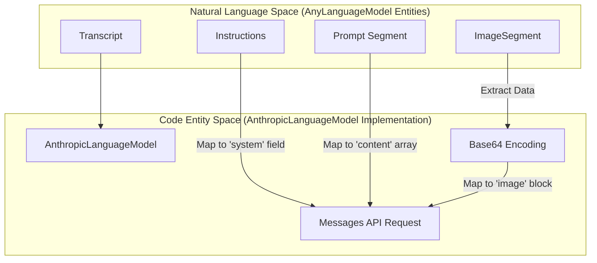
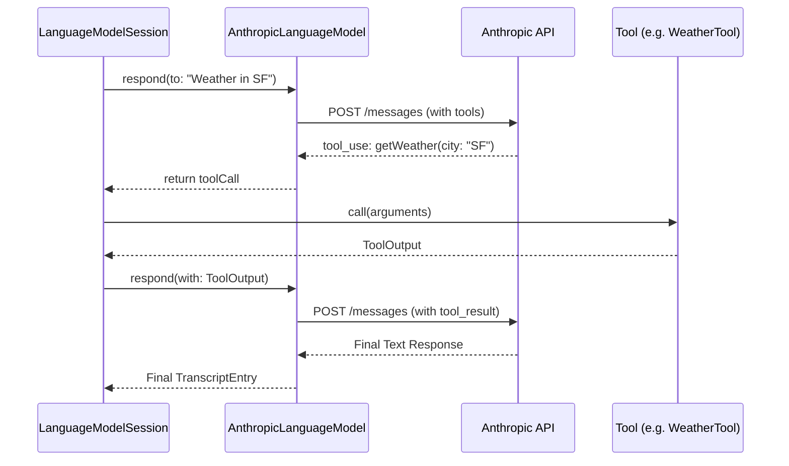

<!-- source: DeepWiki mcp.deepwiki.com · repo huggingface/AnyLanguageModel · extra page AnthropicLanguageModel · fetched 2026-10-26 -->

# AnthropicLanguageModel

<details>
<summary>Relevant source files</summary>

The following files were used as context for generating this wiki page:

- [Sources/AnyLanguageModel/Models/AnthropicLanguageModel.swift](Sources/AnyLanguageModel/Models/AnthropicLanguageModel.swift)
- [Tests/AnyLanguageModelTests/AnthropicLanguageModelTests.swift](Tests/AnyLanguageModelTests/AnthropicLanguageModelTests.swift)
- [Tests/AnyLanguageModelTests/OllamaLanguageModelTests.swift](Tests/AnyLanguageModelTests/OllamaLanguageModelTests.swift)

</details>


The `AnthropicLanguageModel` provides integration with Anthropic's Claude API, supporting the Messages API for text generation, multimodal inputs, and tool calling. It implements the `LanguageModel` protocol, allowing it to be used as a drop-in replacement for other backends in `LanguageModelSession`.

### Configuration and Initialization

The model is initialized with an API key and a model identifier (e.g., `claude-3-5-sonnet-20241022`). It also supports optional beta headers to enable experimental features like extended reasoning (thinking) or specific API versions [[Sources/AnyLanguageModel/Models/AnthropicLanguageModel.swift:10-30]]().

```swift
let model = AnthropicLanguageModel(
    apiKey: "your-api-key",
    model: "claude-3-5-sonnet-20241022",
    betas: ["anthropic-beta-header"]
)
```

**Sources:**
- `Sources/AnyLanguageModel/Models/AnthropicLanguageModel.swift:10-30`

---

### Custom Generation Options

Anthropic-specific parameters are encapsulated in the `CustomGenerationOptions` struct. These options allow fine-tuning of the model's behavior beyond the standard `GenerationOptions` [[Sources/AnyLanguageModel/Models/AnthropicLanguageModel.swift:31-45]]().

| Property | Type | Description |
| :--- | :--- | :--- |
| `topP` | `Double?` | Nucleus sampling probability mass [[Sources/AnyLanguageModel/Models/AnthropicLanguageModel.swift:54]](). |
| `topK` | `Int?` | Limits sampling to the top K options [[Sources/AnyLanguageModel/Models/AnthropicLanguageModel.swift:62]](). |
| `stopSequences` | `[String]?` | Custom text sequences that trigger generation halt [[Sources/AnyLanguageModel/Models/AnthropicLanguageModel.swift:74]](). |
| `metadata` | `Metadata?` | Includes `userID` for abuse detection [[Sources/AnyLanguageModel/Models/AnthropicLanguageModel.swift:77,105-123]](). |
| `thinking` | `Thinking?` | Configuration for extended reasoning/internal thinking [[Sources/AnyLanguageModel/Models/AnthropicLanguageModel.swift:88,182-200]](). |
| `toolChoice` | `ToolChoice?` | Controls tool usage (`auto`, `any`, `tool(name:)`, `disabled`) [[Sources/AnyLanguageModel/Models/AnthropicLanguageModel.swift:82,126-179]](). |
| `extraBody` | `[String: JSONValue]?` | Arbitrary keys merged into the request JSON [[Sources/AnyLanguageModel/Models/AnthropicLanguageModel.swift:100]](). |

**Sources:**
- `Sources/AnyLanguageModel/Models/AnthropicLanguageModel.swift:31-200`

---

### Data Flow: Request and Response

The `AnthropicLanguageModel` maps the internal `Transcript` and `Prompt` types to the Anthropic Messages API format. This includes handling system instructions separately from the message array and converting multimodal segments into base64 inline objects.

#### Request Mapping Diagram
The following diagram illustrates how high-level Swift entities are transformed into the Anthropic API wire format.

"Anthropic Request Transformation"

**Sources:**
- `Sources/AnyLanguageModel/Models/AnthropicLanguageModel.swift:10-30`
- `Tests/AnyLanguageModelTests/AnthropicLanguageModelTests.swift:140-156`

---

### Multimodal Support

`AnthropicLanguageModel` supports inline image data. When a `Transcript.Segment.image` is encountered, the model encodes the image data as a base64 string and identifies the media type (e.g., `image/png`, `image/jpeg`) for the Anthropic payload [[Tests/AnyLanguageModelTests/AnthropicLanguageModelTests.swift:149-156]]().

```swift
let response = try await session.respond(
    to: "Describe this image",
    image: .init(data: imageData, mimeType: "image/png")
)
```

**Sources:**
- `Tests/AnyLanguageModelTests/AnthropicLanguageModelTests.swift:140-156`

---

### Tool Calling and Streaming

The model integrates with the `Tool` protocol. It provides tool definitions to the API and parses `tool_use` blocks from the response. It also supports Server-Sent Events (SSE) for streaming responses through `streamResponse` [[Tests/AnyLanguageModelTests/AnthropicLanguageModelTests.swift:43-54, 125-138]]().

#### Tool Execution Flow
"Anthropic Tool Calling Sequence"

**Sources:**
- `Tests/AnyLanguageModelTests/AnthropicLanguageModelTests.swift:125-138`
- `Sources/AnyLanguageModel/Models/AnthropicLanguageModel.swift:82`

---

### Testing Infrastructure

The implementation is verified via `AnthropicLanguageModelTests`, which require an `ANTHROPIC_API_KEY` environment variable [[Tests/AnyLanguageModelTests/AnthropicLanguageModelTests.swift:6]]().

*   **Basic Response**: Validates simple text generation [[Tests/AnyLanguageModelTests/AnthropicLanguageModelTests.swift:27-31]]().
*   **Streaming**: Ensures SSE chunks are correctly aggregated [[Tests/AnyLanguageModelTests/AnthropicLanguageModelTests.swift:43-54]]().
*   **Structured Output**: Uses `@Generable` types to verify JSON schema adherence [[Tests/AnyLanguageModelTests/AnthropicLanguageModelTests.swift:103-113]]().
*   **Conversation Context**: Confirms the model retains state across multiple `respond` calls in a session [[Tests/AnyLanguageModelTests/AnthropicLanguageModelTests.swift:115-123]]().

**Sources:**
- `Tests/AnyLanguageModelTests/AnthropicLanguageModelTests.swift:1-158`

---

