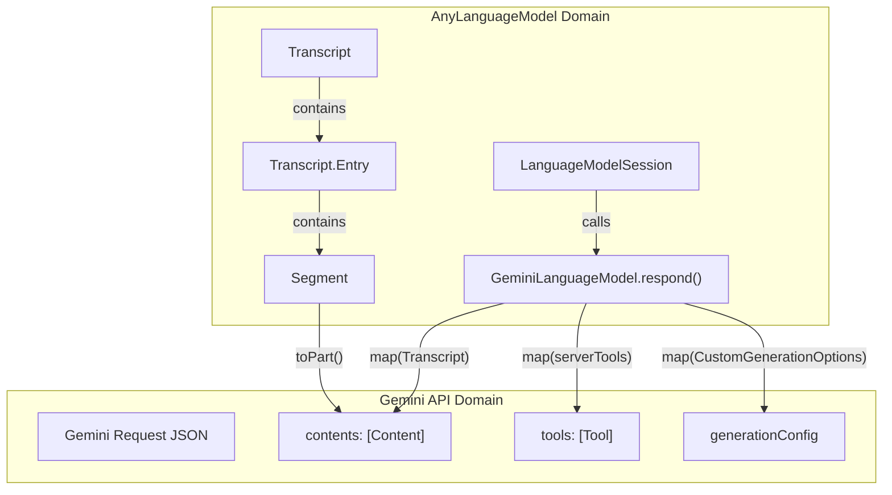
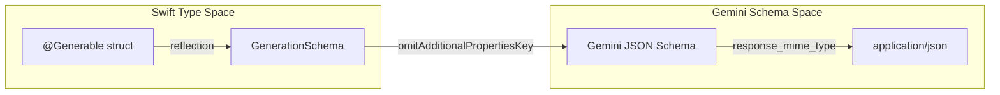

<!-- source: DeepWiki mcp.deepwiki.com · repo huggingface/AnyLanguageModel · extra page GeminiLanguageModel · fetched 2026-10-26 -->

# GeminiLanguageModel

<details>
<summary>Relevant source files</summary>

The following files were used as context for generating this wiki page:

- [Sources/AnyLanguageModel/Models/GeminiLanguageModel.swift](Sources/AnyLanguageModel/Models/GeminiLanguageModel.swift)
- [Tests/AnyLanguageModelTests/GeminiLanguageModelTests.swift](Tests/AnyLanguageModelTests/GeminiLanguageModelTests.swift)

</details>


`GeminiLanguageModel` provides a Swift implementation for interacting with Google's Gemini family of models via the Google Generative AI REST API. It supports advanced features including native "Thinking" (reasoning) modes, server-side tools (Google Search, Maps, etc.), and strict JSON schema enforcement for structured output.

## Overview

The `GeminiLanguageModel` implements the `LanguageModel` protocol, allowing it to be used as a drop-in replacement for other backends in `LanguageModelSession` [Sources/AnyLanguageModel/Models/GeminiLanguageModel.swift:10-12](). It handles the conversion of the library's internal `Transcript` and `Segment` types into the `Content` and `Part` structures required by the Gemini API [Sources/AnyLanguageModel/Models/GeminiLanguageModel.swift:346-350]().

### Key Features
- **Thinking Mode**: Configurable reasoning budget (disabled, dynamic, or specific token count) [Sources/AnyLanguageModel/Models/GeminiLanguageModel.swift:34-57]().
- **Server-Side Tools**: Native integration with Google Search, Google Maps, Code Execution, and URL Context [Sources/AnyLanguageModel/Models/GeminiLanguageModel.swift:63-75]().
- **Structured Output**: Support for `JSONMode` and schema-constrained generation using `JSONSchema` [Sources/AnyLanguageModel/Models/GeminiLanguageModel.swift:96-109]().
- **Multimodal Support**: Handling of inline image data and file-based data [Sources/AnyLanguageModel/Models/GeminiLanguageModel.swift:423-445]().

## Configuration and Initialization

The model is initialized with an API key and a model identifier (e.g., "gemini-1.5-pro"). It defaults to the `v1beta` API version to support the latest features like thinking mode [Sources/AnyLanguageModel/Models/GeminiLanguageModel.swift:13-16]().

```swift
let model = GeminiLanguageModel(
    apiKey: "YOUR_API_KEY",
    model: "gemini-2.0-flash-exp"
)
```

### Thinking Mode
Gemini's "Thinking" mode allows the model to generate a chain of thought before providing a final answer. This is managed via `CustomGenerationOptions` [Sources/AnyLanguageModel/Models/GeminiLanguageModel.swift:29-33]().

| Mode | Description | Implementation |
| :--- | :--- | :--- |
| `.disabled` | Standard generation. | `budgetValue: 0` |
| `.dynamic` | Google-managed reasoning budget. | `budgetValue: -1` |
| `.budget(Int)` | Explicit token limit for reasoning. | `budgetValue: value` |

Sources: [Sources/AnyLanguageModel/Models/GeminiLanguageModel.swift:34-57]()

## Data Flow: Transcript to Gemini Request

The `GeminiLanguageModel` bridges the `AnyLanguageModel` domain to the Gemini API domain. The following diagram illustrates how internal entities map to the Gemini request structure.

### Request Mapping Architecture
"This diagram shows the conversion of a LanguageModelSession request into a Gemini-compatible JSON payload."


Sources: [Sources/AnyLanguageModel/Models/GeminiLanguageModel.swift:346-445](), [Sources/AnyLanguageModel/Models/GeminiLanguageModel.swift:512-580]()

### Content Conversion Logic
The conversion process iterates through `Transcript.Entry` items, mapping them based on their `role`:
- **System Instructions**: Mapped to the `system_instruction` field in the request [Sources/AnyLanguageModel/Models/GeminiLanguageModel.swift:518-525]().
- **User/Assistant Content**: Mapped to the `contents` array.
- **Segments**:
    - `.text`: Converted to Gemini `text` parts [Sources/AnyLanguageModel/Models/GeminiLanguageModel.swift:415-417]().
    - `.image`: Converted to `inline_data` (base64) or `file_data` (URI) [Sources/AnyLanguageModel/Models/GeminiLanguageModel.swift:423-445]().
    - `.structure`: Serialized to JSON text [Sources/AnyLanguageModel/Models/GeminiLanguageModel.swift:418-422]().

## Server-Side Tools

Unlike client-side tools (which require the `ToolExecutionDelegate` loop), Gemini's `ServerTool` options are executed directly by Google's infrastructure [Sources/AnyLanguageModel/Models/GeminiLanguageModel.swift:59-62]().

| Tool | Code Entity | Purpose |
| :--- | :--- | :--- |
| Google Search | `.googleSearch` | Real-time web search results. |
| URL Context | `.urlContext` | Fetching specific web content. |
| Code Execution | `.codeExecution` | Running Python code in a sandbox. |
| Google Maps | `.googleMaps(lat:long:)` | Location-based intelligence. |

Sources: [Sources/AnyLanguageModel/Models/GeminiLanguageModel.swift:63-75](), [Tests/AnyLanguageModelTests/GeminiLanguageModelTests.swift:107-120]()

## Structured Output and JSON Mode

`GeminiLanguageModel` supports two ways to enforce structure:
1.  **JSON Mode**: Setting `jsonMode` to `.enabled` ensures the model output is valid JSON [Sources/AnyLanguageModel/Models/GeminiLanguageModel.swift:100-101]().
2.  **Schema Enforcement**: Passing a `JSONSchema` to `.schema(JSONSchema)` or using a `@Generable` type [Sources/AnyLanguageModel/Models/GeminiLanguageModel.swift:103-104]().

### Schema Conversion
When a schema is provided, the model uses `omitAdditionalPropertiesKey` during encoding to ensure the resulting JSON schema strictly follows Gemini's requirements for tool and response formatting [Sources/AnyLanguageModel/Models/GeminiLanguageModel.swift:560-575]().


Sources: [Sources/AnyLanguageModel/Models/GeminiLanguageModel.swift:560-580](), [Tests/AnyLanguageModelTests/GeminiLanguageModelTests.swift:184-210]()

## Streaming Implementation

Streaming is implemented via `streamGenerateContent` using Server-Sent Events (SSE).

1.  **Request**: The model sends a POST request to the `streamGenerateContent` endpoint [Sources/AnyLanguageModel/Models/GeminiLanguageModel.swift:460-465]().
2.  **Event Processing**: It uses `EventSource` to listen for chunks [Sources/AnyLanguageModel/Models/GeminiLanguageModel.swift:470-475]().
3.  **Parsing**: Each chunk is parsed into a `GeminiResponse`. The text content is extracted from `candidates[0].content.parts[0].text` and yielded to the `ResponseStream` [Sources/AnyLanguageModel/Models/GeminiLanguageModel.swift:485-500]().

### Usage Example: Streaming
```swift
let stream = session.streamResponse(to: "Explain quantum physics")
for try await snapshot in stream {
    print(snapshot.content) // Partial updates
}
```
Sources: [Tests/AnyLanguageModelTests/GeminiLanguageModelTests.swift:38-63]()

## Technical Details

### Endpoint Construction
The model constructs URLs dynamically based on the `baseURL`, `apiVersion`, and `model` name. It appends the API key as a query parameter `key` to every request [Sources/AnyLanguageModel/Models/GeminiLanguageModel.swift:330-345]().

### Error Handling
The model handles API-specific errors through the standard `LanguageModel` interface. It maps Gemini's `FinishReason` (like `SAFETY` or `RECITATION`) to appropriate internal states, though the primary response path focuses on content extraction from the `candidates` array [Sources/AnyLanguageModel/Models/GeminiLanguageModel.swift:400-410]().

Sources: [Sources/AnyLanguageModel/Models/GeminiLanguageModel.swift:10-153](), [Tests/AnyLanguageModelTests/GeminiLanguageModelTests.swift:1-215]()

---

