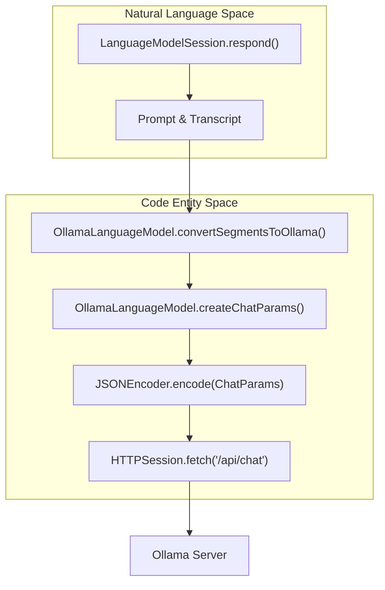
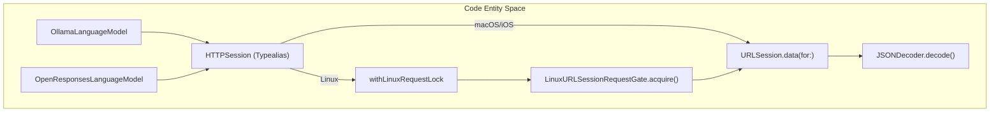

<!-- source: DeepWiki mcp.deepwiki.com · repo huggingface/AnyLanguageModel · extra page OllamaLanguageModel & OpenResponsesLanguageModel · fetched 2026-10-26 -->

# OllamaLanguageModel & OpenResponsesLanguageModel

<details>
<summary>Relevant source files</summary>

The following files were used as context for generating this wiki page:

- [Sources/AnyLanguageModel/Extensions/HTTPClient+Extensions.swift](Sources/AnyLanguageModel/Extensions/HTTPClient+Extensions.swift)
- [Sources/AnyLanguageModel/Extensions/URLSession+Extensions.swift](Sources/AnyLanguageModel/Extensions/URLSession+Extensions.swift)
- [Sources/AnyLanguageModel/Models/OllamaLanguageModel.swift](Sources/AnyLanguageModel/Models/OllamaLanguageModel.swift)
- [Sources/AnyLanguageModel/Models/OpenResponsesLanguageModel.swift](Sources/AnyLanguageModel/Models/OpenResponsesLanguageModel.swift)
- [Sources/AnyLanguageModel/Shared/JSONValue.swift](Sources/AnyLanguageModel/Shared/JSONValue.swift)
- [Sources/AnyLanguageModel/Shared/Transport.swift](Sources/AnyLanguageModel/Shared/Transport.swift)
- [Tests/AnyLanguageModelTests/CustomGenerationOptionsTests.swift](Tests/AnyLanguageModelTests/CustomGenerationOptionsTests.swift)
- [Tests/AnyLanguageModelTests/OpenResponsesLanguageModelTests.swift](Tests/AnyLanguageModelTests/OpenResponsesLanguageModelTests.swift)
- [Tests/AnyLanguageModelTests/URLSessionExtensionsTests.swift](Tests/AnyLanguageModelTests/URLSessionExtensionsTests.swift)

</details>


This page documents the `OllamaLanguageModel` and `OpenResponsesLanguageModel` backends. `OllamaLanguageModel` provides integration with local Ollama servers, supporting both text and multimodal generation. `OpenResponsesLanguageModel` implements the [Open Responses](https://www.openresponses.org) specification, providing a provider-agnostic interface for any API that adheres to the standardized Responses API schema.

## OllamaLanguageModel

The `OllamaLanguageModel` allows the `LanguageModelSession` to communicate with a local Ollama instance. It defaults to `http://localhost:11434` and uses the `/api/chat` endpoint for generation [Sources/AnyLanguageModel/Models/OllamaLanguageModel.swift:40-44]().

### Configuration and Initialization

The model is initialized with a model identifier (e.g., "llama3.3") and an optional base URL [Sources/AnyLanguageModel/Models/OllamaLanguageModel.swift:57-70]().

```swift
let model = OllamaLanguageModel(model: "qwen2.5")
let session = LanguageModelSession(model: model)
```

### Custom Generation Options

Ollama supports a wide variety of model-specific parameters via its `options` field. `OllamaLanguageModel` exposes these through a `CustomGenerationOptions` typealias to `[String: JSONValue]` [Sources/AnyLanguageModel/Models/OllamaLanguageModel.swift:38-38]().

| Option | Type | Description |
| :--- | :--- | :--- |
| `seed` | `Int` | Sets the random number seed for generation. |
| `repeat_penalty` | `Double` | Sets how strongly to penalize repetitions. |
| `stop` | `[String]` | Sets the stop sequences to use. |

Users apply these using the type-safe subscript on `GenerationOptions` [Sources/AnyLanguageModel/Models/OllamaLanguageModel.swift:29-35]():

```swift
var options = GenerationOptions()
options[custom: OllamaLanguageModel.self] = [
    "seed": 42,
    "num_predict": 128
]
```

### Data Flow: Request Transformation

When `respond` or `streamResponse` is called, the internal `Transcript` and `Prompt` are converted into Ollama's native JSON format.

**Ollama Request Flow**


Sources: [Sources/AnyLanguageModel/Models/OllamaLanguageModel.swift:72-104](), [Sources/AnyLanguageModel/Models/OllamaLanguageModel.swift:164-171]()

### Structured Output

Ollama supports structured generation via a `format` parameter. If a `Generable` type is requested, `OllamaLanguageModel` converts the `type.generationSchema` into a JSON schema compatible with Ollama's requirements [Sources/AnyLanguageModel/Models/OllamaLanguageModel.swift:88-94]().

## OpenResponsesLanguageModel

`OpenResponsesLanguageModel` is designed for interoperability with any provider implementing the Open Responses specification (e.g., OpenRouter). It extends the OpenAI-style API with standardized fields for reasoning effort and tool constraints [Sources/AnyLanguageModel/Models/OpenResponsesLanguageModel.swift:8-23]().

### CustomGenerationOptions

The `CustomGenerationOptions` for Open Responses include specific controls for reasoning models and tool execution [Sources/AnyLanguageModel/Models/OpenResponsesLanguageModel.swift:33-84]().

*   **`reasoningEffort`**: Controls the depth of thought for reasoning-capable models (e.g., `low`, `medium`, `high`) [Sources/AnyLanguageModel/Models/OpenResponsesLanguageModel.swift:58-58]().
*   **`toolChoice`**: A highly granular enum that can restrict the model to specific tools or force a tool call [Sources/AnyLanguageModel/Models/OpenResponsesLanguageModel.swift:88-98]().
*   **`allowedTools`**: An explicit list of tool names permitted for the request [Sources/AnyLanguageModel/Models/OpenResponsesLanguageModel.swift:39-39]().
*   **`extraBody`**: A dictionary of `[String: JSONValue]` for passing experimental or provider-specific parameters not yet in the spec [Sources/AnyLanguageModel/Models/OpenResponsesLanguageModel.swift:84-84]().

### Tool Choice Implementation

The `ToolChoice` enum handles complex serialization logic to support both simple strings (`"auto"`, `"required"`) and structured tool descriptors [Sources/AnyLanguageModel/Models/OpenResponsesLanguageModel.swift:88-150]().

| Case | JSON Representation |
| :--- | :--- |
| `.none` | `"none"` |
| `.auto` | `"auto"` |
| `.function(name: "x")` | `{"type": "function", "function": {"name": "x"}}` |
| `.allowedTools(tools: ["t1"], mode: .required)` | `{"type": "allowed_tools", "tools": [...], "mode": "required"}` |

Sources: [Sources/AnyLanguageModel/Models/OpenResponsesLanguageModel.swift:88-167]()

## Networking and Transport

Both models utilize the `HTTPSession` abstraction, which resolves to either `URLSession` or `AsyncHTTPClient` depending on the active traits [Sources/AnyLanguageModel/Shared/Transport.swift:1-21]().

### Linux Thread Safety

On Linux, `URLSession` (via `FoundationNetworking`) is not thread-safe for concurrent request setup. The backends utilize `withLinuxRequestLock` to serialize the initialization of network tasks [Sources/AnyLanguageModel/Extensions/URLSession+Extensions.swift:16-36](), [Sources/AnyLanguageModel/Extensions/URLSession+Extensions.swift:126-133]().

**Transport Layer Execution**


Sources: [Sources/AnyLanguageModel/Shared/Transport.swift:1-21](), [Sources/AnyLanguageModel/Extensions/URLSession+Extensions.swift:105-145]()

### Response Streaming

Streaming is implemented by consuming newline-delimited JSON (Ollama) or Server-Sent Events (Open Responses).
*   **Ollama**: Transforms a stream of `ChatResponse` chunks into `ResponseStream<Content>.Snapshot` objects [Sources/AnyLanguageModel/Models/OllamaLanguageModel.swift:172-185]().
*   **Open Responses**: Uses `URLSession.fetchEventStream` or `HTTPClient.fetchEventStream` to parse the `text/event-stream` protocol [Sources/AnyLanguageModel/Extensions/URLSession+Extensions.swift:162-168](), [Sources/AnyLanguageModel/Extensions/HTTPClient+Extensions.swift:132-137]().

## Comparison Table

| Feature | OllamaLanguageModel | OpenResponsesLanguageModel |
| :--- | :--- | :--- |
| **Target** | Local Ollama Server | Open Responses / OpenAI compatible APIs |
| **Custom Options** | `[String: JSONValue]` | Typed `CustomGenerationOptions` struct |
| **Structured Output** | `format` parameter (JSON Schema) | `response_format` (JSON Schema) |
| **Multimodal** | Inline base64 images | Image URLs or base64 |
| **Tool Calling** | Supported via `/api/chat` | Supported with `toolChoice` control |

Sources: [Sources/AnyLanguageModel/Models/OllamaLanguageModel.swift:16-38](), [Sources/AnyLanguageModel/Models/OpenResponsesLanguageModel.swift:23-84]()

---

