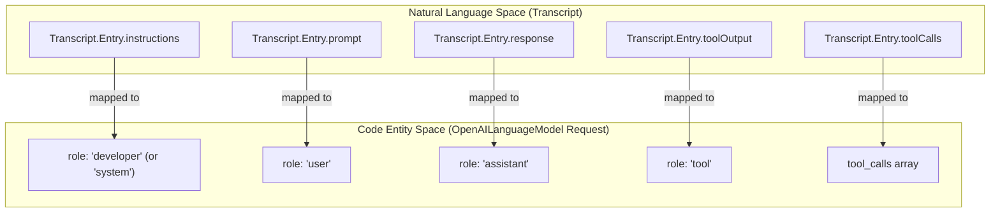
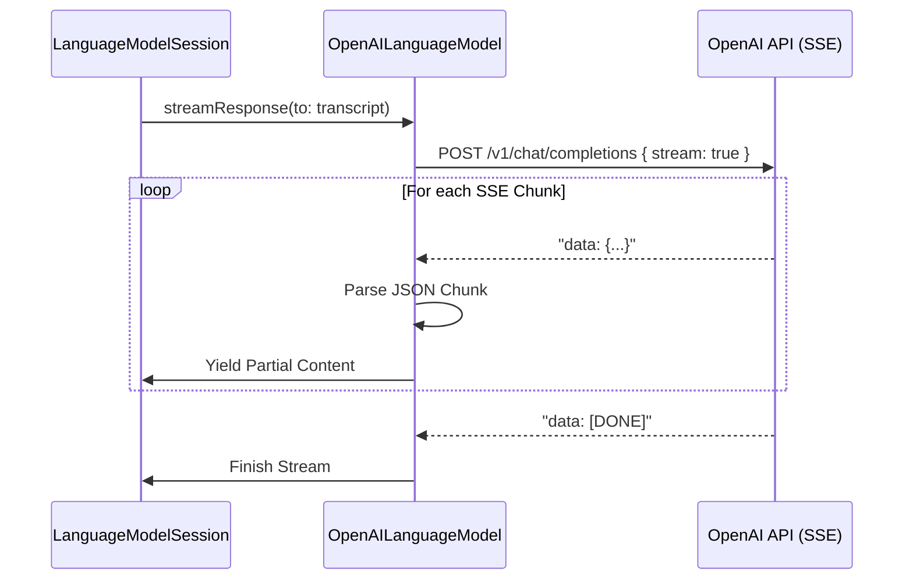

<!-- source: DeepWiki mcp.deepwiki.com · repo huggingface/AnyLanguageModel · extra page OpenAILanguageModel · fetched 2026-10-26 -->

# OpenAILanguageModel

<details>
<summary>Relevant source files</summary>

The following files were used as context for generating this wiki page:

- [Sources/AnyLanguageModel/Models/OpenAILanguageModel.swift](Sources/AnyLanguageModel/Models/OpenAILanguageModel.swift)
- [Tests/AnyLanguageModelTests/OpenAILanguageModelTests.swift](Tests/AnyLanguageModelTests/OpenAILanguageModelTests.swift)

</details>


`OpenAILanguageModel` is a backend implementation of the `LanguageModel` protocol designed to interface with OpenAI's official APIs and any third-party services that maintain OpenAI compatibility (e.g., Together AI, Perplexity, or local proxies). It supports both the legacy Chat Completions API and the newer Responses API, providing full support for streaming, tool calling, and multimodal inputs.

## API Variants

The model supports two primary API interaction patterns through the `APIVariant` enum [Sources/AnyLanguageModel/Models/OpenAILanguageModel.swift:28-36]():

| Variant | Description |
| :--- | :--- |
| `.chatCompletions` | Uses the standard `/v1/chat/completions` endpoint. This is the default for most models. [Sources/AnyLanguageModel/Models/OpenAILanguageModel.swift:31](). |
| `.responses` | Uses the `/v1/responses` endpoint, typically required for advanced reasoning models like `o1` and `o3`. [Sources/AnyLanguageModel/Models/OpenAILanguageModel.swift:35](). |

## Custom Generation Options

`OpenAILanguageModel.CustomGenerationOptions` allows developers to access OpenAI-specific features that are not part of the core `GenerationOptions` abstraction [Sources/AnyLanguageModel/Models/OpenAILanguageModel.swift:57]().

### Reasoning & Performance
- **Reasoning Effort**: For reasoning models (o-series), `reasoningEffort` can be set to `.low`, `.medium`, or `.high` to balance speed and depth of thought [Sources/AnyLanguageModel/Models/OpenAILanguageModel.swift:134]().
- **Service Tier**: Supports specifying `serviceTier` (e.g., `.scale` or `.default`) for latency and throughput guarantees [Sources/AnyLanguageModel/Models/OpenAILanguageModel.swift:161]().
- **Logit Bias**: A dictionary `[Int: Int]` to modify the likelihood of specific tokens appearing in the completion [Sources/AnyLanguageModel/Models/OpenAILanguageModel.swift:92]().

### Verbosity & Reasoning Configuration
- **Verbosity**: Constrains the model's output length via a `Verbosity` enum [Sources/AnyLanguageModel/Models/OpenAILanguageModel.swift:126]().
- **ReasoningConfiguration**: Specifically for the Responses API, allowing detailed control over how reasoning is performed [Sources/AnyLanguageModel/Models/OpenAILanguageModel.swift:139]().

### Extensibility
- **extraBody**: A `[String: JSONValue]` dictionary that allows passing arbitrary top-level fields in the JSON request body. This is useful for experimental parameters or vendor-specific extensions (like those provided by Together AI or Perplexity) [Sources/AnyLanguageModel/Models/OpenAILanguageModel.swift:181-185]().

## Data Flow: Transcript to OpenAI Message Mapping

The `OpenAILanguageModel` transforms the internal `Transcript` data model into the JSON format expected by OpenAI. This involves mapping `Transcript.Entry` types to OpenAI "messages".

### Mapping Logic Diagram
This diagram illustrates how the "Natural Language Space" (Transcript) is mapped to the "Code Entity Space" (OpenAI API JSON).

Title: Transcript to OpenAI Message Mapping

Sources: [Sources/AnyLanguageModel/Models/OpenAILanguageModel.swift:19-36](), [Sources/AnyLanguageModel/Models/OpenAILanguageModel.swift:57-185]()

## Structured Generation & Strict Mode

When using the `Generable` protocol or providing a `ResponseFormat.jsonSchema`, `OpenAILanguageModel` attempts to use OpenAI's "Strict Mode" for JSON schemas.

1.  **Schema Transformation**: The model converts the `GenerationSchema` into a JSON Schema.
2.  **Strict Enforcement**: If `strict` is supported for the specific schema, it sets `"strict": true` in the `response_format` object. This ensures the model's output adheres exactly to the provided schema.
3.  **Tool Integration**: When tools are provided, their parameters are similarly transformed into OpenAI's `tools` array format, leveraging the `parameters` schema defined in the `Tool` protocol.

## Streaming Implementation

Streaming is implemented using Server-Sent Events (SSE).

- **Lifecycle**: The model initiates an HTTPS request with `stream: true`.
- **Chunk Processing**: As chunks arrive via the `HTTPSession`, they are parsed as `text/event-stream`.
- **SSE Mapping**: Each chunk is decoded into a `ChatCompletionChunk` (or equivalent for Responses API).
- **Yielding**: The content (text or tool call fragments) is extracted and yielded back to the `LanguageModelSession` as a `ResponseStream<Content>`.

Title: OpenAI Streaming Sequence

Sources: [Sources/AnyLanguageModel/Models/OpenAILanguageModel.swift:8-19](), [Tests/AnyLanguageModelTests/OpenAILanguageModelTests.swift:50-75]()

## OpenAI-Compatible Base URL Support

A key feature of `OpenAILanguageModel` is the ability to override the `baseURL`. While it defaults to `https://api.openai.com/v1/` [Sources/AnyLanguageModel/Models/OpenAILanguageModel.swift:25](), it can be initialized with any valid URL to point at local or alternative providers [Tests/AnyLanguageModelTests/OpenAILanguageModelTests.swift:11-15]().

```swift
let localModel = OpenAILanguageModel(
    baseURL: URL(string: "http://localhost:1234/v1/")!,
    apiKey: "lm-studio",
    model: "local-model"
)
```

## Testing and Verification

The implementation is verified through `OpenAILanguageModelTests`, which covers:
- **Basic Responses**: Ensuring simple text generation works [Tests/AnyLanguageModelTests/OpenAILanguageModelTests.swift:33-38]().
- **Streaming**: Validating that SSE chunks are correctly aggregated [Tests/AnyLanguageModelTests/OpenAILanguageModelTests.swift:50-61]().
- **Multimodal**: Testing image inputs via both URL and raw data [Tests/AnyLanguageModelTests/OpenAILanguageModelTests.swift:111-128]().
- **Tool Calling**: Verifying that the model can call tools and process the resulting `toolOutput` in subsequent turns [Tests/AnyLanguageModelTests/OpenAILanguageModelTests.swift:139-181]().

Sources: [Tests/AnyLanguageModelTests/OpenAILanguageModelTests.swift:9-181]()

---

