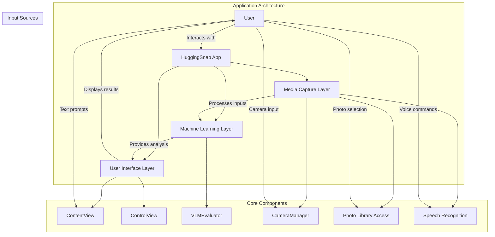
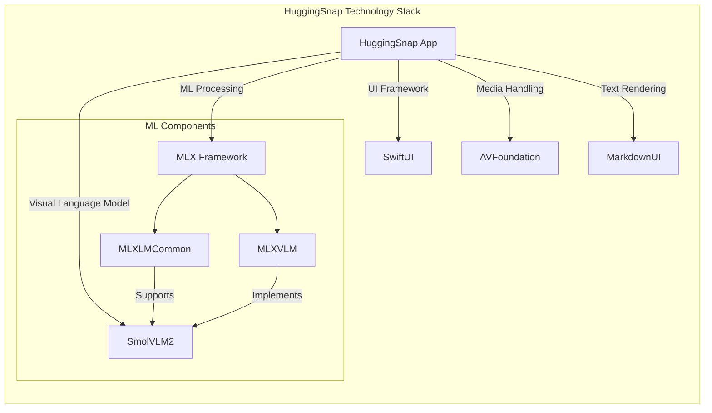
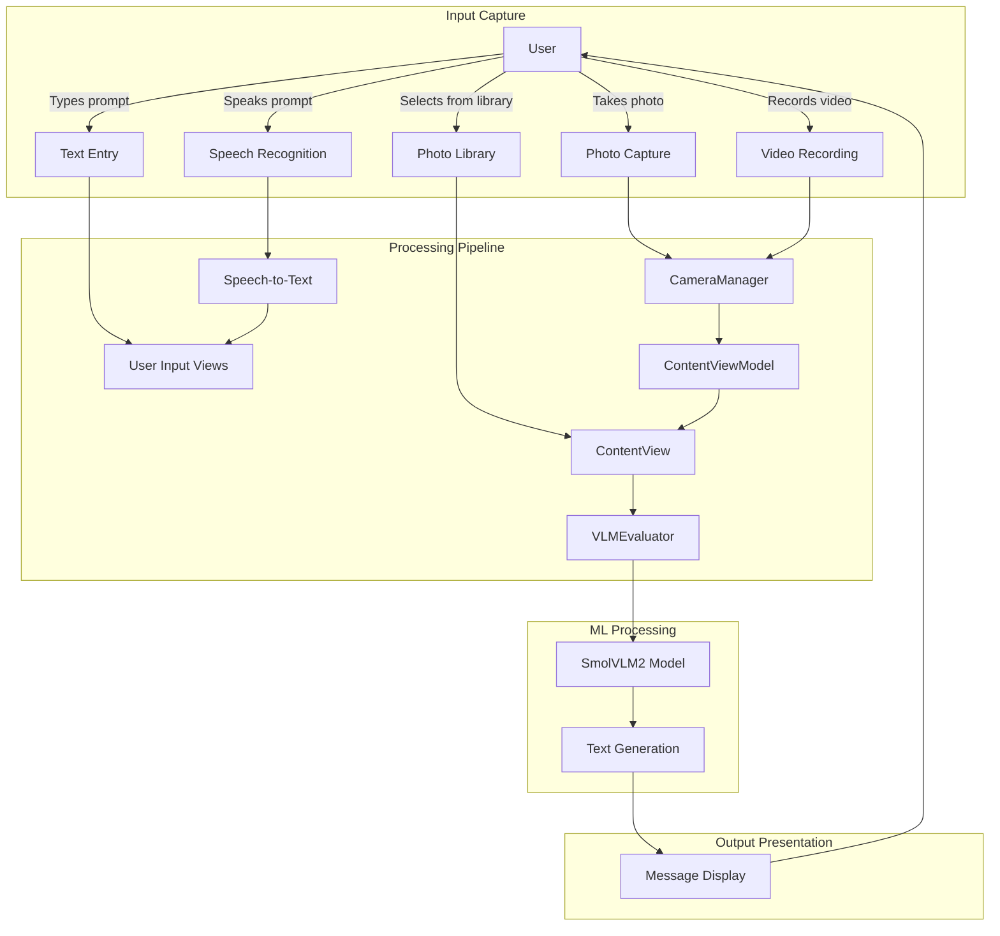

<!-- source: DeepWiki mcp.deepwiki.com · repo huggingface/HuggingSnap · page 1 HuggingSnap Overview · fetched 2026-10-26 -->

# HuggingSnap Overview

Relevant source files

The following files were used as context for generating this wiki page:

- [HuggingSnap.xcodeproj/project.pbxproj](HuggingSnap.xcodeproj/project.pbxproj)
- [HuggingSnap/Info.plist](HuggingSnap/Info.plist)
- [README.md](README.md)

This document provides a comprehensive introduction to HuggingSnap, a mobile application that delivers on-device visual intelligence capabilities. It covers the app's purpose, core features, and high-level architecture. For installation instructions and system requirements, see [Installation & Requirements](#1.1). For detailed technical information about specific components, refer to the [System Architecture](#2) section.

## What is HuggingSnap?

HuggingSnap is an iOS application that enables users to quickly learn about objects, scenes, and text in their surroundings using advanced visual understanding capabilities. The app functions as a visual assistant that processes images and videos captured by the device camera or selected from the photo library, then generates informative text descriptions or answers to user queries.

At its core, HuggingSnap leverages SmolVLM2, a compact multimodal model designed to efficiently run on mobile devices. This model can analyze visual content and respond to user prompts through natural language processing.

Sources: [README.md:6-10]()

## Key Features and Capabilities

HuggingSnap offers a range of visual intelligence features, including:

| Feature | Description |
|---------|-------------|
| **Object Recognition** | Identifies and describes objects within images or video frames |
| **Scene Understanding** | Recognizes and explains environments, settings, and contexts |
| **Text Translation** | Translates text visible in images |
| **Content Summarization** | Creates concise summaries of visual content |
| **Plant/Animal Identification** | Recognizes and provides information about flora and fauna |
| **Visual Question Answering** | Responds to specific questions about visual content |
| **Pure Language Processing** | Functions as a language model without visual inputs when needed |

The application runs entirely on-device, ensuring privacy and enabling offline operation without sending data to external servers.

Sources: [README.md:6-10]()

## System Architecture Overview

HuggingSnap employs a modular architecture organized into three primary layers that work together to deliver its visual intelligence capabilities.

### Core Components

HuggingSnap consists of several key components that handle different aspects of the application's functionality:

1. **ContentView**: The main view controller that orchestrates the app's operation and displays the camera feed, captured media, and generated output.

2. **VLMEvaluator**: The component responsible for processing visual and textual inputs, managing the SmolVLM2 model, and generating responses.

3. **CameraManager**: Handles camera setup, configuration, and media capture operations.

4. **ContentViewModel**: The view model that connects the UI with the underlying data and camera functionality.

5. **ControlView**: Provides user interface elements for controlling the camera and interacting with the app.

Sources: Architecture diagrams provided in the prompt

### Architectural Layers

#### User Interface Layer
The UI layer is built using SwiftUI and handles all user interactions and visual presentation. It consists of various views that display the camera feed, captured media, user controls, and generated outputs.

#### Machine Learning Layer
The ML layer is centered around the VLMEvaluator component, which integrates with MLX Swift to provide on-device visual language model capabilities. This layer handles model loading, configuration, and inference operations.

#### Media Capture Layer
This layer manages media input through the CameraManager, which interfaces with the device camera to capture photos and videos. It also includes components for accessing the photo library and processing speech input.

Sources: Architecture diagrams provided in the prompt

## Technology Stack

HuggingSnap leverages several key technologies and frameworks:

The application relies on several key dependencies:

| Framework/Library | Purpose |
|-------------------|---------|
| **MLXLMCommon** | Provides common functionality for language models |
| **MLXVLM** | Implements the visual language model capabilities |
| **MarkdownUI** | Renders formatted text in the user interface |
| **AVFoundation** | Handles camera and media capture operations |

Sources: [HuggingSnap.xcodeproj/project.pbxproj:10-12](), [HuggingSnap.xcodeproj/project.pbxproj:397-411]()

## Data Flow

HuggingSnap processes data through a well-defined flow from user input to generated output:

The application receives input from various sources, processes it through the appropriate components, runs the inputs through the SmolVLM2 model, and presents the generated output to the user.

Sources: Architecture diagrams provided in the prompt

## User Experience

HuggingSnap is designed to provide a seamless and intuitive user experience. Users can interact with the app through several methods:

1. **Camera Capture**: Point the camera at an object, scene, or text and capture a photo or video for analysis.
2. **Photo Library**: Select existing photos or videos from the device's photo library.
3. **Text Prompts**: Type specific questions or instructions to guide the analysis.
4. **Voice Commands**: Use speech recognition to provide verbal prompts.

The app processes the input and generates informative text that describes the content, answers questions, or provides requested information about the visual subject.

HuggingSnap requires several permissions to function properly:
- Camera access for capturing photos and videos
- Microphone access for recording audio with videos
- Photo library access for saving and accessing media
- Speech recognition for processing voice commands

Sources: [HuggingSnap.xcodeproj/project.pbxproj:289-293]()

## Privacy and Performance

HuggingSnap emphasizes privacy and performance through its on-device processing approach:

- All visual and language processing occurs locally on the device
- No data is sent to external servers for analysis
- SmolVLM2's compact design allows for efficient operation on mobile hardware
- The app functions offline without requiring an internet connection

This architecture ensures user data privacy while delivering responsive visual intelligence capabilities within the constraints of mobile device resources.

Sources: [README.md:8-10]()

---

