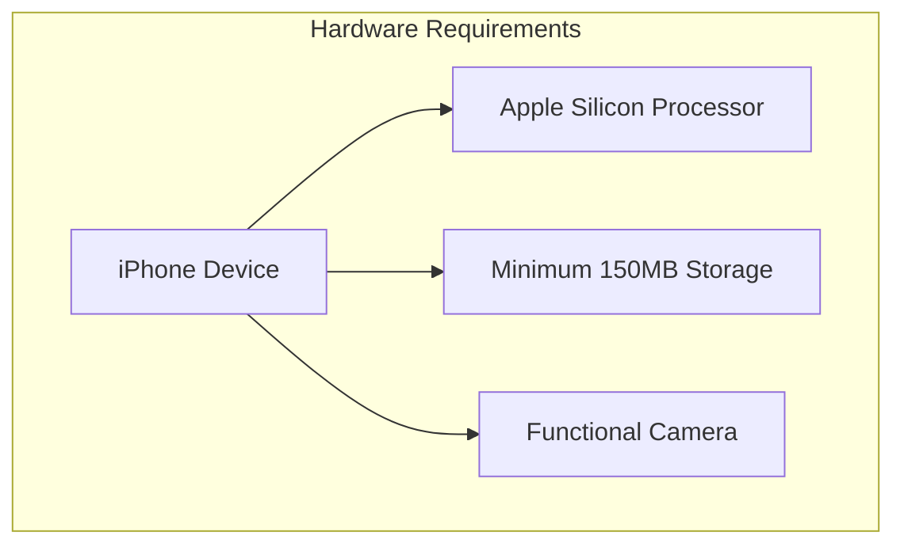
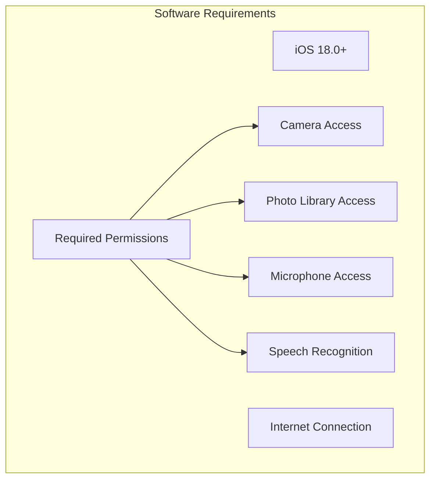
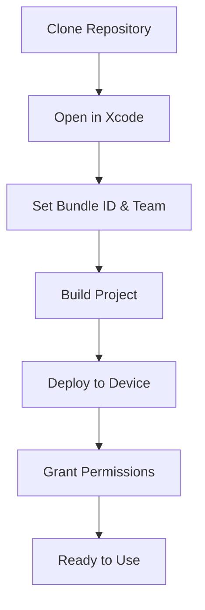
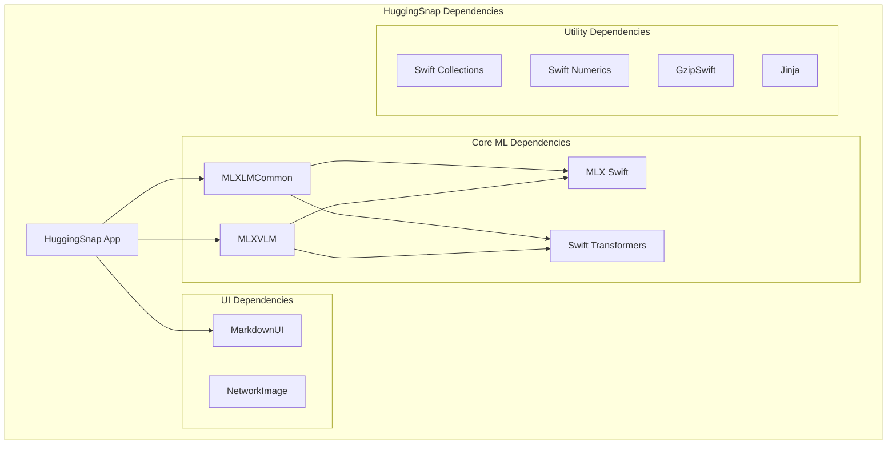
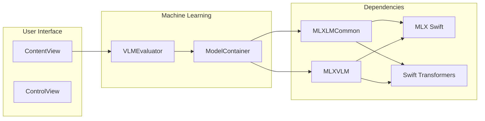
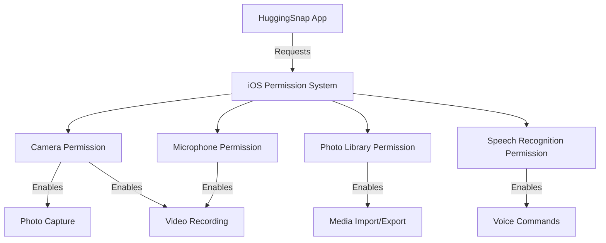

<!-- source: DeepWiki mcp.deepwiki.com · repo huggingface/HuggingSnap · page 1.1 Installation & Requirements · fetched 2026-10-26 -->

# Installation & Requirements

<details>
<summary>Relevant source files</summary>

The following files were used as context for generating this wiki page:

- [HuggingSnap.xcodeproj/project.pbxproj](HuggingSnap.xcodeproj/project.pbxproj)
- [HuggingSnap.xcodeproj/project.xcworkspace/xcshareddata/swiftpm/Package.resolved](HuggingSnap.xcodeproj/project.xcworkspace/xcshareddata/swiftpm/Package.resolved)
- [HuggingSnap/Info.plist](HuggingSnap/Info.plist)
- [README.md](README.md)

</details>


This page provides comprehensive instructions for installing HuggingSnap and details its system requirements. It covers both the App Store installation method and the process for building the application from source. For information about the underlying system architecture, see [System Architecture](#2).

## System Requirements

HuggingSnap has specific hardware and software requirements that must be met for successful operation.

### Hardware Requirements

HuggingSnap is designed to run on Apple devices with the following specifications:

| Requirement | Description |
|-------------|-------------|
| Device Type | iPhone only (not iPad or Mac) |
| Processor | Apple Silicon (required for MLX) |
| Storage | At least 150MB free space for app and model |
| Camera | Working rear camera for optimal experience |



Sources: [HuggingSnap.xcodeproj/project.pbxproj:305-311]()

### Software Requirements

The application requires the following software environment:

| Requirement | Description |
|-------------|-------------|
| iOS Version | iOS 18.0 or later |
| Permissions | Camera, Photo Library, Microphone, Speech Recognition |
| Connectivity | Internet connection (for initial model download) |



Sources: [HuggingSnap.xcodeproj/project.pbxproj:209-266](), [HuggingSnap.xcodeproj/project.pbxproj:289-293]()

## Installation Methods

HuggingSnap can be installed through either the App Store or by building from source.

### App Store Installation

The simplest method to install HuggingSnap is directly from the Apple App Store:

1. Open the App Store on your iOS device
2. Search for "HuggingSnap" or use the direct link: [App Store](https://apps.apple.com/us/app/huggingsnap/id6742157364)
3. Tap "Get" to download and install the application
4. Once installed, open the app and grant the required permissions when prompted


Sources: [README.md:14-16]()

### Building from Source

For developers who want to modify or contribute to HuggingSnap, building from source is the preferred method:

1. Prerequisites:
   - Mac computer with Xcode 16.2 or later installed
   - Apple Developer account (free or paid)
   - Git installed

2. Installation steps:
   ```
   1. Clone the repository:
      git clone https://github.com/huggingface/HuggingSnap.git
   
   2. Open the project in Xcode:
      open HuggingSnap.xcodeproj
   
   3. Modify the bundle identifier and development team:
      Navigate to project settings > Signing & Capabilities
   
   4. Build and run on a physical device (simulator not recommended)
   ```



Sources: [README.md:18-23](), [HuggingSnap.xcodeproj/project.pbxproj:282-285]()

## Dependencies

HuggingSnap relies on several key dependencies to provide its functionality.

### Framework Dependencies

The application integrates with the following frameworks:

| Dependency | Purpose | Source |
|------------|---------|--------|
| MLXLMCommon | Core machine learning functionality | mlx-swift-examples |
| MLXVLM | Vision-language model support | mlx-swift-examples |
| MarkdownUI | Rendering formatted text | swift-markdown-ui |
| MLX Swift | Apple's ML framework for Apple Silicon | ml-explore/mlx-swift |
| Swift Transformers | HuggingFace transformer models | huggingface/swift-transformers |



Sources: [HuggingSnap.xcodeproj/project.pbxproj:10-12](), [HuggingSnap.xcodeproj/project.pbxproj:377-394](), [HuggingSnap.xcodeproj/project.xcworkspace/xcshareddata/swiftpm/Package.resolved:1-105]()

### Dependency Relationship to Core Functionality



Sources: [HuggingSnap.xcodeproj/project.pbxproj:396-406]()

## Required Permissions

HuggingSnap requires several iOS permissions to function properly:

| Permission | Purpose | Info.plist Key |
|------------|---------|---------------|
| Camera | Capturing photos and videos | NSCameraUsageDescription |
| Microphone | Audio recording for videos | NSMicrophoneUsageDescription |
| Photo Library | Saving and accessing media | NSPhotoLibraryUsageDescription |
| Photo Library Additions | Saving captured media | NSPhotoLibraryAddUsageDescription |
| Speech Recognition | Transcribing voice input | NSSpeechRecognitionUsageDescription |



Sources: [HuggingSnap.xcodeproj/project.pbxproj:289-293]()

## Troubleshooting Installation Issues

If you encounter issues during installation or setup, consider the following solutions:

1. **App Store installation fails:**
   - Ensure your device runs iOS 18.0 or later
   - Check available storage space (minimum 150MB recommended)
   - Ensure you have a working internet connection

2. **Building from source issues:**
   - Verify Xcode version (16.2+ required)
   - Run `git submodule update --init --recursive` if dependencies fail to load
   - Ensure you've changed the bundle identifier and development team
   - Connect a physical device (simulator is not recommended)

3. **Permission errors:**
   - If permission dialogs don't appear, go to Settings > HuggingSnap and enable required permissions manually
   - If camera access fails, ensure no other app is currently using the camera

4. **Model loading issues:**
   - Ensure you have an internet connection for the initial model download
   - Verify sufficient storage space for the model files

Sources: [README.md:14-23](), [HuggingSnap.xcodeproj/project.pbxproj:289-293]()

---

