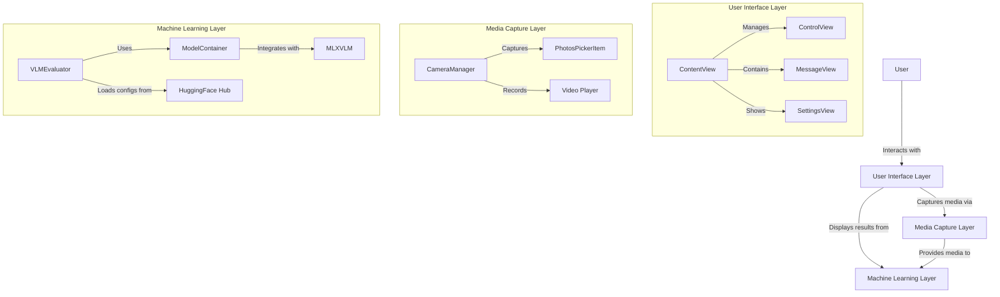
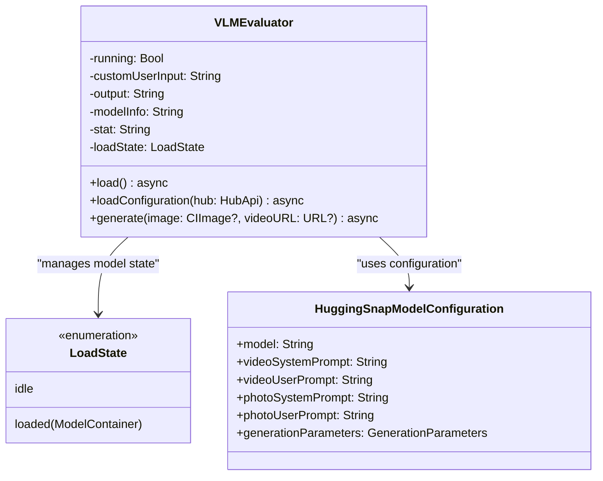
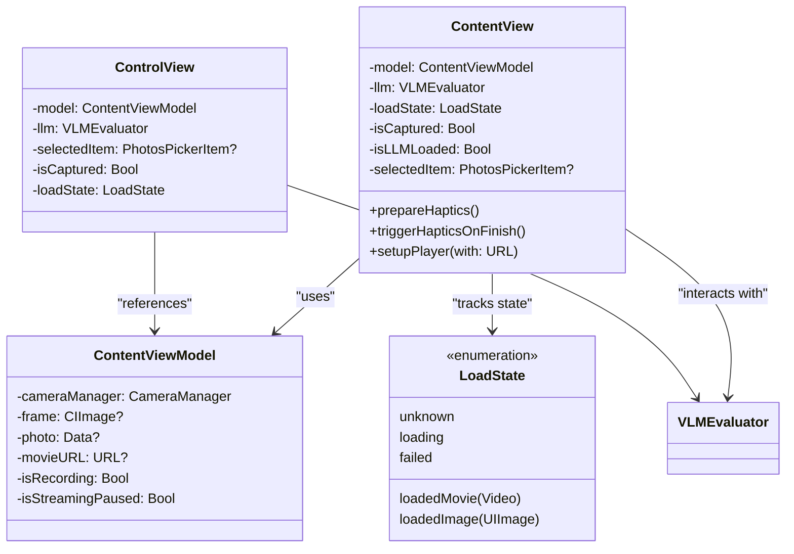
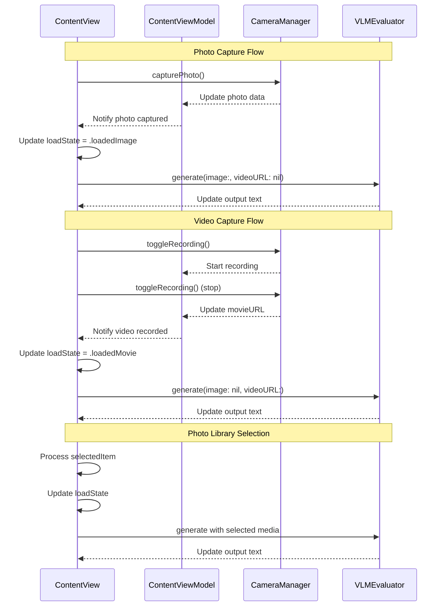
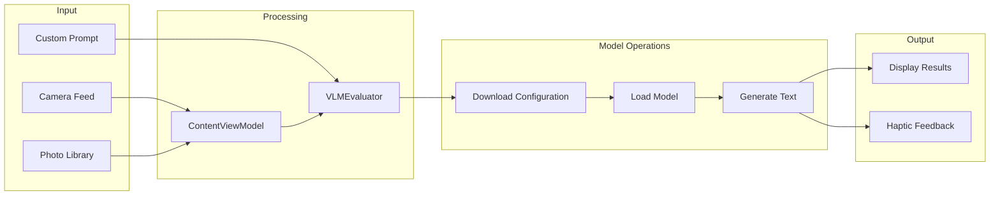
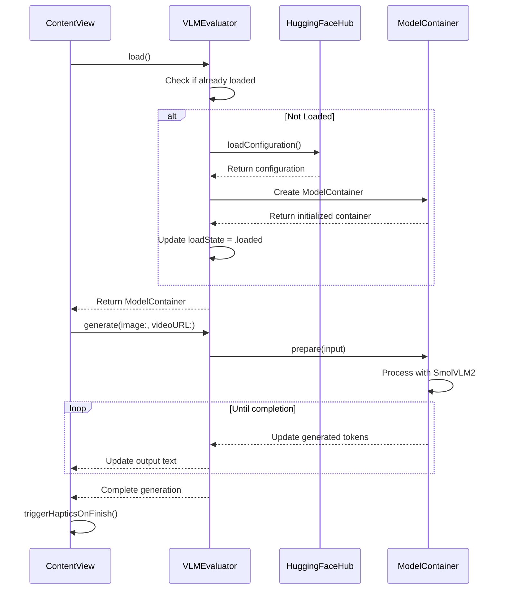

<!-- source: DeepWiki mcp.deepwiki.com · repo huggingface/HuggingSnap · page 2 System Architecture · fetched 2026-10-26 -->

# System Architecture

Relevant source files

The following files were used as context for generating this wiki page:

- [HuggingSnap/Views/ContentView.swift](HuggingSnap/Views/ContentView.swift)
- [HuggingSnap/Views/VLMEvaluator.swift](HuggingSnap/Views/VLMEvaluator.swift)
- [README.md](README.md)

This document provides a high-level explanation of the HuggingSnap application architecture, describing the major components, their relationships, and data flow through the system. For detailed information about specific subsystems, please refer to:

- [Machine Learning System](#2.1) for details about the VLM system and inference process
- [User Interface Components](#2.2) for the app's UI architecture
- [Camera and Media Management](#2.3) for camera capabilities and media processing
- [Speech Recognition System](#2.4) for voice input and transcription

## Overview

HuggingSnap is built with a layered architecture that separates concerns between user interface, media processing, and machine learning components. The application runs entirely on-device, leveraging the SmolVLM2 model for visual understanding without sending data to external servers.

### High-Level Architecture Diagram

Sources: [HuggingSnap/Views/ContentView.swift:23-342](), [HuggingSnap/Views/VLMEvaluator.swift:53-224](), [README.md:1-24]()

## Core Components

HuggingSnap consists of three main architectural layers that interact to provide the application's functionality:

### Machine Learning Layer

The Machine Learning Layer is the core of HuggingSnap, responsible for processing visual inputs and generating descriptive outputs.

#### VLMEvaluator Component Diagram

Sources: [HuggingSnap/Views/VLMEvaluator.swift:17-40](), [HuggingSnap/Views/VLMEvaluator.swift:53-87](), [HuggingSnap/Views/VLMEvaluator.swift:69-75]()

The `VLMEvaluator` is the central component responsible for:

1. **Model Loading**: Downloads and initializes the SmolVLM2 model
2. **Configuration Management**: Fetches runtime configuration from Hugging Face Hub
3. **Media Processing**: Handles image and video inputs
4. **Text Generation**: Produces descriptive text based on visual content

The configuration is dynamically downloaded from Hugging Face Hub, allowing for runtime updates to prompts and generation parameters without requiring app updates.

### User Interface Layer

The User Interface Layer manages all user interactions and visual presentation. `ContentView` serves as the main coordinator for the application UI.

#### User Interface Component Diagram

Sources: [HuggingSnap/Views/ContentView.swift:15-21](), [HuggingSnap/Views/ContentView.swift:23-50](), [HuggingSnap/Views/ContentView.swift:130-134]()

Key UI components include:

1. **ContentView**: Main view controller that orchestrates the UI and user interactions
2. **ControlView**: Manages camera controls, photo/video capture, and library access
3. **MessageView**: Displays generated text output from the VLM model
4. **SettingsView**: Provides access to application settings

The UI layer uses SwiftUI and follows a reactive approach, with state changes driving UI updates.

### Media Capture Layer

The Media Capture Layer handles camera interactions, photo/video capture, and media processing.

#### Media Component Interactions

Sources: [HuggingSnap/Views/ContentView.swift:209-219](), [HuggingSnap/Views/ContentView.swift:225-236](), [HuggingSnap/Views/ContentView.swift:238-266]()

The Media Capture system provides multiple ways to input visual content:

1. **Camera Capture**: Direct photo/video capture using device cameras
2. **Photo Library**: Selection from the device's photo library
3. **Video Playback**: Management of video content and playback

## System Runtime Flow

The following diagram illustrates how data flows through the system during a typical user session:

Sources: [HuggingSnap/Views/ContentView.swift:90-137](), [HuggingSnap/Views/VLMEvaluator.swift:132-224]()

## Model Loading and Execution Flow

A critical aspect of the system architecture is how the ML model is loaded and executed:

Sources: [HuggingSnap/Views/VLMEvaluator.swift:90-130](), [HuggingSnap/Views/VLMEvaluator.swift:132-224](), [HuggingSnap/Views/ContentView.swift:220-224](), [HuggingSnap/Views/ContentView.swift:295-325]()

## Configuration Management

HuggingSnap dynamically loads its model configuration at runtime from Hugging Face Hub:

| Configuration Parameter | Purpose |
|-------------------------|---------|
| `model` | Model identifier for loading from Hugging Face Hub |
| `videoSystemPrompt` | System prompt for video analysis context |
| `videoUserPrompt` | Default user prompt for video analysis |
| `photoSystemPrompt` | System prompt for photo analysis context |
| `photoUserPrompt` | Default user prompt for photo analysis |
| `generationParameters` | Temperature and topP settings for text generation |

Sources: [HuggingSnap/Views/VLMEvaluator.swift:17-40](), [HuggingSnap/Views/VLMEvaluator.swift:76-86]()

## Key Design Decisions

Several important architectural decisions shape the HuggingSnap application:

1. **On-Device Processing**: All ML processing occurs on-device, enhancing privacy and enabling offline operation
2. **Dynamic Configuration**: Runtime configuration download allows updating prompts and parameters without app updates
3. **Reactive UI**: SwiftUI with state-driven updates creates a responsive user experience
4. **Asynchronous Processing**: Heavy ML tasks run asynchronously to maintain UI responsiveness
5. **MLX Integration**: Uses Apple's MLX framework for efficient on-device ML processing
6. **Haptic Feedback**: Provides tactile feedback when processing completes

Sources: [HuggingSnap/Views/ContentView.swift:268-276](), [HuggingSnap/Views/VLMEvaluator.swift:93-95](), [README.md:6-10]()

## Memory Management

The architecture includes memory management strategies for optimal ML performance:

1. **GPU Buffer Cache Limit**: Set to 20MB to manage memory use
2. **Metal Memory Limit**: Dynamically set based on available device memory
3. **Token Generation Limiting**: Maximum token generation capped at 400 tokens
4. **Display Optimization**: Updates UI every 4 tokens to balance performance and responsiveness

Sources: [HuggingSnap/Views/VLMEvaluator.swift:62-67](), [HuggingSnap/Views/VLMEvaluator.swift:93-99](), [HuggingSnap/Views/VLMEvaluator.swift:197-209]()

## Error Handling

The system implements error handling at key points:

1. **Model Loading Errors**: Captured and displayed to users
2. **Media Processing Failures**: Tracked via LoadState changes
3. **Generation Errors**: Displayed in output text
4. **Configuration Download Fallbacks**: Uses default values when download fails

Sources: [HuggingSnap/Views/VLMEvaluator.swift:219-221](), [HuggingSnap/Views/ContentView.swift:262-264]()

---

