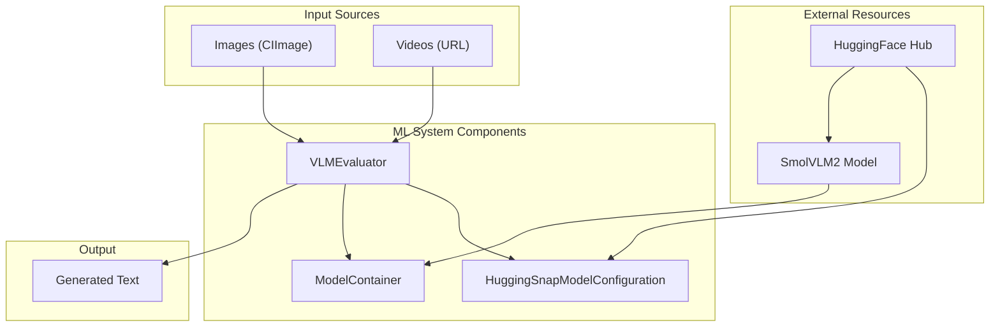
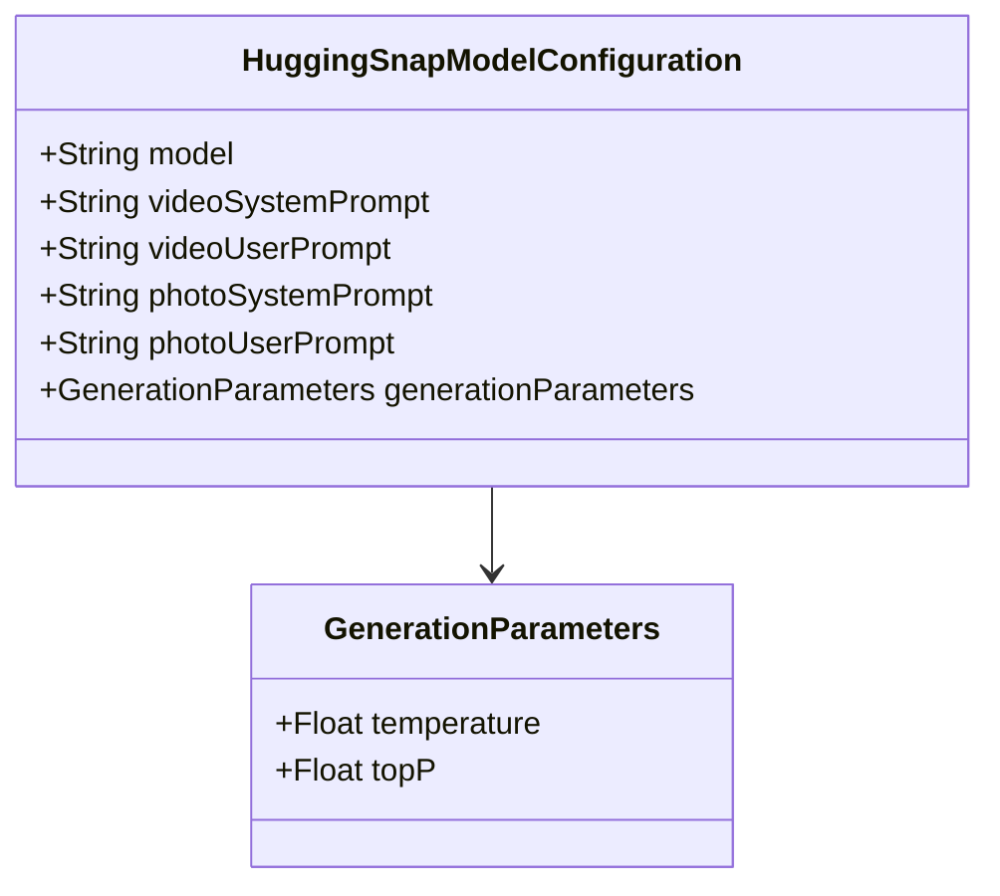
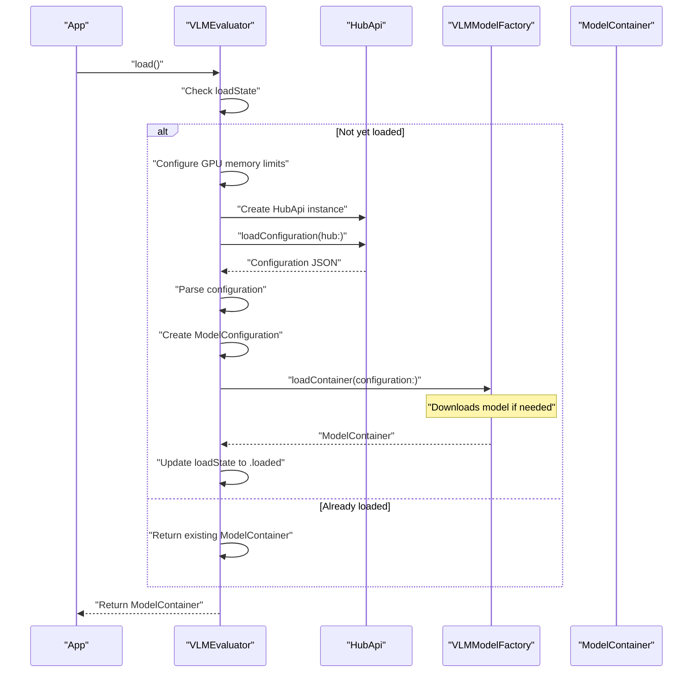
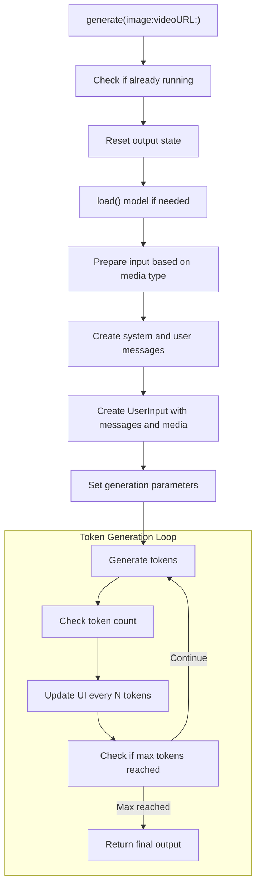
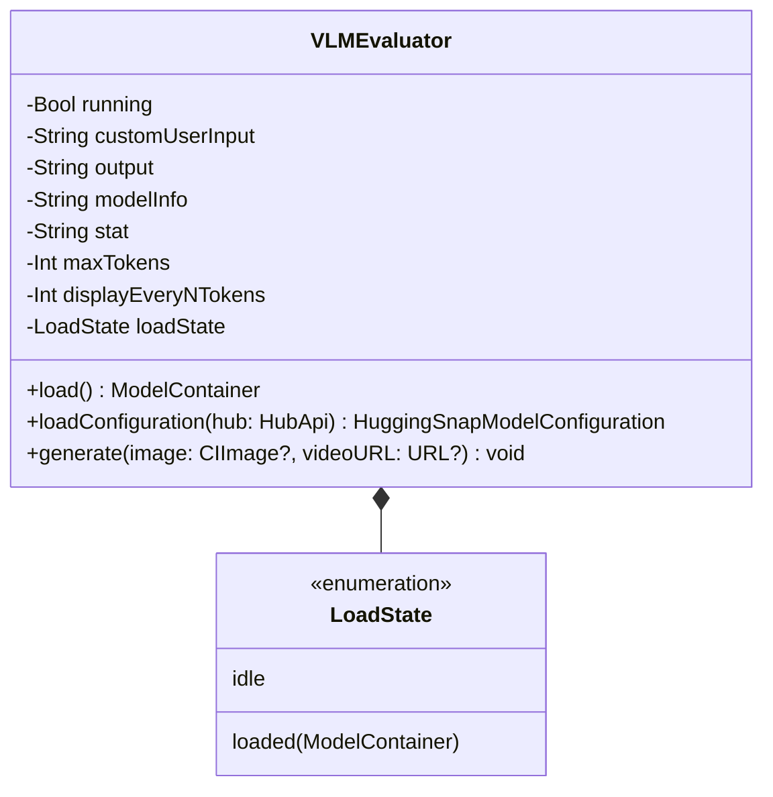
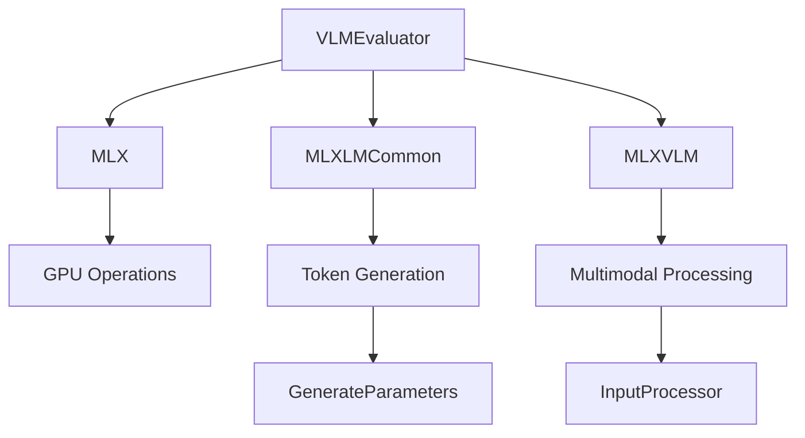
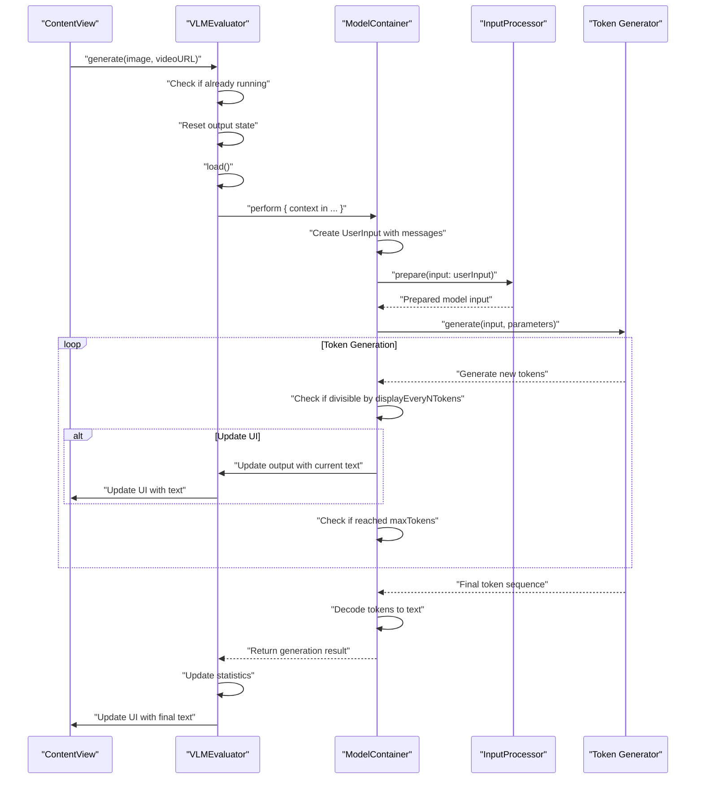

<!-- source: DeepWiki mcp.deepwiki.com · repo huggingface/HuggingSnap · page 2.1 Machine Learning System · fetched 2026-10-26 -->

# Machine Learning System

<details>
<summary>Relevant source files</summary>

The following files were used as context for generating this wiki page:

- [HuggingSnap.xcodeproj/project.xcworkspace/xcshareddata/swiftpm/Package.resolved](HuggingSnap.xcodeproj/project.xcworkspace/xcshareddata/swiftpm/Package.resolved)
- [HuggingSnap/Views/VLMEvaluator.swift](HuggingSnap/Views/VLMEvaluator.swift)

</details>


This document covers the machine learning system in HuggingSnap, focusing on how the Vision Language Model (VLM) is configured, loaded, and used to process visual inputs. For information about camera inputs and media management, see [Camera and Media Management](#2.3). For details about the user interface that interacts with this system, see [User Interface Components](#2.2).

## System Overview

The machine learning core of HuggingSnap is built around the `VLMEvaluator` class, which manages model loading, configuration, and inference. This system leverages a multimodal model (SmolVLM2) capable of processing both images and videos to generate natural language descriptions.



Sources: [HuggingSnap/Views/VLMEvaluator.swift:52-225]()

## Model Configuration Management

The ML system uses a runtime configuration mechanism that allows behavior adjustment without app updates.

### Configuration Structure

The system uses `HuggingSnapModelConfiguration` to store model settings, including the model identifier, prompts for different media types, and generation parameters:



The configuration is stored in a remote repository (`HuggingFaceTB/smolvlm-app-config`) and loaded at runtime, allowing the app behavior to be updated without requiring new app versions.

Sources: [HuggingSnap/Views/VLMEvaluator.swift:16-50](), [HuggingSnap/Views/VLMEvaluator.swift:76-86]()

### Default Configuration

The system provides fallback configuration values in case the remote configuration cannot be loaded:

| Parameter | Default Value |
|-----------|---------------|
| Model ID | HuggingFaceTB/SmolVLM2-500M-Video-Instruct-mlx |
| Photo System Prompt | "You are an image understanding model capable of describing the salient features of any image." |
| Photo User Prompt | "Describe this image." |
| Video System Prompt | "Focus only on describing the key dramatic action or notable event occurring in this video segment..." |
| Video User Prompt | "What is the main action or notable event happening in this segment?..." |
| Temperature | 0.7 |
| Top-P | 0.9 |

Sources: [HuggingSnap/Views/VLMEvaluator.swift:43-50]()

## Model Loading Process

The model loading process is managed by the `load()` method in the `VLMEvaluator` class, which handles the one-time initialization of the ML model.



### Memory Management

The loading process includes important memory management steps:

1. Sets GPU cache limit to 20MB: `MLX.GPU.set(cacheLimit: 20 * 1024 * 1024)`
2. Calculates maximum Metal memory as 82% of available memory: `maxMetalMemory = Int(round(0.82 * Double(os_proc_available_memory())))`
3. Sets memory limit for efficient model execution: `MLX.GPU.set(memoryLimit: maxMetalMemory, relaxed: false)`

Sources: [HuggingSnap/Views/VLMEvaluator.swift:90-130]()

## Inference Process

The text generation from visual inputs is handled by the `generate(image:videoURL:)` method.



### Input Processing and Context Creation

The system handles both images and videos:

1. Images are oriented correctly before processing
2. Different system and user prompts are selected based on input type (photo vs. video)
3. Inputs are formatted into a standardized message structure for the model

### Generation Control

Text generation includes several control mechanisms:

- Maximum token limit (400 tokens)
- UI update frequency (every 4 tokens)
- Temperature and top-P parameters from configuration
- Error handling with user-facing error messages

Sources: [HuggingSnap/Views/VLMEvaluator.swift:132-224]()

## VLMEvaluator Class Structure

The `VLMEvaluator` class is the central component of the ML system:



Key properties:
- `running`: Prevents concurrent inference operations
- `customUserInput`: Holds user-provided prompts
- `output`: Stores generated text for UI display
- `modelInfo`: Provides status updates during loading
- `loadState`: Tracks model loading status

Sources: [HuggingSnap/Views/VLMEvaluator.swift:52-75](), [HuggingSnap/Views/VLMEvaluator.swift:69-74]()

## Integration with MLX Framework

The system leverages several MLX libraries for model execution:



The ML system relies on these key MLX components:
- `MLX`: Core tensor operations and GPU memory management
- `MLXLMCommon`: Common utilities for language model inference
- `MLXVLM`: Support for vision-language model operations

Sources: [HuggingSnap/Views/VLMEvaluator.swift:8-13](), [HuggingSnap.xcodeproj/project.xcworkspace/xcshareddata/swiftpm/Package.resolved:23-29]()

## Data Flow During Inference

The full data flow during the generation process shows how inputs are processed and tokens are generated:



Sources: [HuggingSnap/Views/VLMEvaluator.swift:132-224]()

## UI Integration

The ML system integrates with the UI through several mechanisms:

1. The `@Observable` macro enables automatic UI updates when properties change
2. The `@MainActor` annotation ensures UI updates happen on the main thread
3. Progress updates during model loading populate the `modelInfo` property
4. Token generation progressively updates the `output` property
5. The `running` flag prevents parallel operations and manages UI state

Sources: [HuggingSnap/Views/VLMEvaluator.swift:52-53](), [HuggingSnap/Views/VLMEvaluator.swift:196-202]()

## Error Handling

The system includes error handling for the inference process:

```swift
do {
    // Model loading and inference code
} catch {
    output = "Failed: \(error)"
}
```

This provides user-facing error messages when problems occur during model loading or inference.

Sources: [HuggingSnap/Views/VLMEvaluator.swift:219-221]()

## Dependencies

The ML system relies on several external libraries for its functionality:

| Library | Version | Purpose |
|---------|---------|---------|
| MLX Swift | 0.21.3 | Core ML framework |
| MLXLMCommon | via MLX Swift | Language model utilities |
| MLXVLM | via MLX Swift Examples | Vision-language model support |
| Swift Transformers | 0.1.17 | Transformer model implementations |
| Hub | embedded | Hugging Face Hub integration |

Sources: [HuggingSnap.xcodeproj/project.xcworkspace/xcshareddata/swiftpm/Package.resolved:23-29](), [HuggingSnap.xcodeproj/project.xcworkspace/xcshareddata/swiftpm/Package.resolved:95-101](), [HuggingSnap/Views/VLMEvaluator.swift:8-13]()

---

