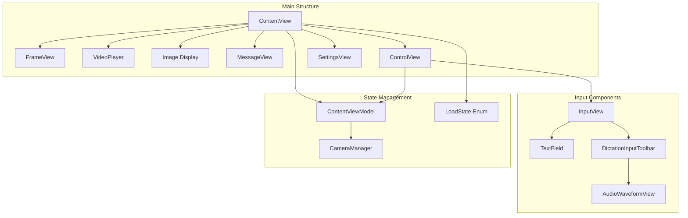
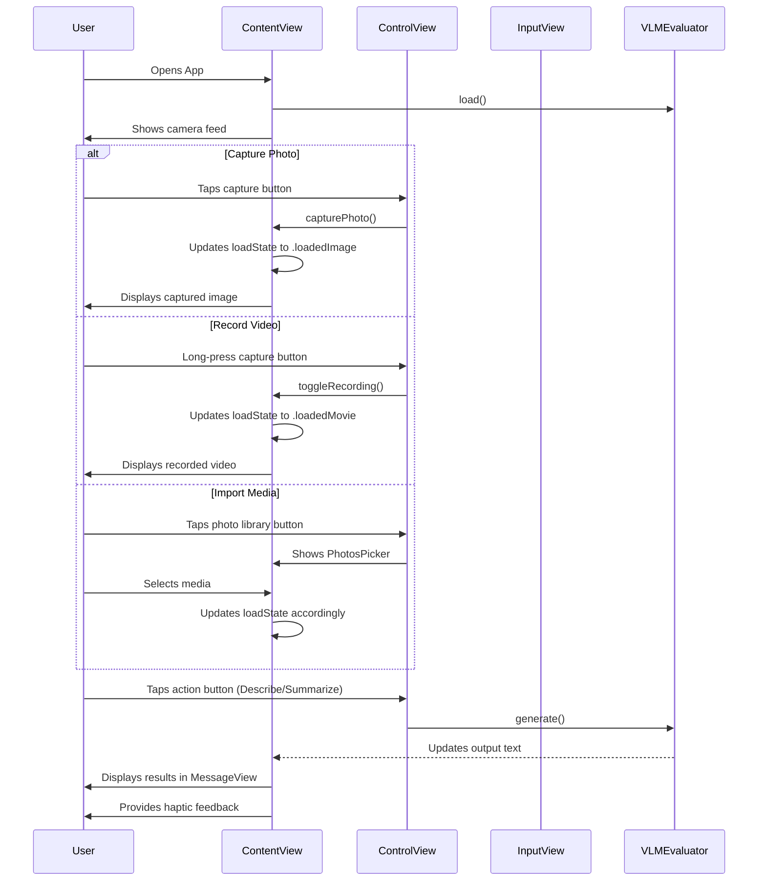
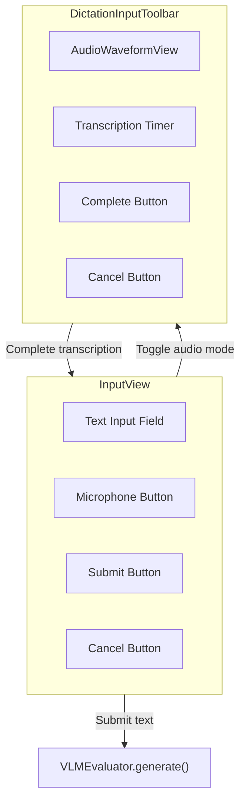
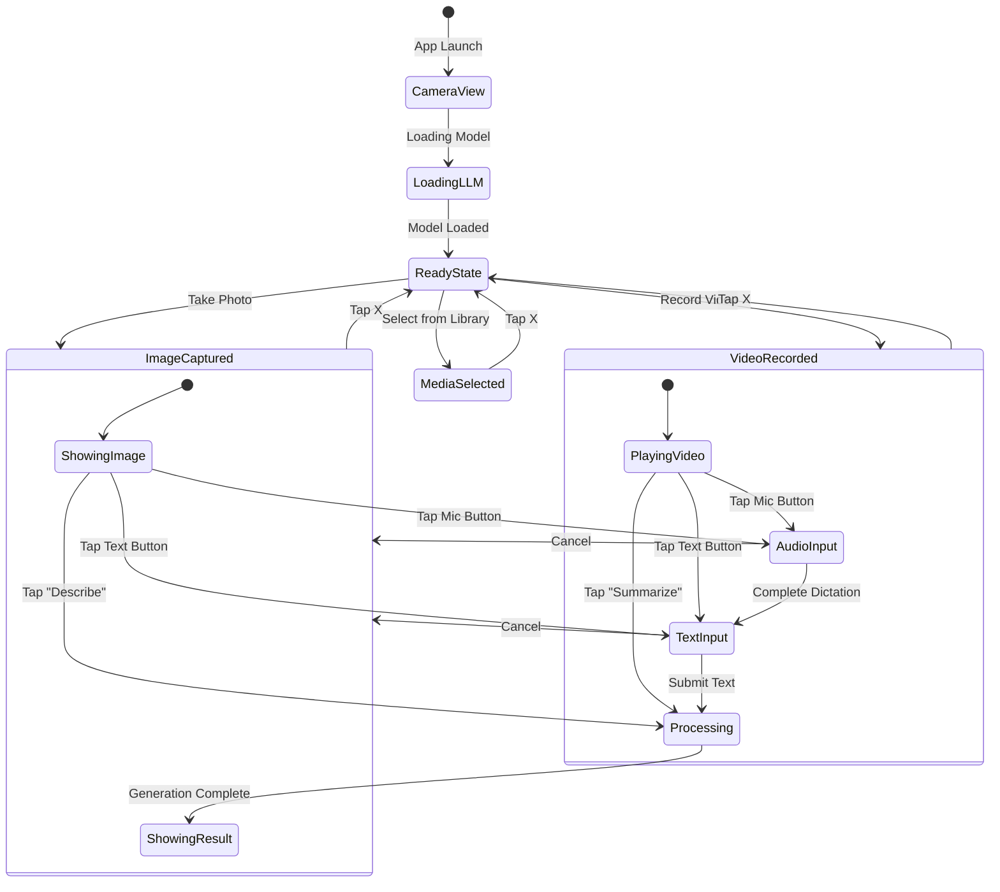

<!-- source: DeepWiki mcp.deepwiki.com · repo huggingface/HuggingSnap · page 2.2 User Interface Components · fetched 2026-10-26 -->

# User Interface Components

Relevant source files

The following files were used as context for generating this wiki page:

- [HuggingSnap/Views/ContentView.swift](HuggingSnap/Views/ContentView.swift)
- [HuggingSnap/Views/ControlView.swift](HuggingSnap/Views/ControlView.swift)
- [HuggingSnap/Views/InputView.swift](HuggingSnap/Views/InputView.swift)
- [HuggingSnap/Views/SettingsView.swift](HuggingSnap/Views/SettingsView.swift)

This document provides a detailed overview of the user interface architecture in HuggingSnap, an iOS application that provides on-device visual intelligence. The UI components manage user interactions, media display, input methods, and result presentation. For information about the underlying machine learning system, see [Machine Learning System](#2.1), and for camera functionality details, see [Camera and Media Management](#2.3).

## UI Component Architecture

HuggingSnap follows a hierarchical view structure using SwiftUI. The UI layer is organized into specialized components that handle specific aspects of the user experience while maintaining a cohesive visual design.

Sources: [HuggingSnap/Views/ContentView.swift:23-282](). [HuggingSnap/Views/ControlView.swift:12-311](). [HuggingSnap/Views/InputView.swift:10-246]().

## Main View Structure (ContentView)

ContentView serves as the primary container for the application UI. It orchestrates different views based on application state and user interactions.

### Key Responsibilities

- Media display (camera feed, photos, and videos)
- State management via the LoadState enum
- Integration with VLMEvaluator for AI processing
- Haptic feedback generation
- Overlay controls and messaging

### View States

The ContentView dynamically changes its display based on the `LoadState` enum:

| State | Purpose | Implementation |
|-------|---------|----------------|
| `.unknown` | Default/initial state | Shows camera feed |
| `.loading` | Loading media | Shows camera feed with loading indicator |
| `.loadedImage(UIImage)` | Displaying a still image | Shows full-screen image |
| `.loadedMovie(Video)` | Displaying a video | Shows video player |
| `.failed` | Error state | Shows camera feed with error indicator |

Sources: [HuggingSnap/Views/ContentView.swift:15-21](). [HuggingSnap/Views/ContentView.swift:53-93]().

### User Interface Flow

Sources: [HuggingSnap/Views/ContentView.swift:49-207](). [HuggingSnap/Views/ContentView.swift:209-235](). [HuggingSnap/Views/ControlView.swift:52-298]().

## Control Interface (ControlView)

ControlView manages user interaction elements, providing context-sensitive controls based on the application state. It adapts its interface depending on whether media has been captured or not.

### Main Control Components

1. **Media Capture Controls**:
   - Central circular button for photo capture/video recording
   - Photo library access button
   - Camera switching button

2. **Action Controls** (when media is captured):
   - "Describe" button for images
   - "Summarize" button for videos
   - Text input button
   - Audio input button

3. **Clear button** - Resets the captured media state

The control view transforms contextually after media is captured, replacing camera controls with AI processing options.

Sources: [HuggingSnap/Views/ControlView.swift:52-298](). [HuggingSnap/Views/ControlView.swift:302-310]().

## Input Methods (InputView)

HuggingSnap offers multiple input methods to interact with the visual intelligence system:

### Text Input

The text input interface provides:
- Multi-line text field
- Submit button
- Toggle to speech recognition
- Cancel button

### Speech Recognition

The dictation interface provides:
- Real-time audio waveform visualization
- Transcription timer
- Accept/cancel buttons for the transcribed text
- Automatic transcription via `SpeechRecognizer`

Sources: [HuggingSnap/Views/InputView.swift:10-127](). [HuggingSnap/Views/InputView.swift:129-193](). [HuggingSnap/Views/InputView.swift:195-245]().

## Settings Interface (SettingsView)

The SettingsView provides access to app information and support functions:

### Key Features

- Privacy policy link
- Terms of service link
- App version information
- Contact support via email

The settings interface uses a standard SwiftUI List with sections for organizing related settings.

Sources: [HuggingSnap/Views/SettingsView.swift:11-124]().

## UI State Management

HuggingSnap's UI is heavily state-driven, with several key state variables controlling the interface presentation:

### Key State Variables

| State Variable | Location | Purpose |
|----------------|----------|---------|
| `isCaptured` | ContentView | Tracks if media has been captured |
| `loadState` | ContentView | Manages media display state |
| `isLLMLoaded` | ContentView | Controls model loading overlay |
| `showInputView` | ControlView | Toggles input interface visibility |
| `isAudioMode` | InputView | Controls text vs. audio input mode |

Sources: [HuggingSnap/Views/ContentView.swift:28-34](). [HuggingSnap/Views/ControlView.swift:17-34](). [HuggingSnap/Views/InputView.swift:14-17]().

## Haptic Feedback

HuggingSnap incorporates haptic feedback to enhance the user experience:

- Initialization with `prepareHaptics()` method
- Multi-stage haptic pattern triggered on AI processing completion
- Custom intensity patterns for notification feedback

Sources: [HuggingSnap/Views/ContentView.swift:284-325]().

## Accessibility Support

The interface includes accessibility features throughout:
- Labeled buttons with descriptive text
- Proper focus management
- Voice-over compatible controls

Sources: [HuggingSnap/Views/ContentView.swift:111](). [HuggingSnap/Views/ControlView.swift:92-288](). [HuggingSnap/Views/SettingsView.swift:41-82]().

---

