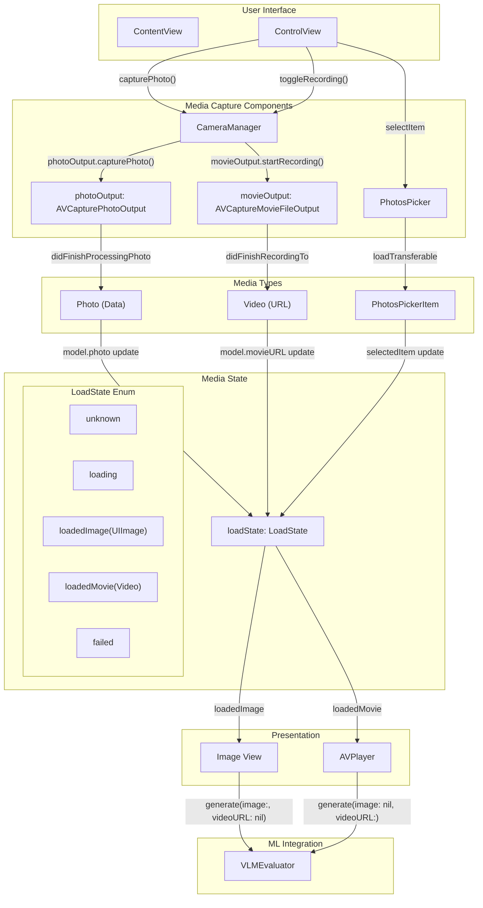
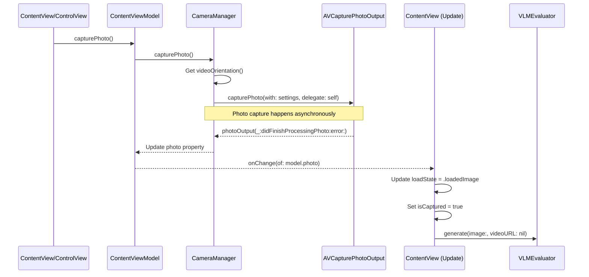
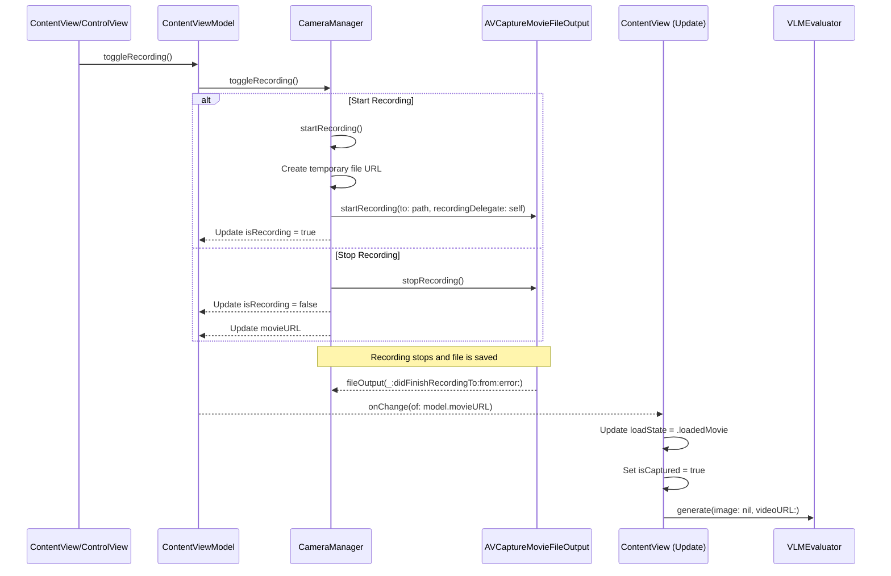

<!-- source: DeepWiki mcp.deepwiki.com · repo huggingface/HuggingSnap · page 2.3 Camera and Media Management · fetched 2026-10-26 -->

# Camera and Media Management

<details>
<summary>Relevant source files</summary>

The following files were used as context for generating this wiki page:

- [HuggingSnap/Camera/CameraManager.swift](HuggingSnap/Camera/CameraManager.swift)
- [HuggingSnap/Extensions/AVPlayerExtension.swift](HuggingSnap/Extensions/AVPlayerExtension.swift)
- [HuggingSnap/Extensions/Transferable.swift](HuggingSnap/Extensions/Transferable.swift)
- [HuggingSnap/Views/ContentView.swift](HuggingSnap/Views/ContentView.swift)

</details>


This document describes the camera and media management system in HuggingSnap. It covers the architecture and functionality for capturing photos and videos, handling media files, and integrating them with the visual intelligence processing pipeline. For information about the machine learning system that processes these media files, see [Machine Learning System](#2.1), and for information about the speech recognition capabilities, see [Speech Recognition System](#2.4).

## 1. System Overview

The camera and media management system in HuggingSnap provides the following core capabilities:

- Real-time camera preview
- Photo capture
- Video recording
- Camera switching (front/back)
- Media import from device photo library
- Video playback
- Media routing to the visual language model for analysis

Sources: [HuggingSnap/Camera/CameraManager.swift:11-312](), [HuggingSnap/Views/ContentView.swift:23-342]()

## 2. Architecture

### Camera and Media Management Architecture

```mermaid
classDiagram
    class CameraManager {
        -AVCaptureSession session
        -AVCapturePhotoOutput photoOutput
        -AVCaptureMovieFileOutput movieOutput
        -Data? photo
        -Bool isRecording
        -URL? movieURL
        -AVCaptureDevice.Position cameraPosition
        +configure()
        +switchCamera()
        +capturePhoto()
        +toggleRecording()
        +toggleStreaming()
    }
    
    class ContentViewModel {
        -CameraManager cameraManager
        -CIImage? frame
        -Data? photo
        -URL? movieURL
        +capturePhoto()
        +toggleRecording()
    }
    
    class ContentView {
        -ContentViewModel model
        -LoadState loadState
        -PhotosPickerItem? selectedItem
        -AVPlayer player
        +setupPlayer(with: URL)
    }
    
    class Video {
        +URL url
        +static TransferRepresentation transferRepresentation
    }
    
    ContentView --> ContentViewModel : uses
    ContentViewModel --> CameraManager : wraps
    CameraManager ..> "AVCapturePhotoCaptureDelegate" : implements
    CameraManager ..> "AVCaptureFileOutputRecordingDelegate" : implements
    ContentView ..> Video : displays
```

Sources: [HuggingSnap/Camera/CameraManager.swift:11-312](), [HuggingSnap/Views/ContentView.swift:29-40](), [HuggingSnap/Extensions/Transferable.swift:11-28]()

### Media Capture and Processing Flow



Sources: [HuggingSnap/Views/ContentView.swift:49-266](), [HuggingSnap/Camera/CameraManager.swift:233-287]()

## 3. Core Components

### 3.1 CameraManager

The `CameraManager` class is the central component that handles all camera operations. It is implemented as a singleton (`shared`) to ensure a single consistent camera instance throughout the app.

Key properties:
- `session`: The `AVCaptureSession` that coordinates the flow of data from input devices to outputs
- `photoOutput`: Handles photo capture operations
- `movieOutput`: Handles video recording operations
- `photo`: Stores the most recently captured photo data
- `movieURL`: Stores the URL of the most recently recorded video
- `isRecording`: Indicates if video recording is in progress
- `cameraPosition`: Tracks which camera is currently active (front or back)
- `isStreamingPaused`: Indicates if the camera preview is currently paused

Key methods:
- `configure()`: Sets up the capture session with appropriate inputs and outputs
- `capturePhoto()`: Captures a still image
- `toggleRecording()`: Starts or stops video recording
- `switchCamera()`: Toggles between front and back cameras
- `toggleStreaming()`: Pauses or resumes the camera preview

Sources: [HuggingSnap/Camera/CameraManager.swift:11-312]()

### 3.2 ContentViewModel

This class serves as an intermediary between the UI (`ContentView`) and the camera system (`CameraManager`). It provides a simplified interface for camera operations and publishes camera state for the UI to observe.

Sources: [HuggingSnap/Views/ContentView.swift:29]()

### 3.3 Video

The `Video` struct implements the `Transferable` protocol, allowing videos to be transferred between the app and system services like Photos library. It encapsulates a video file URL and provides the necessary transfer representations.

Sources: [HuggingSnap/Extensions/Transferable.swift:11-28]()

### 3.4 LoadState

The `LoadState` enum tracks the current state of media loading and display:
- `unknown`: Initial state
- `loading`: Media is being loaded
- `loadedImage(UIImage)`: An image has been loaded and is ready for display
- `loadedMovie(Video)`: A video has been loaded and is ready for playback
- `failed`: Media loading failed

Sources: [HuggingSnap/Views/ContentView.swift:15-21]()

## 4. Camera Operations

### 4.1 Camera Configuration and Permissions

The camera system initializes by checking for camera permissions and configuring the `AVCaptureSession` with appropriate inputs and outputs. The configuration process follows these steps:

1. Check camera access permissions using `AVCaptureDevice.authorizationStatus`
2. Request permissions if not already determined
3. Create and configure the capture session with:
   - Camera input (default to back camera)
   - Photo output for still images
   - Movie output for video recording
   - Video output for preview frames

If any step fails, appropriate error states are set and published.

Sources: [HuggingSnap/Camera/CameraManager.swift:53-157]()

### 4.2 Photo Capture

The photo capture flow is as follows:



Sources: [HuggingSnap/Camera/CameraManager.swift:233-244](), [HuggingSnap/Camera/CameraManager.swift:314-330](), [HuggingSnap/Views/ContentView.swift:209-219]()

### 4.3 Video Recording

The video recording flow is as follows:



Sources: [HuggingSnap/Camera/CameraManager.swift:246-287](), [HuggingSnap/Camera/CameraManager.swift:332-345](), [HuggingSnap/Views/ContentView.swift:225-236]()

### 4.4 Camera Switching

The camera switching operation reconfigures the capture session to use either the front or back camera:

1. Begin session configuration
2. Remove existing camera input
3. Toggle `cameraPosition` between front and back
4. Add new camera input based on the updated position
5. Update video connection properties (rotation angle, mirroring)
6. Commit session configuration

Sources: [HuggingSnap/Camera/CameraManager.swift:159-214]()

## 5. Media Management

### 5.1 Photo Processing

Photos captured by the `CameraManager` are:
1. Converted to `Data` objects via `fileDataRepresentation()`
2. Published through the `photo` property
3. Detected by `ContentView` and converted to `UIImage` for display
4. Set in the `loadState` as `.loadedImage(UIImage)`
5. Displayed in the UI via an `Image` view with appropriate styling
6. Passed to the `VLMEvaluator` for analysis

Sources: [HuggingSnap/Camera/CameraManager.swift:314-330](), [HuggingSnap/Views/ContentView.swift:76-93](), [HuggingSnap/Views/ContentView.swift:209-219]()

### 5.2 Video Management

Videos recorded by the `CameraManager` are:
1. Saved to a temporary file in the documents directory
2. The URL is published through the `movieURL` property
3. Detected by `ContentView` and wrapped in a `Video` object
4. Set in the `loadState` as `.loadedMovie(Video)`
5. Played back using an `AVPlayer` configured with loop functionality
6. Passed to the `VLMEvaluator` for analysis

Sources: [HuggingSnap/Camera/CameraManager.swift:254-287](), [HuggingSnap/Camera/CameraManager.swift:332-345](), [HuggingSnap/Views/ContentView.swift:59-74](), [HuggingSnap/Views/ContentView.swift:225-236](), [HuggingSnap/Views/ContentView.swift:327-341]()

### 5.3 Photo Library Integration

HuggingSnap integrates with the device's photo library using `PhotosPicker` to allow selecting existing photos and videos:

1. Selection through `PhotosPicker` produces a `PhotosPickerItem`
2. The item is loaded asynchronously using `loadTransferable`
3. Depending on the content type, it's processed as:
   - For videos: Loaded as `Video` and set in `loadState` as `.loadedMovie`
   - For images: Loaded as `Data`, converted to `UIImage`, and set in `loadState` as `.loadedImage`
4. The imported media is then displayed and processed like directly captured media

Sources: [HuggingSnap/Views/ContentView.swift:33](), [HuggingSnap/Views/ContentView.swift:238-266](), [HuggingSnap/Extensions/Transferable.swift:11-28]()

## 6. Integration with UI and ML System

### 6.1 UI Integration

The camera preview and media display are integrated into the `ContentView`, with controls provided by `ControlView`. The state of the camera system and loaded media drives the UI display through SwiftUI state bindings.

Key UI integration points:
- Camera preview shown through `FrameView`
- Photos displayed through SwiftUI `Image` view
- Videos played through `VideoPlayer`
- Camera controls provided by `ControlView`
- Media state tracked through `loadState` enum

Sources: [HuggingSnap/Views/ContentView.swift:49-94](), [HuggingSnap/Views/ContentView.swift:130]()

### 6.2 ML System Integration

Captured or imported media is passed to the `VLMEvaluator` for analysis:

1. When a photo is captured or loaded, it's passed to `VLMEvaluator.generate(image:, videoURL:)`
2. When a video is recorded or loaded, it's passed to `VLMEvaluator.generate(image: nil, videoURL:)`
3. The `VLMEvaluator` processes the media and generates descriptive text
4. The generated text is displayed to the user through `MessageView`

The tight integration between the camera system and ML components allows for a seamless flow from media capture to visual intelligence analysis.

Sources: [HuggingSnap/Views/ContentView.swift:40](), [HuggingSnap/Views/ContentView.swift:115]()

## 7. Key Implementation Details

### 7.1 Video Playback Customization

Videos are played back using `AVPlayer` with customized behavior:
- Looped playback (using notification observation of `AVPlayerItemDidPlayToEndTime`)
- Hidden playback controls (via `AVPlayerViewController` extension)
- Automatic playback on load

Sources: [HuggingSnap/Views/ContentView.swift:327-341](), [HuggingSnap/Extensions/AVPlayerExtension.swift:11-16]()

### 7.2 Camera Orientation Handling

The camera system handles device orientation by:
- Determining the current device orientation
- Mapping it to the appropriate `AVCaptureVideoOrientation`
- Applying the orientation to photo captures and video recordings
- Handling rotation and mirroring for front vs. back camera

Sources: [HuggingSnap/Camera/CameraManager.swift:216-232](), [HuggingSnap/Camera/CameraManager.swift:238-241]()

### 7.3 Camera Stream Control

The camera preview stream can be paused and resumed, which is used when:
- A photo is captured and being displayed
- A video is recorded and being played back
- Media is imported from the photo library

This helps conserve battery and processing power when the camera is not actively needed.

Sources: [HuggingSnap/Camera/CameraManager.swift:299-311](), [HuggingSnap/Views/ContentView.swift:211-214](), [HuggingSnap/Views/ContentView.swift:228-231](), [HuggingSnap/Views/ContentView.swift:239-241]()

## 8. Error Handling

The camera system implements comprehensive error handling through:

1. A dedicated `CameraError` enum (not shown in provided code)
2. Error state publishing through `@Published var error: CameraError?`
3. Status tracking via `Status` enum (unconfigured, configured, unauthorized, failed)
4. UI feedback based on error states

Common error conditions handled include:
- Camera permission denied or restricted
- Camera hardware unavailable
- Inability to configure inputs or outputs
- Failures during photo capture or video recording

Sources: [HuggingSnap/Camera/CameraManager.swift:12-17](), [HuggingSnap/Camera/CameraManager.swift:32](), [HuggingSnap/Camera/CameraManager.swift:47-51]()

---

